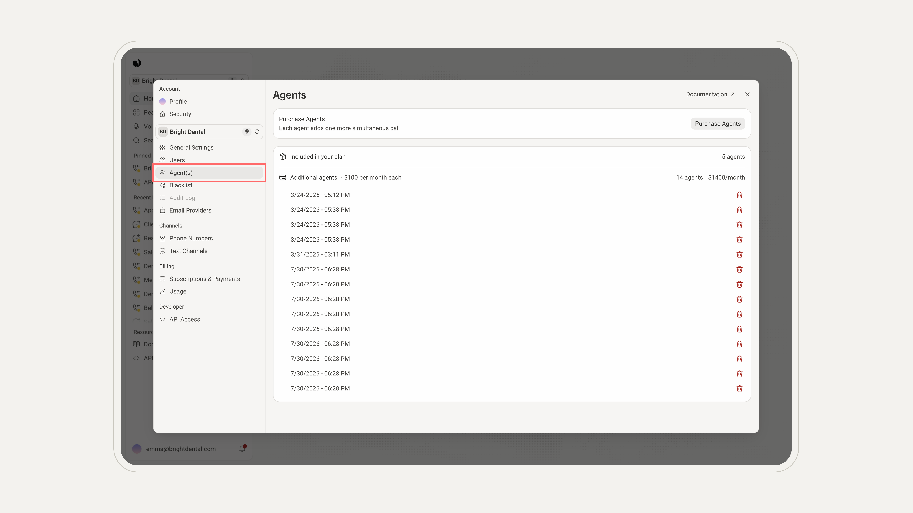
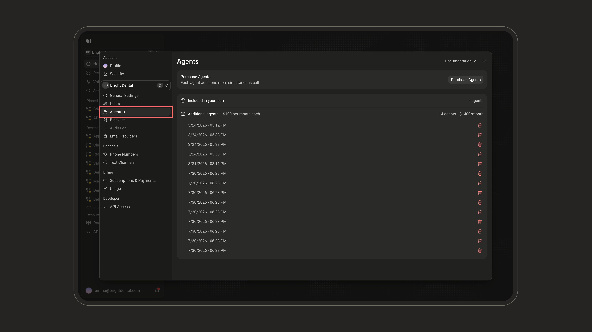
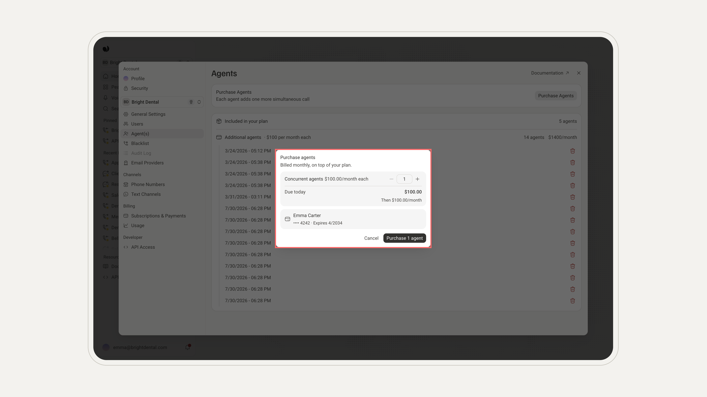
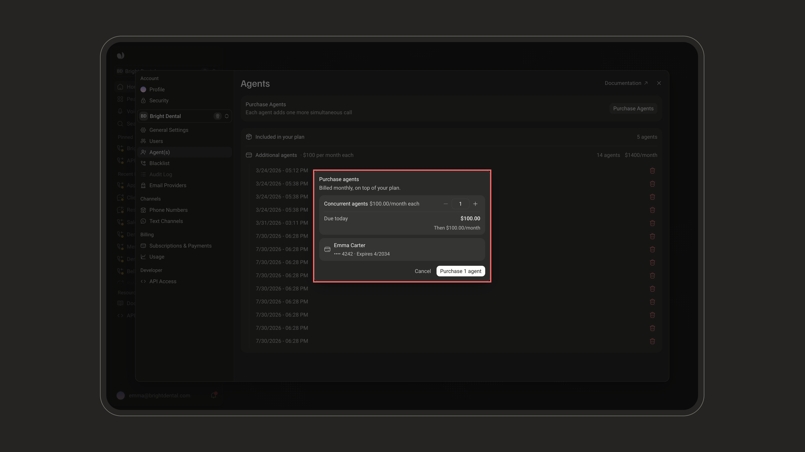
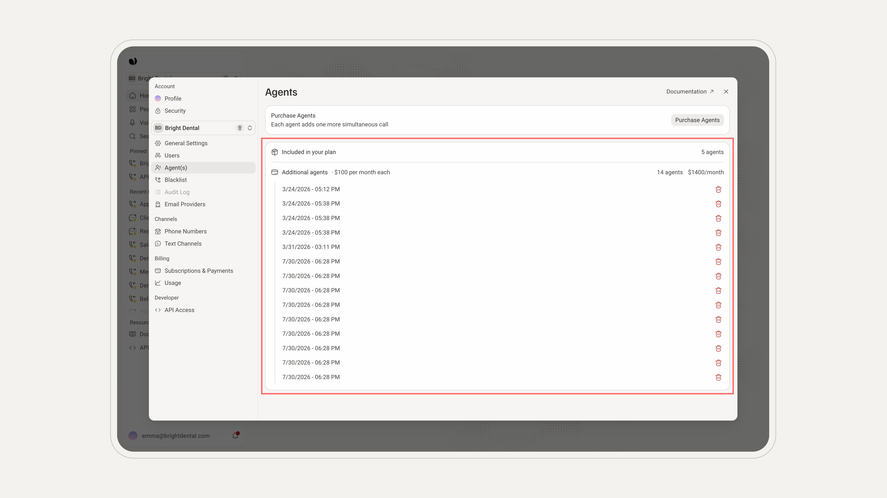
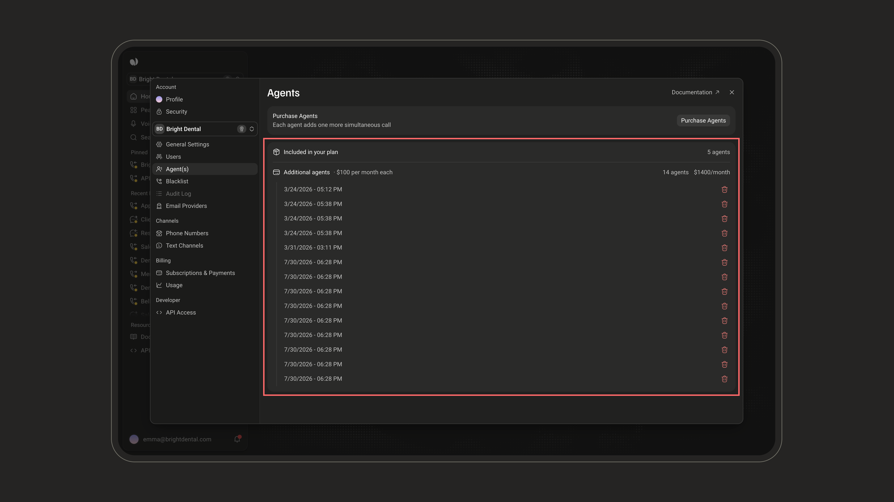
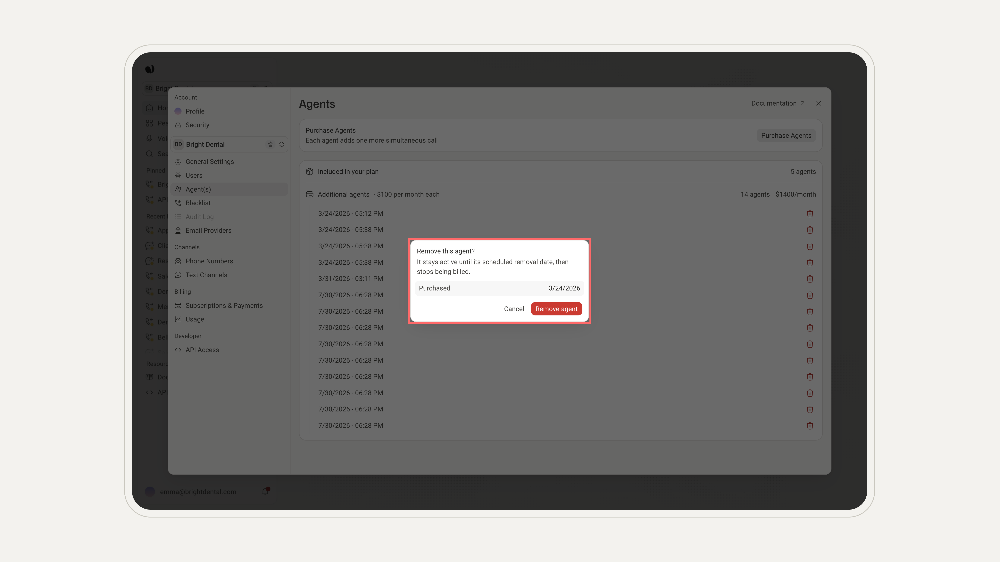
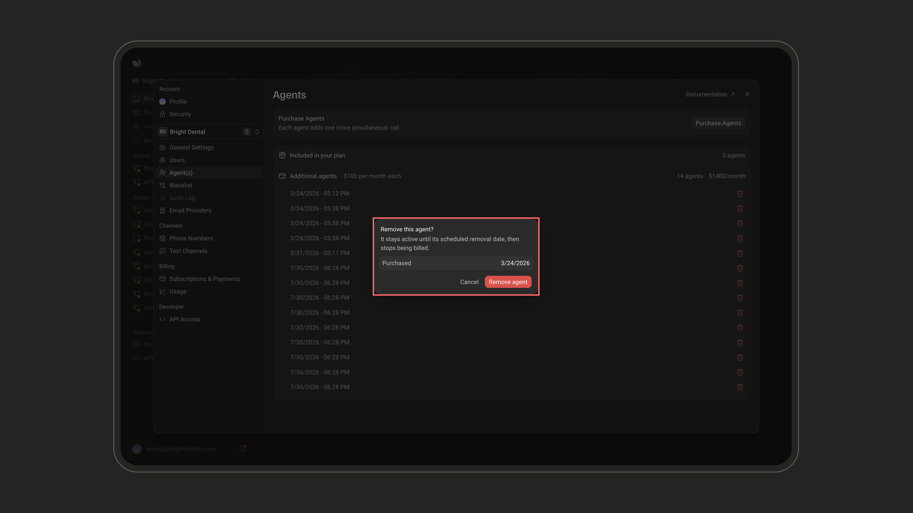
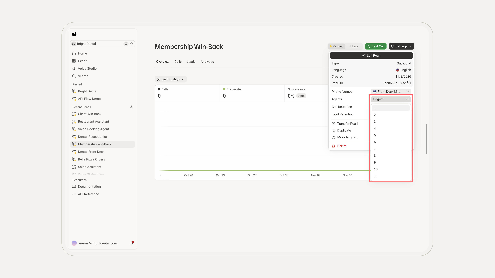
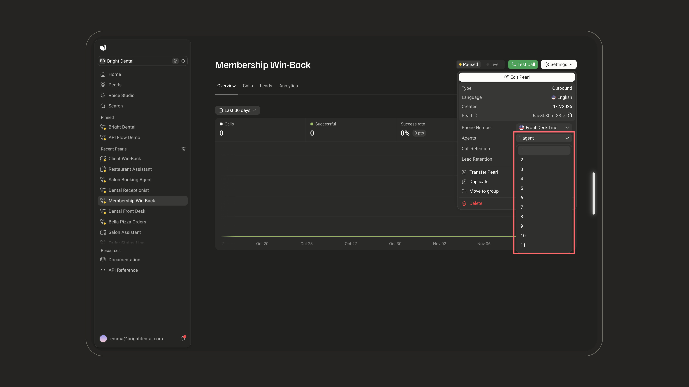

  <Frame>
    

      
    

  </Frame>

  <Frame>
    

      
    

  </Frame>

In NLPearl, **agents** are your capacity to handle activity. They power both your **voice calls** and your **text conversations** - the number of agents you have determines how much you can run at the same time.

## How agent capacity works

<Warning>
  An agent is a **virtual unit of capacity — not a person and not a specific Pearl.** Think of it as one "lane" of throughput that your whole workspace shares.
</Warning>

The more agents you own, the more activity you can run in parallel. What a single agent unlocks depends on the channel:

<CardGroup cols={2}>
  <Card title="Voice calls" icon="phone" iconType="light">
    Each agent handles **one call at a time**. With 5 agents, you can run **5 calls simultaneously** — a 6th call waits until one frees up.

    Phone calls and [stream calls](/pages/stream/overview) share the same agents. A stream call that finds no free agent is **refused**, not queued.
  </Card>
  <Card title="Text conversations" icon="comments" iconType="light">
    Each agent adds **3 messages per minute** of throughput. With 10 agents, that's up to **30 messages per minute**, spread across all your open chats.
  </Card>
</CardGroup>

<Info>
  **The key difference:** on **voice**, an agent limits how many calls run *at the same time* (concurrency). On **text**, an agent doesn't cap the number of open conversations — it sets how fast Pearl can reply *across all of them* (a message rate). Capacity scales linearly: 1 agent → 3 messages/minute, 10 agents → 30 messages/minute.
</Info>

<Note>
  Agents are shared at the **workspace** level. You buy them once, then allocate them to each inbound or outbound activity from the Pearl's page — so a busy campaign can use more lanes while a quieter one uses fewer.
</Note>

## Set up agents for your activities

Agents are managed at the **workspace** level from your Settings, then allocated to each Pearl from its page once published.

<Steps>
  <Step title="Open the Agent(s) settings">
    Click your **profile card** at the bottom-left of the sidebar, open **Settings**, then select the **Agent(s)** tab. This is where you purchase, review, and remove the agents in your workspace.

    
<Frame></Frame>

    
<Frame></Frame>

  </Step>

  <Step title="Purchase agents">
    In **Purchase Agents** (*Each agent adds one more simultaneous call*), click **Purchase Agents**. The **Purchase agents** window (*Billed monthly, on top of your plan*) shows the price per agent: choose how many with **−** and **+**, check what is **Due today** and then each month, and the card that will be charged, then click **Purchase … agent(s)**. You're billed immediately (see [Subscription and billing](#subscription-and-billing)).

    <Info>
      Adding concurrent agents requires an **active paid subscription**. Without one, the button reads **Upgrade** and takes you to the plans.
    </Info>

    
<Frame></Frame>

    
<Frame></Frame>

  </Step>

  <Step title="Review your agents">
    The **Agents** card shows where your capacity comes from:

    - **Included in your plan**: the agents that come with your subscription. They're free and can't be removed.
    - **Additional agents**: the agents you bought, with their price per month each and their monthly total, then one row per agent with its purchase date.

    
<Frame></Frame>

    
<Frame></Frame>

  </Step>

  <Step title="Remove an agent">
    To remove an additional agent, click **Remove** (the trash icon) on its row, then **Remove agent** to confirm. Its row then shows the date it will be removed.

    
<Frame></Frame>

    
<Frame></Frame>

    <Note>
      There are no pro-rata refunds — the agent stays active until the end of the period you've already paid for.

      **Example:** you remove an agent on the 5th, but your last renewal was on the 1st. The agent stays available until the end of that paid period (the 30th), and won't be billed again in the next cycle.
    </Note>
  </Step>

  <Step title="Allocate agents to a Pearl">
    After publishing your Pearl, open its page, click **Settings**, and pick the number of agents in **Agents** for that activity: it is saved right away. Allocate 2 agents to a campaign and it handles 2 leads at a time. You can scale this up or down anytime.

    
<Frame></Frame>

    
<Frame></Frame>

  </Step>
</Steps>

## Example

<Card icon="lightbulb" iconType="light">
  The same number of agents translates differently on voice and text. Here's how a given allocation plays out:

  | Agents | Voice (simultaneous calls) | Text (messages / minute) |
  |:------:|:--------------------------:|:------------------------:|
  | **2**  | 2 calls at the same time   | 6 messages / minute      |
  | **5**  | 5 calls at the same time   | 15 messages / minute     |
  | **10** | 10 calls at the same time  | 30 messages / minute     |

  For example, allocate **2 agents** to an outbound voice campaign and it dials **2 leads at the same time**; the same 2 agents on a text Pearl let it reply at up to **6 messages per minute** across all open chats.
</Card>

## Subscription and billing

Every plan includes a set number of agents at no extra cost - higher tiers include more. On an **active paid subscription**, you can add extra concurrent agents at any time to grow your capacity.

Standard agents are billed at a flat monthly rate. Enterprise use and fine-tuned models cost more, depending on model complexity. See [Billing](/pages/billing) for current pricing.

### When you're billed

When you purchase an agent, you're billed for it immediately, whatever point you're at in your billing cycle. On your renewal date, every additional agent renews automatically for the next period.

<Warning>
  Buying an agent shortly before your renewal date means two charges close together: one when you purchase, and one when everything renews.

  **Example** - your subscription renews on the 1st and you add an agent on the 29th. You're billed for it right away. On the 1st, the whole subscription (including that agent) renews, so it's billed again for the new period. You've effectively paid for two periods, and you keep the agent for the full duration of each.
</Warning>
