<Frame>
  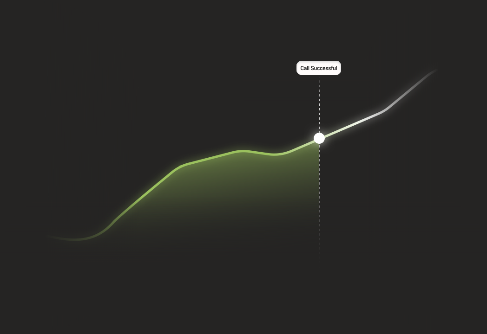
</Frame>

 

NLPearl gives every Pearl a detailed analytics dashboard, so you can track performance, understand what Pearl is doing on your calls, and optimize your strategy as results come in. To open it, go to your Pearl's page and select the **Analytics** tab.

<Card icon="circle-info" iconType="light" title="How this dashboard works">
Outbound Pearls (Pearl places the calls) surface more data than inbound Pearls (Pearl answers them). Every metric reflects Pearl's automated voice interactions, never human agents.

Every card follows the same layout: a **headline metric** at the top, a small tag that gives it context (such as **Selected period**, **Most used tag**, or the busiest time slot), and an **info** button (ⓘ) with a short explanation. Cards with a chart plot that metric across the selected period; on Average Call Duration, Success Rate, Pickup Rate, and Costs, a line marks the period's average.

Until there's data for the period, a card shows an empty state instead (*No Call Status Yet*, *No Duration Data Yet*, and so on).
</Card>

<Note>
Running a **Pearl Text** agent? The same dashboard adapts its wording to chats — *Chat Status Breakdown*, *Average Chat Duration*, *Chats Heatmap*, and so on.
</Note>

## The analytics toolbar

A toolbar sits at the top of the dashboard. On an outbound Pearl, the **Leads** chip shows how many leads the figures cover; on an inbound Pearl, a chip shows the phone number. Next to it, the period picker sets the time range for every card, and the **Print** button (printer icon, on the right) exports a report.

<Frame>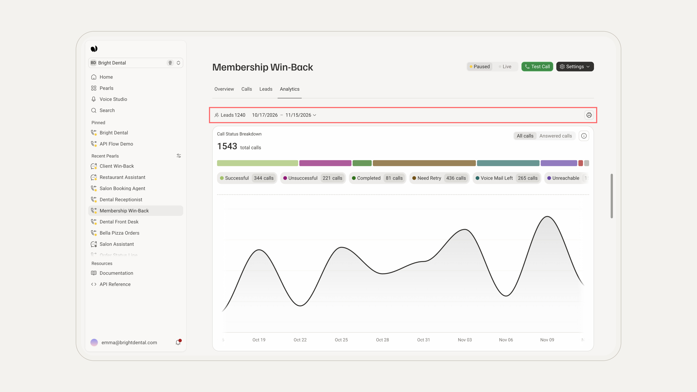</Frame>

<Frame>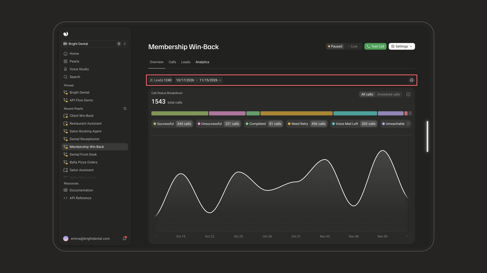</Frame>

### Choose your time range

By default the dashboard shows the **last 30 days**. Open the period picker to jump to a preset — `Today`, `Yesterday`, `Last 7 days`, `This week`, `This month` — or pick a start and an end date on the calendar. Every card updates to match.

<Frame>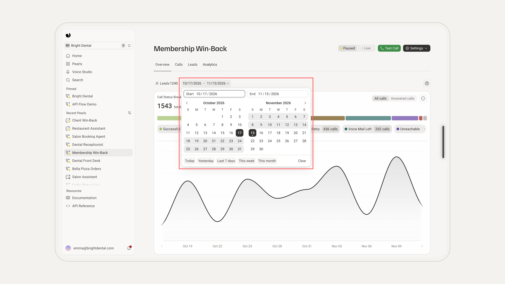</Frame>

<Frame>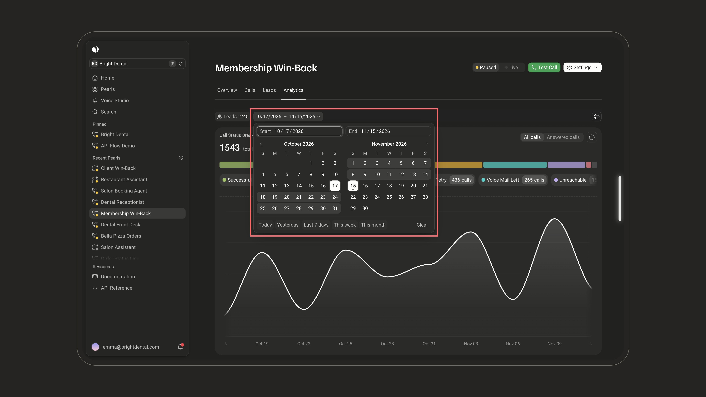</Frame>

<Info>
A range can cover up to **90 days**.
</Info>

### Export a report

Click **Print** to turn the current view into a shareable report.

<Steps>
  <Step title="Set your time range">
    Pick the period you want the report to cover.
  </Step>
  <Step title="Click Print">
    The printer button sits on the right of the toolbar.
  </Step>
  <Step title="Save as PDF">
    In your browser's print dialog, choose **Save as PDF** (or send it to a printer).
  </Step>
</Steps>

The report is formatted for print, in a light theme. It opens with a header showing your Pearl's name and the selected period, and every page ends with a footer giving the generation date and the period.

## Call Status Breakdown

This card shows how your calls are distributed across their **final statuses**. The headline is your total number of calls for the period.

<Frame>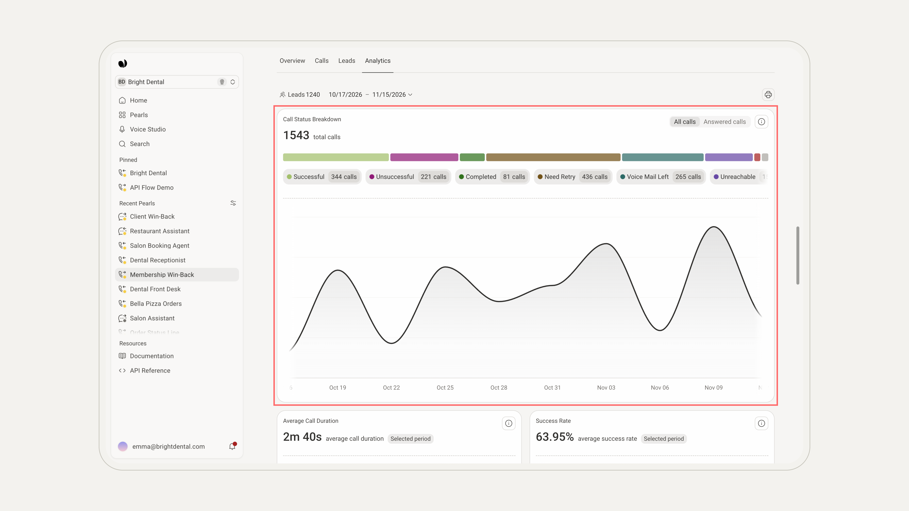</Frame>

<Frame>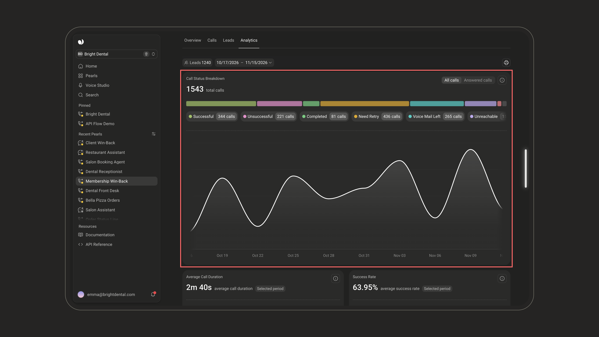</Frame>

**Each status is a segment of the distribution bar, sized by its share of the total.** The pills below the bar list each status with its number of calls. Statuses with no calls in the period are left out.

<Frame>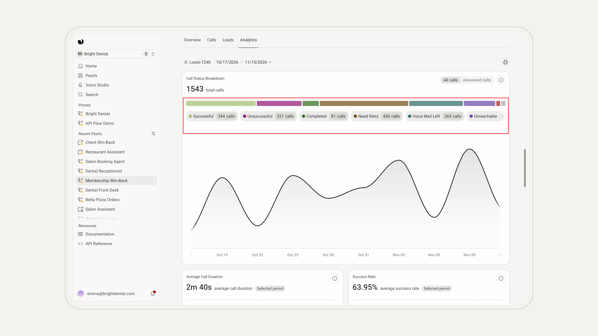</Frame>

<Frame>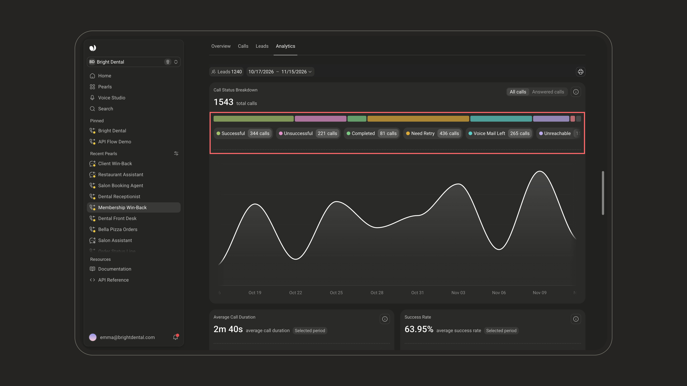</Frame>

Statuses you'll see:

| Status | Meaning | Availability |
|---|---|---|
| **Successful** | The call met the success condition you defined for the Pearl (a booking, a confirmation, and so on). | All |
| **Unsuccessful** | The conversation happened, but the goal wasn't reached. | All |
| **Completed** | An answered call with no success/failure verdict — shown when no success criteria is set for the Pearl. [Define one](/pages/pearl_analytics) to split these into Successful and Unsuccessful. | All |
| **Need Retry** | Nobody picked up, so the lead will be retried per your retry settings. | Outbound |
| **Voice Mail Left** | Pearl reached voicemail and left a message. | Outbound |
| **Unreachable** | The lead couldn't be reached after every retry was exhausted. | Outbound |
| **Error** | The call failed for a technical reason. | All |
| **Other** | Any remaining calls that don't fit the above (for example, calls still in progress). Shown on the bar but can't be selected. | All |

The chart below shows your total calls over the period.

<Tip>
Select any status — on the bar or in its pill — to add that status's trend to the chart, and select it again to hide it. Hover a segment to see its exact count and percentage.
</Tip>

<Frame>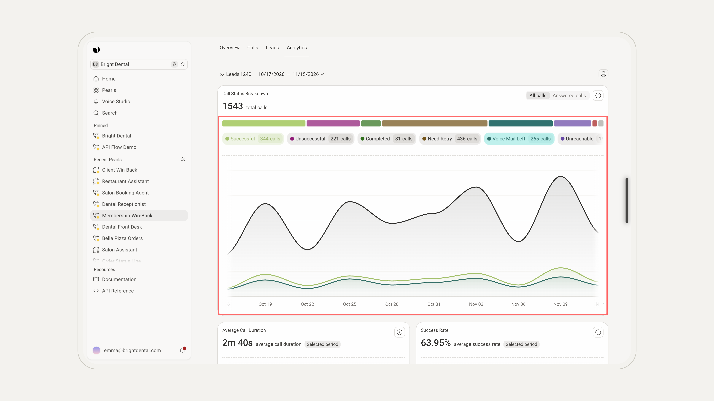</Frame>

<Frame>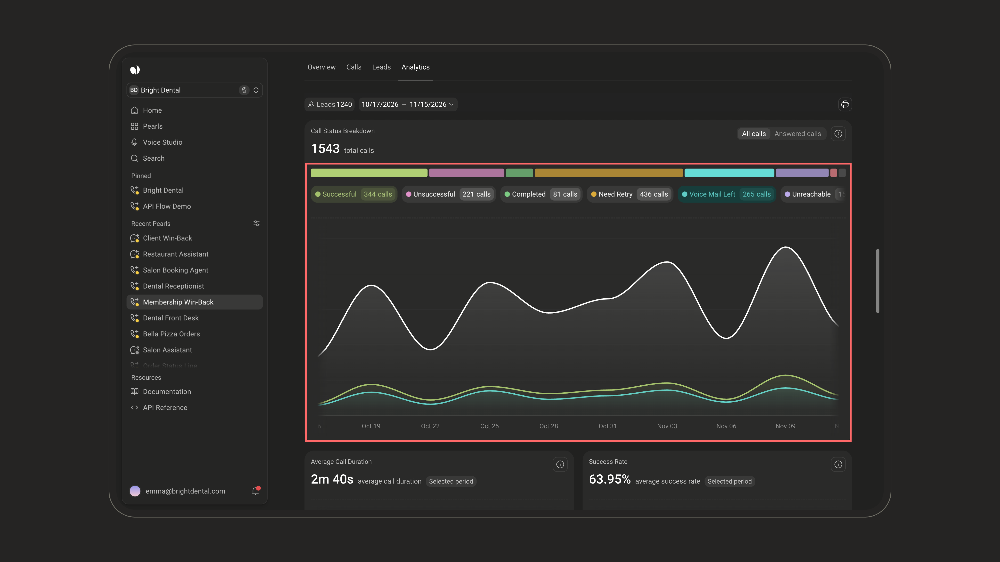</Frame>

On outbound Pearls, a toggle at the top of the card switches it between **All calls** and **Answered calls** — the calls a person actually picked up: Successful, Unsuccessful, and Completed. The headline and the bar then cover answered calls only, and the chart adds an answered calls curve. The toggle is greyed out when no call was answered in the period.

<Frame>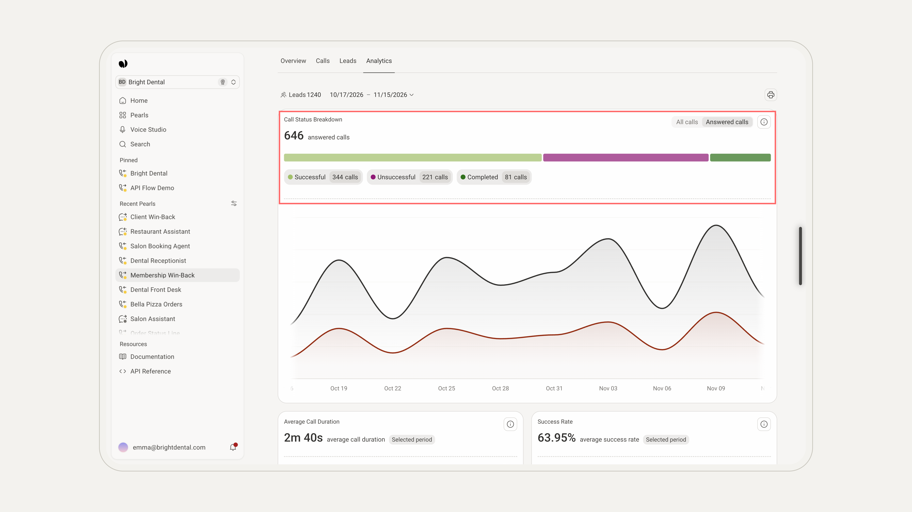</Frame>

<Frame>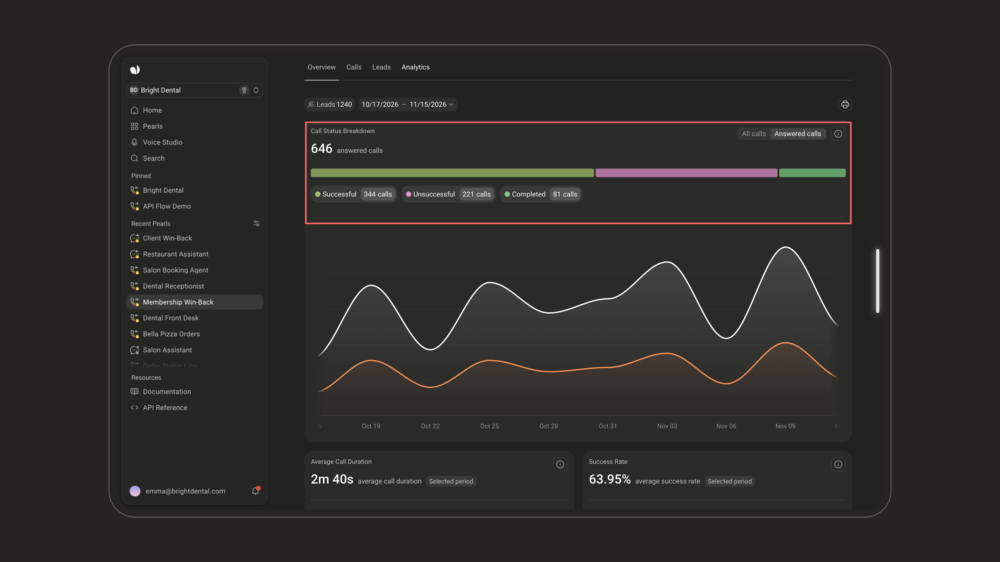</Frame>

## Average Call Duration

The **average length of your calls**, measured from the moment the person picks up or starts interacting with Pearl. The headline is the average over the selected period, weighted by the number of answered calls each day. Useful to:

- Detect drop-offs
- Monitor engagement quality
- Measure attention span

<Frame>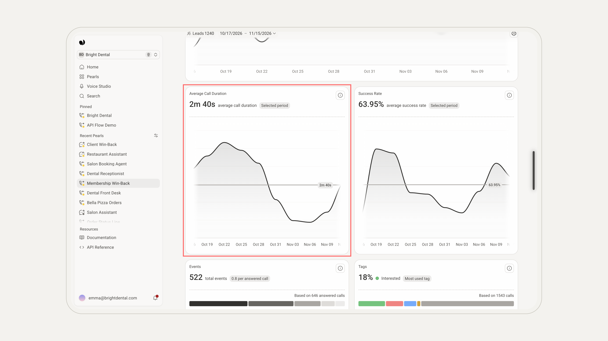</Frame>

<Frame>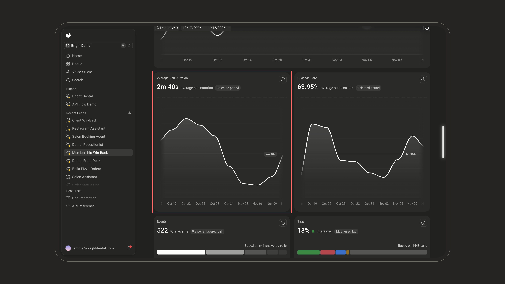</Frame>

## Success Rate

The **percentage of calls that achieved the goal** you defined for your Pearl — booking a meeting, confirming information, or anything else you set as a success. It's measured on the calls where a conversation took place: calls waiting for a retry, unreachable, sent to voicemail, or in error are left out. The headline is your average success rate over the selected period, weighted by the number of answered calls each day.

<Frame>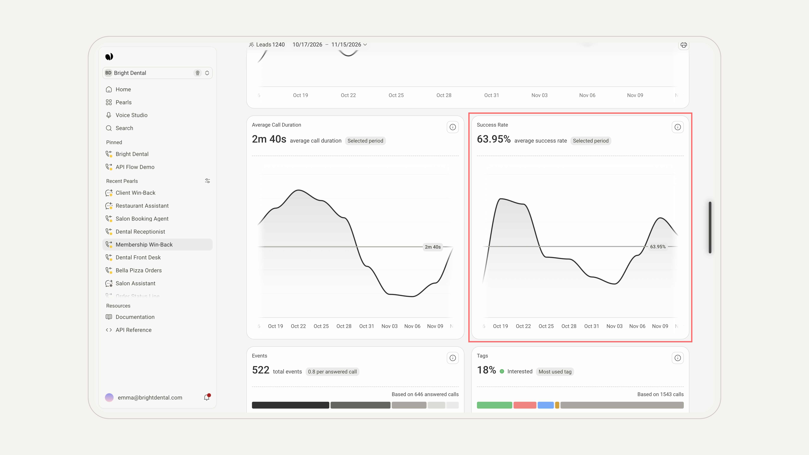</Frame>

<Frame>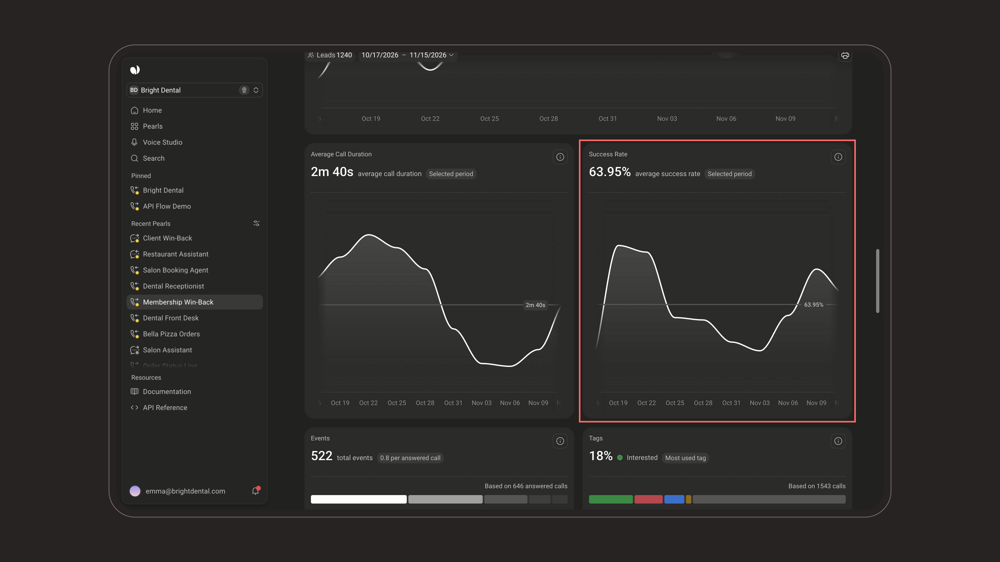</Frame>

<Info>
Calls marked **Completed** count toward the success rate too. Until you [define what success means](/pages/pearl_analytics) for your Pearl, every answered call is Completed, so the rate isn't a measure of your goal yet.
</Info>

<Tip>
Read Success Rate alongside Average Call Duration to gauge how efficient your conversations are.
</Tip>

## Events

**Events are the actions Pearl took during conversations.** The headline shows the total number of events, with the average per answered call next to it. A distribution bar shows how the events split between actions, based on the answered calls of the period.

<Frame>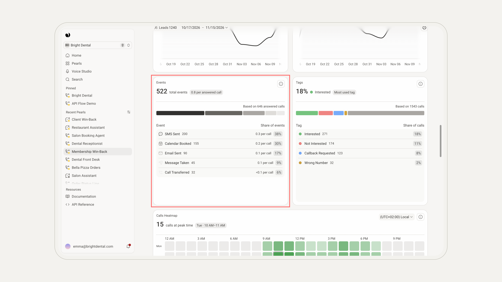</Frame>

<Frame>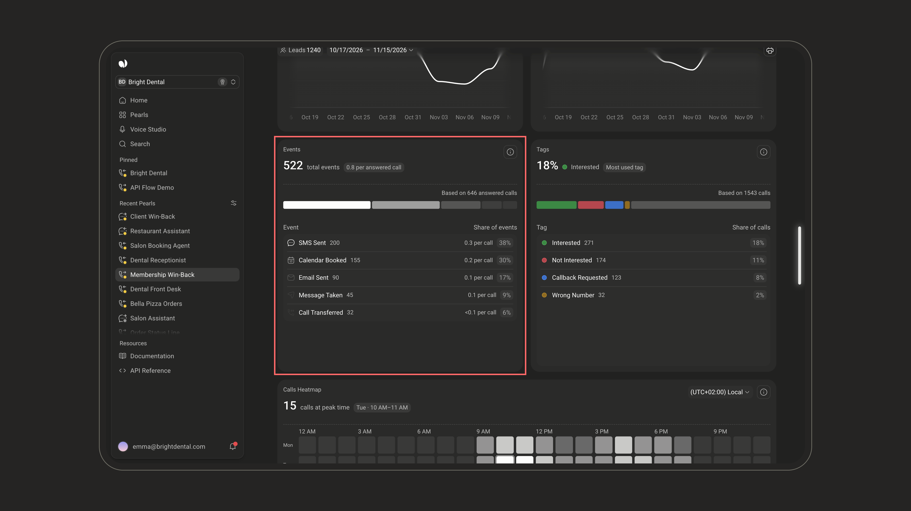</Frame>

Each row breaks down one action three ways:

- **Count** — the number of calls in which it happened (an action counts once per call).
- **Per call** — the average per answered call.
- **Share of events** — its portion of all events.

Tracked actions:

- **Message Taken**
- **SMS Sent**
- **Call Transferred**
- **Calendar Booked**
- **Email Sent**

## Tags

**Tags are the Indicator Tags you defined for your Pearl** — labels like `Interested`, `Callback Requested`, or `Wrong Number` that Pearl applies automatically based on how each conversation goes. The headline highlights your most used tag and its share of calls.

<Frame>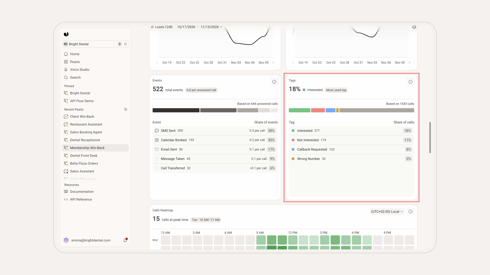</Frame>

<Frame>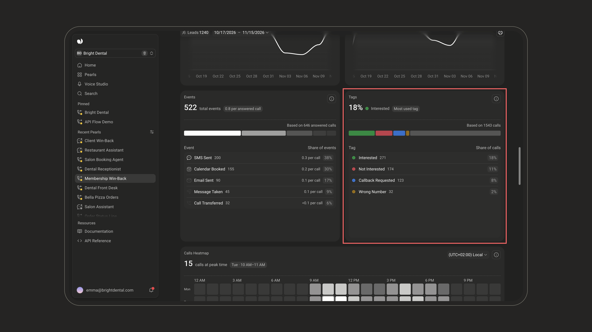</Frame>

Each tag shows its color, its count, and its **share of calls** — the percentage of all calls in the period it was applied to. The distribution bar adds a grey **No tag** segment for the calls without any tag.

<Info>
Tags aren't just for display. You can filter calls by tag, trigger notifications, and use them to segment leads. Learn how to set them up in [Call Analytics — Indicator Tags](/pages/pearl_analytics).
</Info>

## Calls Heatmap

The heatmap shows **when your answered calls happen** across the week — every cell is a day-and-hour slot, and brighter cells mean more activity. The headline gives the number of calls in your busiest slot, with that slot next to it (for example, *Tue · 10 AM–11 AM*). Use it to find the best times to call (outbound) or to staff for demand (inbound).

<Frame>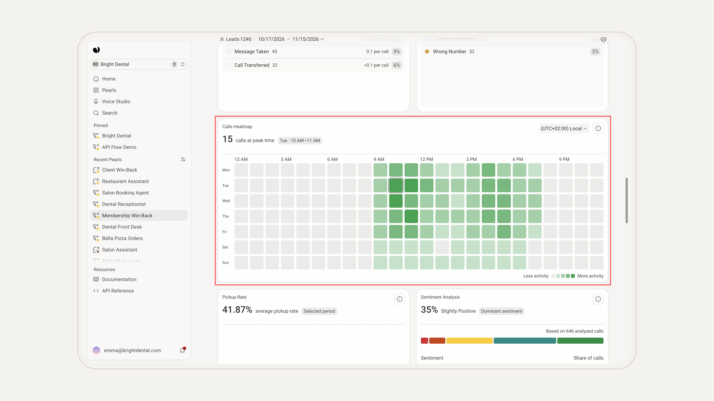</Frame>

<Frame>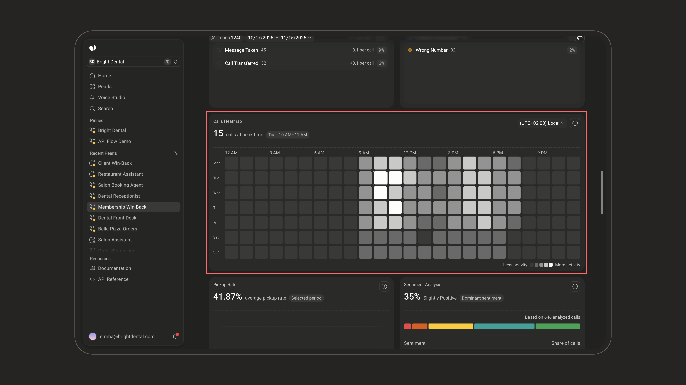</Frame>

Use the **timezone** menu at the top of the card to read the grid in the timezone that matters to you: **Local** (your browser's timezone, the default), **Pearl** (the timezone set on your Pearl), or **UTC**. Each option shows its UTC offset.

<Frame>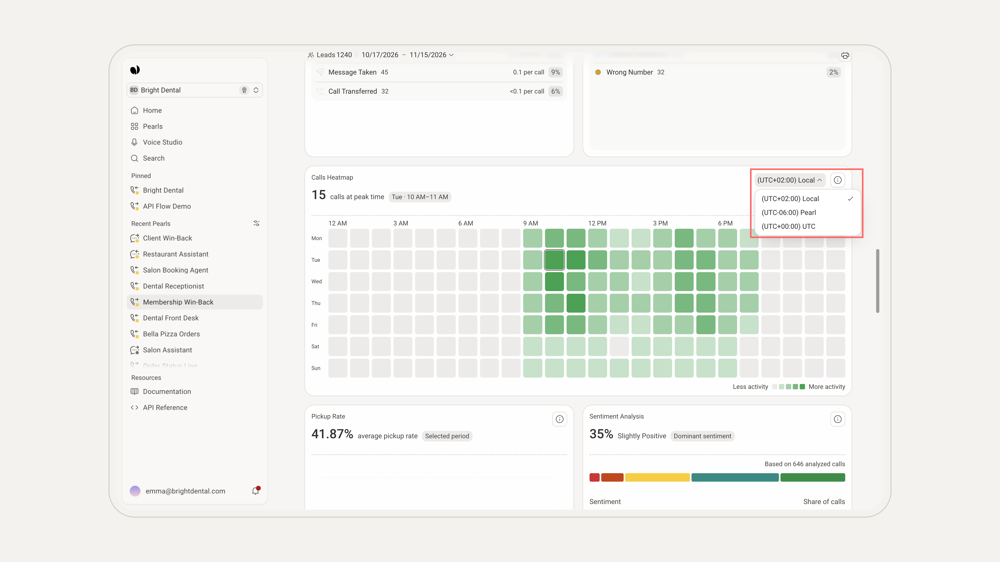</Frame>

<Frame>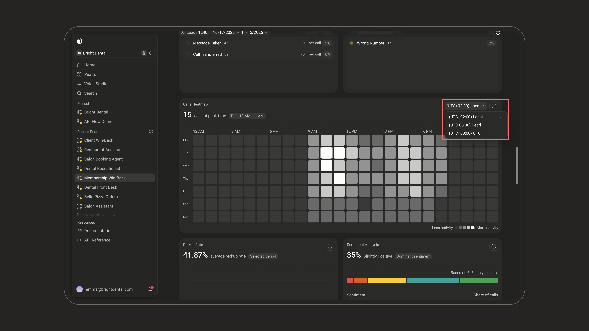</Frame>

## Pickup Rate

<Warning>Outbound only.</Warning>

The **percentage of calls answered** by your contacts: answered calls divided by all calls placed. The headline is your average pickup rate for the period, weighted by the number of calls each day. It tells you how reachable your audience is, so you can fine-tune your calling hours.

<Frame>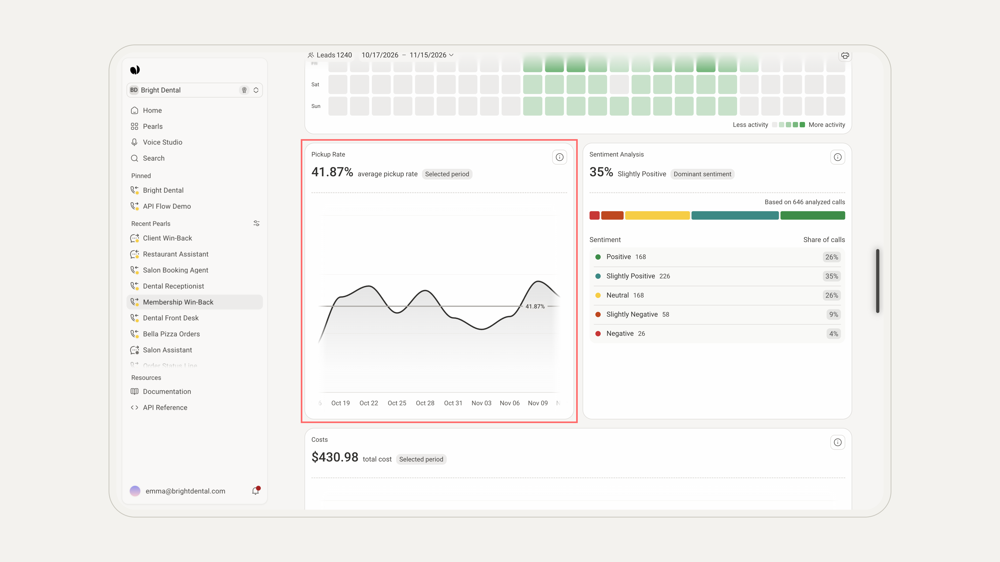</Frame>

<Frame>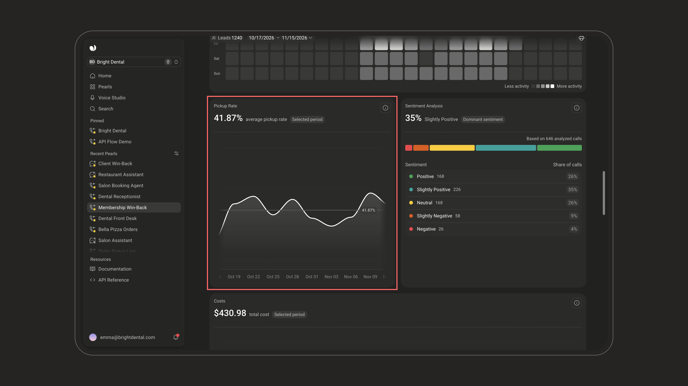</Frame>

## Sentiment Analysis

The **emotional tone of your conversations**, detected from customer responses across five levels. The headline names the dominant sentiment and its share of the analyzed calls.

- Negative
- Slightly Negative
- Neutral
- Slightly Positive
- Positive

<Frame>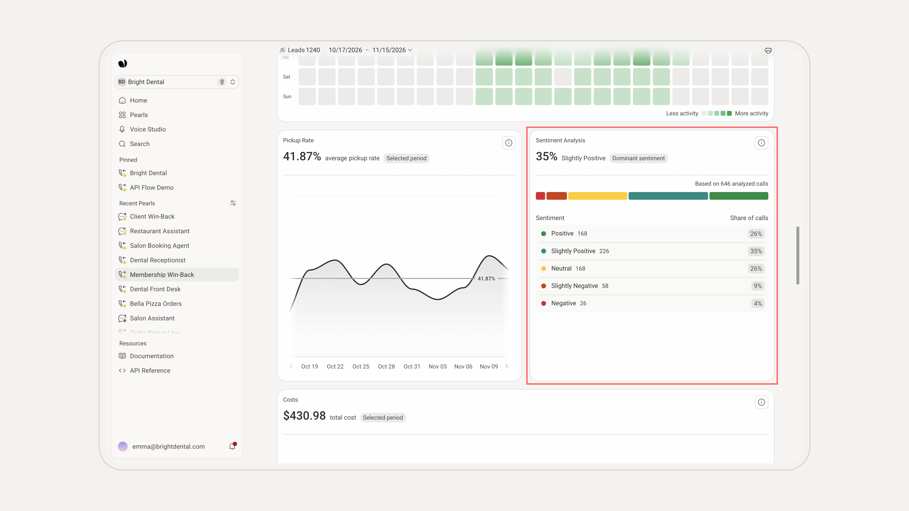</Frame>

<Frame>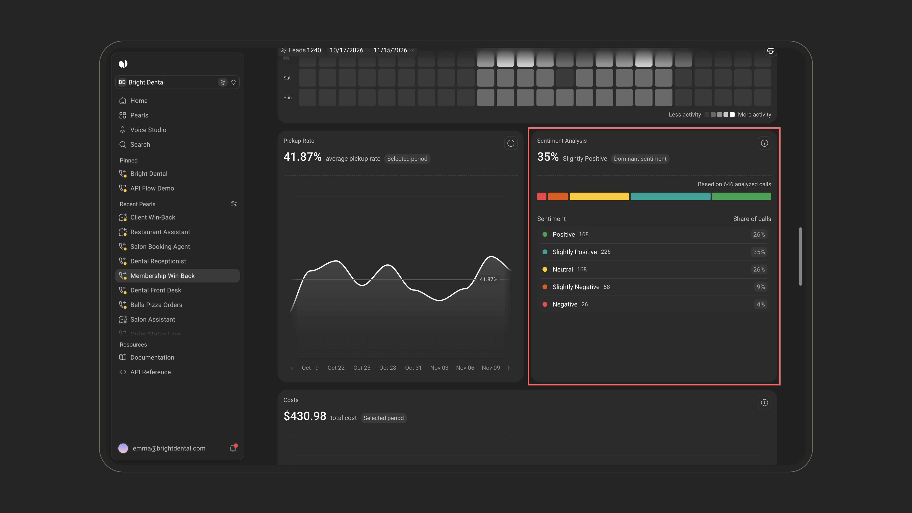</Frame>

A distribution bar and a row per level give each level's call count and share of the analyzed calls, so you can watch satisfaction trends and adjust Pearl's tone.

## Costs

Your **call costs** over the period: the headline is the total cost, and the chart plots two curves, **Total** (what you spent) and **Average** (the average cost per call) — so you can see how usage affects your balance.

<Frame>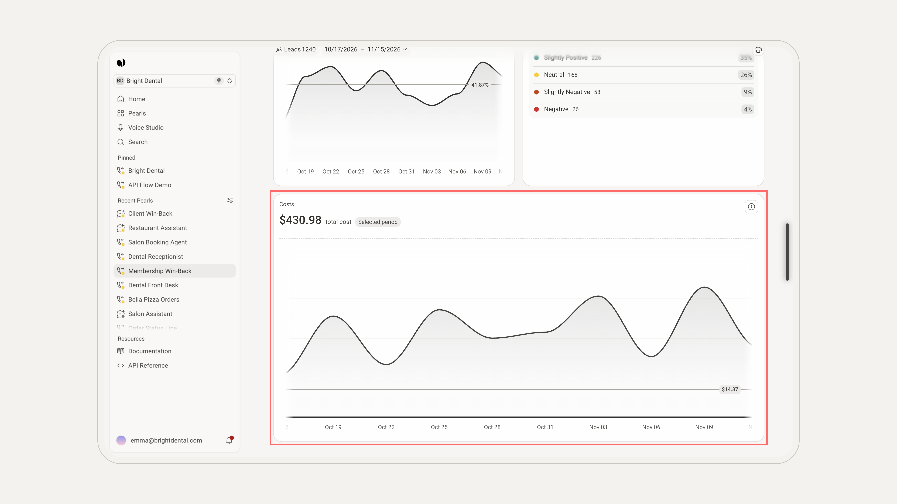</Frame>

<Frame>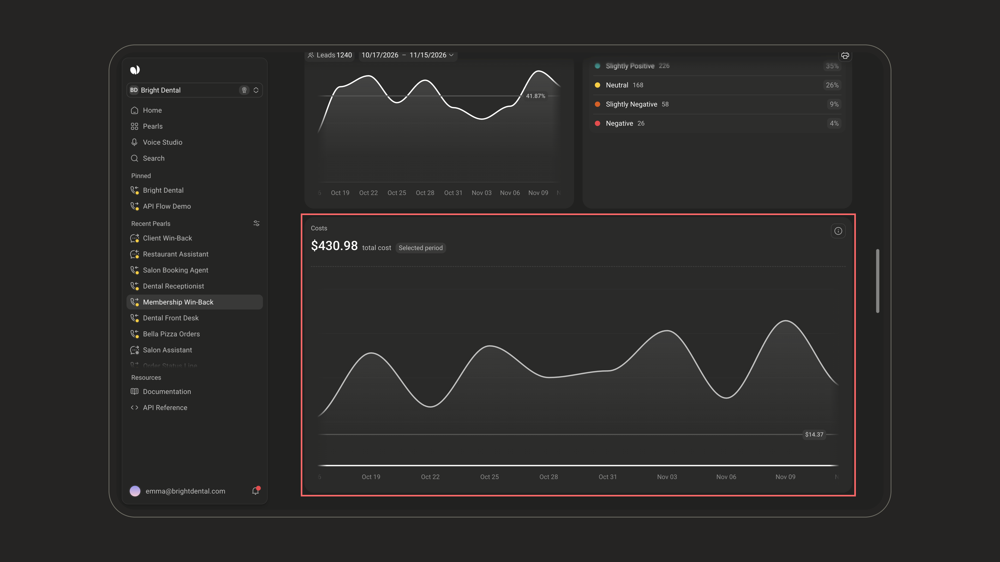</Frame>

<Warning>
This card only reflects costs deducted from your available credit. Calls covered by your included minutes aren't shown.
</Warning>

## Inbound vs Outbound

| Feature | Inbound | Outbound |
|---|---|---|
| Call initiation | By the caller | By Pearl |
| Toolbar chip | Phone number | Leads |
| Call Status Breakdown | ✅ | ✅ *(adds Need Retry, Voice Mail Left, Unreachable)* |
| All calls / Answered calls toggle | — | ✅ |
| Pickup Rate | — | ✅ |
| Duration, Success, Events, Tags, Sentiment, Heatmap, Costs | ✅ | ✅ |

## Summary

With NLPearl Analytics you get full visibility into your Pearls' performance. Use these insights to fine-tune your strategy, lift your success and pickup rates, and optimize every conversation.
