<div className="block dark:hidden">
<Frame>
  <div className="p-1">
  

  </div>
</Frame>

</div>

<div className="hidden dark:block">
<Frame>
  <div className="p-1">
  

  </div>
</Frame>

</div>

The **API** node sends an HTTP request to your own system or to a third-party service, so your Pearl can pull data (a customer record, open slots, a price) or push it (a booking, a CRM update). Depending on where you place it, it runs at one of three moments:

- **Pre-Call API**: once, before the conversation starts.
- **In-Call API**: during the conversation, when the flow reaches the node.
- **Post-Call API**: after the conversation ends, as a post-call action.

The form is the same in all three cases. Only the available variables, the response handling, and the transitions differ (see [Context Differences](#context-differences)). It works on voice and text Pearls alike: on a text Pearl, the tabs are called **Pre-Chat**, **In-Chat**, and **Post-Chat**.

---

## Adding an API Node

In the [PearlVibe editor](/pages/pearl_vibe), click **Add Node** at the bottom of the canvas, then pick the moment the request should run. You can also ask PearlVibe to add one for you in the chat (**Build** mode).

<Tabs>
  <Tab title="In-Call API">
    In the **In-Call** tab, pick **API** in the **Actions** section, then connect it where the request should run.

    <div className="block dark:hidden"><Frame>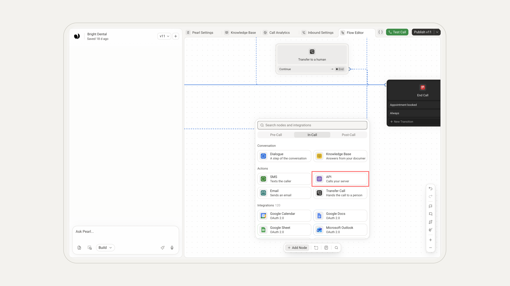</Frame></div>
    <div className="hidden dark:block"><Frame>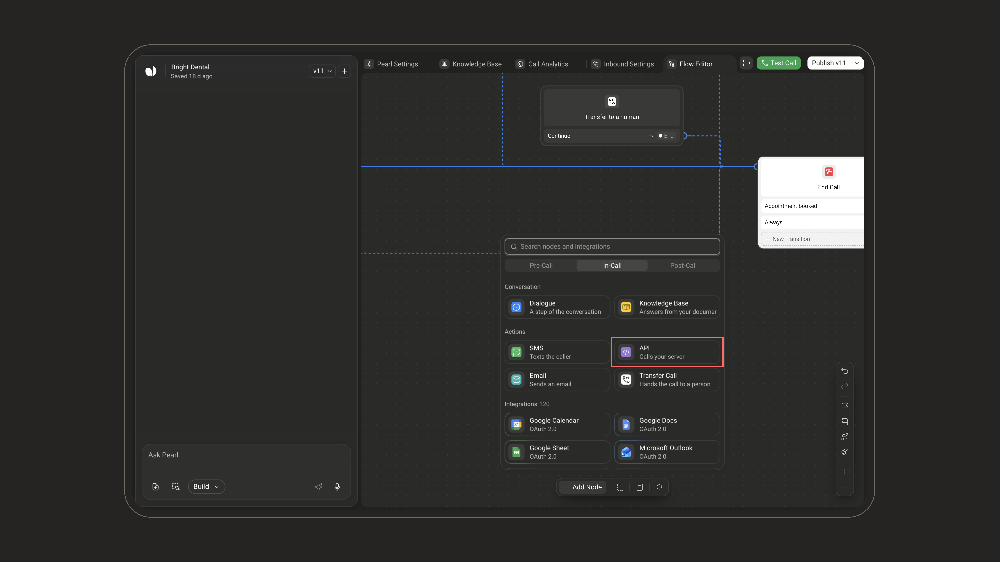</Frame></div>
  </Tab>
  <Tab title="Pre-Call API">
    In the **Pre-Call** tab, pick **Pre Call API**. You can also choose **Pre Call API** on the **Start** node. It is inserted between Start and the Opening Sentence, and runs before the call.

    <div className="block dark:hidden"><Frame>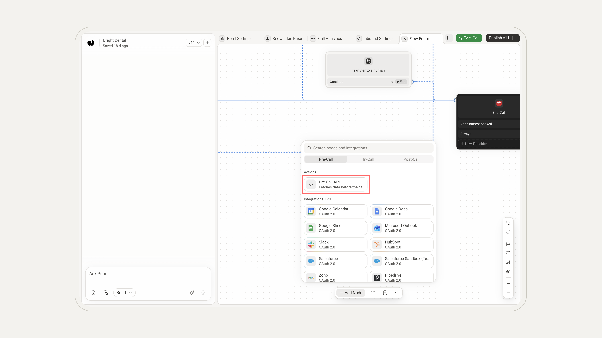</Frame></div>
    <div className="hidden dark:block"><Frame>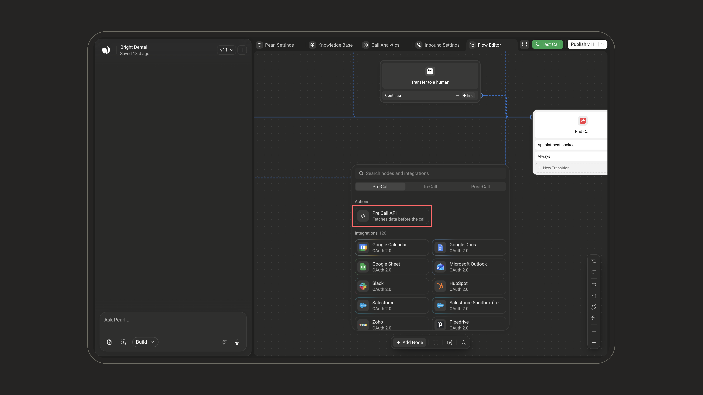</Frame></div>
  </Tab>
  <Tab title="Post-Call API">
    In the **Post-Call** tab, pick **API**. In **Add Post Call Action**, select the end of the conversation it should follow, or **New Transition** to write your own condition, then click **Add**. You can also click **Add Action** on an existing **Post-Call Actions** node.

    <div className="block dark:hidden"><Frame>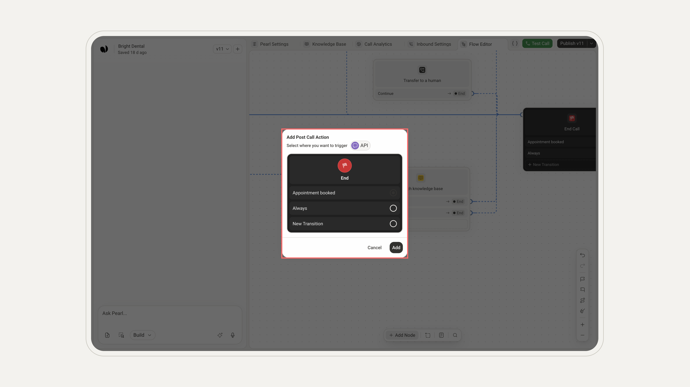</Frame></div>
    <div className="hidden dark:block"><Frame>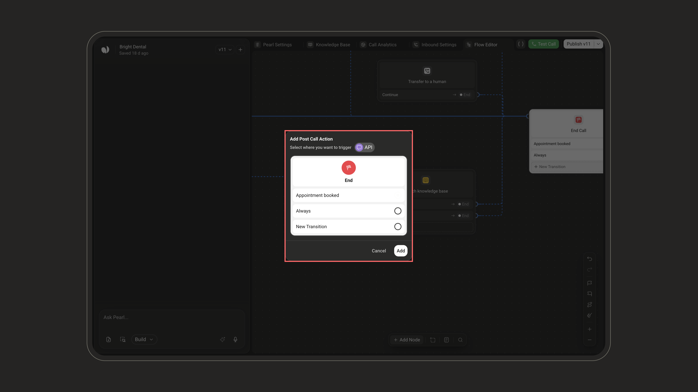</Frame></div>
  </Tab>
</Tabs>

<Tip>
  The **Integrations** section of the picker lists ready-made services (Google Calendar, HubSpot, Salesforce, and more). Picking one adds an API node with its credential already created.
</Tip>

To configure the node by hand, click it on the canvas and open it with the pencil of its tile in the chat (**Manual edit**), or hover it and click **Edit Manually**. Your changes are kept once you click **Save Changes**.

---

## Configuring the Request

<Steps>
  <Step title="Description">
    Explain what this API does and what data it returns (e.g. *"Returns open appointment slots for the requested day"*). The description is **required**, up to **150 characters**. Pearl reads it to understand what the request is for.

    <div className="block dark:hidden"><Frame>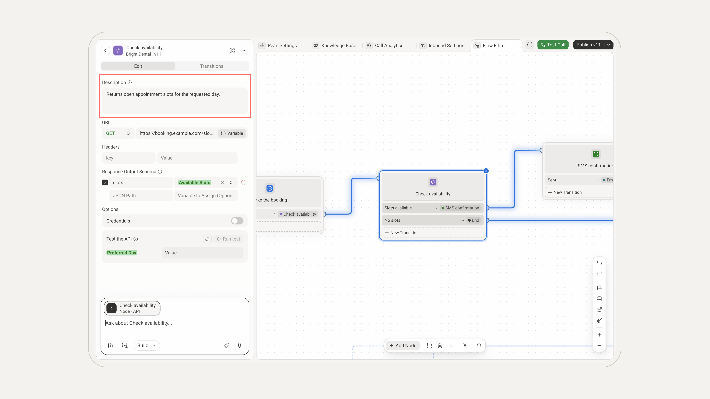</Frame></div>
    <div className="hidden dark:block"><Frame>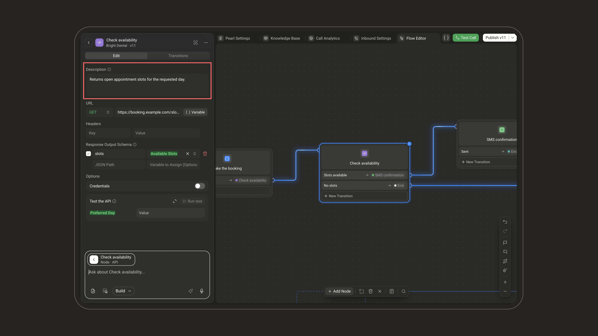</Frame></div>
  </Step>
  <Step title="URL & Method">
    In **URL**, pick the method in the dropdown before the address (**GET**, **POST**, **PUT**, **DELETE**, or **PATCH**), then type the endpoint URL. Click **Variable** to insert a variable, among those available in the node's context (see [Context Differences](#context-differences)) and your environment variables, for example `{apiBaseUrl}/orders`. Variables are inserted as they are, without URL encoding.

    <div className="block dark:hidden"><Frame>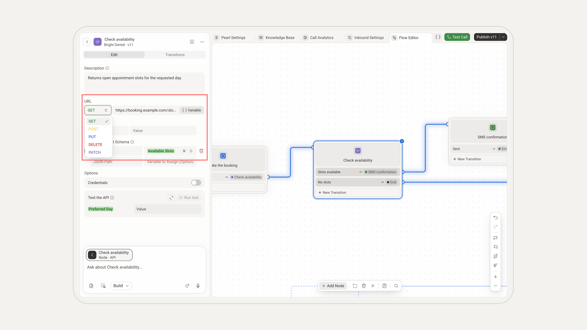</Frame></div>
    <div className="hidden dark:block"><Frame>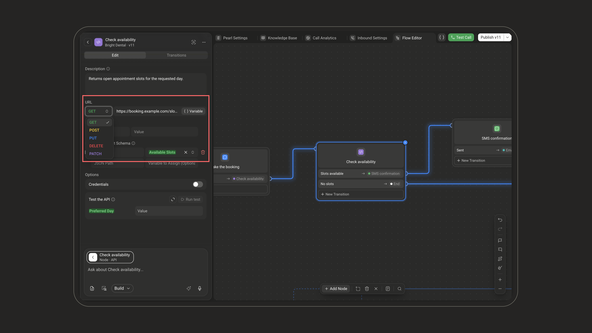</Frame></div>

    <Info>
      The available fields depend on the method:

      - The **Body** section is shown only for **POST**, **PUT**, and **PATCH** (hidden for GET and DELETE).
      - The **Response Output Schema** is available for every method **except DELETE**.
    </Info>

    <Note>
      A request times out after **10 seconds**, and only a **2xx** status counts as a success. If your API is behind a firewall, allow the NLPearl IP addresses listed in [IP Whitelisting](/pages/ip_whitelist). This applies to Pre-Call, In-Call, and Post-Call requests alike.
    </Note>
  </Step>
  <Step title="Headers">
    Add any header required by the API, such as `Content-Type` or `Authorization`, as **Key / Value** pairs. Header values are **static**: only environment variables are replaced in them, since they are filled in across the whole flow before each call. When you don't set a `Content-Type`, `application/json` is sent.

    <div className="block dark:hidden"><Frame>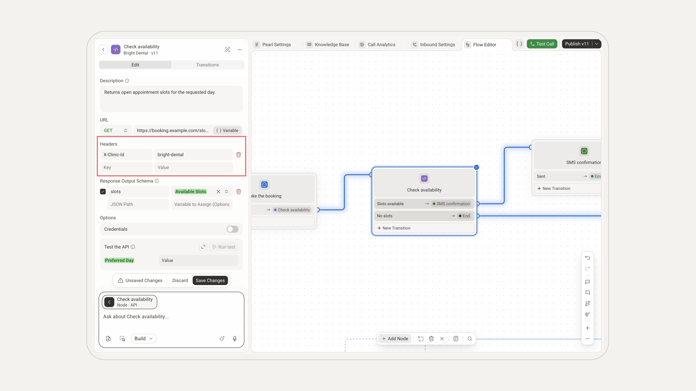</Frame></div>
    <div className="hidden dark:block"><Frame>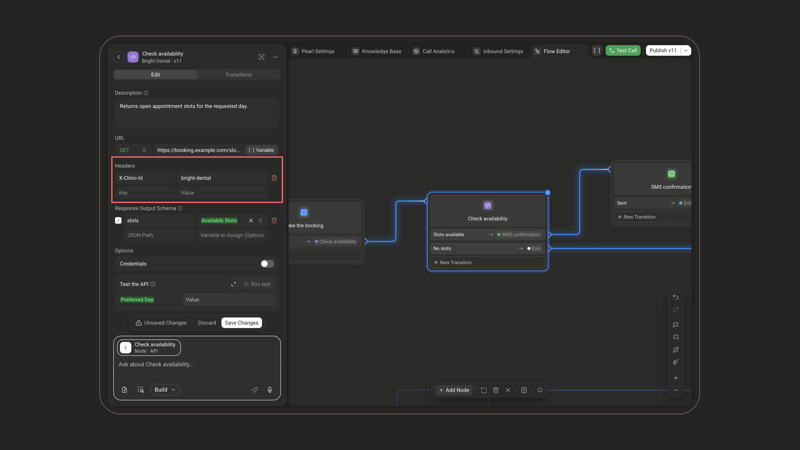</Frame></div>

    <Info>
      For a **dynamic authorization token**, use a [**Credential**](#credentials-authentication) instead of a static header.
    </Info>
  </Step>
  <Step title="Body (POST / PUT / PATCH)">
    Provide **Key / Value** pairs, sent as JSON. Type in the empty row at the bottom to add one; hover a row to delete it.

    <div className="block dark:hidden"><Frame>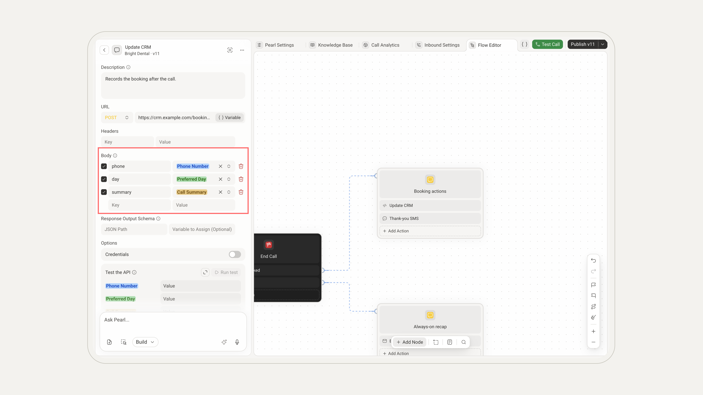</Frame></div>
    <div className="hidden dark:block"><Frame>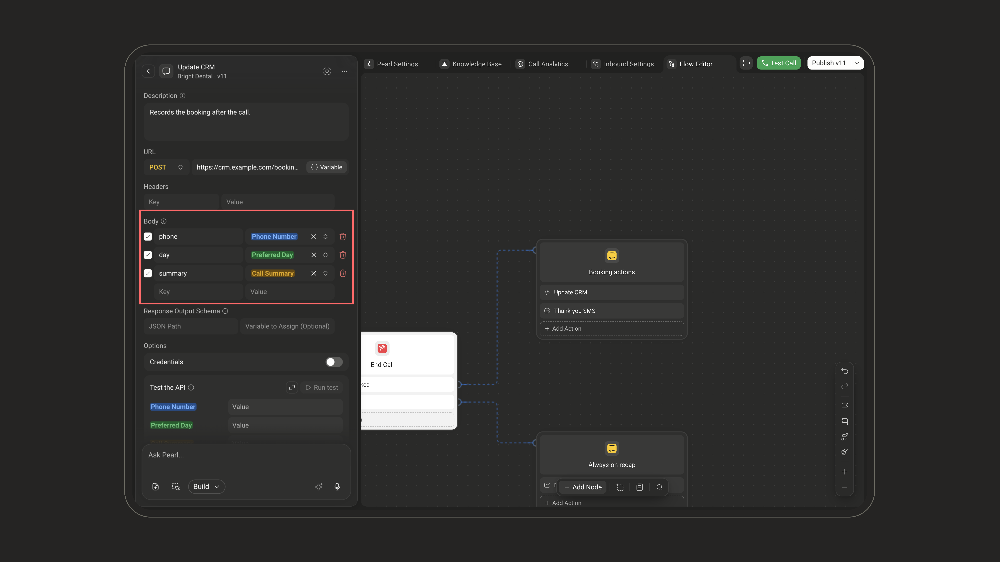</Frame></div>

    Each **Value** is either one of your **Variables** or a **Static & Custom** value. Static values support these types:

    | Type | Format |
    | --- | --- |
    | **Text** | String, up to 250 characters, which can include variables |
    | **Whole Number** | Integer |
    | **Decimal Number** | Float / double |
    | **Boolean** | `true` / `false` |
    | **Date** | Calendar date |
    | **Time** | Time of day |
    | **Date & Time** | Combined date and time |

    <Info>
      For each row you can tick the **Required** checkbox:

      - **Checked**: if the value is missing, the request is not sent. During the conversation, Pearl is told which value is missing and asks the customer for it. In a Pre-Call API, there is no one to ask, so the node takes its **Not Success** path.
      - **Unchecked**: the request is sent even if the value is missing; the key is simply left out.
    </Info>

    When using a variable in the body, be aware that:

    - Each variable keeps its **configured data type** (e.g. a Whole Number is sent as a number, a Text as a string). During the conversation, a value that doesn't match the type stops the request.
    - You can mix static values and variables in the same body.
    - For nested JSON, use **dot notation** in the Key (`customer.address.street`) and **square brackets** for array indices (`order.items[0].productId`). See [Using Nested Objects](#using-nested-objects) below.

    A body value can also carry its own braces - a GraphQL query or a nested JSON fragment, for example. In an API node, only braces wrapping a valid variable ID are substituted; every other brace is sent as-is:

    - `{ {agentName} }` - the variable is replaced, the outer braces are kept.
    - `query { boards(ids: {agentName}) { id } }` - the variable is replaced, the rest of the query is left untouched.
    - `{ agentName }` - braces containing spaces around the ID are **not** recognized as a variable; the text is sent literally.
  </Step>
</Steps>

### Using Nested Objects

Many APIs expect a **nested JSON structure** in their request body. Use dot notation and array indices in the **Key** column to build nested payloads while keeping them organised and readable.

<Card title="How to define nested keys">
  - Use **dot notation** for properties (`customer.address.street`)
  - Use **square brackets** for array indices (`order.items[0].productId`)

  <Info>
    You can pair nested paths with any variable type: Text, Number, Boolean, etc.
  </Info>

  Mapping table:

  | API key | Variable |
  | --- | --- |
  | `customer.name` | `customerName` |
  | `customer.email` | `customerEmail` |
  | `customer.address.street` | `street` |
  | `customer.address.city` | `city` |
  | `order.items[0].productId` | `productId` |
  | `order.items[0].quantity` | `quantity` |

  Resulting body:

  ```json body.json
  {
    "customer": {
      "name": "{customerName}",
      "email": "{customerEmail}",
      "address": {
        "street": "{street}",
        "city": "{city}"
      }
    },
    "order": {
      "items": [
        {
          "productId": "{productId}",
          "quantity": "{quantity}"
        }
      ]
    }
  }
  ```
</Card>

---

## Response Output Schema & Variable Assignment

<Warning>
  API responses are capped at **10,000 characters**, and error responses at **1,000 characters**. Anything longer is automatically truncated.
</Warning>

Available for every method **except DELETE**. The **Response Output Schema** lets you filter the API response so only the relevant data flows back into the conversation. Without filtering, the entire JSON is returned, which can reduce precision because the AI receives too much unrelated information. Even for small responses, setting a schema is strongly recommended to keep Pearl focused.

Each row of the schema has three parts:

| Column | Description |
| --- | --- |
| **Required** (checkbox) | The path must come back in the response. |
| **JSON Path** | The path to extract from the response. |
| **Variable to Assign** | Store the extracted value in a variable. **Required for Pre-Call**, optional otherwise (**Variable to Assign (Optional)**). |

<div className="block dark:hidden"><Frame>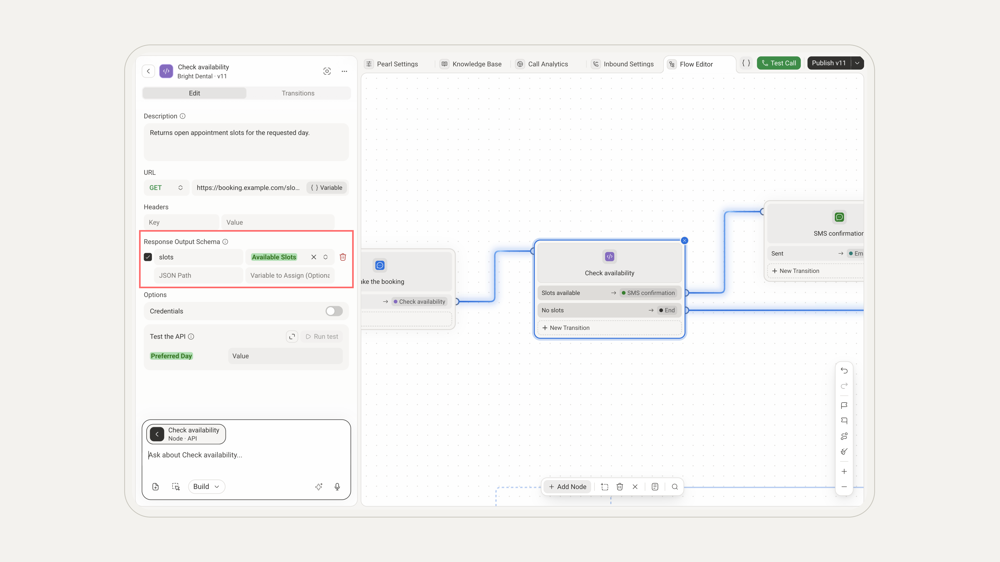</Frame></div>
<div className="hidden dark:block"><Frame>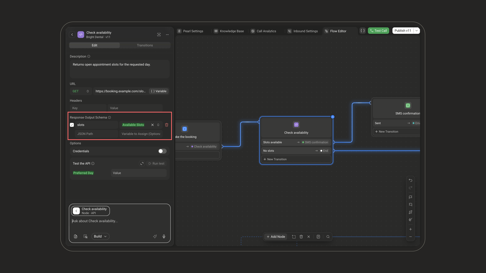</Frame></div>

### How it works

- Provide a list of **JSON Path** strings, one per row.
- The system extracts only those paths from the API response; everything else is discarded.
- As soon as one row has a variable, Pearl receives **only the assigned variables**, not the rest of the response. Rows without a variable then don't reach Pearl.
- The same variable can't be assigned to two paths, and environment variables can't be assigned.

### Path syntax

A path walks down the API response to the value you want. The simplest form is a chain of keys, and it covers most responses:

| Path | What it returns |
| --- | --- |
| `customer.email` | The `email` property inside `customer`. |
| `items[0].id` | The `id` of the first entry in `items`. |

A path can also **choose**, which is what you need as soon as an API answers with a list and you only want one entry out of it:

| Path | What it returns |
| --- | --- |
| `collection[?(@.status == 'available')][0].start_time` | The `start_time` of the first entry whose `status` is `available` — a filter, then the first match. |
| `items[-1].id` | The `id` of the last entry. Negative indices count from the end. |
| `items[0:3]` | The first three entries — a slice. |
| `..email` | Every `email` found anywhere in the response, at any depth. |

Filters accept `==`, `!=`, `<`, `<=`, `>`, `>=`, `contains`, `startswith`, and `endswith`. A path can be up to 2,048 characters, with at most two `..` searches and eight nested brackets; beyond that, it selects nothing.

A slice or a recursive `..` search can match several values at once. Assign one of those to a variable and the variable has to allow multiple values — see **Assigning to a variable** below.

<Note>
  These are not the same as the paths in the **Key** column of the request body. There, `order.items[0].productId` **builds** a nested payload. Here, the same shape **reads** a value out of the response.
</Note>

<Card icon="circle-info" iconType="light">
  ### Using a variable inside a path

  A path can carry a `{variableId}` placeholder — the same syntax used everywhere else (see [Flow Variables](/api-reference/flow_variables)) — for a variable the request itself sends, in the URL or the body. It is replaced with the value sent in this request before the response is read, so the path can depend on what the conversation has collected:

  ```text
  collection[?(@.start_time startswith '{preferredDateIso}')][0].start_time
  ```

  If the request sends the day the caller asked for as `preferredDateIso`, that path returns the first slot on that day. If the value is missing, nothing is extracted.
</Card>

<Tip>
  Use a filtered path whenever the API returns a list and you only want one entry from it. A calendar call is the usual case: without a filter, you map slot 1, slot 2 and slot 3 into separate variables and let the agent pick between them. With one filtered path, the platform hands it exactly the first free slot on the day the caller asked for.
</Tip>

<Check>
  Benefits:

  - Keeps the response size small
  - Improves the quality and relevance of AI outputs
  - Prevents hitting the 10,000-character truncation limit
  - Ensures only the necessary fields are carried into the next steps of the conversation
</Check>

<Card icon="circle-info" iconType="light">
  ### Assigning to a variable

  Key things to know:

  - **The variable's type must match the data type returned by the API at that path.**
  - If the value returned is a list, make sure the variable is configured to **allow multiple values**.
  - A variable can store up to **2,000 characters**. Any data beyond this limit is **truncated**.

  <Info>
    Outside of Pre-Call APIs, assigning a variable is optional. Without any assigned variable, Pearl receives the filtered JSON for the rest of the conversation, but it isn't stored for later reuse.
  </Info>
</Card>

---

## Credentials (Authentication)

If your API requires authentication, use a **Credential**. In the node's **Options**, turn on **Credentials** and pick one in **Token**. **Add New** opens your Pearl's credentials, and the pencil next to the selected one (**Edit**) opens its settings. Leave **Credentials** off if no authentication is needed. Credentials are shared by the whole Pearl.

<div className="block dark:hidden"><Frame>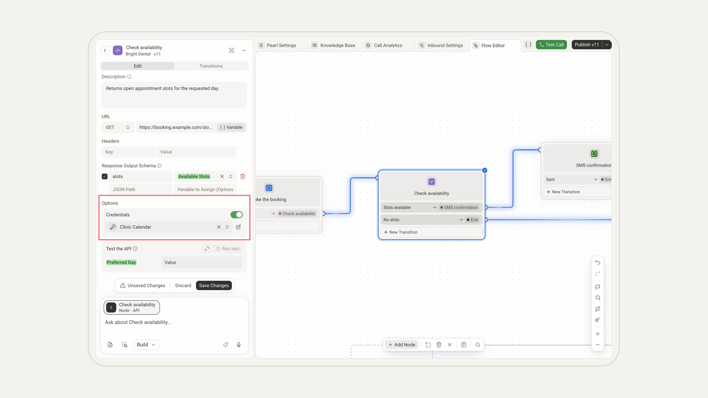</Frame></div>
<div className="hidden dark:block"><Frame>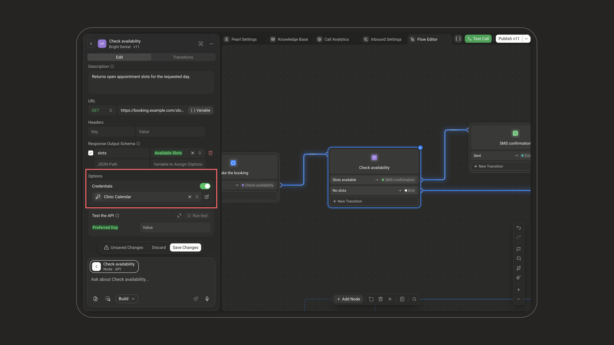</Frame></div>

**Supported credential types** (chosen from the **Type** dropdown when you add a credential manually):

| Type | Description |
| --- | --- |
| **Api Key** | A key and value injected in a **Header** or **Query** parameter |
| **Basic Auth** | Username + password |
| **Bearer** | A static token, sent as `Authorization: Bearer <token>` |
| **Custom Api Key** | Custom headers / query params / body |
| **Refresh Token** | The platform fetches and refreshes a token automatically |

<Info>
  **OAuth2** services are connected through their **integration** in the **Add a credential** panel: pick it, then click **Connect** to sign in. They are not created manually in this form.
</Info>

<Tip>
  Why use a Credential?

  - Avoid hardcoding tokens manually in every API node
  - Automatically refresh tokens based on their lifetime
  - Centralized management when multiple API nodes reuse the same token
  - No need to parse token responses manually, the platform extracts the token for you
</Tip>

### Configuring a Refresh Token credential

<Steps>
  <Step title="Open Variables & credentials">
    Click the `{ }` button (**Variables & credentials**) in the editor header.

    <div className="block dark:hidden"><Frame>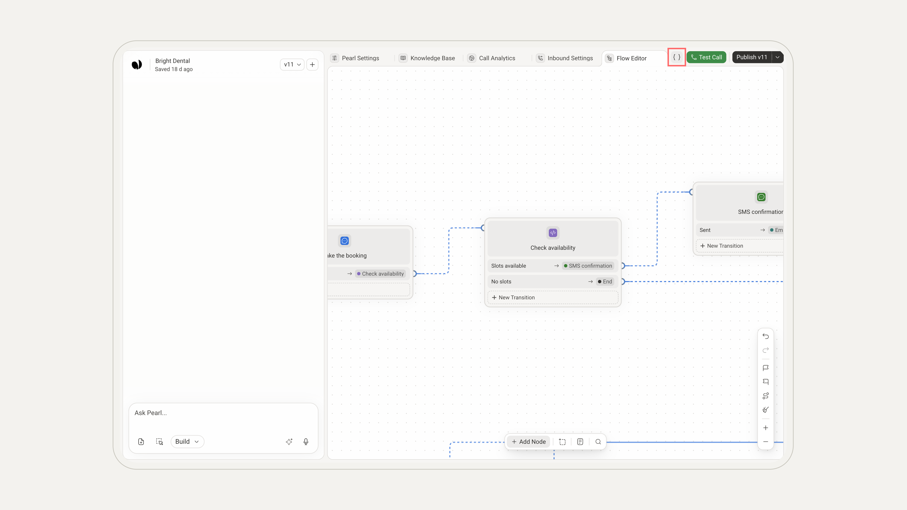</Frame></div>
    <div className="hidden dark:block"><Frame>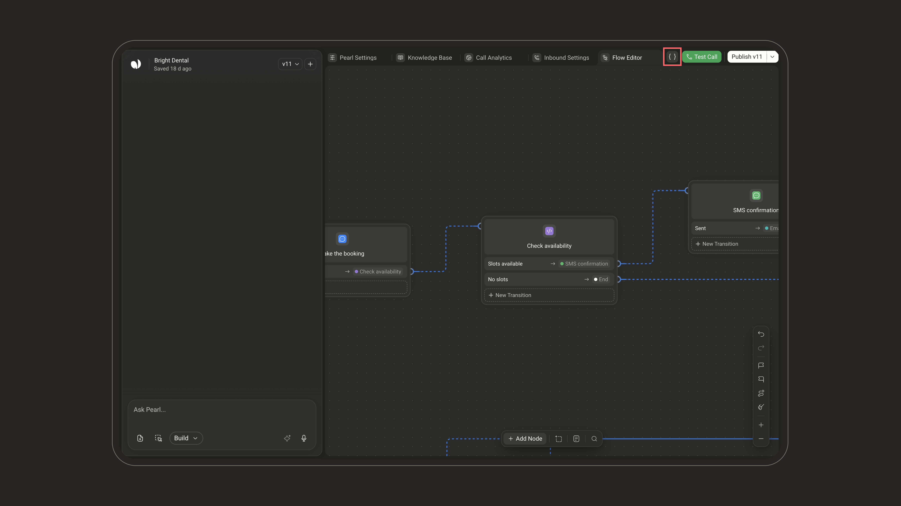</Frame></div>
  </Step>
  <Step title="Add a credential">
    In **Credentials**, click **Add credential**. The list shows each credential's **Name**, **Type**, and **Status**: **Ready**, or what it still needs (**Not connected**, **Reconnect needed**, **Values missing**).

    <div className="block dark:hidden"><Frame>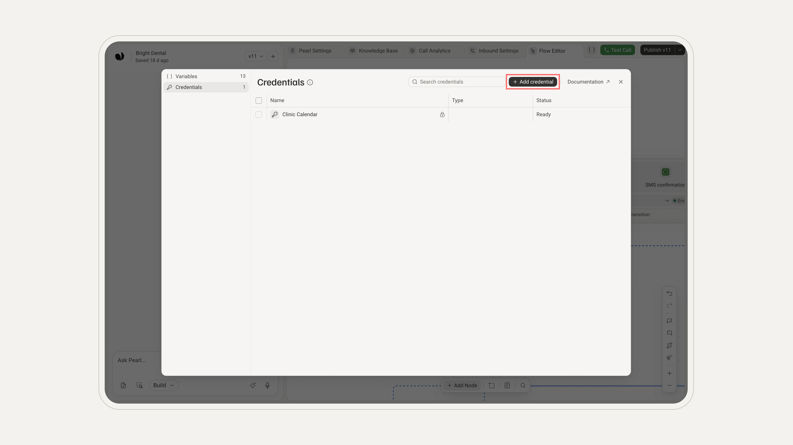</Frame></div>
    <div className="hidden dark:block"><Frame>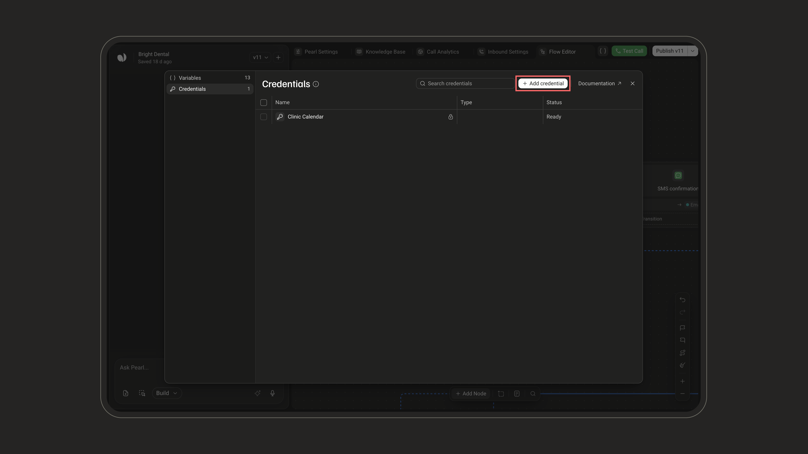</Frame></div>
  </Step>
  <Step title="Choose how to add it">
    In **Add a credential**, either pick a ready-made **integration** from the list (Google, Microsoft, Slack, HubSpot, Salesforce, Zoho, and more) to connect through its own sign-in, or click **Add manually** to configure a custom credential such as a **Refresh Token**.

    <div className="block dark:hidden"><Frame>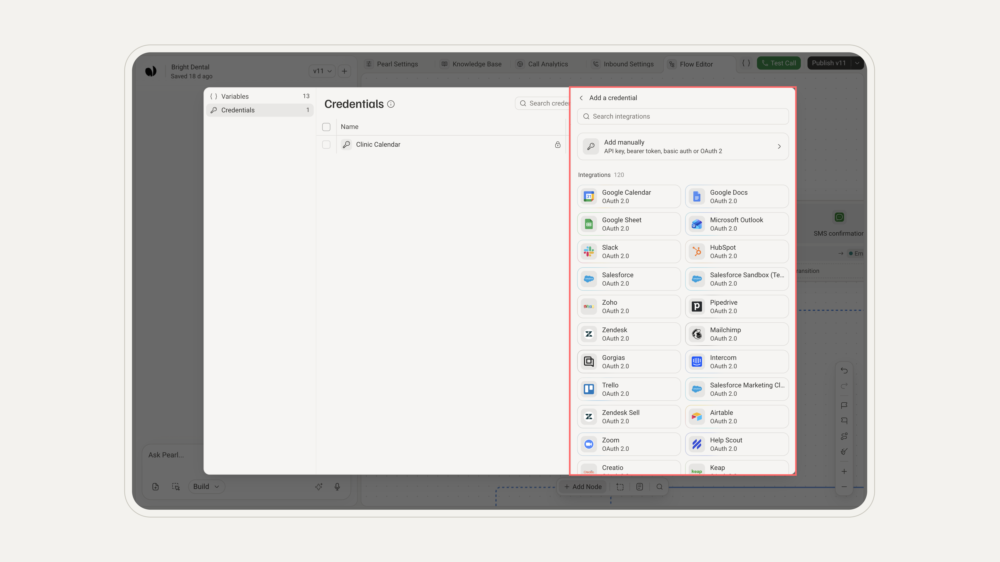</Frame></div>
    <div className="hidden dark:block"><Frame>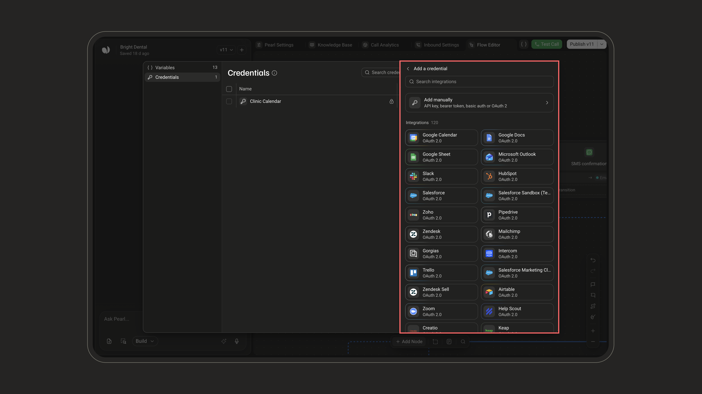</Frame></div>
  </Step>
  <Step title="Fill in the credential details">
    Enter a **Name** (a label to identify it later) and choose a **Type**. The form updates to show the fields specific to the selected type.

    <div className="block dark:hidden"><Frame>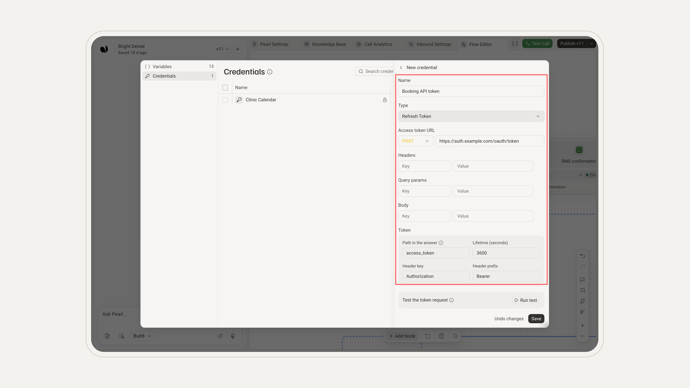</Frame></div>
    <div className="hidden dark:block"><Frame>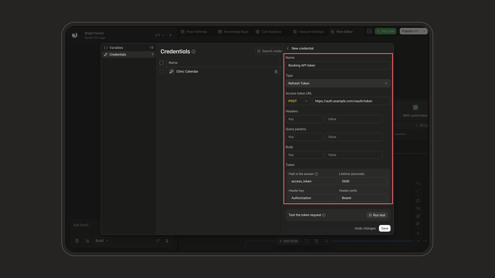</Frame></div>

    <Card title="Example: Refresh Token fields">
      | Field | Description |
      | --- | --- |
      | **Access token URL** | The method and endpoint used to request the token, with optional **Headers**, **Query params**, and **Body** (e.g. `grant_type`, `client_id`, `client_secret`). The Body is hidden for GET and DELETE. |
      | **Path in the answer** | JSON path to locate the token in the response (e.g. `access_token` or `data.access_token`). |
      | **Lifetime (seconds)** | How long the token stays valid (minimum **100**, **300** by default). |
      | **Header key** | Name of the header where the token is injected (**Authorization** by default). |
      | **Header prefix** | Optional prefix for the token (**Bearer** by default). |

      To keep a sensitive value such as a client secret out of sight, click the `{ }` button of a value (**Insert a secured variable**) and add it as a **secured variable**.
    </Card>
  </Step>
  <Step title="Test and save">
    In **Test the token request**, click **Run test** to call the token endpoint. The result shows **Token ready** with the token, how it is sent, and how often it is renewed, or what went wrong (for example no token at the path you set, with a button to use the path it found). Then click **Save**.

    <div className="block dark:hidden"><Frame>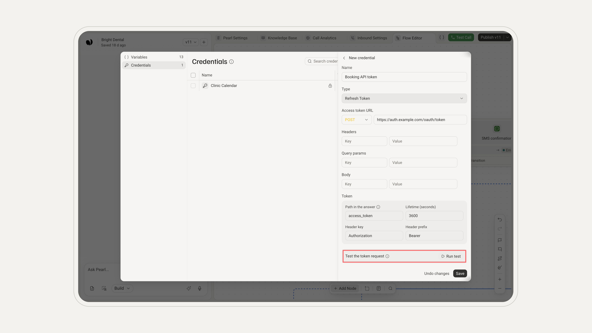</Frame></div>
    <div className="hidden dark:block"><Frame>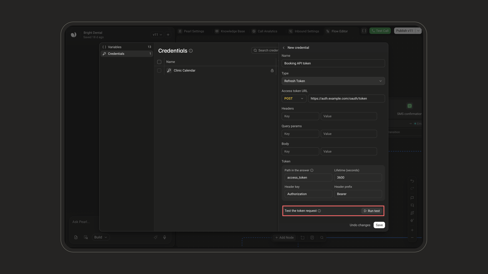</Frame></div>
  </Step>
</Steps>

<Card icon="circle-info" iconType="light">
  ### How the Credential is used

  Once saved, select this Credential from the **Token** dropdown in any API node. When selected:

  - The platform automatically adds the token to the request header, using the configured **Header key** and optional **Header prefix**.
  - The token is kept for its **Lifetime** and fetched again when it expires. If the API answers with an error, the token is refreshed and the request retried once.

  <Warning>
    Make sure **Path in the answer** matches the exact location of the token in the JSON response. If the platform can't find the token at this path, the Credential will fail.
  </Warning>
</Card>

---

## Context Differences

The same API node behaves differently depending on where you place it in the flow.

| Aspect | Pre-Call API | In-Call API | Post-Call API |
| --- | --- | --- | --- |
| **When it runs** | Before the call | During the call | After the call |
| **Available variables** | Pre-Call only | Pre-Call + In-Call | Pre-Call + In-Call + Post-Call |
| **Assign response to variable** | Required | Optional | Optional |
| **Transitions** | Success (+ optional Not Success) | Continue / conditional | None |
| **Can duplicate** | No | Yes | Yes |

Environment variables are available in all three.

<Tabs>
  <Tab title="Pre-Call API">
    Runs **once before the conversation begins**. Typical uses:

    - **Inbound**: look up the caller using the auto-captured **phone number** and **call id**.
    - **Outbound**: preload data from Pre-Call variables already stored on the lead.

    <Info>
      Only **Pre-Call variables** are available (system variables like phone number, call id, first/last name, email, plus your own Pre-Call variables).
    </Info>

    - **Assigning response values to variables is required**: that's how pre-call data becomes usable in the conversation. The rows marked **Required** must come back for the node to take the **Success** path.
    - **Transitions**: a **Success** branch by default. Turn on **On Error Transition** in the **Transitions** tab to add a **Not Success** branch. It is taken when a required input is missing, the API answers with a non-2xx status, the response can't be read, a required value doesn't come back, or the request fails.
    - Pre-Call API nodes **can't be renamed or duplicated**.

    <div className="block dark:hidden"><Frame>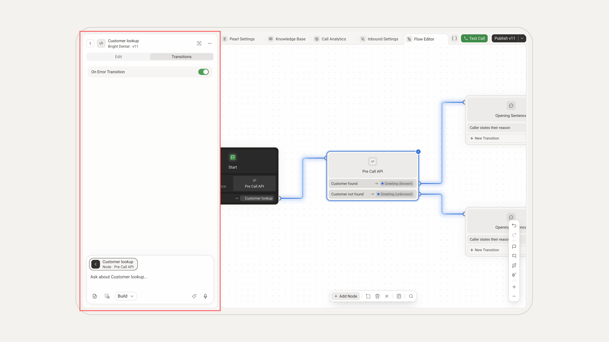</Frame></div>
    <div className="hidden dark:block"><Frame>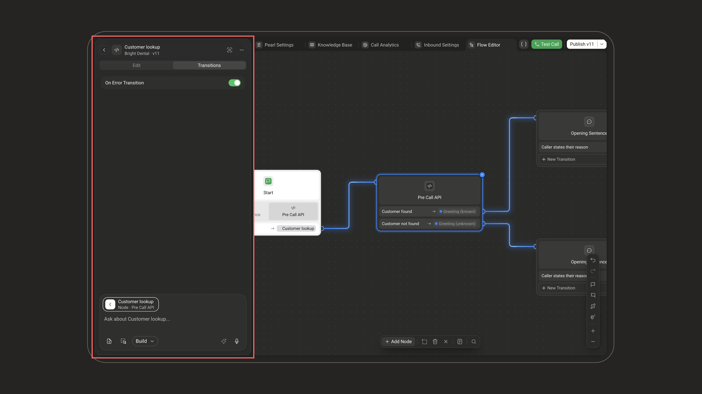</Frame></div>
  </Tab>
  <Tab title="In-Call API">
    Runs **when the flow reaches the node during the conversation**.

    - Both **Pre-Call** and **In-Call** variables are available.
    - A new node starts with a single **Continue** transition. Add conditional transitions with **New Transition**: each has a condition (**Transition**) and a **Node Chosen**.
    - If the request fails, Pearl receives the status code and the error message and decides what to say. There is no automatic error branch, so add a transition for that case (for example *No slots*).
    - Assigning response values to variables is optional but recommended for reuse later in the flow.

    <div className="block dark:hidden"><Frame>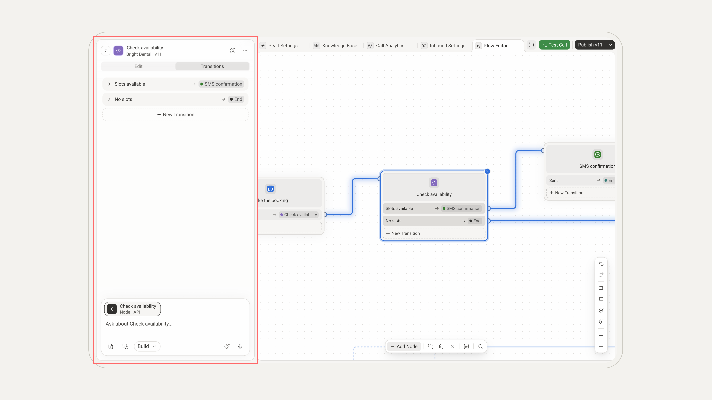</Frame></div>
    <div className="hidden dark:block"><Frame>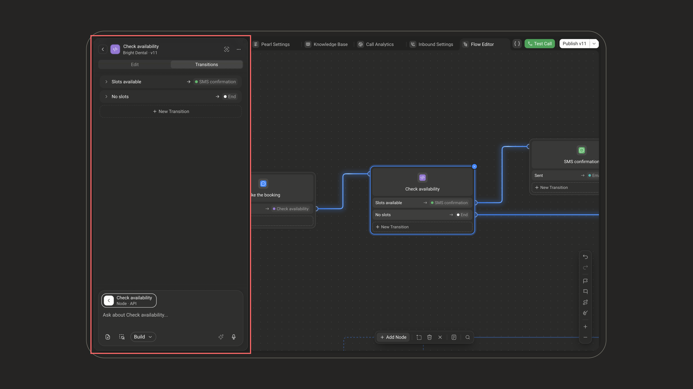</Frame></div>
  </Tab>
  <Tab title="Post-Call API">
    Runs **after the call**, as part of the **Post-Call Actions**.

    - All variable groups are available, including **Post-Call** variables (call time, summary, recording, duration, transcript).
    - Post-Call actions have **no transitions**.
  </Tab>
</Tabs>

---

## Testing Your API

Use the **Test the API** block at the bottom of the form. Testing sends a real request to your API.

<Steps>
  <Step title="Fill in the test values">
    Give a sample **Value** to every variable used in the request.

    <div className="block dark:hidden"><Frame>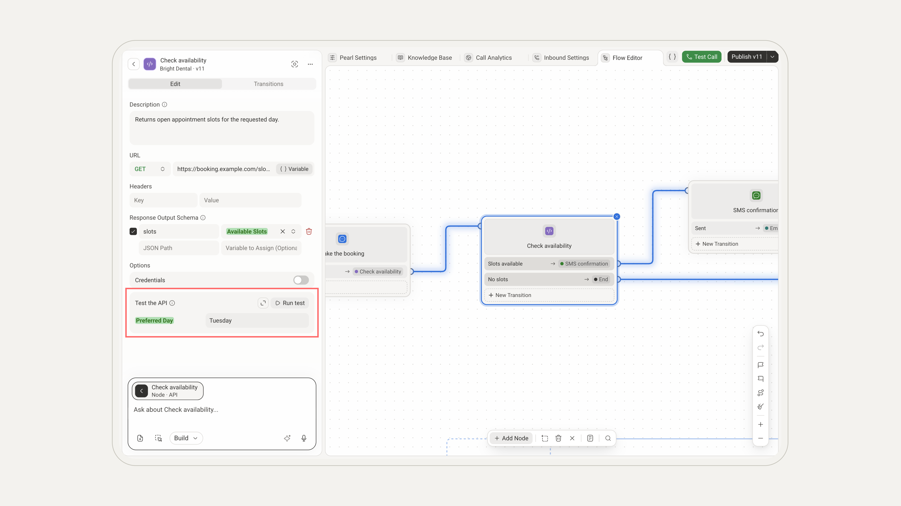</Frame></div>
    <div className="hidden dark:block"><Frame>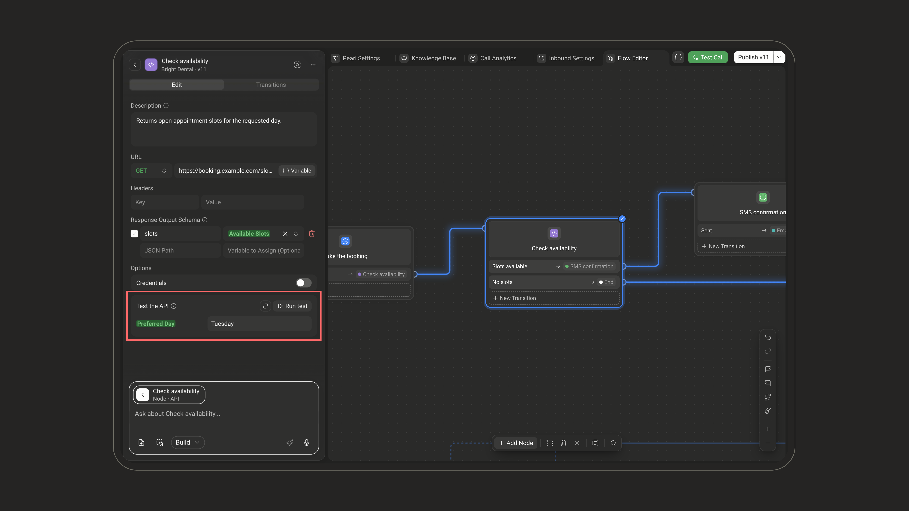</Frame></div>
  </Step>
  <Step title="Run the test">
    Click **Run test** (**Run again** afterwards). To work with more room, click **Expand**: the form and the test values sit on the left, the answer on the right, and **Send** runs the request.

    <div className="block dark:hidden"><Frame>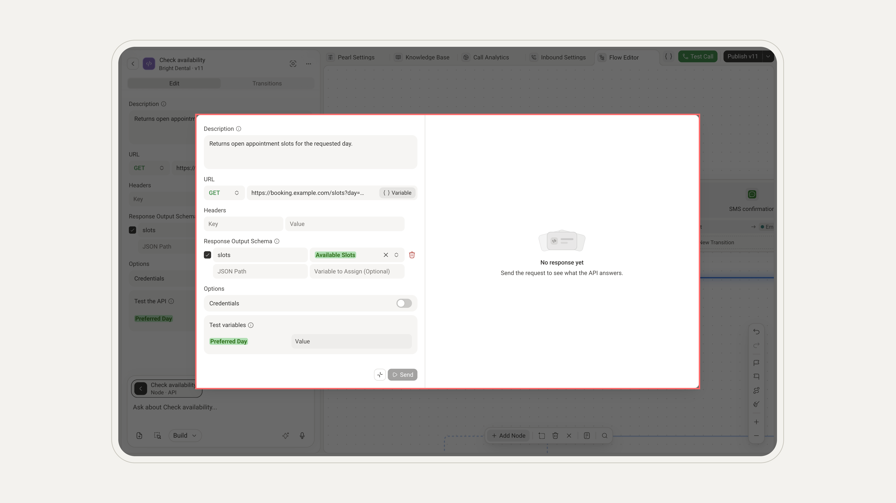</Frame></div>
    <div className="hidden dark:block"><Frame>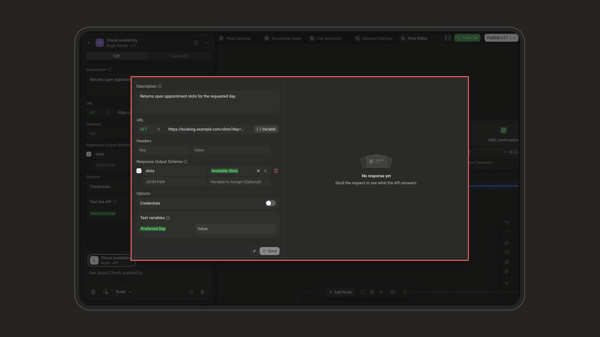</Frame></div>
  </Step>
  <Step title="Inspect the answer">
    The result starts with a verdict (**Answer received**, **The API answered with an error**, **Couldn't reach the URL**, or **The test couldn't run**), the status code with the time it took, and the request line. Then switch between **Request**, **Response** (**Filtered** or **Unfiltered**, if an Output Schema is set), and **Assigned Variables**.

    <div className="block dark:hidden"><Frame>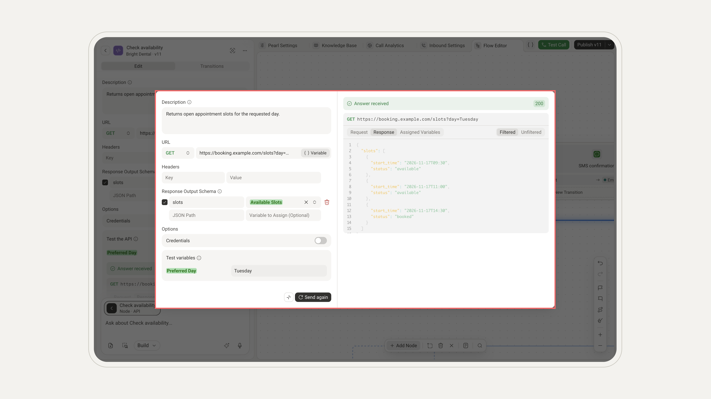</Frame></div>
    <div className="hidden dark:block"><Frame>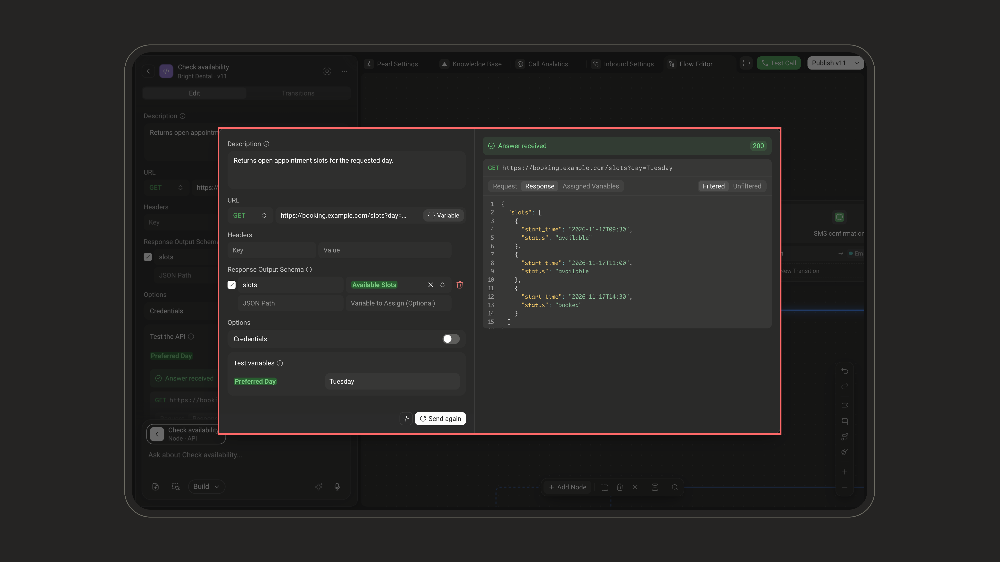</Frame></div>
  </Step>
</Steps>

<Tip>
  Test and perfect your setup before putting the Pearl in production.
</Tip>

---

<CardGroup cols={1}>
  <Card title="Variables" icon="square-root-variable" iconType="light" href="/pages/variables">
    Learn how to create and use variables inside API nodes.
  </Card>
</CardGroup>
