Everything related to payments lives in **Settings → Subscriptions & Payments**, in the **Billing** group of the Settings. The page has four tabs: **Subscription**, **Payment Method**, **Credits**, and **Invoices**.

<Info>
  Opening this page requires the **Billing** permission (*Manage account billing*). The **Usage** page, in the same group, requires the **Usage** permission. See [Users & Workspaces](/pages/users_workspaces).
</Info>

---

## Subscription

The **Subscription** tab shows your **Current Billing Plan**, with your credit balance and its renewal date, followed by the **Subscription Plans** you can switch to.

<Frame>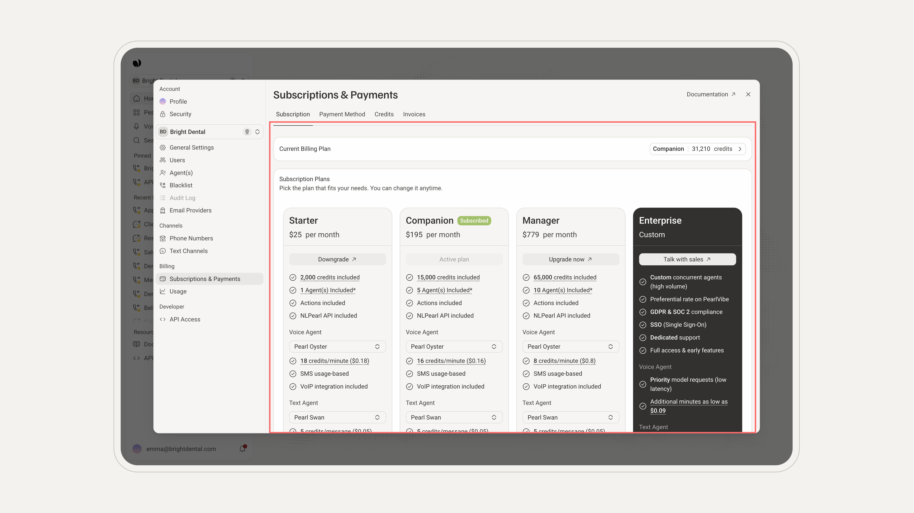</Frame>

<Frame>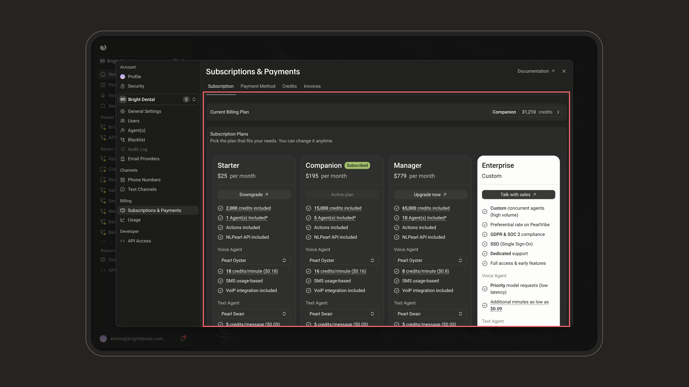</Frame>

Each plan card shows its price, the **credits included** each cycle, the number of **Agent(s) Included**, and what the platform costs on it:

- **Voice Agent**: the credits per minute for each voice model (pick the model in the card's list).
- **Text Agent**: the credits per message.
- **Text to Speech**: the price per million characters and the number of concurrent requests.

The **Enterprise** card has a custom price: click **Talk with sales** to reach our team. To compare the plans in detail, see the [pricing page](https://nlpearl.ai/pricing/).

### Upgrade your plan

Click **Upgrade now** on a higher plan (or **Subscribe now** if you don't have a plan yet). The **Subscription** window opens with:

- the **Payment method** and the **Billing details** that will be used, each with an **Update** button;
- the lines of the charge: the new plan for a full cycle and, if you're upgrading, a **Pro-rata refund** for the days you haven't used on your current plan;
- what is **Due today**, then what each renewal costs (**Then $X/month**).

Click **Confirm payment** to pay. The upgrade takes effect **immediately**.

<Frame>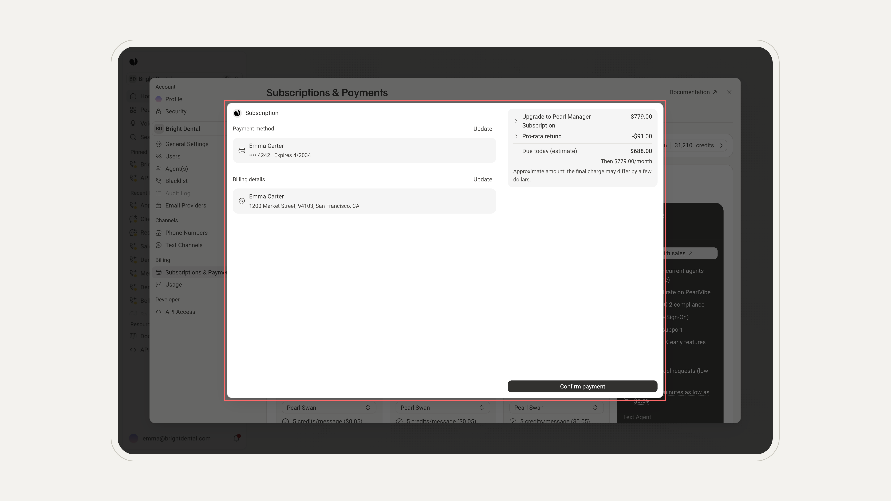</Frame>

<Frame>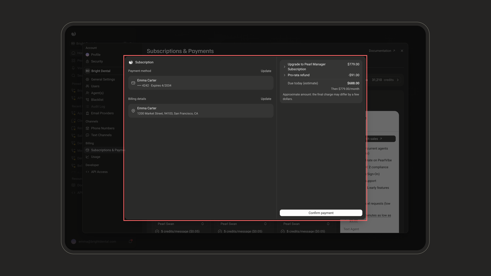</Frame>

### Downgrade your plan

Click **Downgrade** on a lower plan. Tell us why you're downgrading, click **Continue**, then confirm. **Nothing is charged today**: your current plan stays active until its renewal date, when the new plan takes over.

<Frame>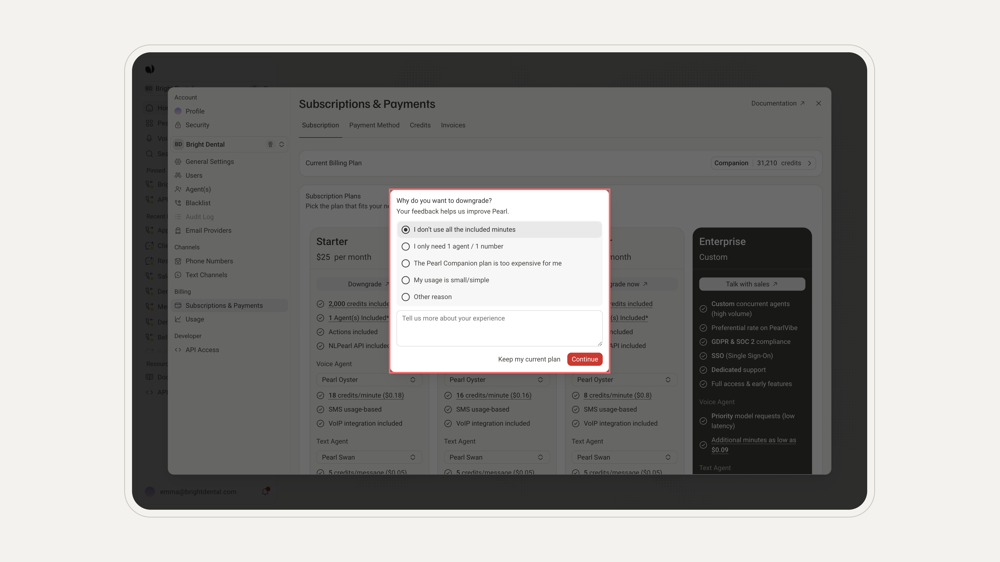</Frame>

<Frame>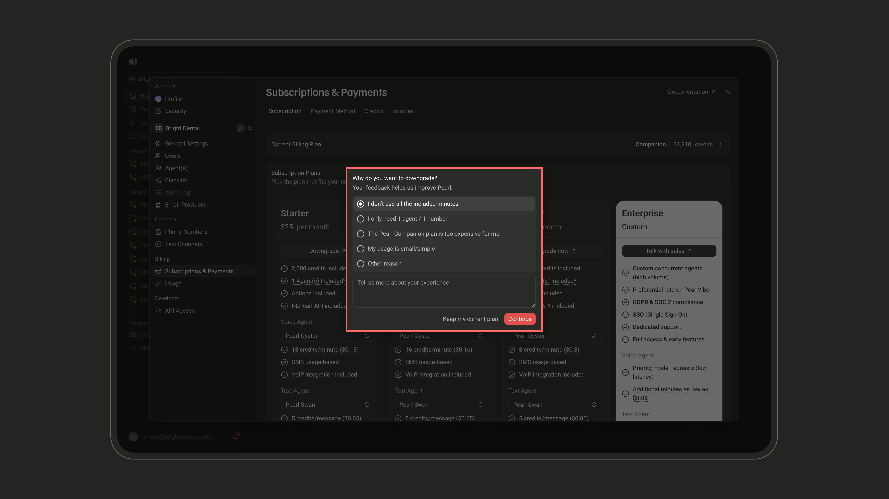</Frame>

A plan with a shorter billing cycle that doesn't cost less shows **Change at renewal** instead: it also switches on your renewal date, without asking for a reason.

Once a change is scheduled, the tab tells you *Your plan switches to … on … at renewal*, and the button of that plan reads **Scheduled for renewal**.

---

## Payment Method

The **Payment Method** tab holds the card that pays your subscription, your agents, and your credits, and the **Billing Details** printed on your invoices.

<Frame>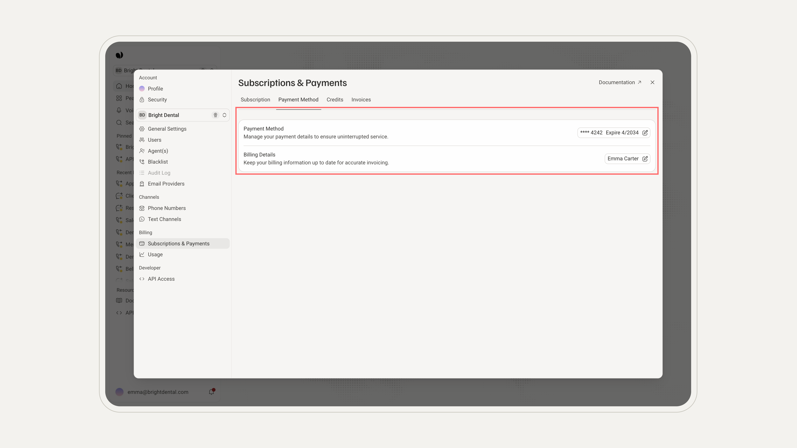</Frame>

<Frame>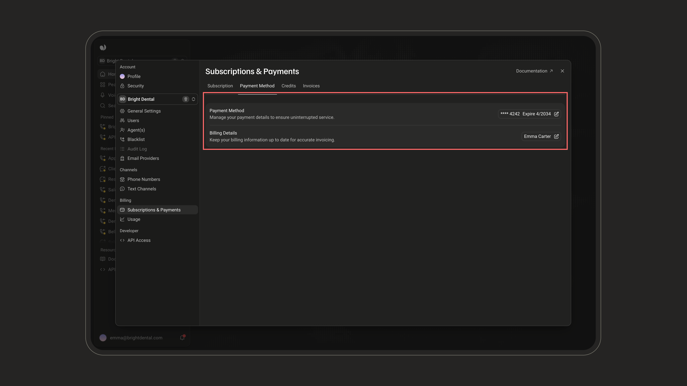</Frame>

- **Payment Method**: one card per account. To replace it, click the edit button next to it, enter the new card, then click **Update card**. The new card is used for your next charge.
- **Billing Details**: the **Invoice name**, **Invoice email**, and **Billing address** printed on your invoices. The Invoice email is pre-filled with your login email until you change it.

---

## Credits

Credits fund your activity on NLPearl.AI: calls, messages, and speech. **$1 buys 100 credits.**

The **Credits** tab shows your **Auto Recharge** setting (*Inactive*, or the amount and the threshold you set) and your balance, with two ways to top it up.

<Frame>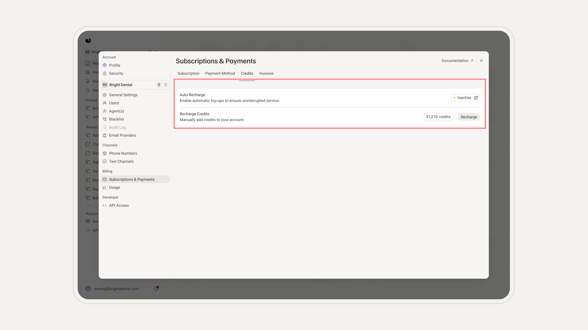</Frame>

<Frame>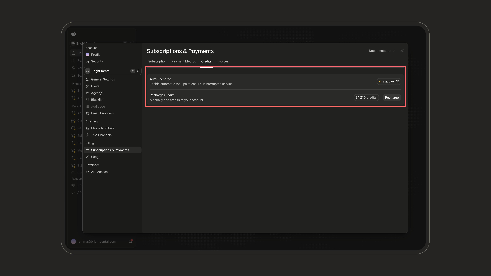</Frame>

<Note>
  Buying credits and auto-recharge both require a **paid plan** and a **card** on file. Neither is available on a one-time plan: contact support instead.
</Note>

### Buy credits

In **Recharge Credits**, click **Recharge**. In the **Purchase credits** window, pick an amount ($10, $25, $50, $100, $200) or **Custom** (at least $10), check the credits you'll get and the **Total due today**, then click **Purchase credits**. The credits are added to your balance as soon as your card is charged.

<Frame>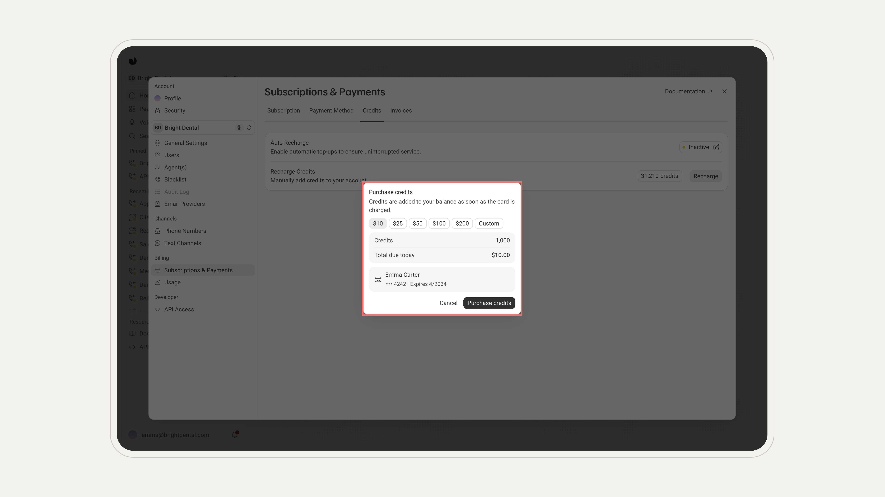</Frame>

<Frame>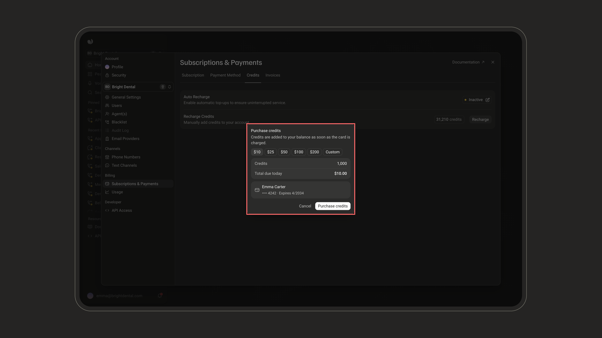</Frame>

### Auto-recharge

Auto-recharge buys credits for you when your balance gets low, so your activities keep running.

<Steps>
  <Step title="Open Auto Recharge">
    In **Auto Recharge**, click the edit button, then turn on **Auto Recharge**.
  </Step>
  <Step title="Set the threshold">
    In **When balance drops below**, enter the balance, in credits, that triggers a recharge (at least 1).
  </Step>
  <Step title="Set the amount">
    In **Automatically recharge**, enter the amount in dollars to buy each time (at least $10). The credits it buys are shown next to it.
  </Step>
  <Step title="Save">
    Click **Update**. If your balance is already below the threshold, a first recharge happens right away.
  </Step>
</Steps>

<Frame>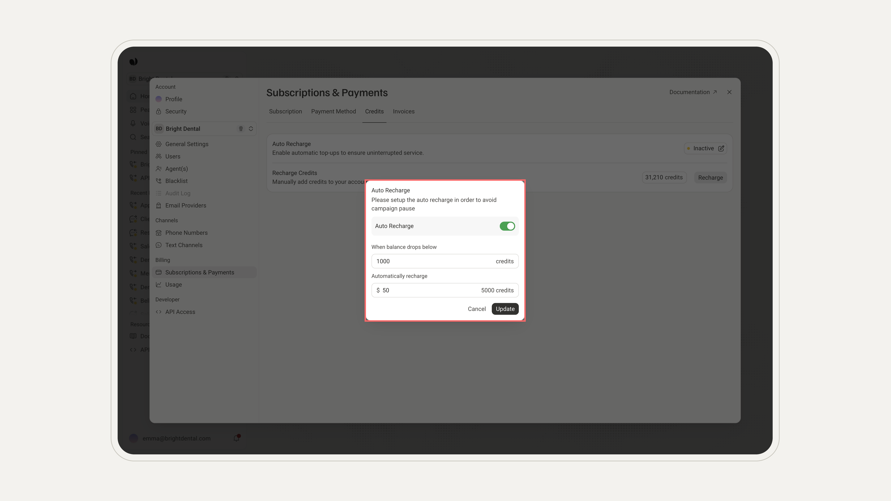</Frame>

<Frame>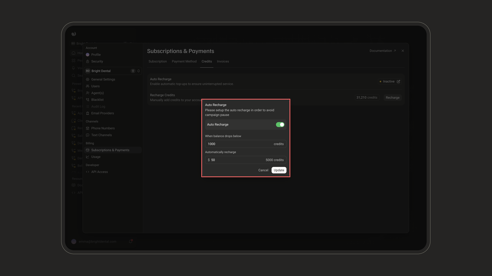</Frame>

Each recharge charges the same fixed amount: it doesn't top your balance up to a target. If a recharge is declined, auto-recharge is turned off.

### How long credits last

- Credits **included in your plan** are valid for the current billing period, unless your plan carries them over.
- Credits you **buy**, by hand or through auto-recharge, expire **6 months** after the purchase.

### When your credits run out

<Warning>
  We strongly recommend enabling auto-recharge. Without it, running out of credits first limits your activities, then suspends them.
</Warning>

- **Your balance reaches zero and auto-recharge is off**: the service is limited to **1 agent per Pearl**. Each Pearl handles one call at a time, inbound, outbound, and web calls alike. A banner tells you *No credits left. Service is limited to 1 agent per Pearl.*
- **Your balance goes past your plan's limit**: every running activity is **suspended**. Calls, messages, test calls, web calls, and PearlVibe are refused, and you can't start an activity. A banner tells you *Your account is suspended due to insufficient credits.*

As soon as credits are added (a purchase, a recharge, or your plan's renewal), suspended activities start running again on their own.

---

## Invoices

The **Invoices** tab lists your invoices. Click an invoice to see its date, its lines, and its total, and use the download button to save it. Search them by invoice number or amount.

<Frame>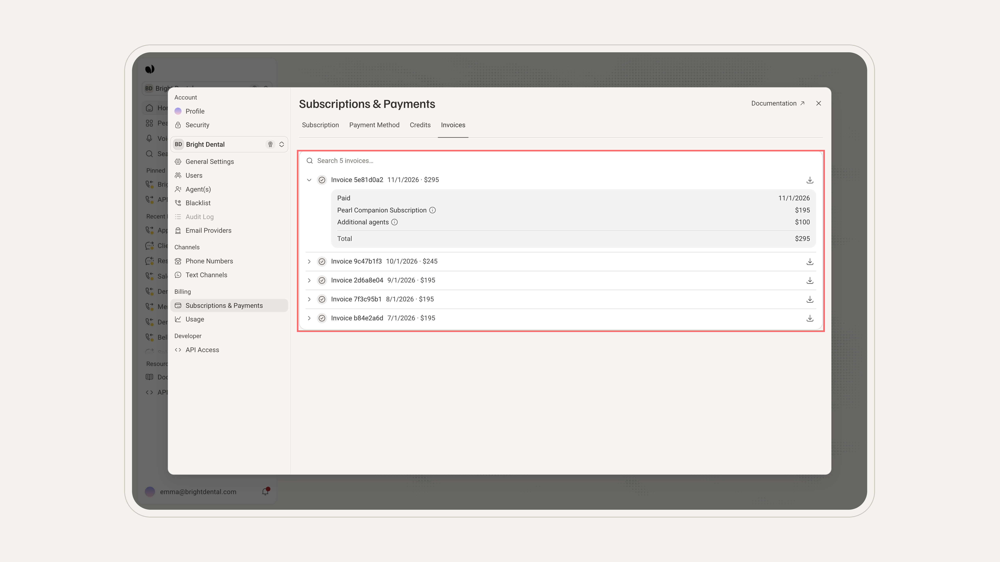</Frame>

<Frame>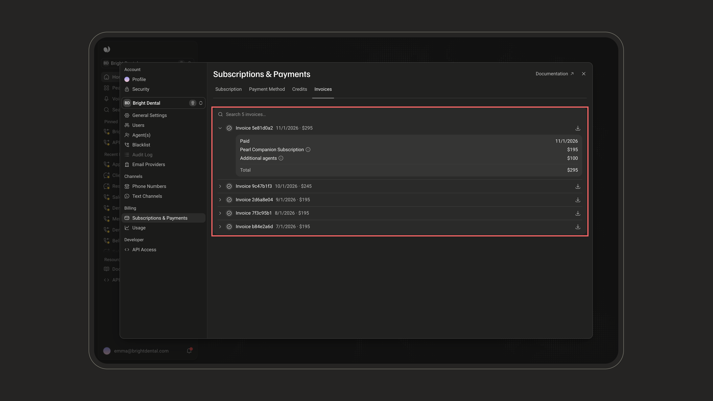</Frame>

Invoices and receipts are emailed to the workspace **Billing Email** (see [Users & Workspaces](/pages/users_workspaces)).

### Failed payments

Unpaid invoices are listed separately at the top of the tab, with a **Retry Payment** button. They can't be downloaded until they're paid.

A declined payment is retried once a day, and each failure is emailed to your Billing Email. If it still fails after three retries, your account is restricted: all its activities are suspended until the payment goes through.

---

## Next steps

<CardGroup cols={2}>
  <Card title="Agents" icon="users" iconType="light" href="/pages/agents">
    Buy agents to run more calls at the same time.
  </Card>
  <Card title="Subscription Plans" icon="credit-card" iconType="light" href="https://nlpearl.ai/pricing/">
    Compare the plans and choose the one that fits your needs.
  </Card>
</CardGroup>
