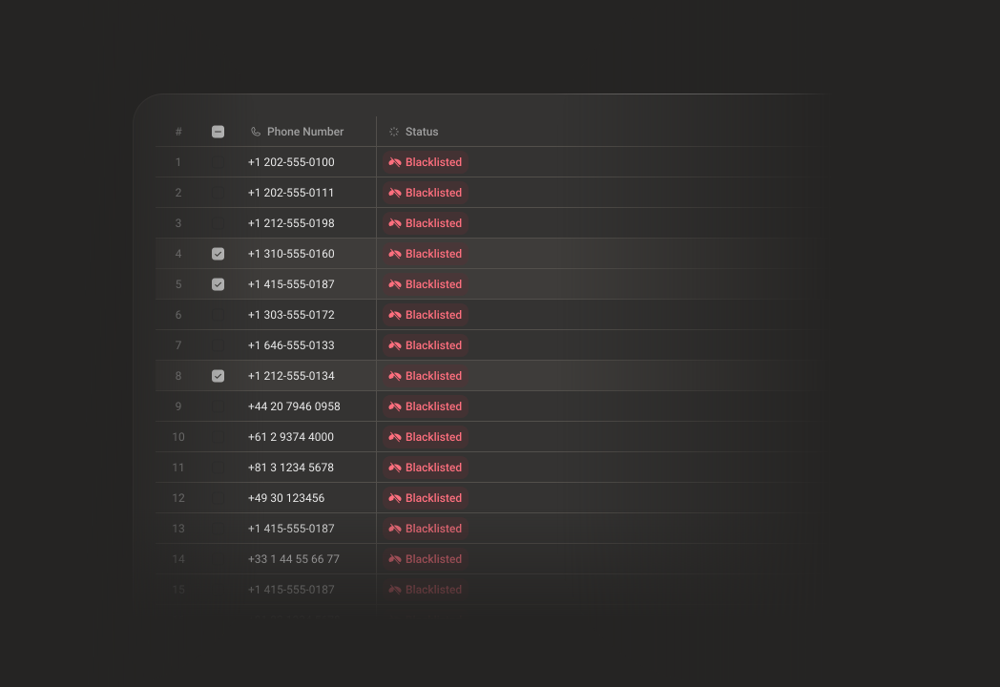
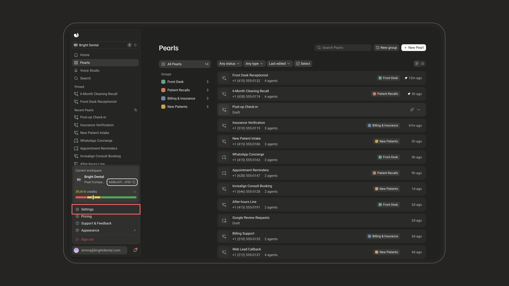
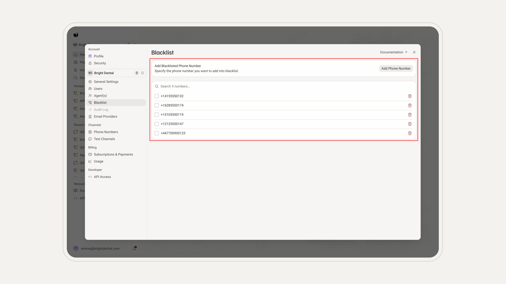
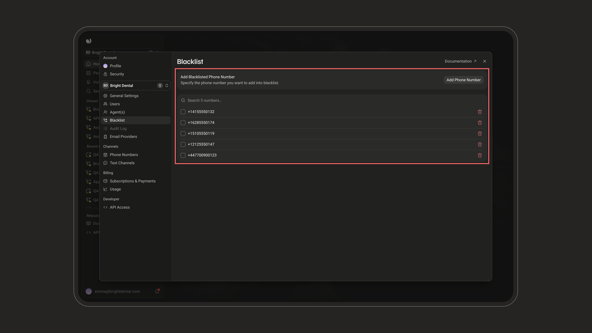
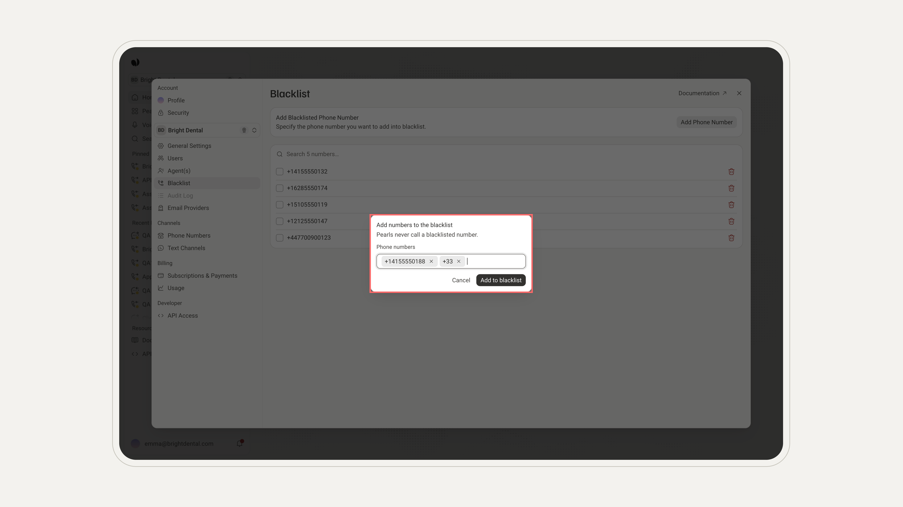
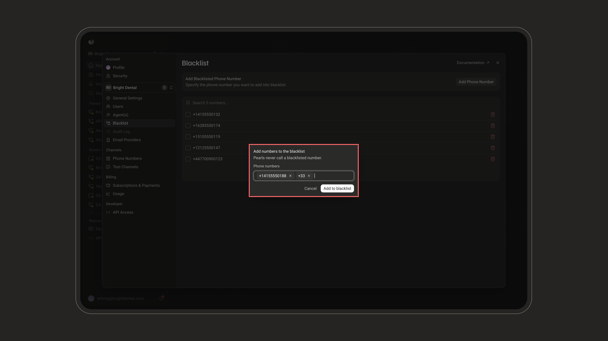
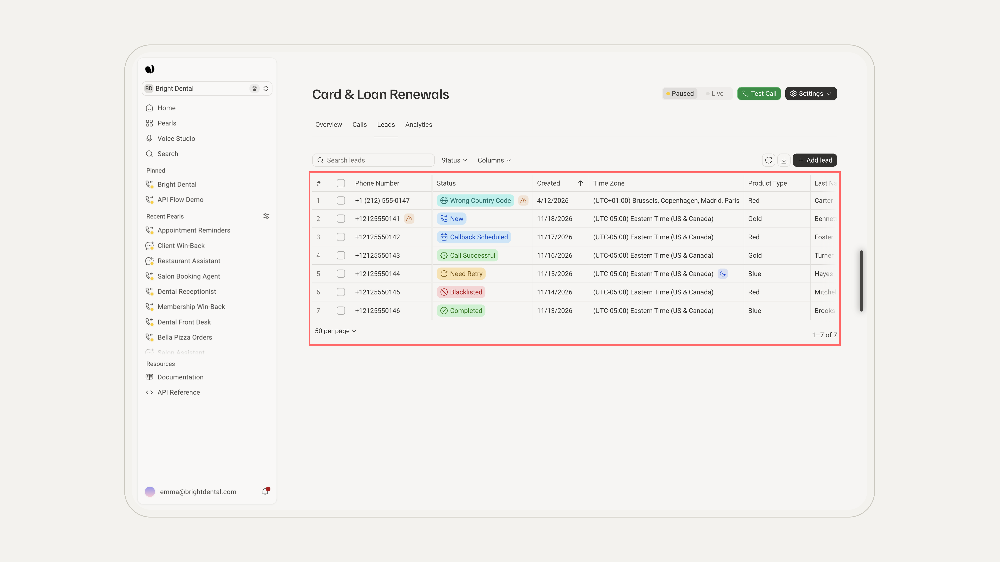
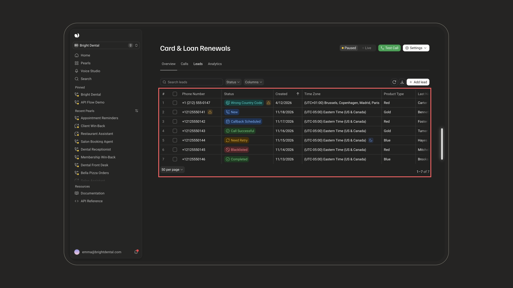
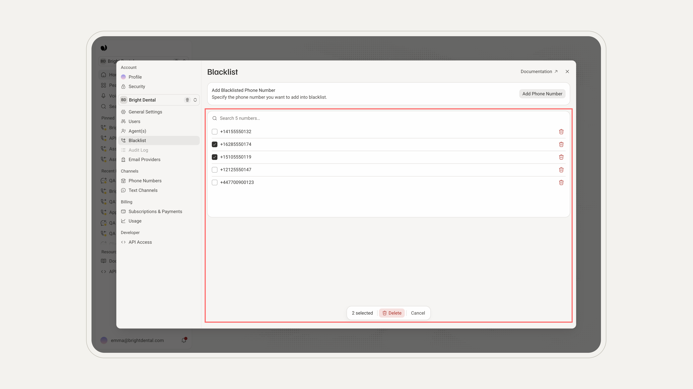
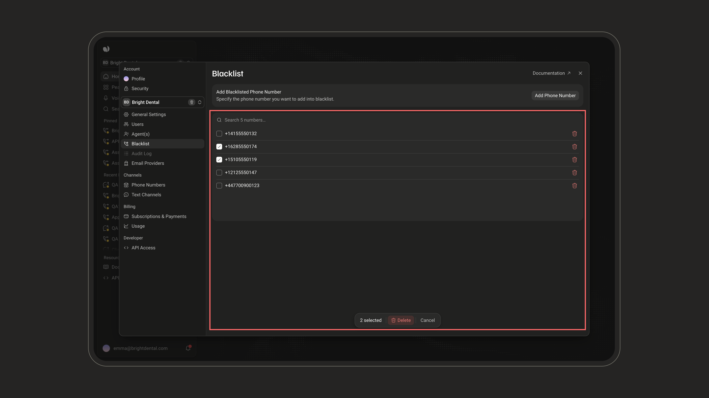

  <Frame>
    

      
    

  </Frame>

  <Frame>
    

      
    

  </Frame>

---

The **Blacklist** lets you block specific phone numbers, or entire prefixes, for every Pearl of your workspace: your Pearls never call or text them, and their calls and messages never reach your Pearls.

---

### Accessing the Blacklist

The Blacklist lives in your **Settings**. Click your **profile card** at the bottom-left corner of the sidebar, then select **Settings**.

<Frame>
  
</Frame>

From the left menu, select **Blacklist** under the *Workspace* section. The page shows the **Add Blacklisted Phone Number** bar, then the list of blocked numbers.

<Frame></Frame>

<Frame></Frame>

<Info>
  Adding or removing numbers requires the **Manage advanced settings** permission (see [Users & Workspaces](/pages/users_workspaces)) and a **paid plan**: without one, the button reads **Upgrade** and takes you to the plans.
</Info>

---

### Adding Numbers to the Blacklist

<Steps>
  <Step title="Open the add window">
    In the **Add Blacklisted Phone Number** bar, click **Add Phone Number**.
  </Step>

  <Step title="Enter the numbers and confirm">
    In the **Add numbers to the blacklist** window, type a phone number in **Phone numbers** (e.g., `+1 408 XXX XXXX`) and press **Enter**. Add as many numbers as you need the same way, then click **Add to blacklist**.

    
<Frame></Frame>

    
<Frame></Frame>

    <Tip>
    To add many numbers at once, paste a whole list into the field: numbers separated by commas, semicolons, spaces, or line breaks are split into separate entries.
    </Tip>

    <Note>
    You can also block an entire **prefix** (e.g., `+33`). Every number beginning with that prefix (`+33123456789`, `+33456789012`, etc.) is then blocked.
    </Note>
  </Step>
</Steps>

---

### What the Blacklist Blocks

A blacklisted number is blocked across all the Pearls of your workspace:

- **Outbound calls and messages**: your Pearls never call or text it. The lead gets the **Blacklisted** status in the Pearl's **Leads** tab.
- **Inbound calls**: its calls to your Pearls are rejected, and appear in the Pearl's calls with the **Blacklisted** status.
- **Inbound SMS**: its text messages don't reach your Pearls.
- **Test calls**: you can't place a test call to it.

<Frame></Frame>

<Frame></Frame>

<Warning>
  A blacklisted number can't be used inside a Pearl either. Saving a Pearl is refused if one of its **transfer** destinations or **SMS** recipients is on the blacklist: remove it from the flow, or from the blacklist, first.
</Warning>

---

### Managing Blacklisted Numbers

The list shows every blocked number, with a counter of how many are stored. Use the **search** field at the top to find a number in a long list, and **Load more** at the bottom to see the rest.

- **Remove one number**: click the red trash icon on its row (**Remove from blacklist**).
- **Remove several numbers**: tick their checkboxes, then click **Delete** in the bar that appears at the bottom.

<Frame></Frame>

<Frame></Frame>

