

  <Frame>
    

      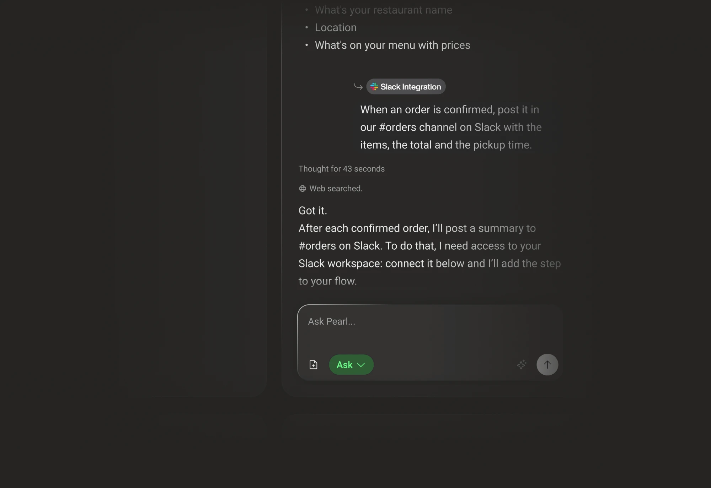
    

  </Frame>

  <Frame>
    

      
    

  </Frame>

---

## Introduction

**Credentials** are the API keys, tokens, and connected accounts your Pearl signs in with when it calls an external service: your CRM, your calendar, Slack, or your own API. You set a credential up once, then pick it in every node that needs it, instead of pasting a key into each request.

<CardGroup cols={2}>
  <Card title="Connected accounts" icon="plug" iconType="light">
    Connect Google, Microsoft, Slack, HubSpot, Salesforce, and more through their own sign-in.
  </Card>
  <Card title="Keys and tokens" icon="key" iconType="light">
    Add an API key, a bearer token, a username and password, or a token the platform renews for you.
  </Card>
</CardGroup>

---

## Credentials Overview

Credentials belong to a **Pearl**: every node of that Pearl can use them, but other Pearls can't. Like the rest of your Pearl, they are saved with its **version**: a change you make in a draft only reaches live calls once you publish it.

<Note>
  Some credentials are set by the platform for your workspace. They appear in every Pearl's list with a lock (**Set by the platform: nothing to edit**), and can be used but not edited.
</Note>

#### Accessing Credentials

Click the `{ }` button (**Variables & credentials**) in the header of the Pearl editor, then select **Credentials** in the dialog.

<Frame>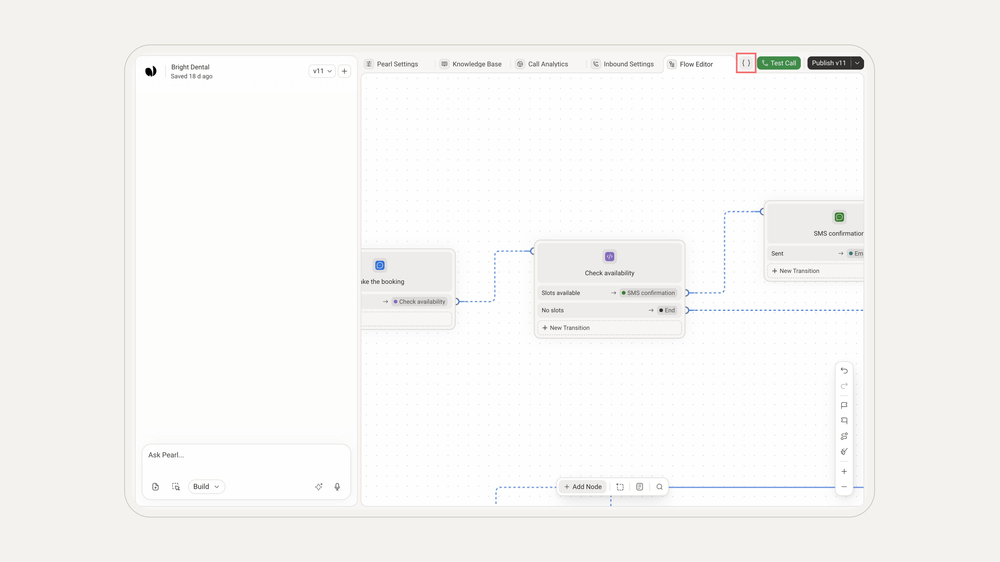</Frame>

<Frame>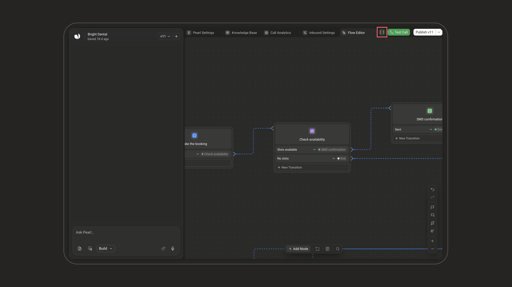</Frame>

The list shows each credential's **Name**, **Type**, and **Status**. Use the search field to find a credential by name.

<Frame>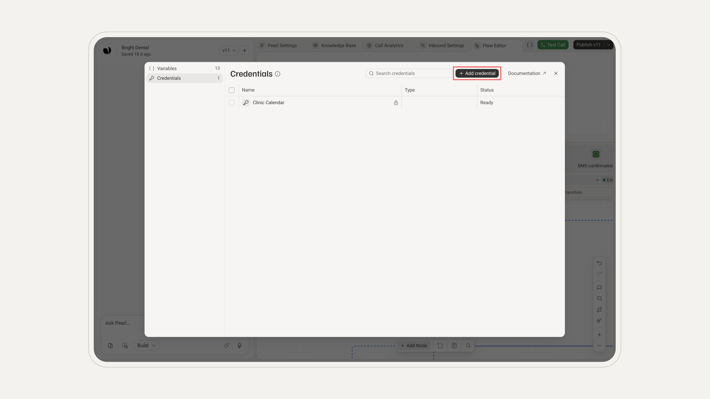</Frame>

<Frame>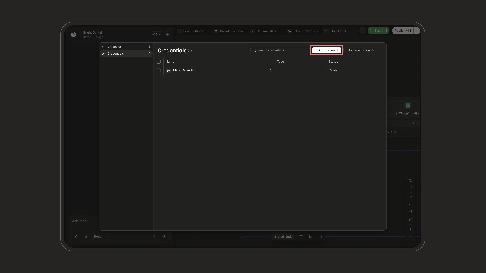</Frame>

| Status | Meaning |
| --- | --- |
| **Ready** | The credential is complete and can be used. |
| **Not connected** | The account still has to be connected: open the credential and click **Connect**. |
| **Reconnect needed** | The account's token lacks some of the scopes asked for: click **Reconnect** to grant them. |
| **Values missing** | A value is empty: fill in every value. Until then, API calls can't sign in with it. |

---

## Adding a Credential

Click **Add credential**. The **Add a credential** panel opens with two ways to add one: **Add manually**, or pick an **integration** from the list. Use **Search integrations** to find one.

<Frame>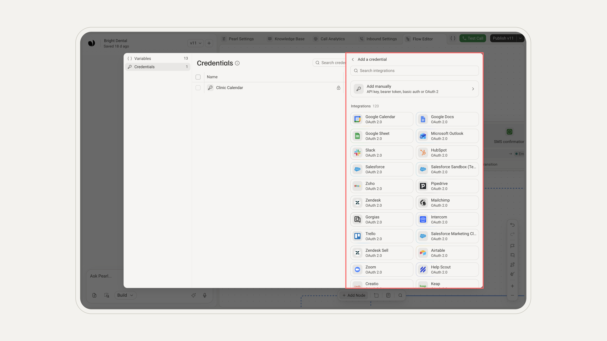</Frame>

<Frame>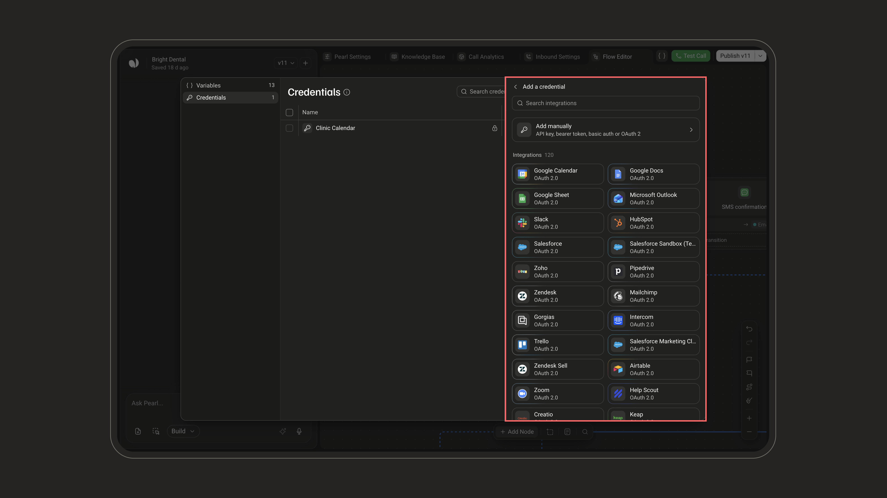</Frame>

### From an integration

Each integration of the catalog shows how it signs in (**OAuth 2.0**, **API key**, **Bearer token**…), or **Connected** when your Pearl already has a working credential for it (**Connected · 2** if it has two).

<Steps>
  <Step title="Pick the integration">
    Click the integration. A credential is created for it and opens in the panel. Some integrations first ask for **Secure values**, such as your app's client ID and secret or your shop domain.
  </Step>
  <Step title="Connect the account">
    Click **Connect**. A window opens on the service's own sign-in page: sign in and grant access. When you're done, the window closes and the credential is **Ready**.
  </Step>
</Steps>

<Note>
  Clicking an integration always creates a new credential, even if you already have one for it. To use a second account of the same service, add the integration again and connect the other account.
</Note>

### Manually

Click **Add manually**, enter a **Name** (a label to recognize it later, up to 100 characters), and choose a **Type**. The form shows the fields of that type.

| Type | What you enter |
| --- | --- |
| **Api Key** | Where the key goes (**Header** or **Query**), its **Key**, and its **Value**. |
| **Basic Auth** | A **Username** and a **Password**. |
| **Bearer** | The token, without "Bearer". It is sent as `Authorization: Bearer <token>`. |
| **Custom Api Key** | Your own **Headers**, **Query params**, and **Body** values. |
| **Refresh Token** | The request that gets a token. The platform fetches it, adds it to your calls, and renews it before it expires. |

<Info>
  The type can't be changed once the credential is saved: to sign in another way, create a new credential. **OAuth 2** accounts are connected through their integration, not added manually.
</Info>

#### Configuring a Refresh Token credential

<Frame>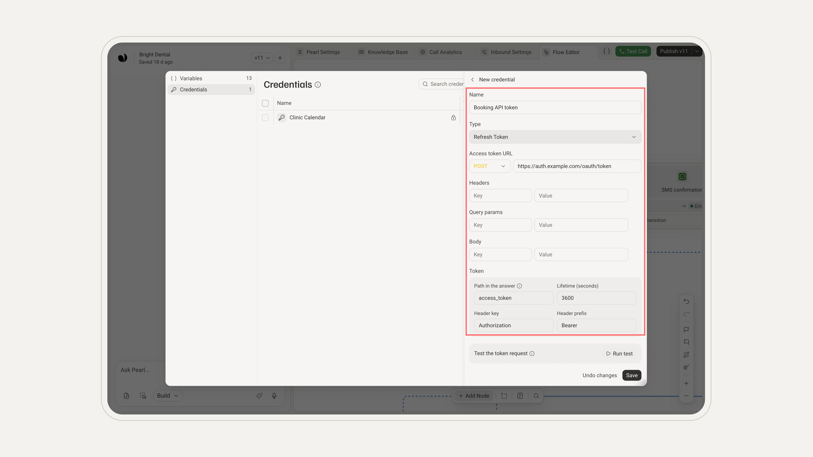</Frame>

<Frame>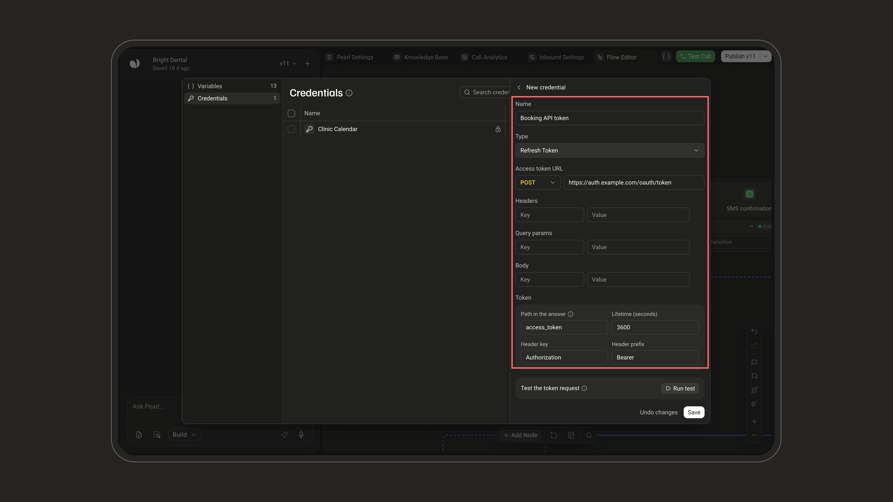</Frame>

| Field | Description |
| --- | --- |
| **Access token URL** | The method and endpoint used to request the token, with optional **Headers**, **Query params**, and **Body** (e.g. `grant_type`, `client_id`, `client_secret`). The Body is hidden for GET and DELETE. |
| **Path in the answer** | JSON path to locate the token in the response (e.g. `access_token` or `data.access_token`). |
| **Lifetime (seconds)** | How long the token stays valid (minimum **100**, **300** by default). |
| **Header key** | Name of the header where the token is injected (**Authorization** by default). |
| **Header prefix** | Optional prefix for the token (**Bearer** by default). |

In **Test the token request**, click **Run test** to call the token endpoint. The result shows **Token ready** with the token, how it is sent, and how often it is renewed, or what went wrong. If the token is somewhere else in the answer, a button offers to use the path it found. Then click **Save**.

<Frame>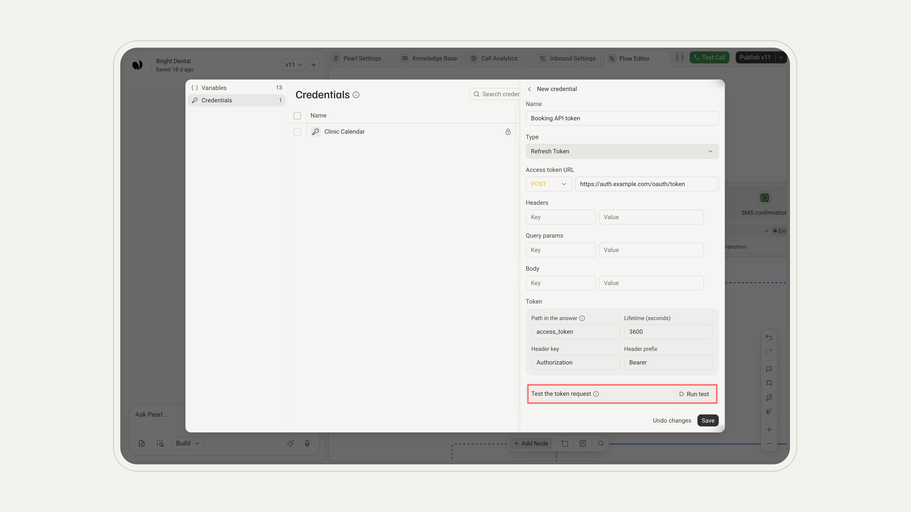</Frame>

<Frame>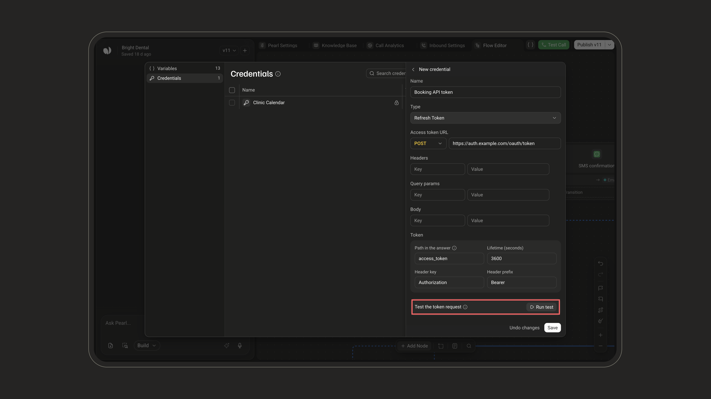</Frame>

<Warning>
  Make sure **Path in the answer** matches the exact location of the token in the JSON response. If the platform can't find the token at this path, the credential fails.
</Warning>

#### Keeping a value out of sight

In a **Refresh Token** or **Custom Api Key** credential, keep a sensitive value, such as a client secret, out of the form: click the `{ }` button of a value (**Insert a secured variable**), add it as a **secured variable** (a key made of letters, numbers, `-` and `_`, and its value), and insert it as `{its key}`. Once saved, only its last two characters are shown.

---

## Managing Credentials

Click a credential in the list to open it.

- **Edit**: change its values, then click **Save**, or **Undo changes** to go back. Editing a connected account's settings disconnects it: click **Reconnect** afterwards.
- **Reconnect**: sign in to the account again, for example after its access was revoked.
- **Delete**: in the **…** menu, click **Delete credential**, then confirm. To delete several at once, tick them in the list and click **Delete**.

<Warning>
  Deleting a credential can't be undone. Every node that used it shows **Credential not found.**, and the Pearl can't be published until you pick another credential in those nodes or turn their **Credentials** option off.
</Warning>

<Tip>
  Credentials are saved as soon as you click **Save**: no need to save the Pearl. If you change them on the live version, a new version is created for your changes (**New version created**), and the live version keeps taking calls until you publish.
</Tip>

---

## Using Credentials

#### In an API node

In the node's **Options**, turn on **Credentials** and pick one in **Token**. **Add New** opens your Pearl's credentials, and the pencil next to the selected one (**Edit**) opens its settings. See [API node](/pages/api_action#credentials-authentication).

<Frame>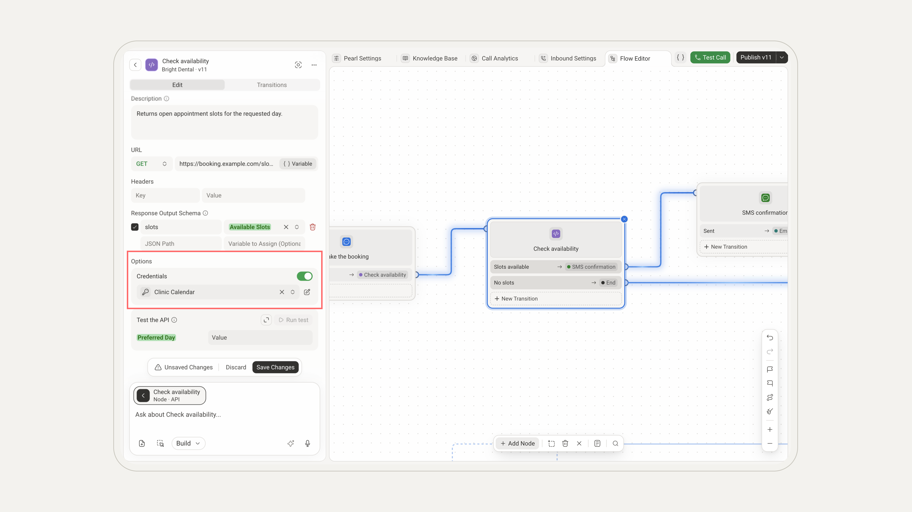</Frame>

<Frame>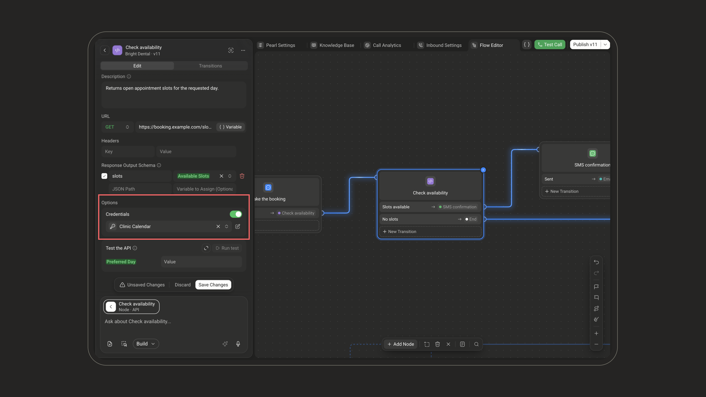</Frame>

The platform adds the credential to each request. A **Refresh Token** is kept for its **Lifetime** and fetched again when it expires; if the API answers **401**, **403**, **419**, **440**, or **498**, the token is renewed and the request sent again once.

#### In an integration node

In the **Add Node** picker, the **Integrations** section lists the whole catalog, and marks **Connected** the integrations your Pearl already has a credential for. Picking one adds a node that uses that credential, or creates the credential if there's none yet.

<Frame>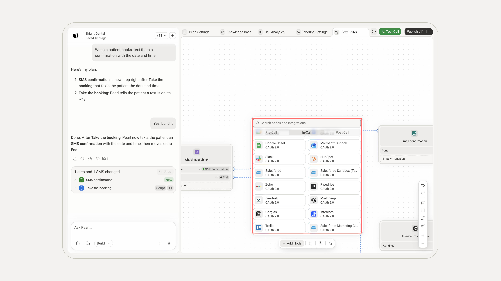</Frame>

<Frame>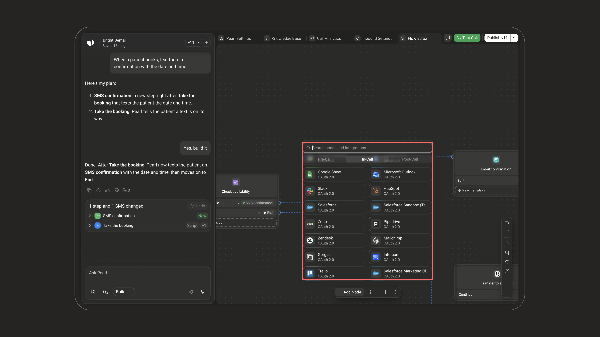</Frame>

#### With PearlVibe

When PearlVibe builds a step that needs an account, it asks for it in the chat with a card: **Connect Your … Account** for an account you sign in to, or **Set Up Your … Account** for keys. Click **Connect** and sign in, or fill in the keys and click **Save**; **Dismiss** skips it. If the sign-in window closes before you're done, click **Ask Pearl** next to **Having trouble?** and PearlVibe helps you.

#### When a credential fails during a call

If the platform can't get a token (an account to reconnect, a token request that fails), the API request isn't sent. The node then behaves as if the API had failed, and the error appears in the call's events. Publishing is also blocked while a credential used by a node isn't **Ready**: the errors panel lists it under **Credentials**, with a button to connect it or fill it in.

---

## Frequently Asked Questions (FAQ)

<AccordionGroup>
  <Accordion title="Are credentials shared between my Pearls?">
    No. Each Pearl has its own credentials. Only the credentials set by the platform, marked with a lock, appear in every Pearl of the workspace.
  </Accordion>

  <Accordion title="What happens to credentials when I duplicate or transfer a Pearl?">
    The copy gets the same credentials, values included, whether you duplicate the Pearl or transfer it to another workspace.
  </Accordion>

  <Accordion title="What happens when I copy nodes to another Pearl?">
    Credential values never travel with copied nodes. On paste, each node keeps its credential if the target Pearl has it, or takes the target Pearl's credential for the same integration. Otherwise, you're asked to **Choose a credential again** on those nodes.
  </Accordion>

  <Accordion title="Can two credentials have the same name?">
    Yes, but give each one a clear name (for example `Stripe production` and `Stripe test`) to pick the right one in your nodes.
  </Accordion>

  <Accordion title="How do I use a credential in the API?">
    `GET /v2/Pearl/Credential/{pearlId}` returns the **Id** and **Name** of the published Pearl's credentials, never their values. Use an **Id** as the credential of an API action. See [Get Pearl Credentials](/api-reference/v2/pearlFlow/get-pearl-credentials).
  </Accordion>

  <Accordion title="Where are the credentials of the Email node?">
    The Email node doesn't use these credentials: it sends through the email providers of your workspace. See [Email node](/pages/email_action).
  </Accordion>
</AccordionGroup>
