

  <Frame>
    

      
    

  </Frame>

  <Frame>
    

      
    

  </Frame>

Integrate your own VoIP service with NLPearl to use your existing phone numbers for inbound and outbound calls. This flexibility allows you to leverage your current VoIP infrastructure while benefiting from NLPearl.AI’s advanced features.

---

### How to Integrate Your Custom VoIP Service

To integrate your custom VoIP service, follow these steps:

<Steps>

<Step title="Go to Phone Numbers Settings">

Click your **profile** at the bottom-left corner of the sidebar, then click **Settings**.

<Frame>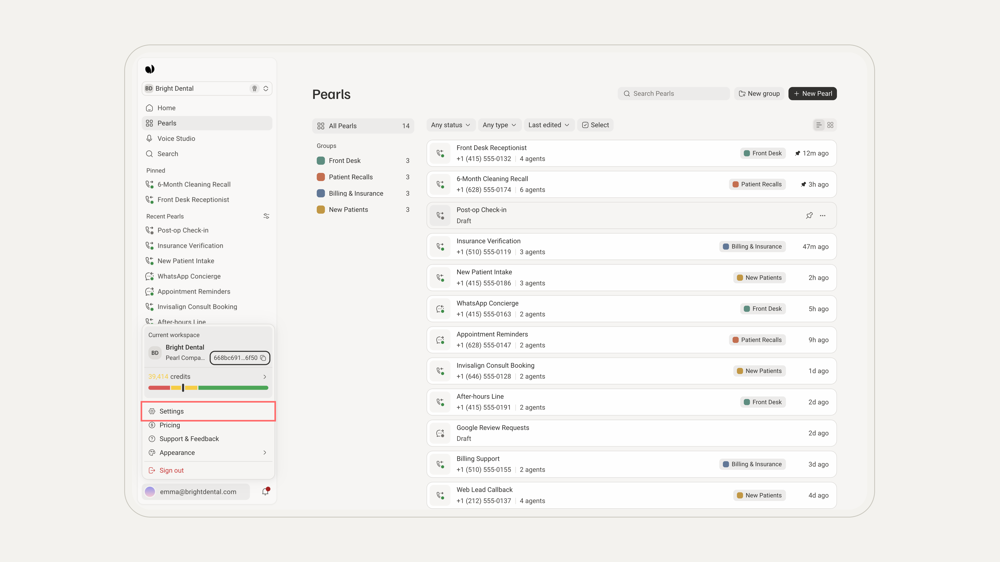</Frame>

<Frame>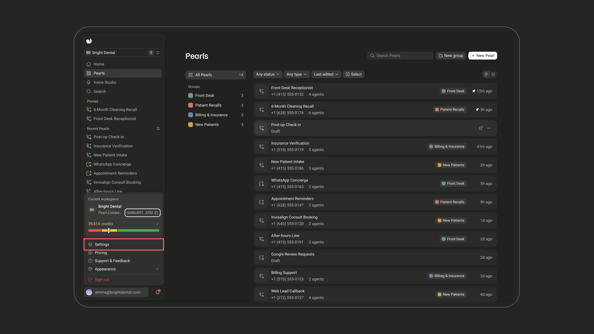</Frame>

In the Settings window, open **Phone Numbers** (under **Channels**).

<Frame>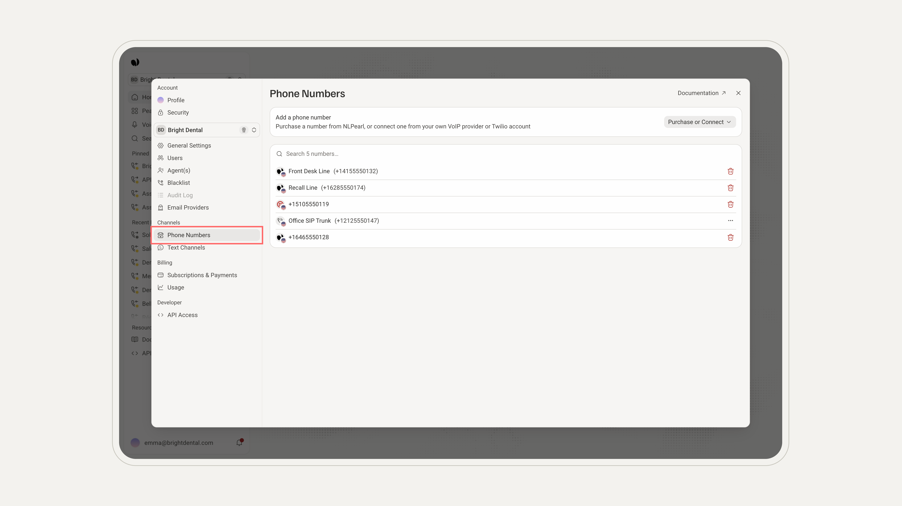</Frame>

<Frame>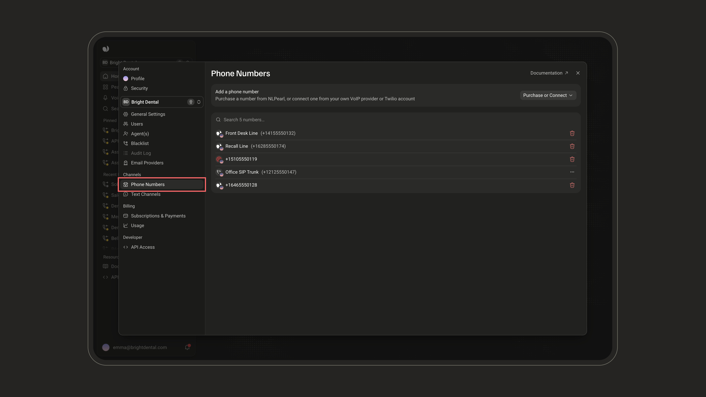</Frame>

</Step>

<Step title="Click on Custom VoIP">

Click **Purchase or Connect** at the top right of the list, then choose **Custom VoIP**.

<Frame>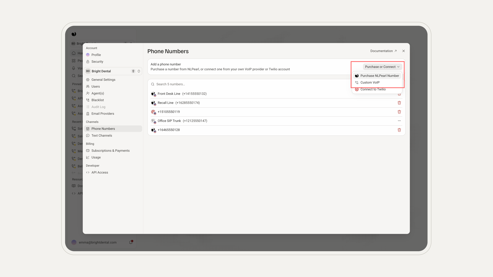</Frame>

<Frame>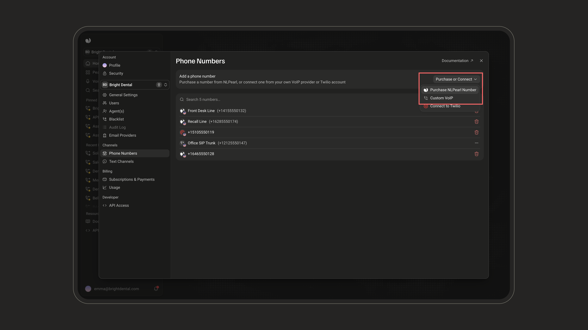</Frame>

</Step>

<Step title="Add Phone Number">

The **Add custom VoIP** window opens, with a short guide on the left. Enter your number in the **Phone number** field on the right, as your provider gives it, then click **Continue**.

<Note>
Enter it in **E.164 format**: digits only, with an optional leading `+` (for example `+12125550147`). It's how the number appears in NLPearl: calls are routed by the SIP settings you configure next.
</Note>

<Frame>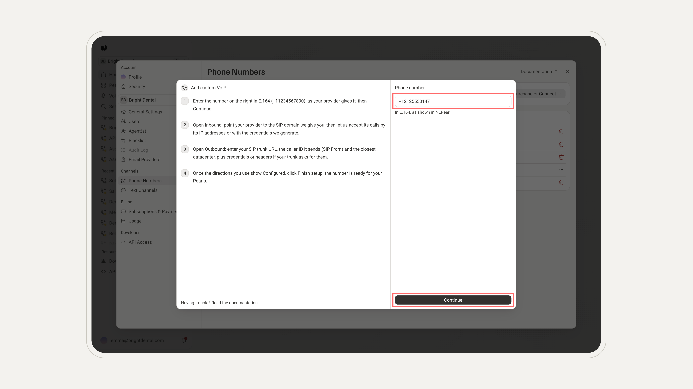</Frame>

<Frame>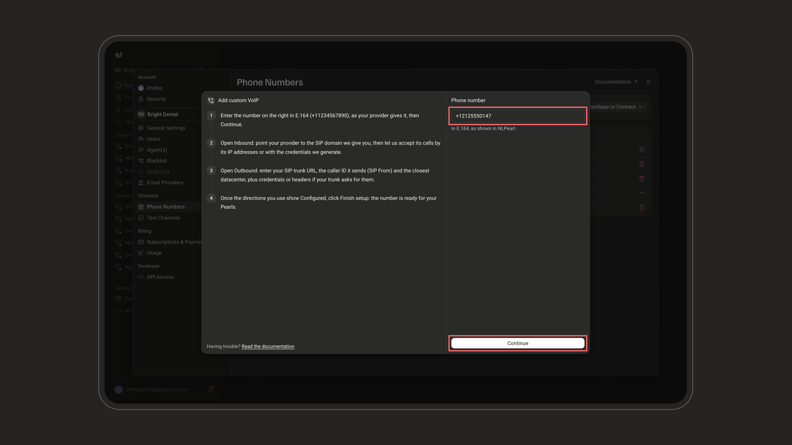</Frame>

</Step>

<Step title="Configure Inbound and/or Outbound">

The window becomes **Edit custom VoIP**. On the right, two rows show where the number stands: **Inbound** (calls coming in) and **Outbound** (calls going out), each marked **Configured** or **Not configured**.

Click a row to open its settings on the left, fill them in, and click **Save**. Configure the directions you need, then click **Finish setup**.

<Frame>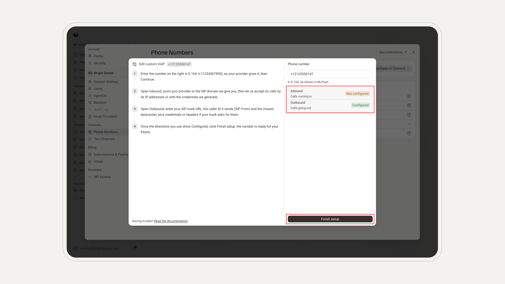</Frame>

<Frame>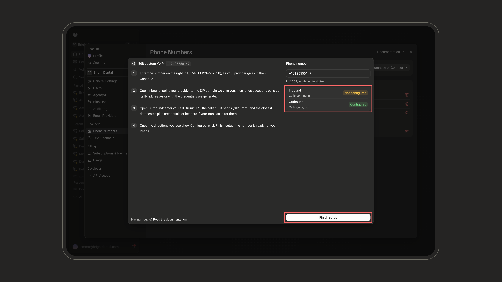</Frame>

<Info>
A number only works in the directions you configure:
- An **inbound** Pearl needs the **Inbound** configuration.
- **Outbound** campaigns, test calls, and calls started through the API need the **Outbound** configuration.
- **Call transfers always use the Outbound configuration**, even during inbound calls. If your Pearl transfers calls, configure **Outbound** too.
</Info>
</Step>

<Step title="Configure Your VoIP Settings">

<Card>
### Inbound Configuration Settings

<Steps>
<Step title="Copy Your SIP Domain">

NLPearl generates a **SIP domain** for this number. This is what tells your provider where to send incoming calls so they reach the platform.

<Info>
The SIP domain isn't something you type. It's shown **read-only** at the top of the **Inbound configuration**: click the copy icon (or the field itself) to copy it.
</Info>

<Frame>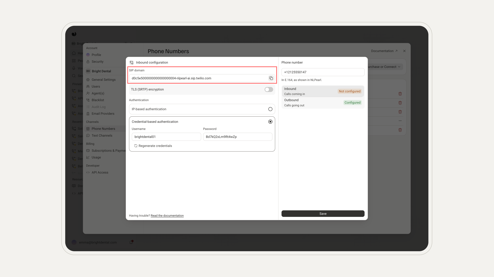</Frame>

<Frame>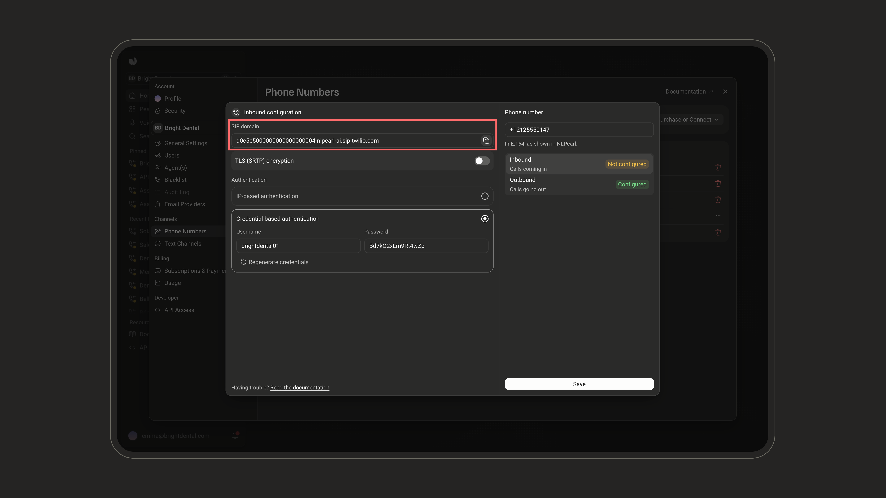</Frame>

<Warning>
**To finish connecting inbound calls:**

1. Copy the **SIP domain** from the **Inbound configuration**.
2. Add it to your VoIP provider / PBX as the **destination for inbound calls**, so your operator routes incoming calls to NLPearl.
3. If you choose **Credential-based authentication**, also add the **username and password** set here to your VoIP settings so authentication succeeds.
4. Click **Save**.
</Warning>

</Step>

<Step title="TLS (SRTP) Encryption">
Secures your VoIP traffic by encrypting both the signaling (via TLS) and media (via SRTP). It's off by default: turn on **TLS (SRTP) encryption** **only** if your VoIP provider requires it.

<Tip>
**When to Enable It:**
- Your SIP provider specifically mentions TLS or SRTP support.
- You want to ensure secure, encrypted voice communication (e.g., for compliance or privacy reasons).

**When to Leave It Off:**
- Your provider doesn’t support TLS/SRTP, enabling it may block calls or cause failed connections.
- You’re using basic test environments or local SIP servers without encryption.
</Tip>

<Frame>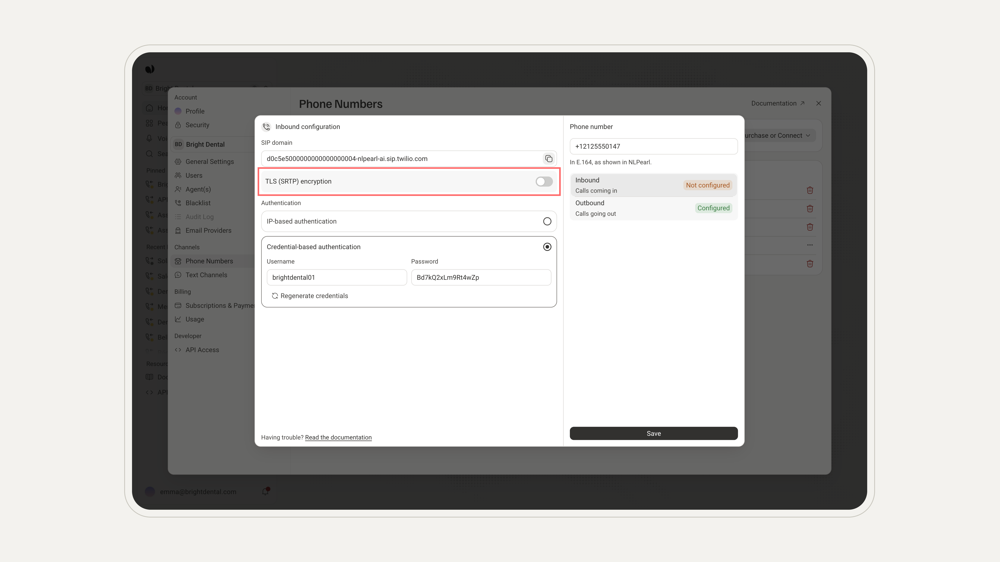</Frame>

<Frame>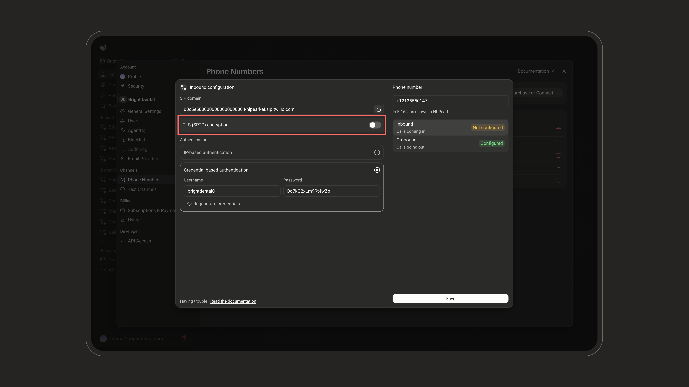</Frame>

</Step>
<Step title="Authentication Methods">
<Info>
Inbound calls require an authentication method. Under **Authentication**, choose **one**: **IP-based authentication** or **Credential-based authentication**. The two cannot be combined. A new inbound configuration starts on **Credential-based authentication**.
</Info>

**IP-based authentication:**

Allow traffic from specific IP addresses, ideal if your VoIP infrastructure has a static IP.

Enter the public IP address(es) of your SIP servers so we can accept and process requests from them: type an address and press **Enter** to add the next one. Use **IPv4** addresses only, without leading zeros, and no duplicates, up to **100** addresses.

<Frame>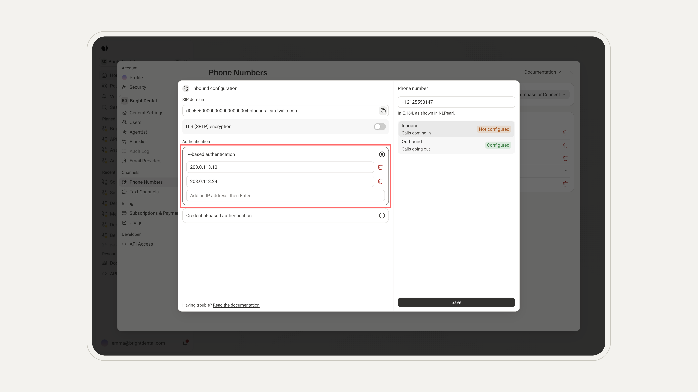</Frame>

<Frame>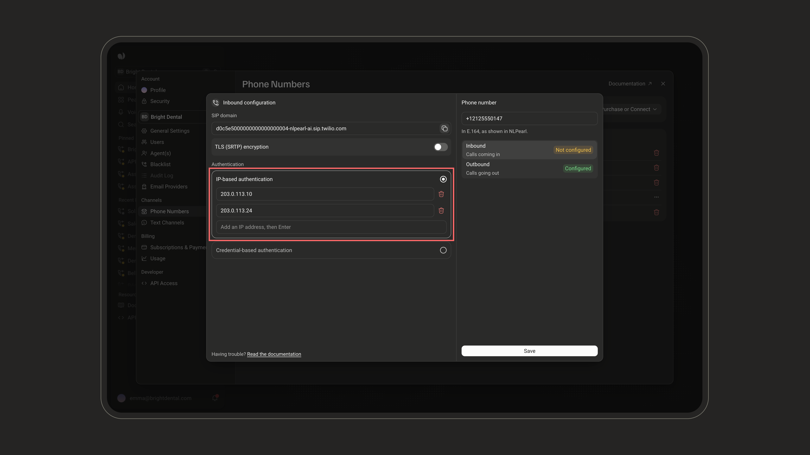</Frame>

---

**Credential-based authentication:**

Use a username and password to authenticate each incoming SIP request.

NLPearl proposes a username and a password for you. Keep them, edit them, or click **Regenerate credentials** for a new pair.

- **Username**: 2–32 characters, letters and digits only.
- **Password**: 12–72 characters, with at least one uppercase letter, one lowercase letter, and one digit. Letters and digits only: **special characters are not allowed**.

<Tip>
This method is useful if your infrastructure is cloud-based and IPs can change, or you want multi-tenant control.
</Tip>

<Frame>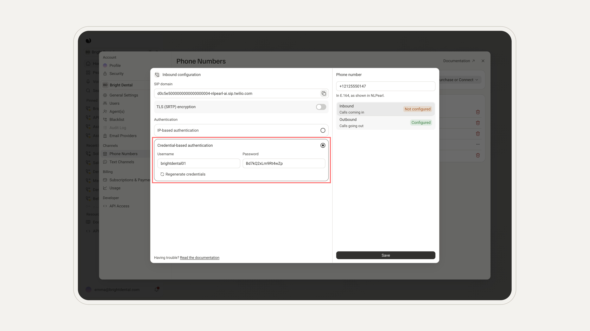</Frame>

<Frame>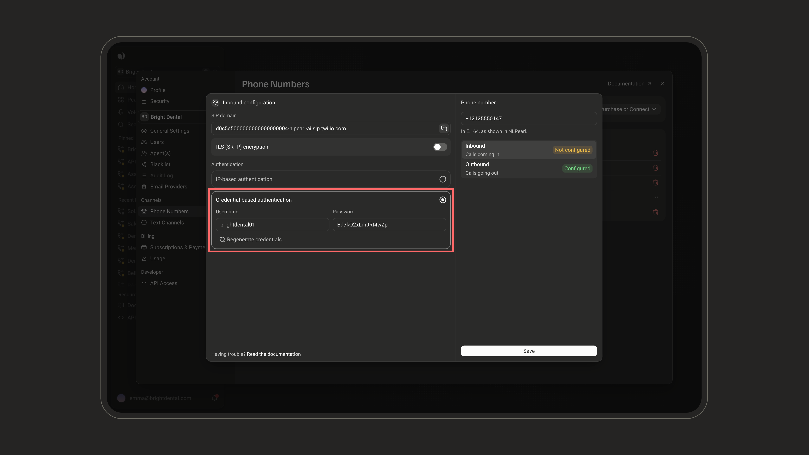</Frame>

</Step>
</Steps>
</Card>

---

<Card>
### Outbound Configuration Settings

<Steps>
<Step title="TLS (SRTP) Encryption">
Encrypts the signaling (TLS) and media (SRTP) of your outbound calls. It's off by default: turn on **TLS (SRTP) encryption** **only** if your VoIP provider requires it (see the tips in the inbound settings above).

<Frame>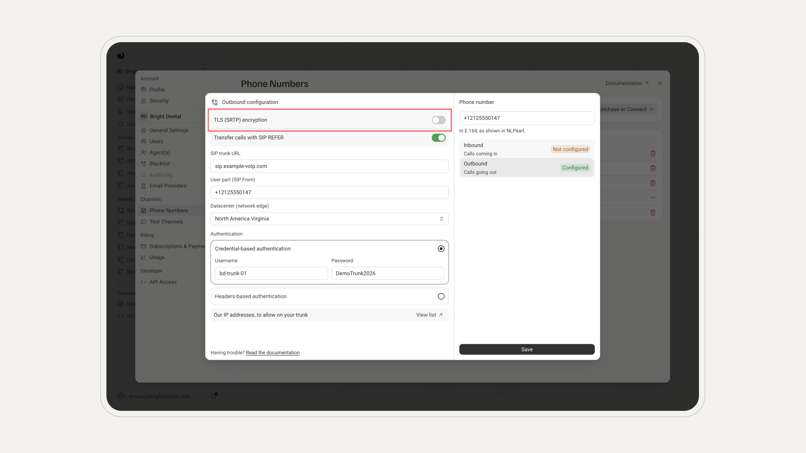</Frame>

<Frame>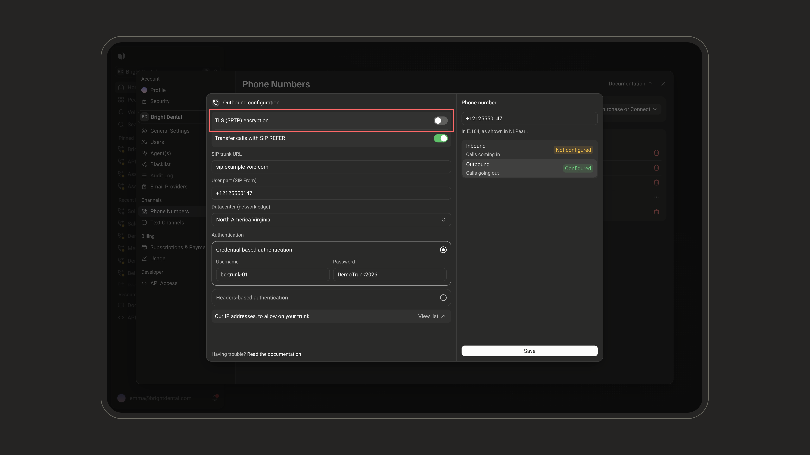</Frame>

</Step>

<Step title="Transfer Calls with SIP REFER">
**Transfer calls with SIP REFER** is **on by default**. When a Pearl transfers a call, NLPearl hands it over to your provider with the SIP REFER method, so the call continues directly between the caller and the destination.

When enabled, it allows:

- Transferring a live call from one destination to another without media proxying
- Offloading media streams directly between endpoints
- Reducing latency and server load

<Warning>
Leave it on unless your provider doesn't support SIP REFER. If you turn it off, NLPearl's servers stay connected for the whole transfer, and the app reminds you with a **SIP REFER is off** message.
</Warning>

<Note>
A [Warm Transfer](/pages/transfer_call#transfer-types), where Pearl introduces the call to the recipient first, always goes through NLPearl's servers, whatever this setting.
</Note>

<Frame>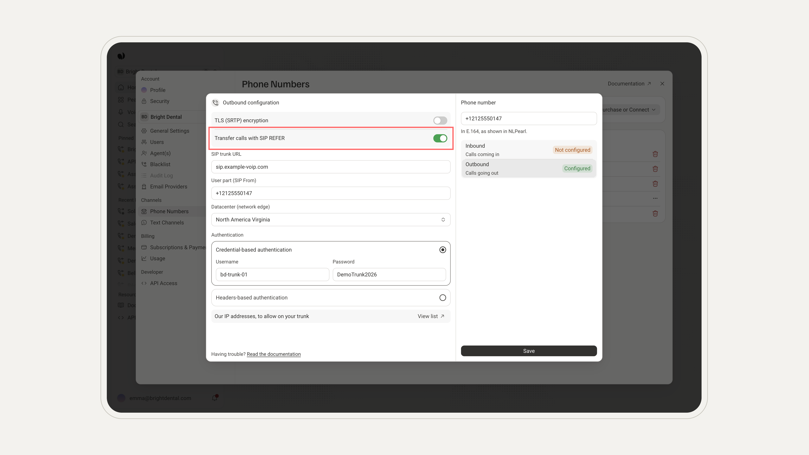</Frame>

<Frame>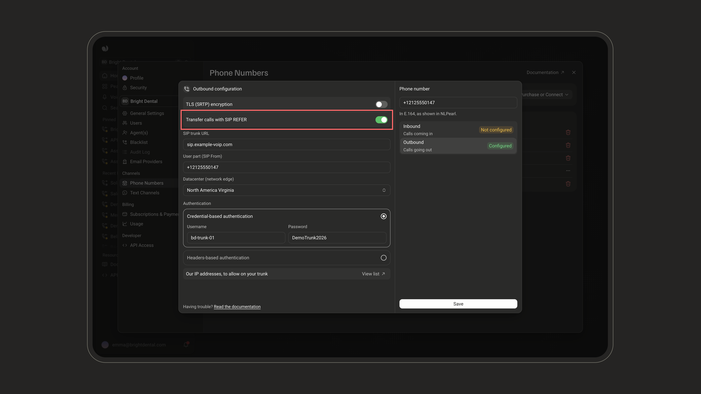</Frame>

</Step>

<Step title="SIP Trunk URL">
This is the address your outbound calls will be sent to, typically provided by your VoIP provider. In **SIP trunk URL**, enter a **domain or IPv4 address**, with an optional port (for example `sip.example-voip.com` or `203.0.113.10:5060`). Don't add a `sip:` prefix. Up to 100 characters.

<Frame>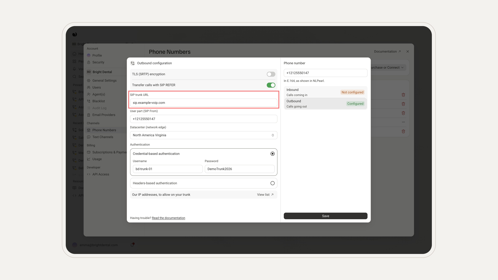</Frame>

<Frame>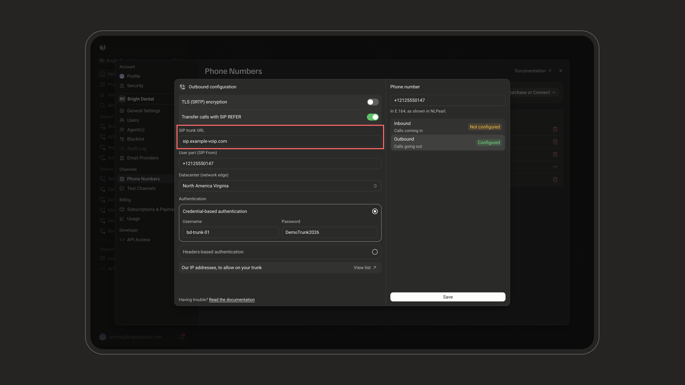</Frame>

</Step>

<Step title="User Part">
**User part (SIP From)** is the SIP user identity used in the “From” header of your outbound SIP requests. It's how your VoIP system identifies the origin of the call. It's required.

What to enter:
You can use one of the following formats depending on your provider:
- A SIP username (e.g. `caller01`)
- A DID or phone number in `E.164` format (e.g. `+12125550147`)
- An extension (e.g. `201`)

Up to 50 characters: letters, digits, and `+ - _ .` only. A full SIP URI such as `caller01@example.com` is not accepted.

<Frame>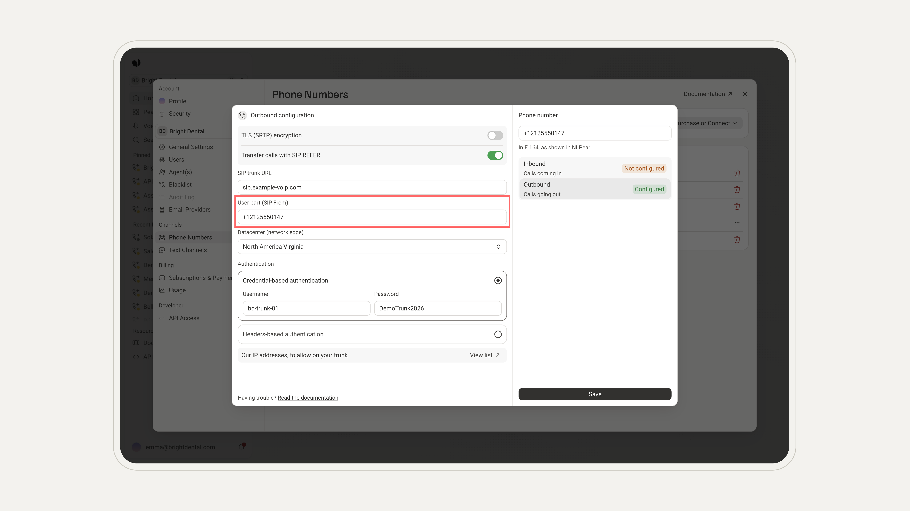</Frame>

<Frame>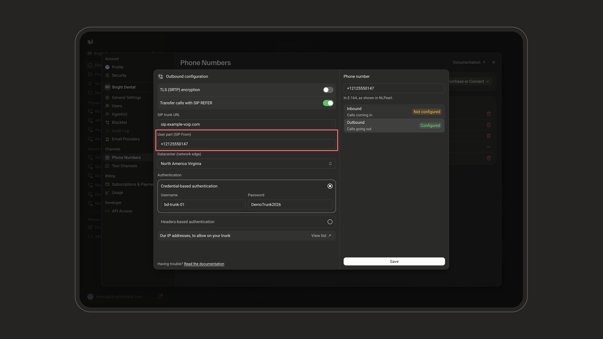</Frame>

</Step>

<Step title="Data Center">
In **Datacenter (network edge)**, select the network edge closest to your VoIP infrastructure to optimize call routing and reduce latency. Eight regions are available:

| Region | Location |
|--------|----------|
| North America | Virginia |
| North America | Oregon |
| Europe | Ireland |
| Europe | Frankfurt |
| Asia Pacific | Singapore |
| Asia Pacific | Tokyo |
| South America | São Paulo |
| Asia Pacific | Sydney |

<Frame>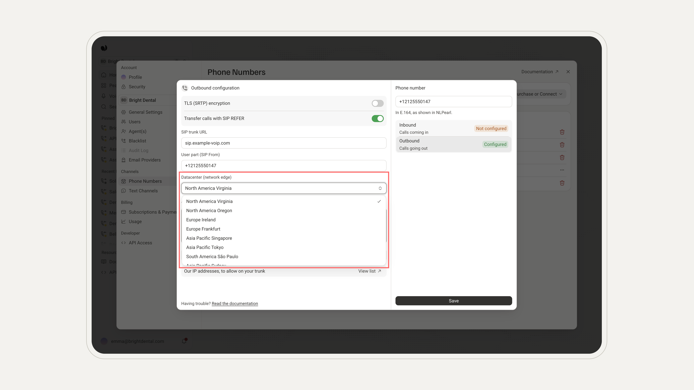</Frame>

<Frame>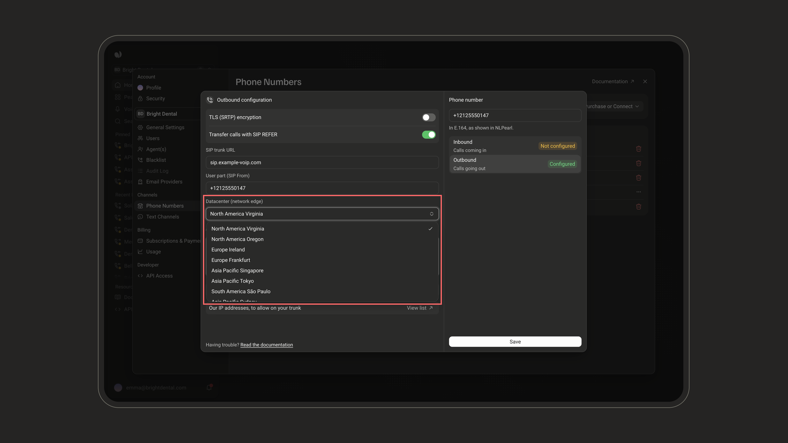</Frame>

</Step>

<Step title="Authentication Methods (optional based on your VoIP)">

If your provider requires authentication, choose **one** method under **Authentication**: **Credential-based authentication** or **Headers-based authentication**. The two cannot be combined.

**Credential-based authentication:**

Use this method if your VoIP provider requires username/password credentials to authenticate outbound calls.

- **Username**: the identifier associated with your SIP account (up to 32 characters).
- **Password**: the password of that SIP user, as your provider defines it.

<Frame>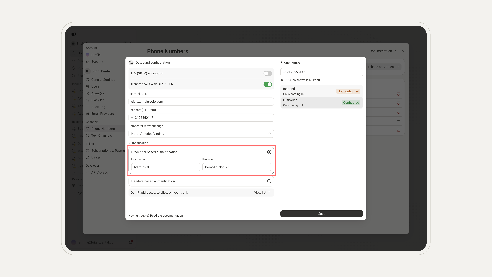</Frame>

<Frame>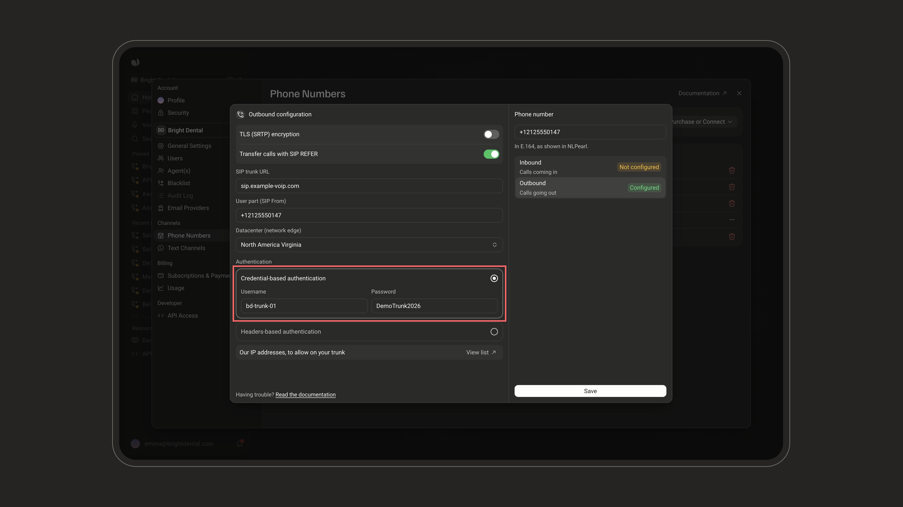</Frame>

**Headers-based authentication:**

Use this method if your VoIP provider requires custom headers for SIP request authentication. Type a key, then press **Enter** to add its value and the next pair.

- **Key**: the name of the custom SIP header expected by your provider (e.g. `X-Account-Id`, `X-Access-Token`). It must start with `X-` and can be up to 100 characters.
- **Value**: the value used to validate the request (e.g. a token, account ID, or static secret), up to 500 characters. Letters, digits, and `- _ . ! ~ * ' ( ) [ ] / : + $` are allowed.

<Note>
Header-based auth is typically used for advanced integrations or when SIP gateways are behind proxies/firewalls that don’t support IP or credential-based auth.
Ensure this matches exactly what your provider expects, as even small typos (like case or symbols) can lead to rejections.
</Note>

<Info>
You can add up to **15** key-value pairs if needed, for example, to meet multi-token security policies.
</Info>

<Frame>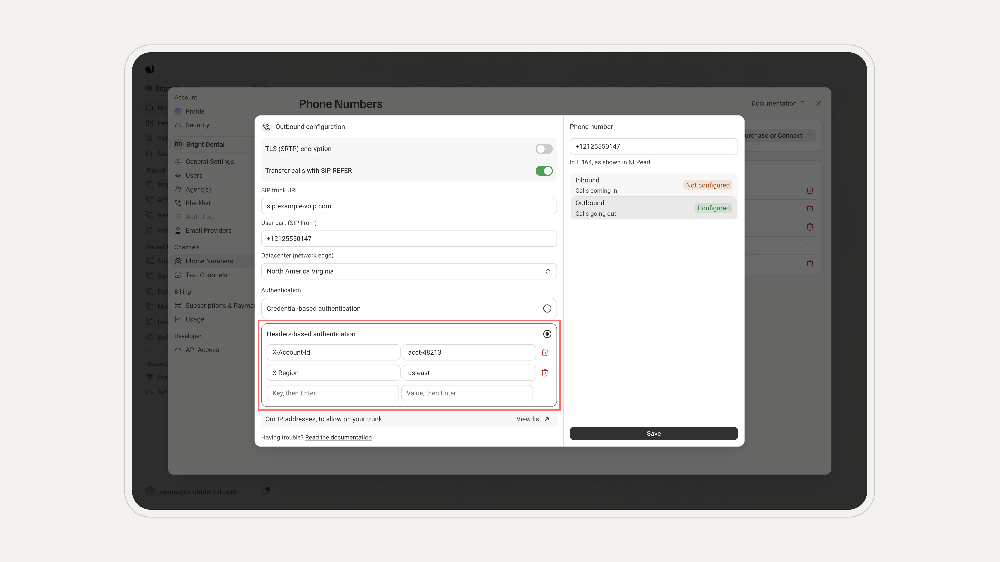</Frame>

<Frame>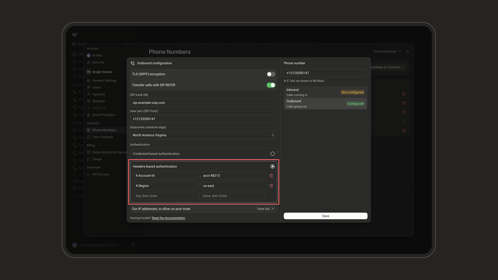</Frame>

</Step>

<Step title="Allow Our IP Addresses">
If your trunk only accepts calls from known addresses, allow ours. At the bottom of the **Outbound configuration**, **Our IP addresses, to allow on your trunk → View list** opens the list ([Twilio's SIP Trunking IP Addresses](https://www.twilio.com/docs/sip-trunking/ip-addresses)).

Then click **Save**.

<Frame>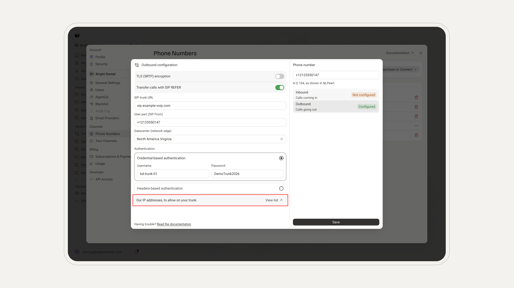</Frame>

<Frame>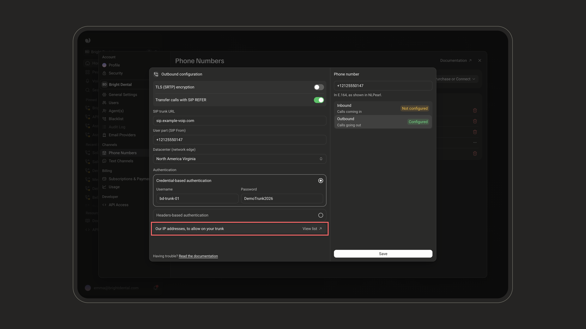</Frame>

</Step>
</Steps>
</Card>
</Step>
<Step title="Managing Your Custom VoIP Phone Numbers">

Once integrated:

- **Assign to a Pearl:**
  Open the Pearl, click **Settings** at the top right of its page, then pick the number in the **Phone Number** row: Custom VoIP numbers are listed under **SIP**. A number can be used by only one running inbound Pearl at a time.

<Frame>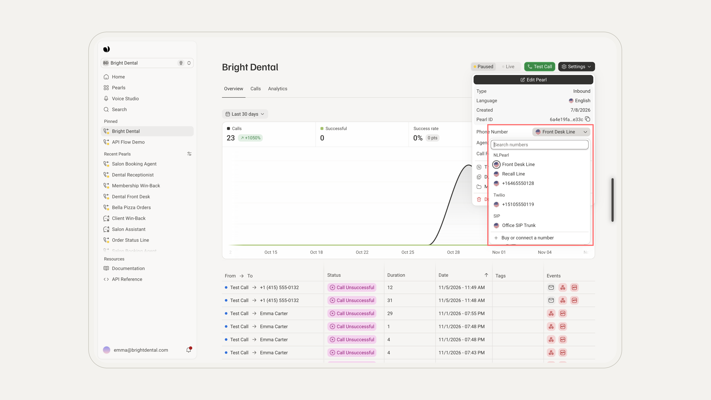</Frame>

<Frame>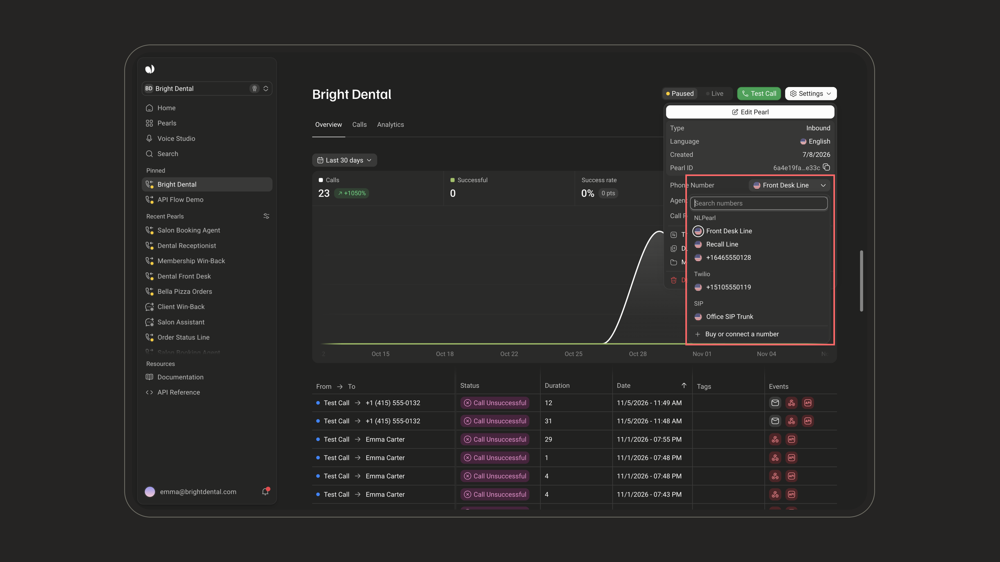</Frame>

- **Update Configuration:**
  In **Settings → Phone Numbers**, click **⋯ (More)** on the number's row, then **Edit**. The same window opens: click **Inbound** or **Outbound**, change the settings, and click **Save**.

- **Delete a Number:**
  Click **⋯ (More)** on the number's row, then **Delete**, and confirm with **Delete number**. The number is removed immediately, along with its SIP domain. Pearls using it are paused, and your workspace's notification email receives the list of paused Pearls.

<Frame>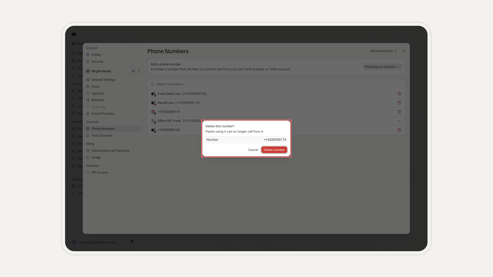</Frame>

<Frame>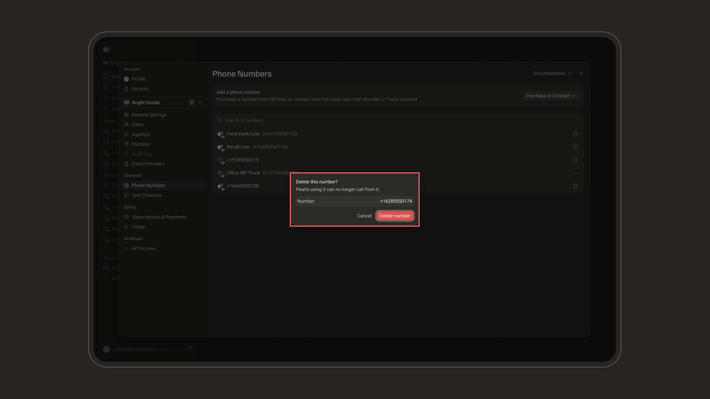</Frame>

</Step>
</Steps>

---

<Tip>
### Troubleshooting Tips

**Connection Issues**: Double-check all configuration settings, especially the SIP domain, SIP trunk URL, usernames, passwords, and IP addresses.

**Authentication Failures**: Make sure the authentication method you've selected matches the one supported by your VoIP provider.

**Transfers Not Working**: Check that the number has an **Outbound** configuration: transfers use it, even during inbound calls.

**Provider Support**: If you're unsure about specific requirements, contact your VoIP provider for assistance with configuration.
</Tip>

<Info>
### Advantages of Custom VoIP Integration

**Flexibility**: Leverage your existing VoIP infrastructure without switching providers or modifying your current setup.

**Global Reach**: Access phone numbers and make calls in any region your VoIP provider supports, ideal for international teams. Unlike NLPearl numbers, Custom VoIP numbers aren't limited to calling their own country.

**No Number Fee**: NLPearl charges no monthly fee for Custom VoIP numbers. Your Pearls' calls are billed at your usual NLPearl rate.

**Caller Context**: Pass data to your Pearl on inbound calls with custom SIP headers (`X-` prefix). Each value lands in the matching Pre-call variable. [Learn how](/pages/variables#passing-data-on-inbound-calls-with-custom-sip-headers).
</Info>

---

<Card title="Explore Other Options" icon="circle-info" iconType="light">
  
   

<CardGroup cols={2}>
  <Card
    title="NLPearl Phone Numbers"
    icon="mobile"
    iconType="light"
    href="/pages/nlpearl_phones"
  >
  Purchase and manage your **NLPearl-hosted phone numbers** directly, with instant activation and native support.
  </Card>
  <Card
    title="Twilio Integration"
    icon="object-intersect"
    iconType="light"
    href="/pages/twilio_integration"
  >
  Explore our **Twilio Integration** to access a broader range of international phone numbers.
  </Card>
</CardGroup>

<Info> 
**Need Assistance?**  
If you require help with the integration process, please refer to our support resources or contact our support team for guidance.
</Info>
</Card>
