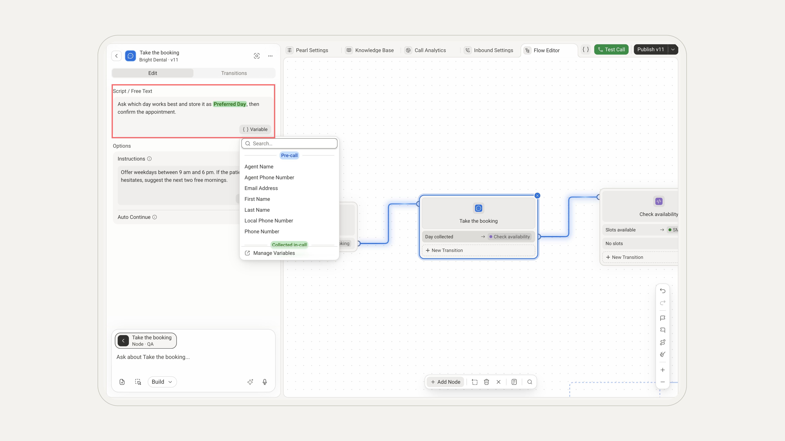
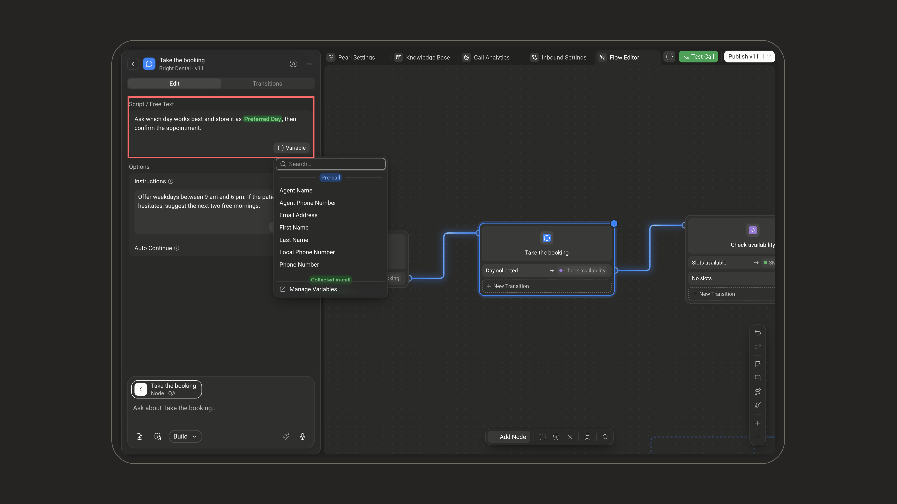
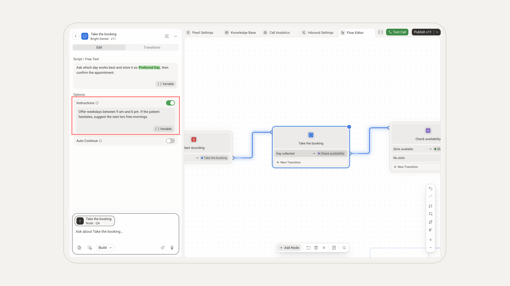
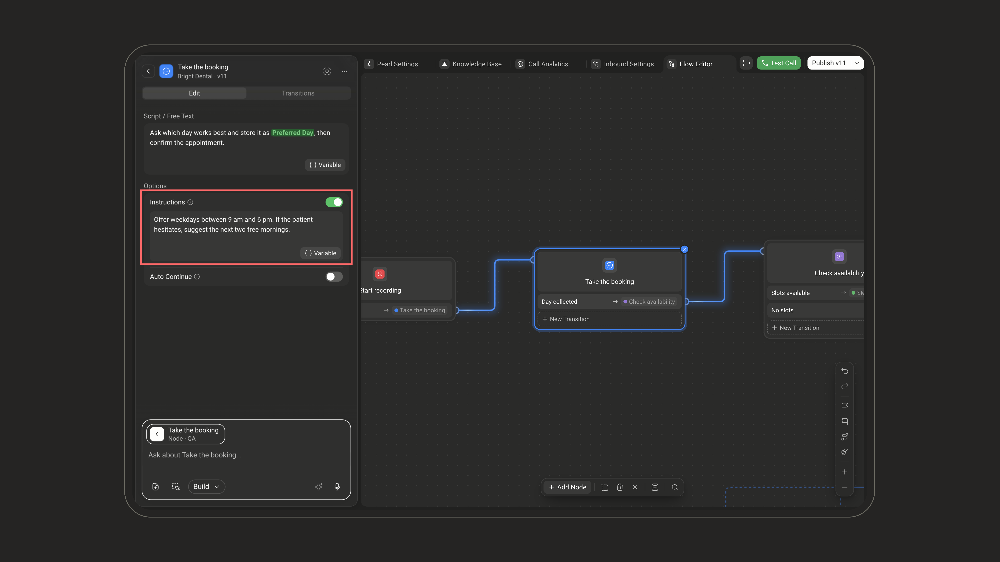
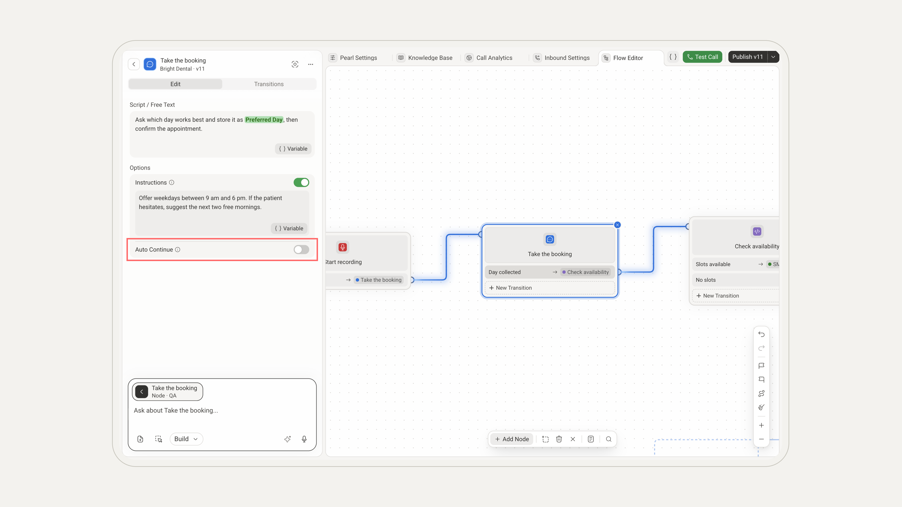
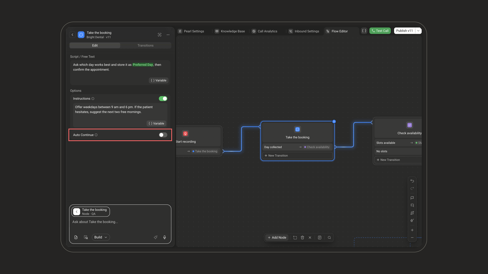
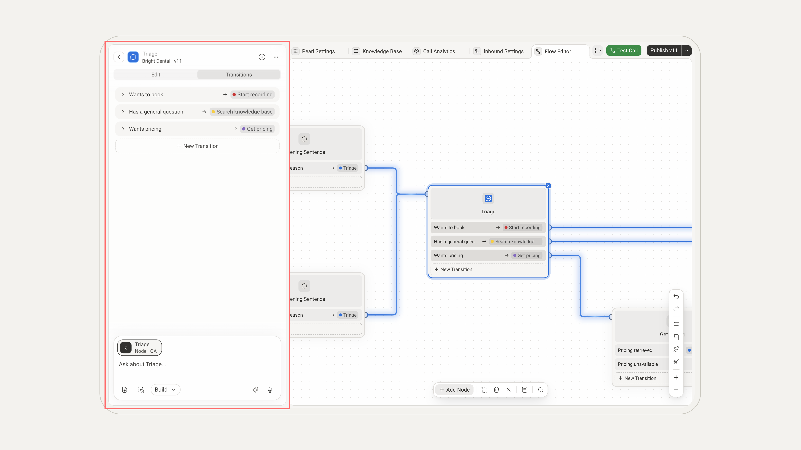
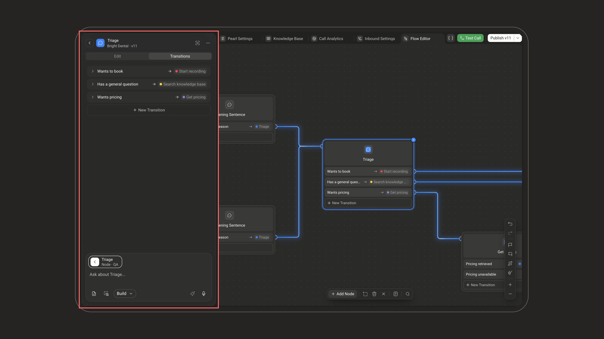
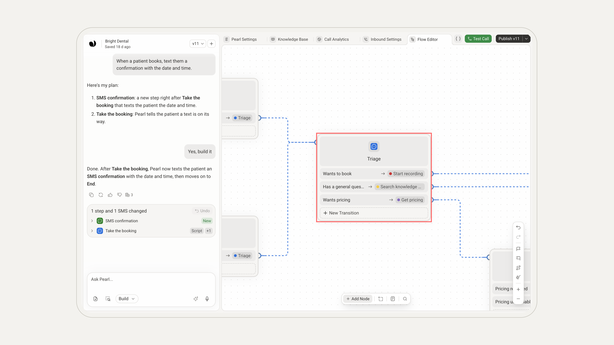
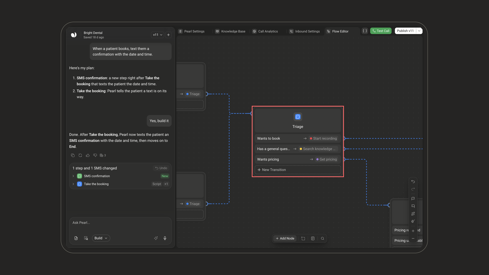

  <Frame>
    

      
    

  </Frame>

  <Frame>
    

      
    

  </Frame>

The **Dialogue** node is the main conversational node. Pearl speaks, asks questions, collects information, and keeps the conversation moving. It is the workhorse of most flows, on voice and text Pearls alike.

## What it does

Unlike a traditional IVR, Dialogue is not a rigid prerecorded prompt. Pearl understands the intent of the step, adapts its wording in real time to what the customer says, and follows the most relevant transition based on the conversation.

## When to use it

Use Dialogue whenever Pearl needs to:

| Pearl needs to | What it means |
| --- | --- |
| **Speak to the customer** | Deliver a message, greeting, or confirmation |
| **Ask a question** | Prompt the customer for an answer or a choice |
| **Collect information** | Capture details such as a name, email, or intent |
| **Explain something** | Give context, options, or next steps |
| **React to the customer** | Respond before continuing or branching to another path in the flow |

## Adding a Dialogue node

In the [PearlVibe editor](/pages/pearl_vibe), click **Add Node** and pick **Dialogue** in the **Conversation** section of the **In-Call** tab. You can also ask PearlVibe to add or change one for you in the chat (**Build** mode).

To configure a node by hand, click it on the canvas and open it with the pencil of its tile in the chat (**Manual edit**), or hover it and click **Edit Manually**. Your changes are kept once you click **Save Changes**.

## How to configure

<Steps>
  <Step title="Write the script">
    In **Script / Free Text**, enter what Pearl should say or ask — up to 500 characters. To insert a variable, click **Variable** under the field and pick it from the list.

    

      <Frame>
        
      </Frame>
    

    

      <Frame>
        
      </Frame>
    

  </Step>
  <Step title="Add instructions (optional)">
    In **Options**, turn on **Instructions** to guide tone, context, exceptions, pronunciation, required details, or how closely Pearl should follow the script — up to 250 characters. Instructions can use variables too.

    

      <Frame>
        
      </Frame>
    

    

      <Frame>
        
      </Frame>
    

  </Step>
  <Step title="Turn on Auto Continue (optional, voice only)">
    With **Auto Continue** on, Pearl moves on to the next step right after speaking, without waiting for the caller to reply. Use it on lines that don't ask the caller anything, such as a disclaimer or a short explanation. The same switch exists on the **Opening Sentence** node.

    

      <Frame>
        
      </Frame>
    

    

      <Frame>
        
      </Frame>
    

  </Step>
</Steps>

<Note>
Auto Continue is available only on voice Pearls. On a text Pearl, Pearl always waits for the customer's next message.
</Note>

<Tip>
When specific wording must be followed closely, add clear instructions such as "Say this exactly", "Do not rephrase", or "Always include the following sentence".
</Tip>

## Transitions

A new Dialogue node starts with a single **Continue** transition: Pearl moves on once the step is done. Add conditional transitions to direct the conversation to another Dialogue node, an action node, or an End Call node depending on what the customer says — they replace **Continue**.

In the node's **Transitions** tab, each transition has:

| Field | Description |
| --- | --- |
| **Transition** | The condition for taking this path, written in plain language, with variable support |
| **Node Chosen** | The node the conversation goes to |

Use **New Transition** to add one.

  <Frame>
    
  </Frame>

  <Frame>
    
  </Frame>

On the canvas, each transition shows the node it leads to. You can also add one there with **New Transition** at the bottom of the node, and connect it by dragging its dot onto another node.

  <Frame>
    
  </Frame>

  <Frame>
    
  </Frame>

<Card title="Example: routing on the caller's answer" icon="code-branch">
Pearl asks whether the caller wants to book an appointment. Based on the answer, she can move to a Booking node, send an SMS, transfer the call, or continue to another part of the conversation.
</Card>
