

  <Frame>
    

      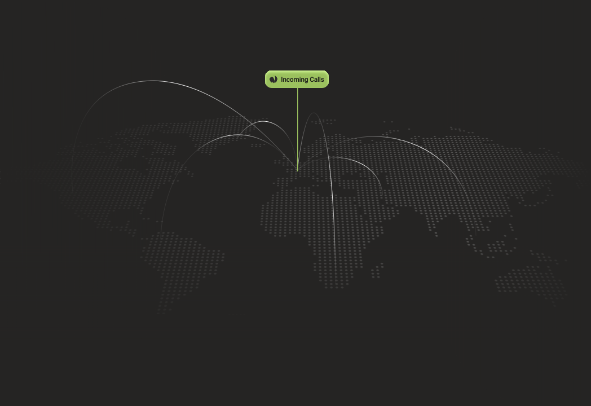
    

  </Frame>

  <Frame>
    

      
    

  </Frame>

---

## Setting Up Inbound Calls

Once you have created a Pearl, you can enable it to receive inbound calls. Inbound settings are configured inside your Pearl, under **Inbound Settings**, giving callers a dynamic and responsive experience driven by your conversational flow.

<Info>
**What are inbound calls?**

Inbound calls let your Pearl handle incoming calls, engaging with callers immediately and effectively using the conversational flow you defined.
</Info>

---

## Attach a Phone Number

To receive calls, your Pearl needs a phone number. Numbers are purchased and connected from **Settings → Phone Numbers** (or with **Buy or connect a number** in your Pearl's settings, see below).

Click your **profile** at the bottom-left corner of the sidebar, then click **Settings**.

<Frame>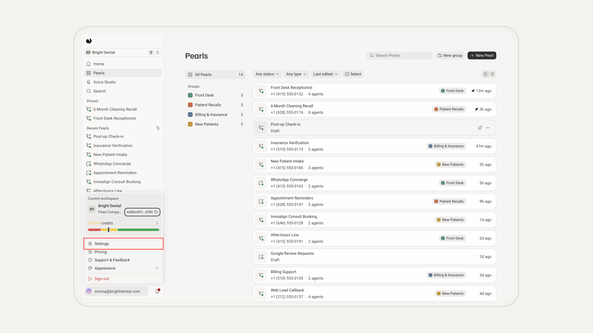</Frame>

<Frame>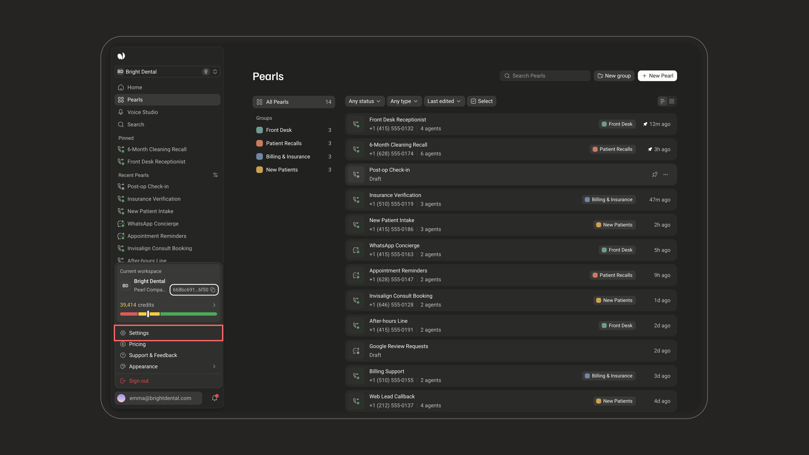</Frame>

Then open **Phone Numbers** (under **Channels**). From here you can purchase, connect, and manage all your numbers with **Purchase or Connect**.

<Frame>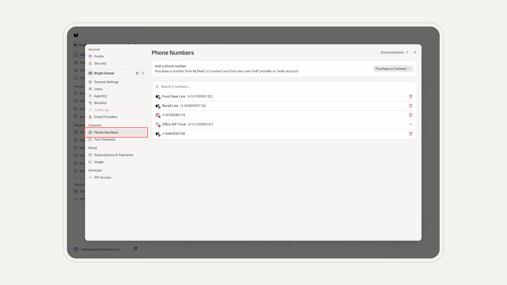</Frame>

<Frame>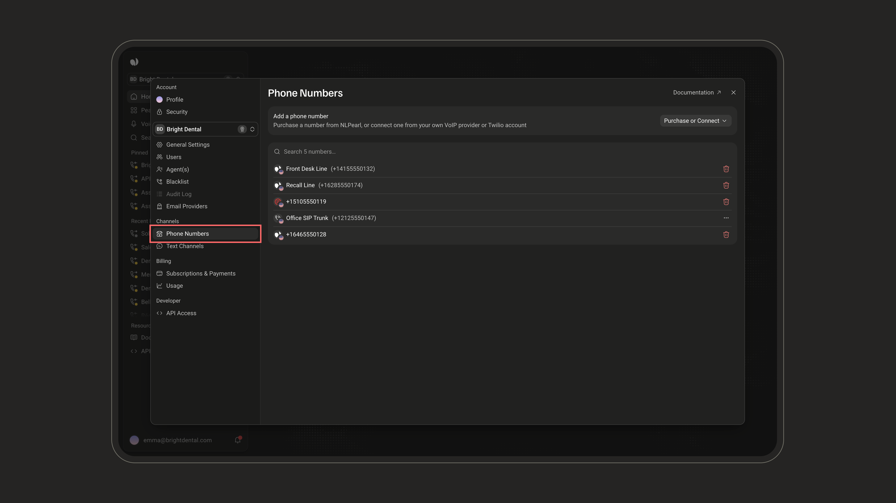</Frame>

You have three ways to get a number for your Pearl:

<Card>

  
  NLPearl Number

  
  NLPearl Number

Buy a number directly from NLPearl and start receiving or making calls in minutes (US numbers, billed monthly, available once you subscribe to a plan).

<Info>
For more details, visit the [NLPearl Phone Numbers](/pages/nlpearl_phones) page.
</Info>

</Card>

 

<Card>

  
  Twilio

  
  Twilio

Connect your Twilio account to use your existing numbers, with access to a wide range of countries.

<Info>
Visit [Twilio Integration](/pages/twilio_integration) for details on how to import and manage your Twilio phone numbers.
</Info>

</Card>

 

<Card>

  
  Custom VoIP

  
  Custom VoIP

Bring your own VoIP provider and connect custom numbers over SIP to your account.

<Info>
To learn more about integrating your own VoIP service, check out [Custom VoIP Integration](/pages/custom_voip).
</Info>

</Card>

Once you have a number, attach it to your Pearl: on the Pearl's page, click **Settings**, then the number in the **Phone Number** row (**Choose a number** if none is set). The menu groups your numbers by source (**NLPearl**, **Twilio**, **SIP**), with a search field at the top; pick one and it is saved right away. **Buy or connect a number**, at the bottom of the menu, adds a number without leaving the page. Your Pearl will then answer calls on that number.

<Frame>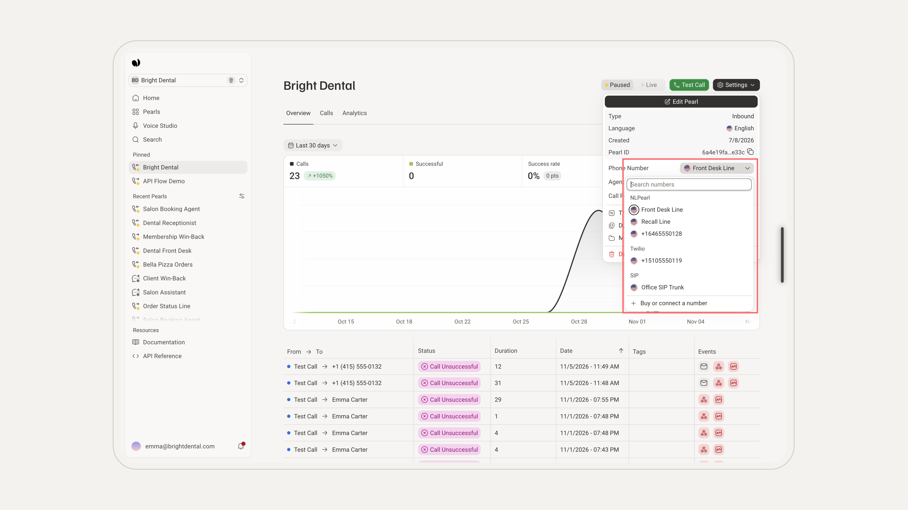</Frame>

<Frame>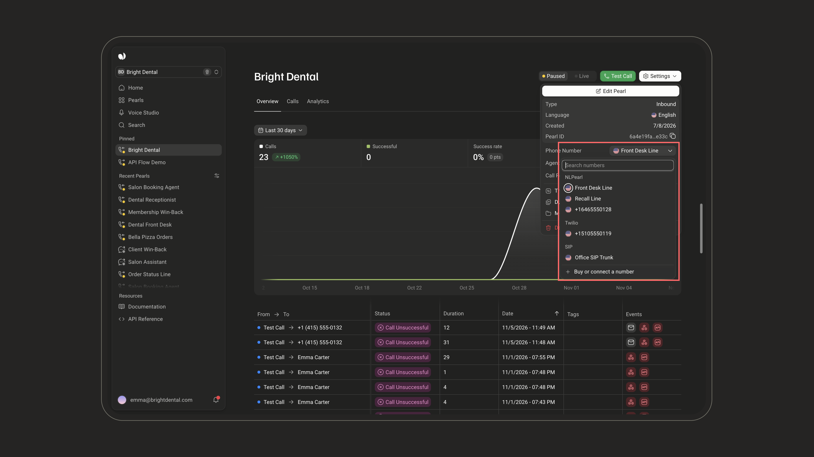</Frame>

---

## Inbound Settings

Configure how your Pearl answers incoming calls from the **Inbound Settings** tab of your Pearl, in the [PearlVibe](/pages/pearl_vibe) flow editor. Each setting is saved automatically in your Pearl's draft: publish the Pearl to apply it to live calls.

<Note>
**Mask Sensitive Info** and **Webhooks** apply to every Pearl. The other settings on this page apply to **voice** Pearls only: a Text Pearl has its own inbound options (message limit, auto-close after inactivity, response delay, inactivity follow-up).
</Note>

### Recording Options

Choose whether the call audio is recorded. Recordings are available afterwards from your **call logs** for quality reviews, training, and analytics.

<Frame>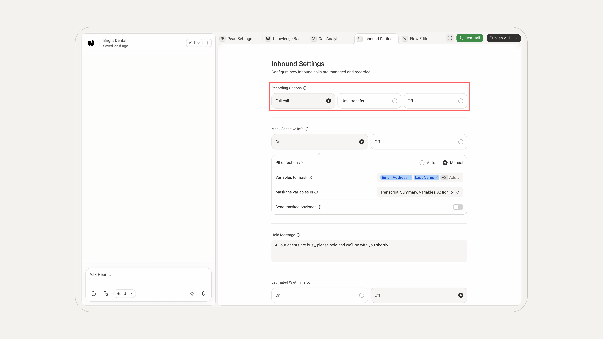</Frame>

<Frame>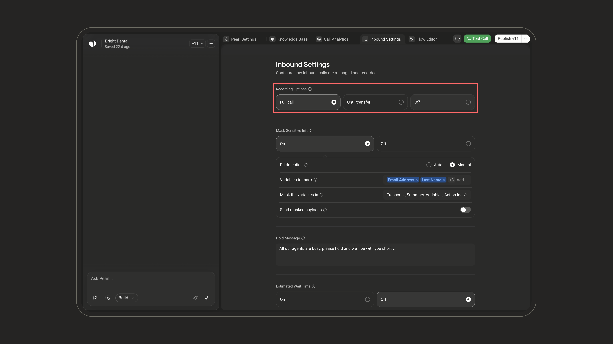</Frame>

| Option | Description |
| --- | --- |
| **Full call** | Records Pearl, then the person the call is transferred to. |
| **Until transfer** | Records Pearl, and stops when Pearl hands the call over to a person. |
| **Off** | Nothing is recorded. |

<Warning>
Call recording laws vary by region and often require informing or getting consent from callers. Make sure your Pearl's flow discloses recording where required.
</Warning>

<Note>
See the [Transfer Call Node](/pages/transfer_call) to learn how call transfers work.
</Note>

---

### Mask Sensitive Info

Replace personal details with `****` in everything that is kept after the call. **Off** keeps the transcript as-is; **On** masks it and opens the masking settings below.

<Frame>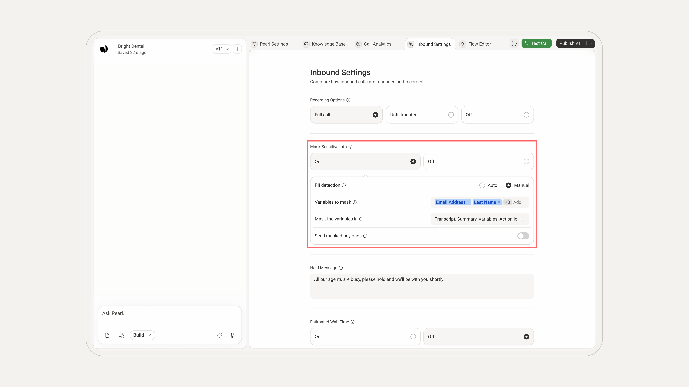</Frame>

<Frame>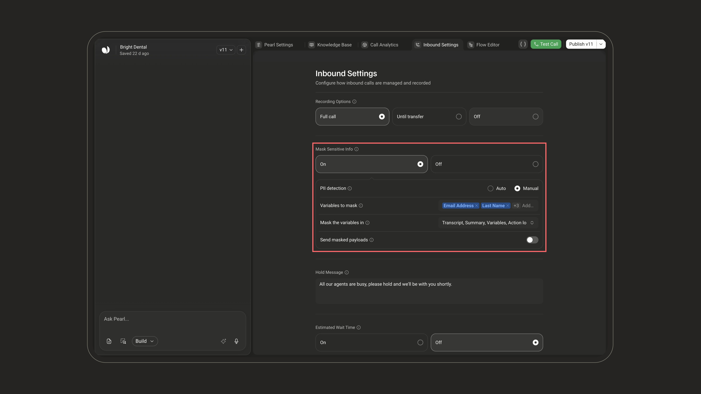</Frame>

| Setting | Description |
| --- | --- |
| **PII detection** | **Auto** (default) lets the AI decide what is personal information, such as names, phone numbers, or card numbers. **Manual** masks only the variables you pick, the same way on every call. |
| **Variables to mask** | *Manual only.* The variables whose values are masked. Their values are replaced with `****` wherever they appear, including inside other variables. With no variable selected, nothing is masked (a warning tells you so). |
| **Mask personal details in** | Where masking applies: **Transcript**, **Summary**, **Variables**, and **Action logs** (all checked by default, at least one stays checked). Unchecked parts keep the original values. In Manual mode, this setting reads **Mask the variables in**. |
| **Send masked payloads** | **On**: webhooks and post-call actions receive the masked values (`****`). **Off** (default): they receive the original values. |

<Info>
With **Auto** detection, if a customer says *"My credit card number is 1234-5678-9012-3456"*, the transcript stores it as *"My credit card number is \*\*\*\*"*, so you can review interactions safely without exposing sensitive data.
</Info>

---

### Hold Message

Played once to callers when they are put on hold, typically when all agents are busy and the caller enters the holding line. Required, English only, max **300 characters**.

<Frame>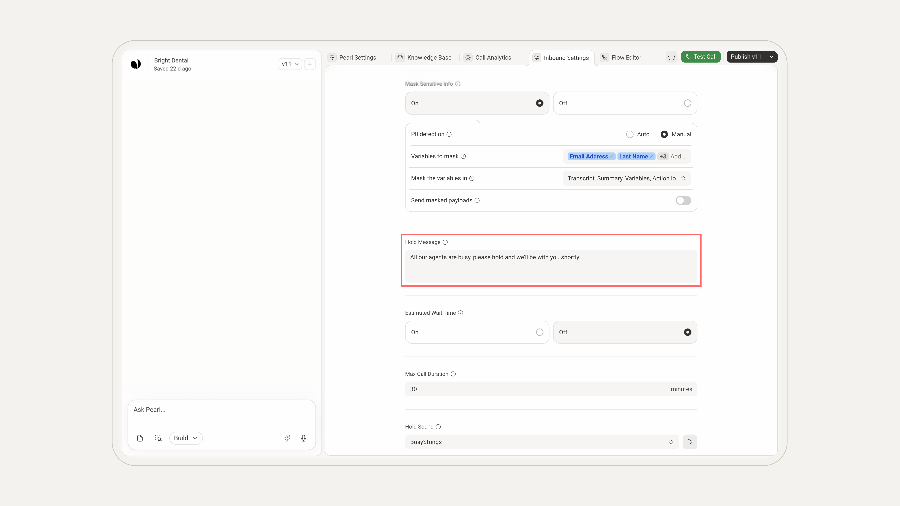</Frame>

<Frame>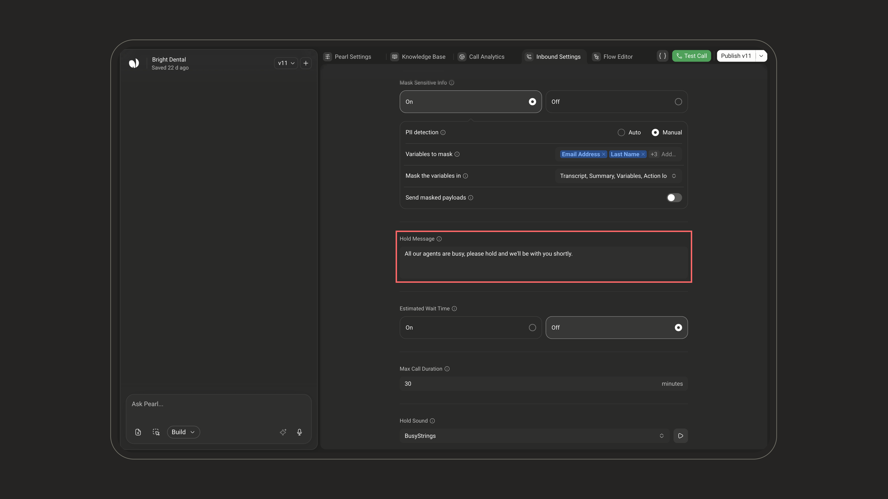</Frame>

<Info>
Example: *"Thanks for calling! One moment while I connect you to our team."*
</Info>

<Note>
If your Pearl experiences high call volumes, callers are not turned away. They enter the holding line and hear your hold message and sound until an agent becomes available (the holding line takes up to 1,000 callers per Pearl). A caller can wait up to **4 hours**: they stay in line until an agent is free or they hang up.
</Note>

---

### Estimated Wait Time

When **On** (default **Off**), callers who have been waiting more than a few seconds hear their position in the queue and an estimated wait time (*"You are in position 2, it will take about 3 minutes"*), then the hold sound resumes. Setting expectations this way helps reduce hang-ups during busy periods.

<Frame>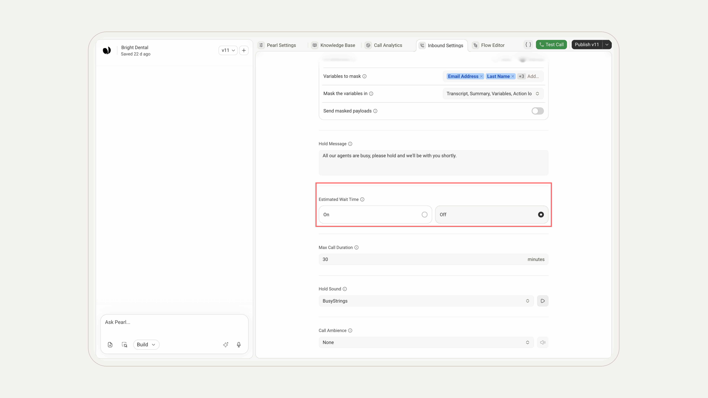</Frame>

<Frame>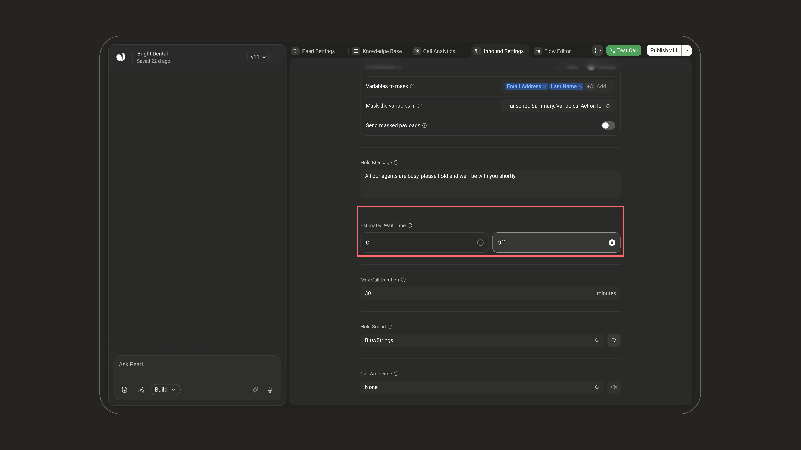</Frame>

---

### Max Call Duration

How long a call can last at most, in **minutes** (1 to 120, default **30**). When a call reaches this length, Pearl ends it, whatever is still being said.

<Frame>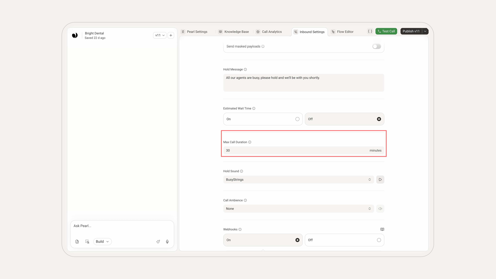</Frame>

<Frame>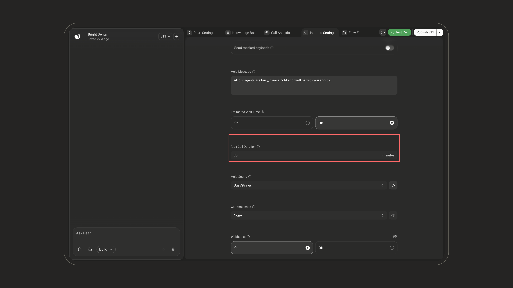</Frame>

---

### Hold Sound

The music that loops while callers wait in the holding line (required). Select one of the built-in tracks, or choose **Upload** to add your own `.mp3` file (we recommend tracks of up to **3 minutes**). Use the play button next to the field to listen to it.

<Frame>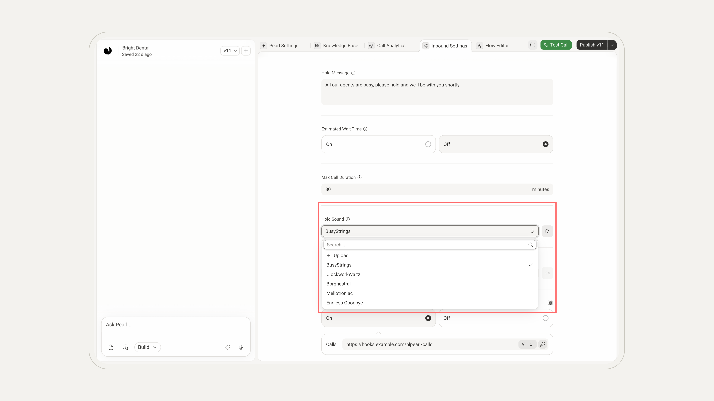</Frame>

<Frame>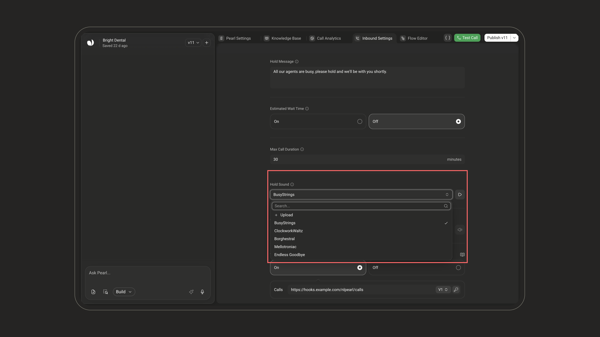</Frame>

---

### Call Ambience

A subtle background environment (office, call center, outdoor…) played **during the live conversation** to make the call sound more natural and human. Defaults to **None**.

Pick an ambience from the list: the play icon next to an ambience lets you hear it first. Then fine-tune its **volume** (0–100) with the **Volume** button next to the field; each ambience starts at its own recommended volume.

<Frame>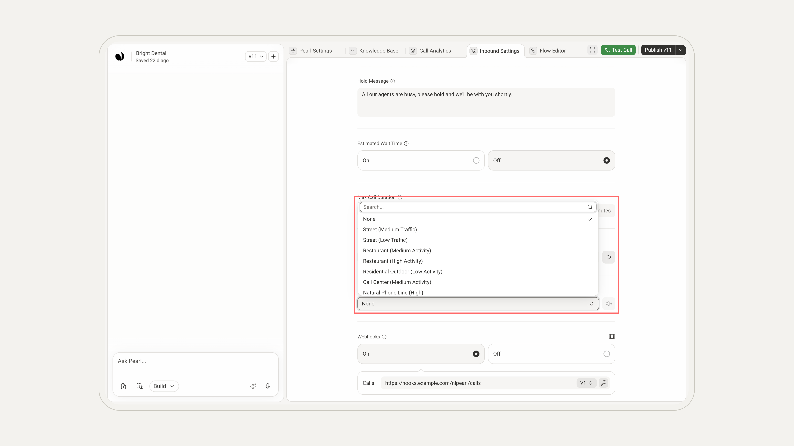</Frame>

<Frame>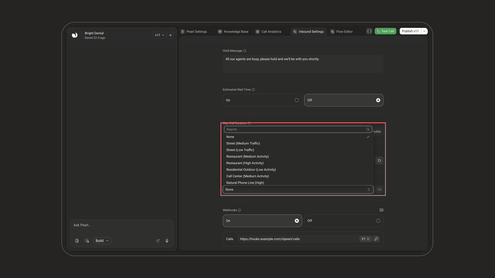</Frame>

<Note>
Don't confuse this with **Hold Sound**: Call Ambience plays quietly behind Pearl's voice during the call, while Hold Sound only plays while a caller is waiting in the holding line.
</Note>

---

### Webhooks

Send call lifecycle events to an external endpoint. Turn **Webhooks** **On** (default **Off**), then fill in the **Calls** line:

<Frame>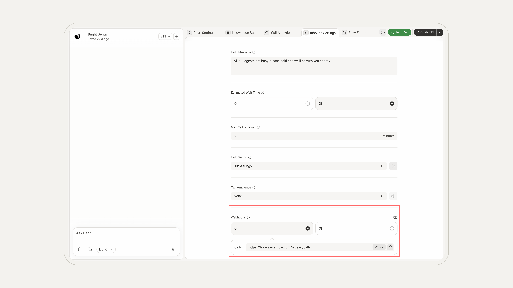</Frame>

<Frame>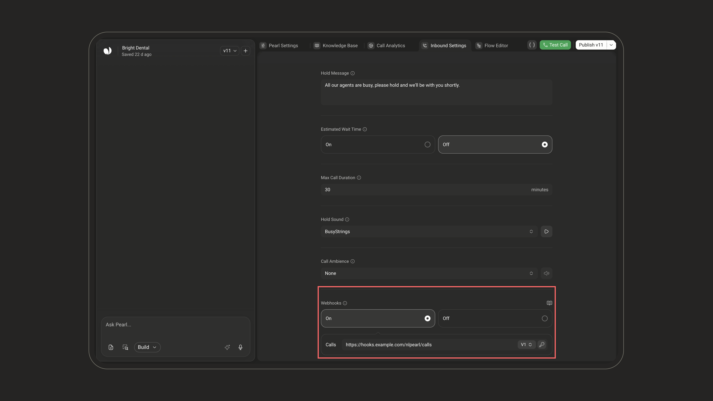</Frame>

- **URL**: your endpoint. It is called at key points in the call lifecycle (when the call starts and when it ends), with an object similar to the [Get Calls Endpoint](/api-reference/v2/call/get-call): duration, outcome, and any data collected during the call.
- **Version** (the `V1`/`V2` pill): the payload format, default **V2**. Keep V1 only if you have an older integration built against it.
- **Signature** (the key icon): optionally sign the requests with one of your tokens (or create a **New token**) so your endpoint can verify they come from NLPearl. **No signature** sends them unsigned.

<Note>
If your endpoint is behind a firewall, allow the NLPearl IP addresses listed in [IP Whitelisting](/pages/ip_whitelist).
</Note>

<Tip>
Use Webhooks only if external tools need event notifications. For actual automations, rely on **Post-Call Actions** tied to how the call ended.
</Tip>

<Card
  title="Webhooks"
  icon="webhook"
  iconType="light"
  href="/pages/webhooks"
>
  Learn how to configure webhooks, authenticate requests, and handle the events NLPearl sends.
</Card>

---

## Project-Level Settings

A few settings live at the **Project** level rather than in the Inbound Settings screen. Open them with the **Settings** button on your Pearl's page: next to **Phone Number**, you'll find **Agents** and **Call Retention**.

<Frame>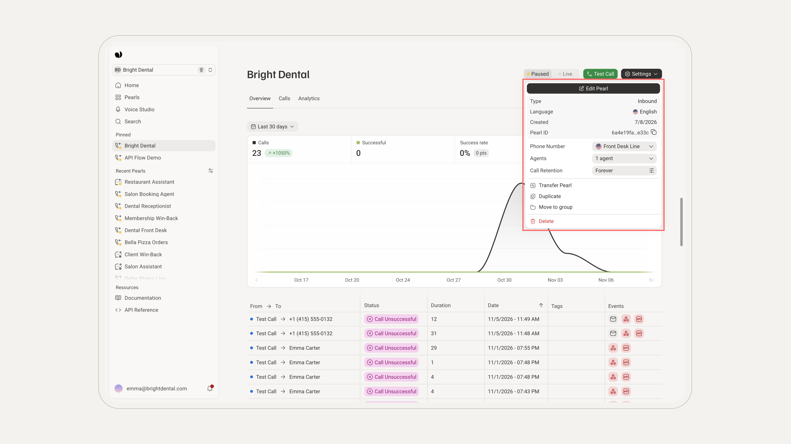</Frame>

<Frame>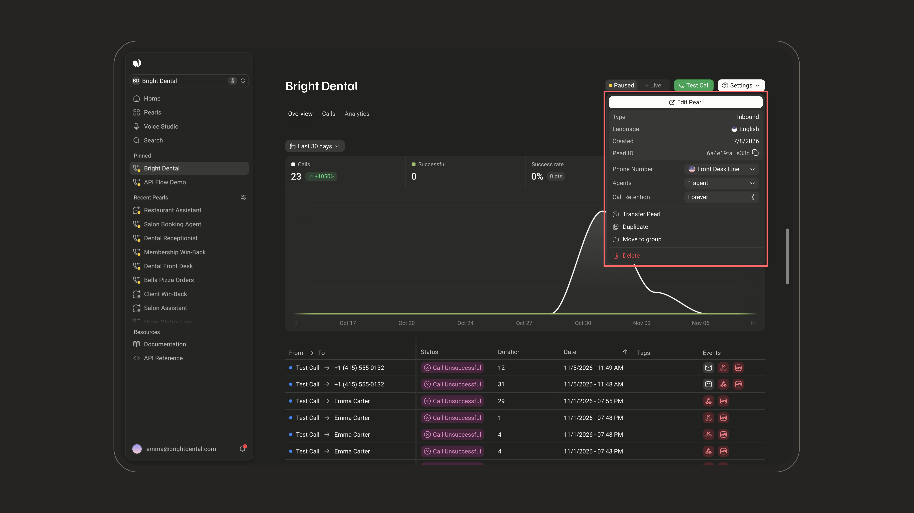</Frame>

### Agents

Sets how many **simultaneous agents** handle this Pearl's incoming calls, i.e. how many calls can be answered at the same time, capped by your account's agent quota. A higher number lets your Pearl take more concurrent callers before the rest enter the holding line. Click the **Agents** value and pick a number: it is saved right away.

<Frame>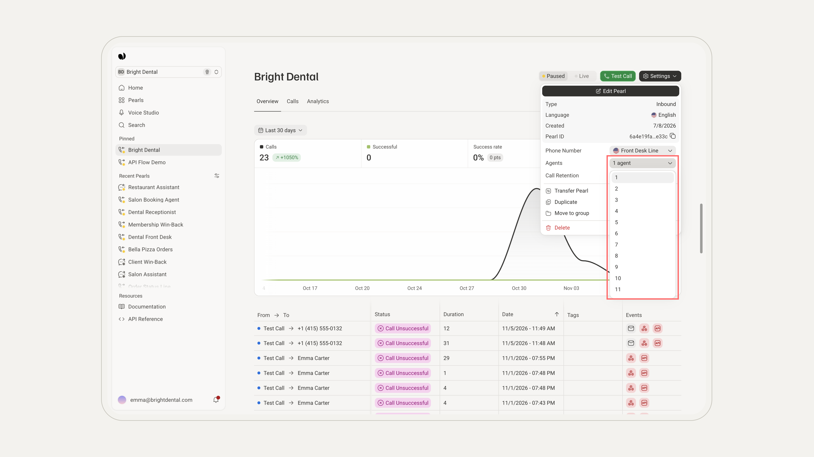</Frame>

<Frame>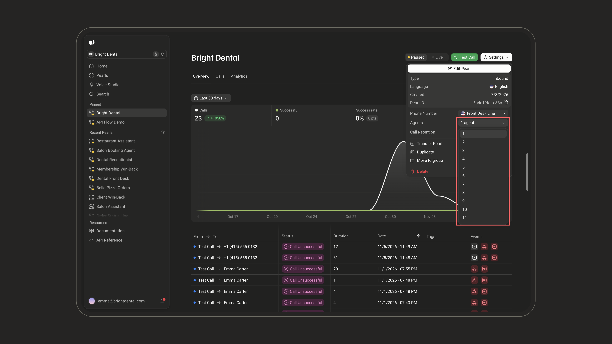</Frame>

<Card
  title="Agents"
  icon="users"
  iconType="light"
  href="/pages/agents"
>
  Learn how to manage the agents assigned to your inbound and outbound activities.
</Card>

---

### Call Retention

Click the **Call Retention** value to open the **Call retention** window. Set the **Retention period** in days (leave it empty to keep calls **Forever**), then choose what is removed when calls expire: **Delete all call data** (on by default), or turn it off to pick the **Recording**, **Transcript**, **Summary**, or collected **Variables**. Click **Save** to apply.

<Frame>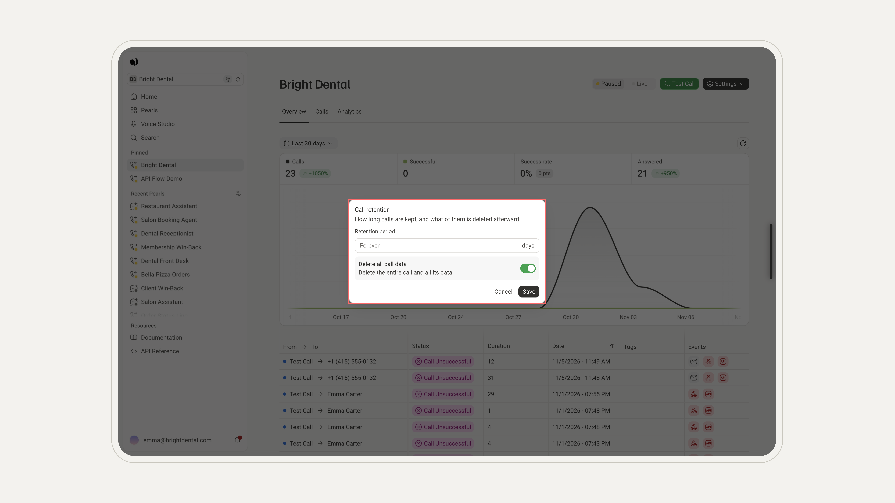</Frame>

<Frame>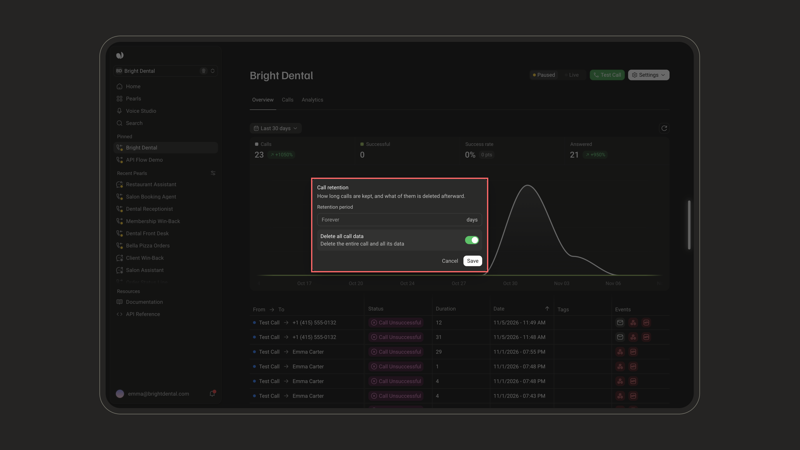</Frame>

---

<Info>
### Monitoring and Adjusting Your Inbound Calls

While basic monitoring of call logs and reports can be done via our API, any changes to the setup, such as voice or language settings, must be handled directly on the platform.
</Info>
