

  <Frame>
    

      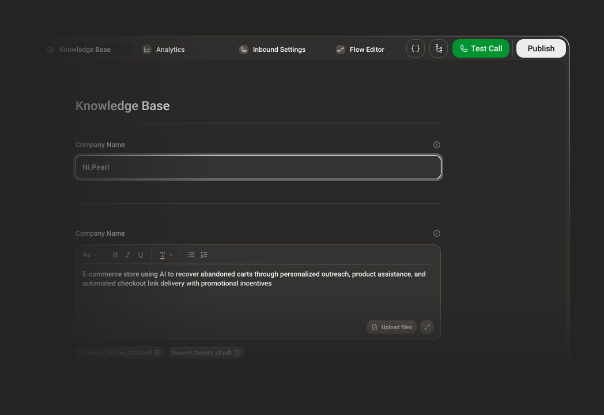
    

  </Frame>

  <Frame>
    

      
    

  </Frame>

Before your Pearl can answer questions accurately, it needs context. This step helps define the essential background information your agent will rely on during conversations.

---

## Company Name

These settings live in the **Knowledge Base** tab of your Pearl's editor (**Edit Pearl** in the **Settings** of the Pearl's page). Changes are saved automatically in your Pearl's draft: publish the Pearl to use them in live calls.

Give your Pearl the name of the company it represents. This name may be used when Pearl introduces itself or provides company-related information. It's **required**, up to **100 characters**. Not representing a company? Write the name of the entity your agent says it's from.

<Frame>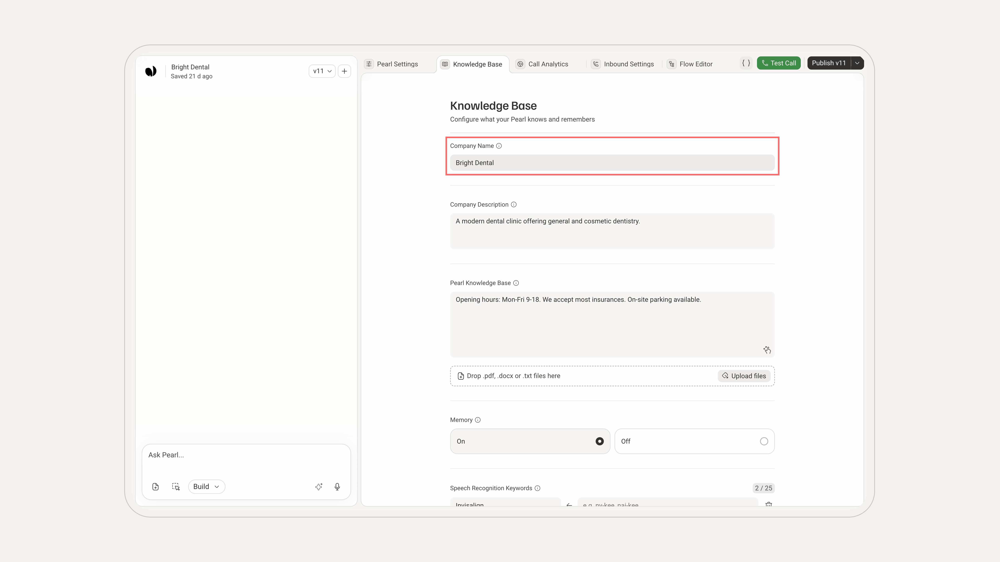</Frame>

<Frame>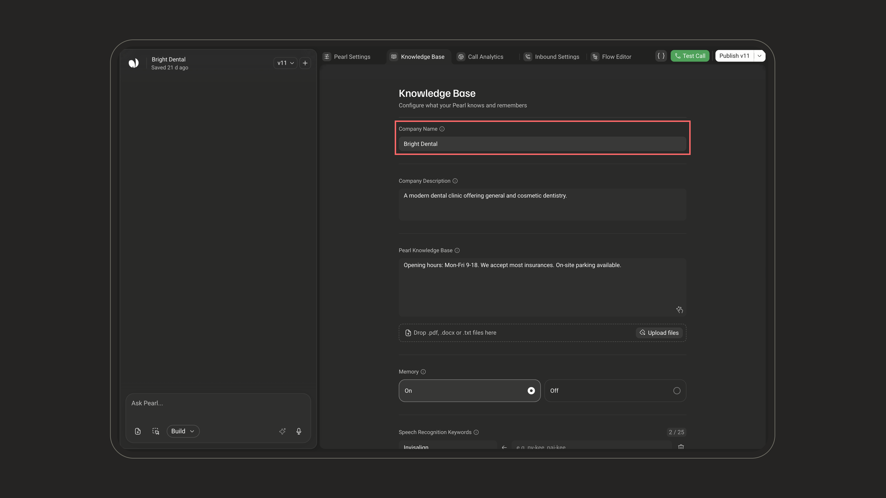</Frame>

---

## Company Description

Add a brief company description including your industry, mission, or key services. This allows Pearl to answer questions with more contextual relevance. It's **required**, up to **500 characters**: a few sentences are enough.

<Frame>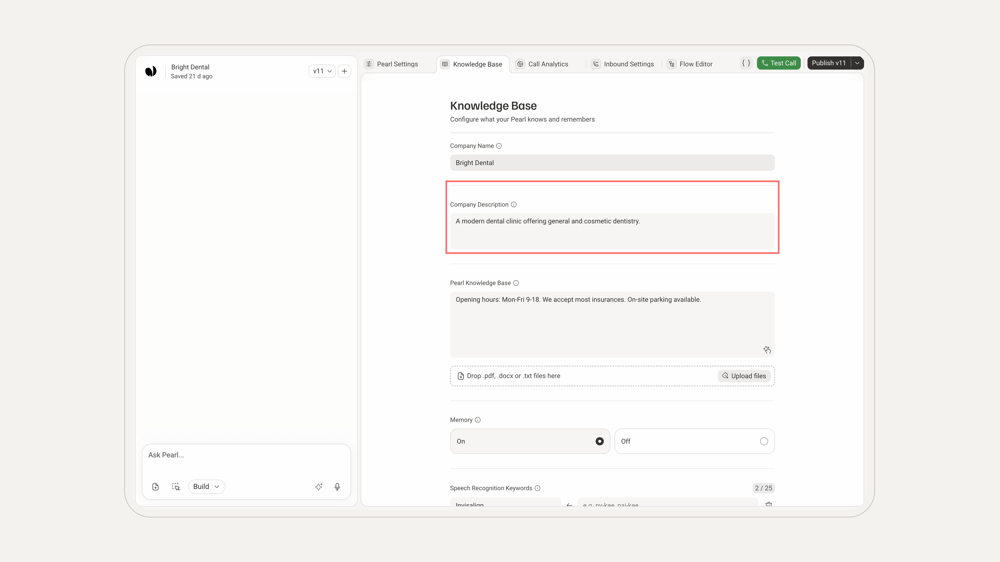</Frame>

<Frame>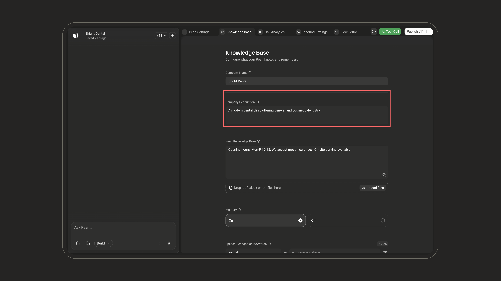</Frame>

---

## Pearl Knowledge Base

This is where you teach Pearl what it needs to know to respond with relevance and accuracy. Add detailed information about your services, pricing, opening hours, locations, and any key operational data.

<Frame>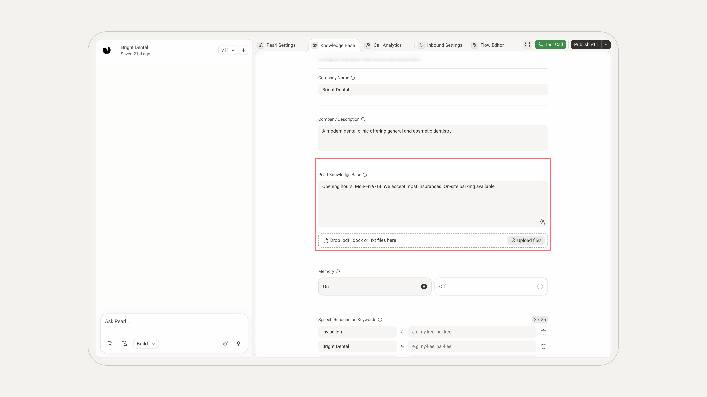</Frame>

<Frame>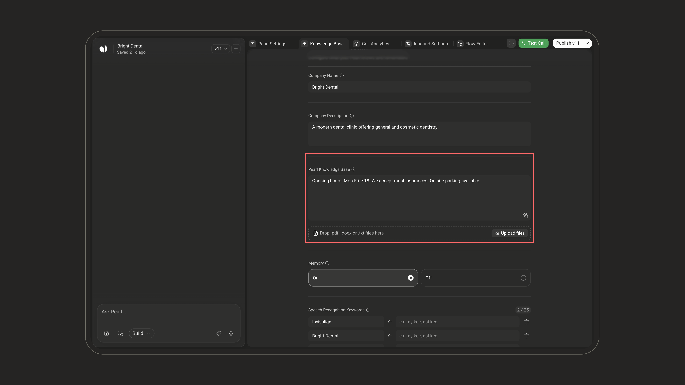</Frame>

- **Text**: type directly in the field (optional). The expand icon at its bottom right opens it in a larger editor.
- **Files**: drop `.pdf`, `.docx`, or `.txt` files anywhere on the section, or click **Upload files**. Each file shows as a chip with its size (and its progress while uploading); click its **×** to remove it.

<Note>
**Background knowledge, not a script.** The Knowledge Base is passive reference data: Pearl consults it **only when needed** to answer accurately. It doesn't dictate the conversation flow, that's handled by the Flow Editor.
</Note>

<Note>
Both options live in the same area and can be combined: type your information directly in the **text field** and/or **upload reference files**. Multiple documents can be added if needed.
</Note>

Whether you're describing how your subscription plans work, listing available services, or clarifying your business hours, this section allows Pearl to access structured information that supports more precise answers.

<Info>
This is the same knowledge that powers the [Knowledge Base node](/pages/knowledge_base_node) in the Flow Editor. What you add here is what your Pearl draws on during conversations.
</Info>

### Files and limits

These caps apply **per Pearl**: they cover every file attached to that Pearl's Knowledge Base, not each file individually.

| Limit | Value |
|---|---|
| Number of files | 50 |
| Supported formats | `.pdf`, `.docx`, `.txt` |
| Total size of all files | 25 MB (no per-file cap) |
| Total text extracted from files | 1,000,000 characters (2,000,000 for chat, SMS, and WhatsApp Pearls) |
| Free-text field | 20,000 characters (counted separately) |

There is no page limit and no character cap on an individual document, only the shared 25 MB and character totals apply. The free-text field has its own 20,000-character budget and does **not** consume the characters reserved for files.

<Tip>
Once the text extracted from your files passes **100,000 characters**, a usage gauge appears next to your files (e.g. *17% of 1M characters*). It turns red if you go over the limit.
</Tip>

<Warning>
Pearl uses the **text extracted** from your `.pdf`, `.docx`, and `.txt` files. Standalone image files can't be uploaded, so make sure anything Pearl needs to answer with exists as text in the document.
</Warning>

---

## Memory

When enabled, Pearl remembers the user or lead, allowing it to seamlessly continue conversations from where they left off. Choose **On** or **Off** (off by default).

<Frame>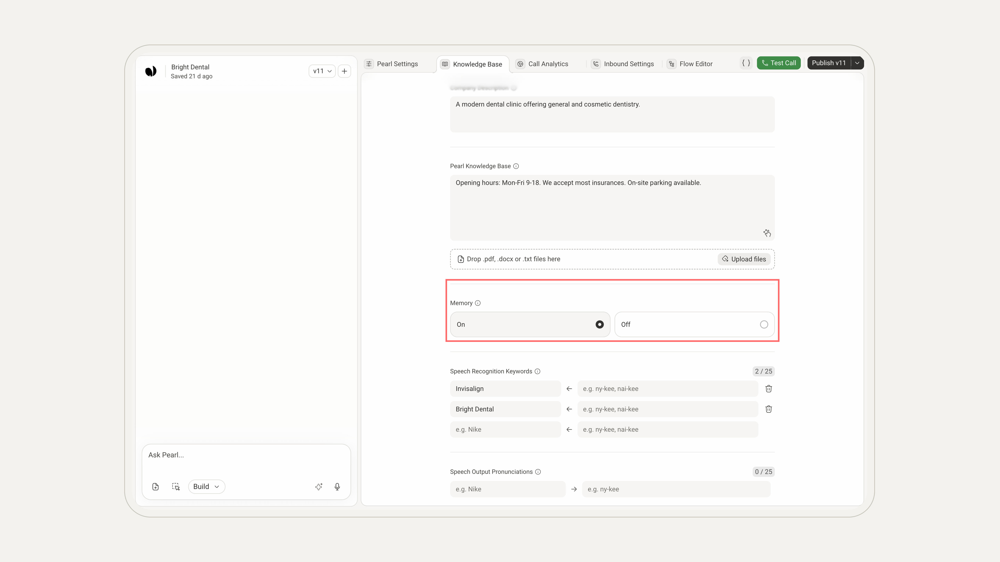</Frame>

<Frame>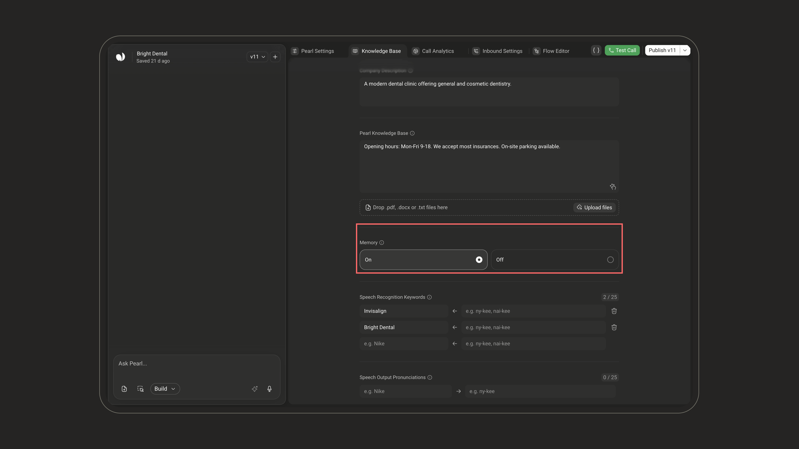</Frame>

How it works:
- After each conversation, Pearl adds what it learned to a short **profile** of that person, built from the conversation summaries.
- The profile is kept **per phone number** and per Pearl. At the start of the next call or conversation with the same number, Pearl reads it and picks up from there.
- Pearls in a [group](/pages/pearl_groups) with **Shared Memory** turned on share the same profiles.
- No phone number, no memory: for example, a [stream call](/pages/stream/overview) started without an `endUserId` is neither remembered nor recognized.

<Tip>
This feature is particularly useful for:
- Multi-step processes  
- Follow-ups  
- Any scenario where continuity matters
</Tip>

<Card>
### Example use case: Hospitality

Let's say a guest checks into a hotel. Once they've mentioned it in a call, Pearl can:
- Remember their room number  
- Greet them by name  
- Recall their preferences (like "extra towels" or "no wake-up call")  
- Offer a smooth, personalized experience every time they call
</Card>

<Info>
**Resetting Memory**

Memory is never cleared automatically. To give a phone number a fresh start, reset its memory through the API (**Reset Memory**, with the phone number).

This is especially important in contexts like hospitality: when a guest checks out, have your system reset the memory of their number, so the next guest starts with a clean experience.
</Info>

---

## Speech Recognition Keywords

Some words are just… not in the dictionary. Whether you're using brand-specific terms, creative product names, or industry jargon, teaching Pearl how to recognize them makes all the difference.

<Frame>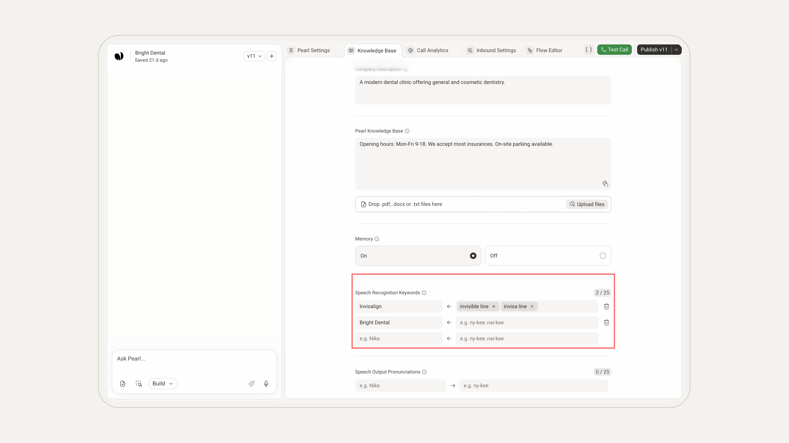</Frame>

<Frame>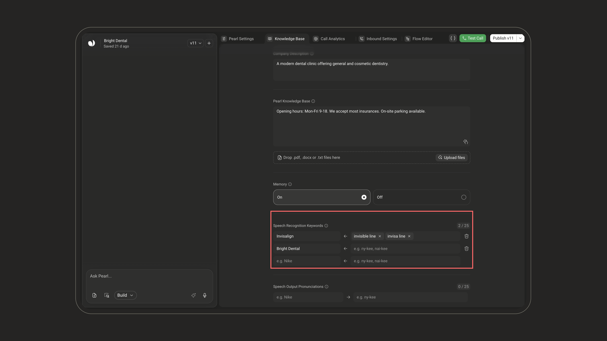</Frame>

Each row has two fields:
- **Pearl understands**: the word you want Pearl to catch. Pearl's speech recognition listens for it in priority.
- **Caller says** (optional): how the transcription might write it by mistake. Whenever one of these variants shows up in what the caller said, Pearl reads it as your keyword.

To add a keyword, fill the empty row at the bottom. In **Caller says**, press **Enter** or type a comma after each variant. Use the trash icon to delete a row.

<Note>
**Limits:** up to **25** keywords, each a **single word** without digits (no duplicates), with up to **4** variants. The first and last name of the person on the call are added as keywords automatically.
</Note>

<Card>
### Example

Let's say your bakery sells a pastry called `FluffoBun`.

Here's how you'd define it:
- **Pearl understands:** FluffoBun  
- **Caller says:** fluffy bun, fluff o bun  
*(Press Enter or type a comma after each variant)*

Write the variants the way a transcription would spell them, as real words, not as phonetic spellings: if the caller's "FluffoBun" comes out as "fluffy bun", Pearl now reads it as FluffoBun.
</Card>

---

## Speech Output Pronunciations

Speech Output Pronunciations let you fine-tune how Pearl *pronounces* specific words or short phrases out loud. You provide the text as it appears (**Pearl says**) and a simple phonetic respelling of how it should actually sound (**Caller hears**).

<Frame>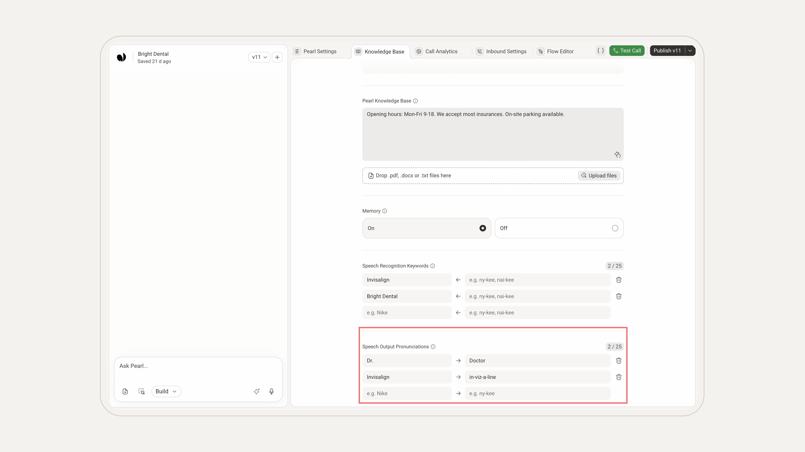</Frame>

<Frame>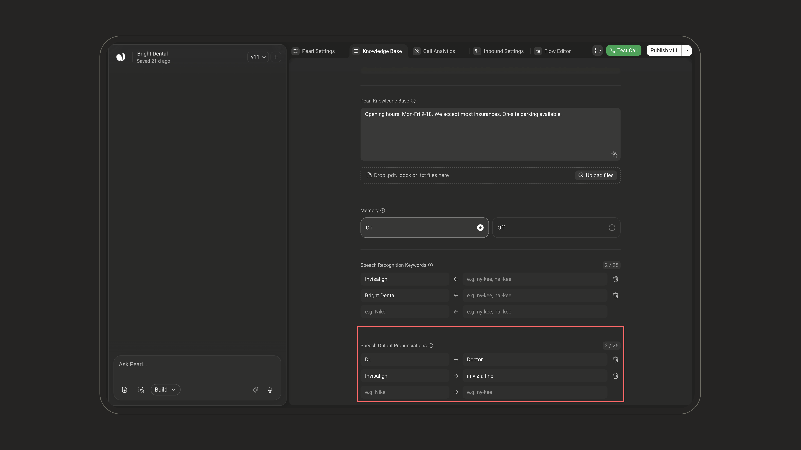</Frame>

Whenever Pearl is about to speak a word or phrase listed in **Pearl says**, it uses the **Caller hears** respelling instead. It changes the **audio only**: your scripts, variables, and node text stay exactly as you wrote them.

Matching is on **whole words or phrases**, regardless of case (`dr.` matches `Dr.`). When two entries overlap, the longest one applies first.

Reach for it whenever text-to-speech mispronounces something important, such as:

| Use case | Example |
| --- | --- |
| **Brand and product names** | `Nike` → `ny-kee` |
| **Acronyms** you want spelled out | `NLPearl` → `N-L-Pearl` |
| **Industry terms** | `SQL` → `sequel` |
| **Abbreviations** you want expanded | `Dr.` → `Doctor` |
| **Foreign or uncommon words** | Words that need a specific phonetic reading |

To add one, fill the empty row at the bottom: type the text in **Pearl says**, then a plain phonetic respelling in **Caller hears** (readable syllables separated by hyphens, e.g. `ny-kee`). Use the trash icon on a row to delete it.

<Info>
Write **Caller hears** the way it should be *spoken*, not spelled, e.g. `2024` → `twenty twenty-four`, or `NLPearl` → `N L Pearl`. Keep it simple and phonetic.
</Info>

<Warning>
**Each row must have both fields filled**: a **Pearl says** value *and* a **Caller hears** value. Otherwise the row is flagged as incomplete. Empty rows are ignored and dropped when you save.
</Warning>

<Note>
**Limits:** up to **25** entries, and each field is capped at **50 characters**.
</Note>

<Note>
**Speech Output Pronunciations vs. Speech Recognition Keywords** — don't mix them up:
- **Speech Output Pronunciations** control how Pearl **speaks** (text-to-speech / output). Fields: **Pearl says** → **Caller hears**.
- **Speech Recognition Keywords** help Pearl **understand** what the caller says (speech-to-text / input). Fields: **Pearl understands** ← **Caller says**.

Both are voice settings: they don't appear on chat, SMS, and WhatsApp Pearls.
</Note>
