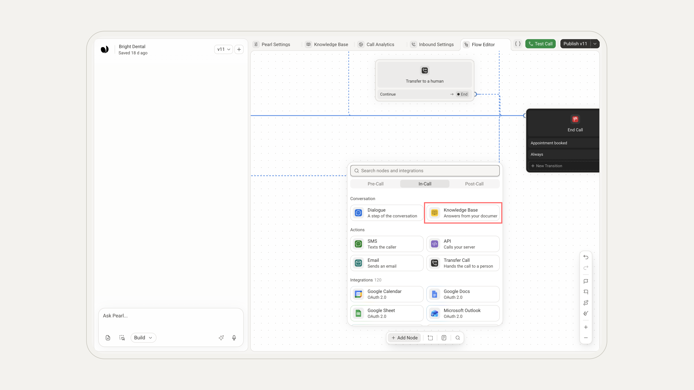
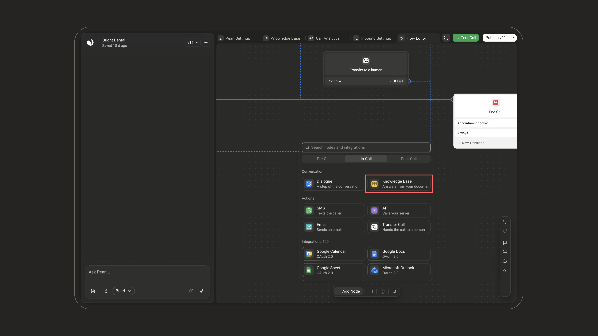
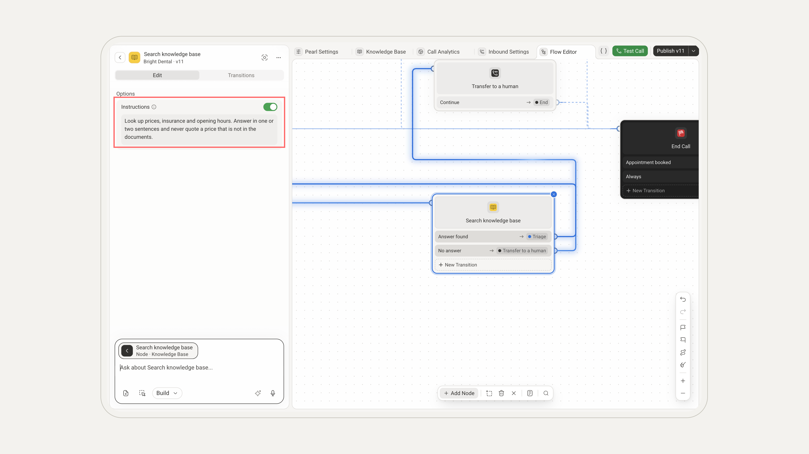
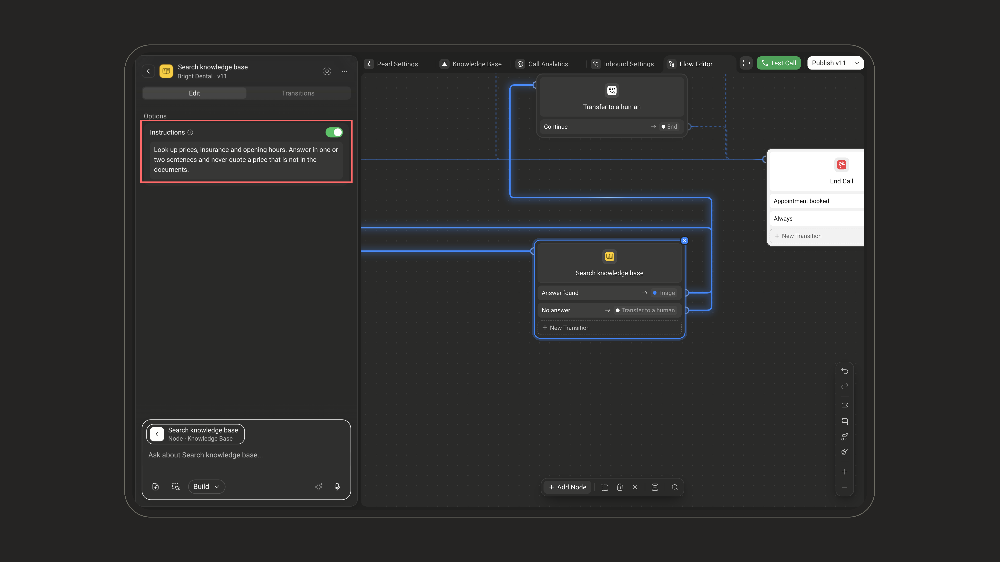
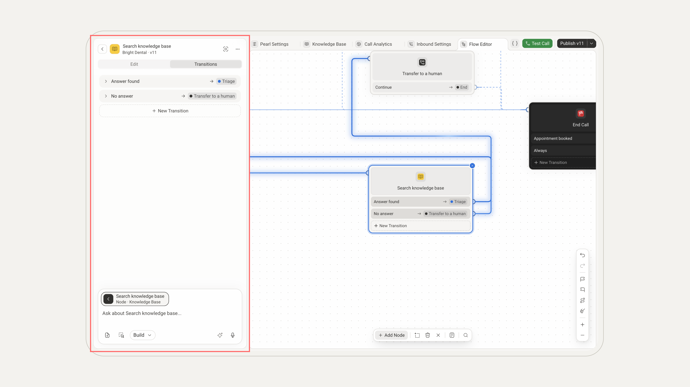
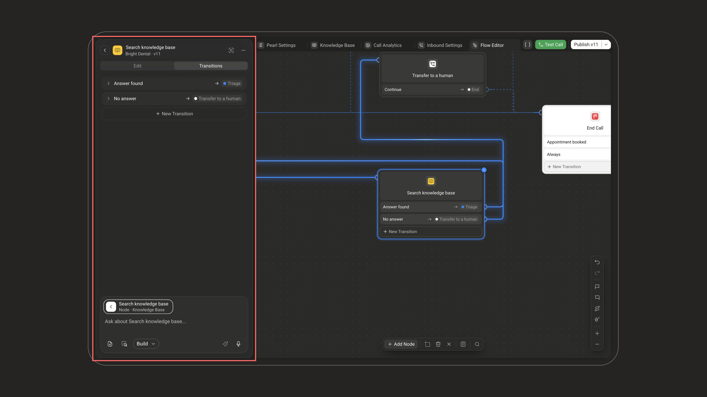
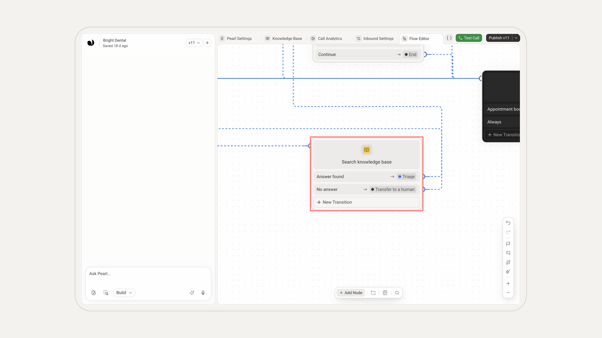
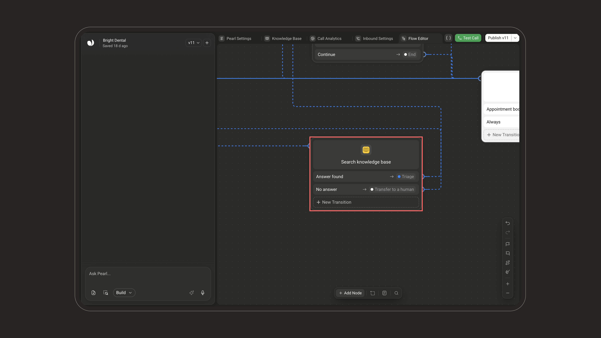

  <Frame>
    

      
    

  </Frame>

  <Frame>
    

      
    

  </Frame>

The **Knowledge Base** node makes Pearl search your own documents at a given step of the conversation and answer from what she finds, instead of reading a scripted line. It works on voice and text Pearls alike.

## What it does

When the conversation reaches the node, Pearl turns the customer's question into a search, looks it up in your Pearl's knowledge base, and answers in her own words from the most relevant passages.

## When to use it

Use it whenever Pearl should answer from your own content (product details, pricing, policies, opening hours) rather than from a fixed script. It is ideal for open-ended questions whose wording varies from one customer to the next.

## How to configure

<Steps>
  <Step title="Add the node">
    In the [PearlVibe editor](/pages/pearl_vibe), click **Add Node** and pick **Knowledge Base** in the **Conversation** section of the **In-Call** tab (**In-Chat** on a text Pearl). You can also ask PearlVibe to add one for you in the chat (**Build** mode).

    To configure it by hand, click it on the canvas and open it with the pencil of its tile in the chat (**Manual edit**), or hover it and click **Edit Manually**. Your changes are kept once you click **Save Changes**.

    

      <Frame>
        
      </Frame>
    

    

      <Frame>
        
      </Frame>
    

  </Step>
  <Step title="Add instructions (optional)">
    In **Options**, turn on **Instructions** to tell Pearl how to use what she finds: the topics to look up, what to leave out, how long the answer should be — up to 250 characters.

    

      <Frame>
        
      </Frame>
    

    

      <Frame>
        
      </Frame>
    

  </Step>
  <Step title="Set the transitions">
    In the **Transitions** tab, add a transition for each outcome — typically one for when Pearl found the answer and one for when your documents don't cover the question. Each transition has a **Condition**, written in plain language, and a **Node Chosen**, the node the conversation goes to. Use **New Transition** to add one.

    

      <Frame>
        
      </Frame>
    

    

      <Frame>
        
      </Frame>
    

  </Step>
</Steps>

On the canvas, the node shows each transition and the node it leads to.

  <Frame>
    
  </Frame>

  <Frame>
    
  </Frame>

<Info>
The content itself lives in the **Knowledge Base** tab of the Pearl editor, not in the node: the node only tells Pearl to search it. See [Knowledge Base](/pages/knowledge_base) to manage your content, including [supported formats and limits](/pages/knowledge_base#files-and-limits).
</Info>

## Example

<Card title="Example: answering about opening hours" icon="clock">

Imagine your knowledge base includes a document that says:

> The clinic is open Monday to Friday, 9 AM to 6 PM, and Saturday from 9 AM to 1 PM.

Here is how the node uses it:

1. The customer asks: *"Are you open on Saturdays?"*
2. The **Knowledge Base** node makes Pearl search your documents and find the opening hours.
3. Pearl answers: *"Yes, we're open on Saturdays from 9 AM to 1 PM."*
4. The **Answer found** transition takes the conversation on to the next step of your flow.

</Card>

## Good to know

- Your content is managed once, in the **Knowledge Base** tab, so every Knowledge Base node in your flow searches the same documents. You don't need to upload them again for each node.
- Pearl already has part of your knowledge base in mind during the whole conversation. The node goes further: at this step, it makes her search your documents for the answer to the customer's question.
- If your documents don't cover the question, the search comes back empty. Plan a transition for that case, for example to a [Transfer Call](/pages/transfer_call) node or to a [Dialogue](/pages/dialogue) node that offers a callback.
