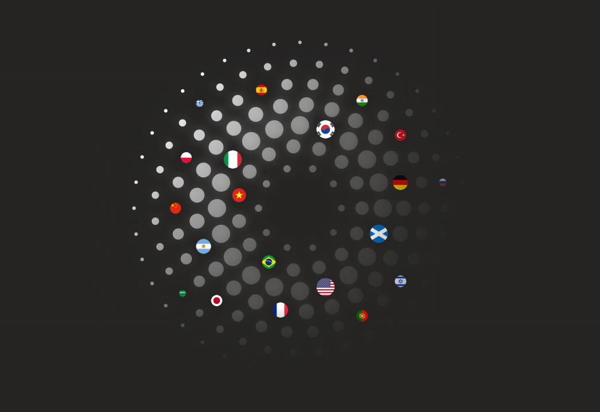
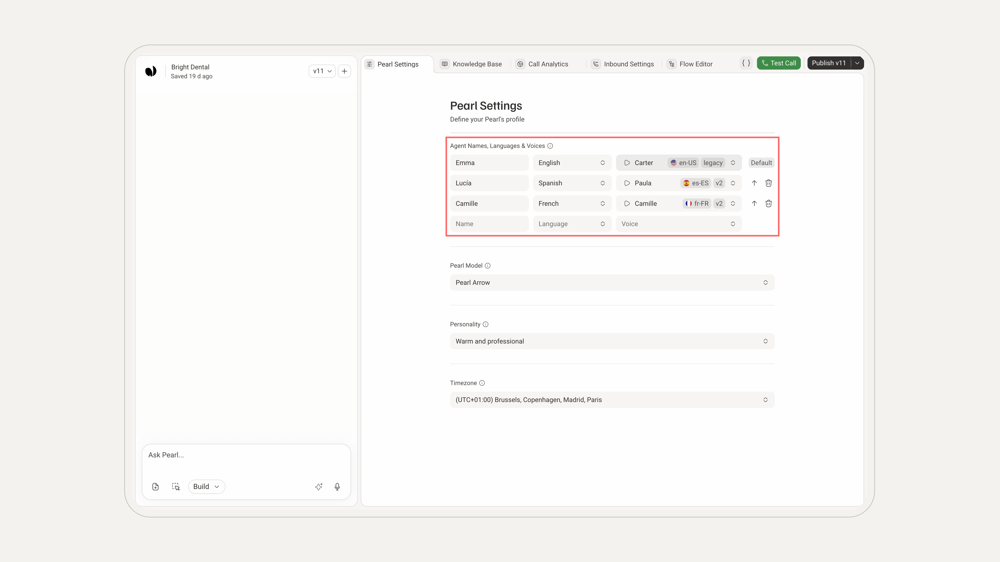
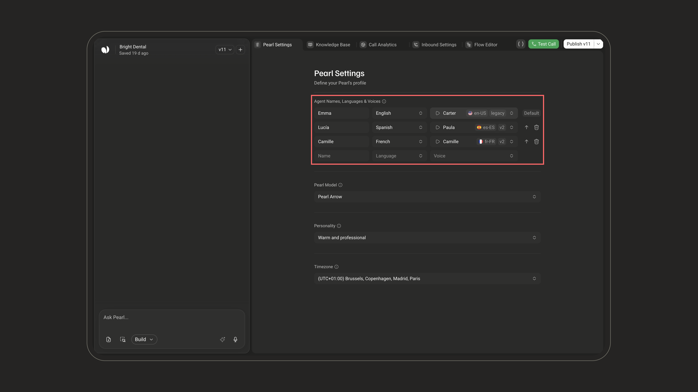
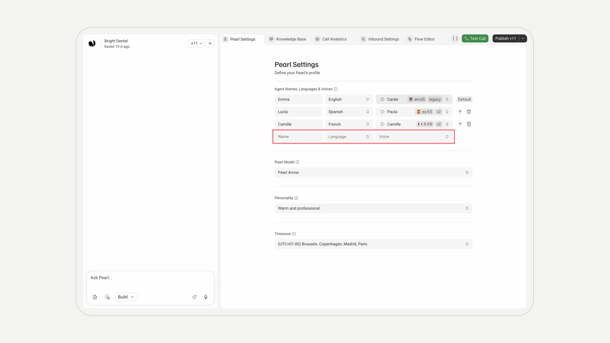
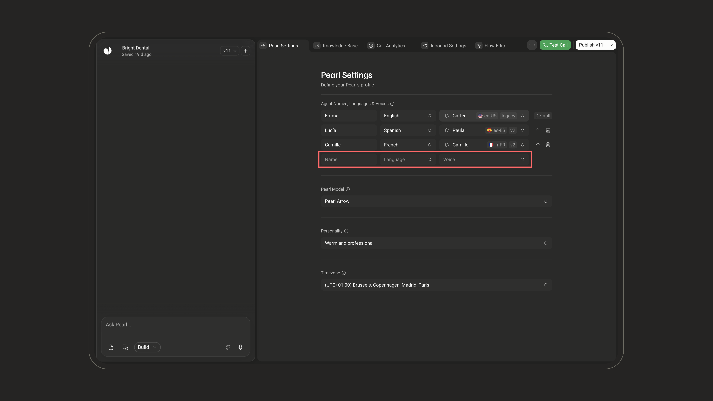
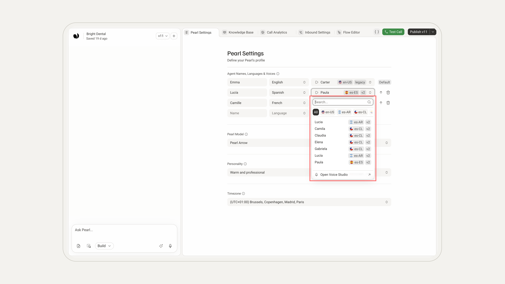
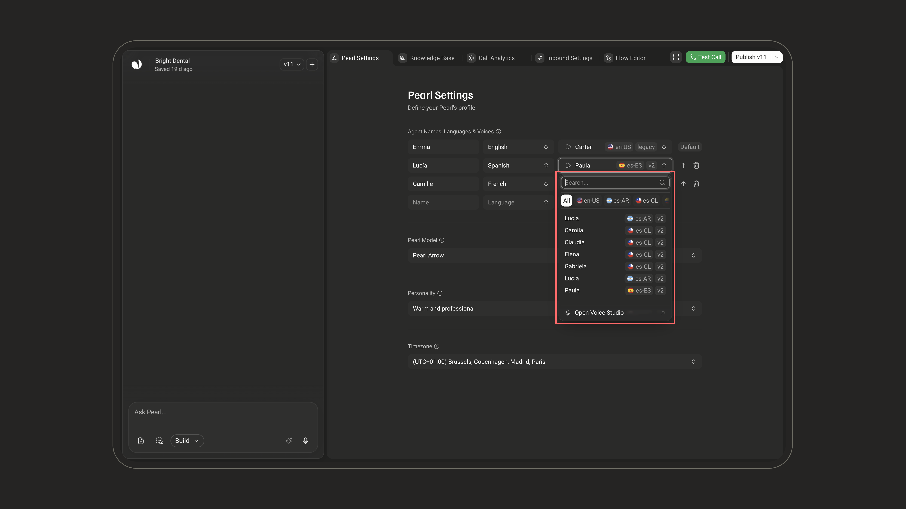
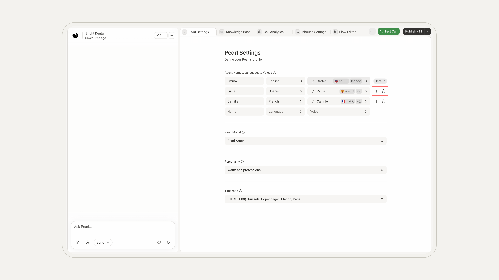
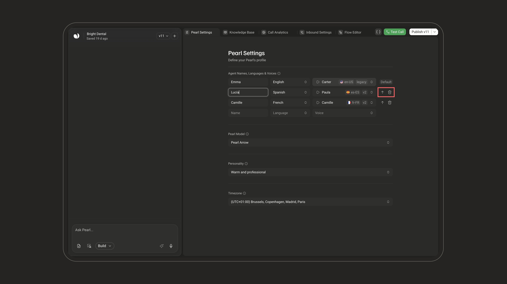

  <Frame>
    

      
    

  </Frame>

  <Frame>
    

      
    

  </Frame>

---

### Configuring Agent Names, Languages & Voices

When creating or editing your Pearl, you can set up multiple agents with different languages and voices. This flexibility allows your Pearl to engage in conversations in more than one language and switch smoothly between them as needed.

<Info>
For chat, SMS, and WhatsApp Pearls, this section is a single **Agent Name** field: the name your Pearl answers with. Languages, voices, and language switching apply to voice Pearls.
</Info>

---

#### How to Add Multiple Languages and Voices

<Steps>
  <Step title="Open the Agent Names, Languages & Voices section">
Open your Pearl's editor (**Edit Pearl** in the **Settings** of the Pearl's page) and go to the **Pearl Settings** tab. In **Agent Names, Languages & Voices**, each row is one agent: its **Name**, **Language**, and **Voice**. The voice shows its accent next to its name (e.g. `en-US`).

<Frame></Frame>

<Frame></Frame>

<Note>
Your changes are saved automatically in your Pearl's draft. Publish the Pearl to use them in live calls.
</Note>

  </Step>

  <Step title="Add an agent">
Use the empty row at the bottom (**Name**, **Language**, **Voice**). Type a name, or pick a language or a voice: the agent is added right away, and you can adjust its other fields.

- **Name**: the name the agent uses during conversations in that language (required, up to 25 characters).
- **Language**: pick a language from the supported list.
- **Voice**: pick a voice for that language.

<Frame></Frame>

<Frame></Frame>

<Note>
Each language can be assigned to **only one agent**: languages already in use don't appear in the list. Once every language is used, the empty row disappears.
</Note>

  </Step>

  <Step title="Choose a voice and accent">
Open the **Voice** list to browse the available voices:

- **Search** a voice by name.
- When a language has several accents, filter the list with the accent chips (**All**, `es-AR`, `es-CL`…) to match your target audience.
- Your favorite voices (star) come first.
- To hear a voice, select it, then click the **play** button in its field.

**Open Voice Studio**, at the bottom of the list, opens [Voice Studio](/pages/voice_studio) in a new tab to create or fine-tune a voice (English, Spanish, French, German, Italian, and Hebrew).

<Frame></Frame>

<Frame></Frame>

  </Step>

  <Step title="Set the default (opening) language">
The first agent, marked **Default**, is the one your Pearl uses to open the conversation.

To change it, click **Make default** (↑) on another agent's row: that agent moves to the top. Click the trash icon (**Delete**) to remove an agent. The default agent can't be deleted: make another agent the default first.

<Frame></Frame>

<Frame></Frame>

  </Step>
</Steps>

<Note>
Switching Languages During a Call

- Pearl switches to another language when the caller asks for it, or simply starts speaking it, as long as you've added an agent for that language.
- The current agent says a short word in its own language, a brief ring plays, then the agent for the new language introduces itself and continues the conversation where it left off, without asking the caller to repeat anything.
- If the requested language isn't configured, Pearl stays in its current language and tells the caller which languages it can speak.
</Note>

---

### Supported Languages and Accents

Currently, NLPearl.AI supports the following languages and accents:

| **Language**   | **Accent(s)**                                | **Tag(s) shown on voices**         |
| -------------- | -------------------------------------------- | -----------------------------------|
| **English**    | American, British, Australian, South African, Irish, Scottish, Indian | `en-US`, `en-UK`, `en-AU`, `en-ZA`, `en-IE`, `en-SC`, `en-HI` |
| **French**     | French, Canadian French                      | `fr-FR`, `fr-CA`                   |
| **Italian**    | Italian                                      | `IT`                               |
| **Spanish**    | Spanish, Mexican, Argentine, Colombian, Chilean, Peruvian, Latin American | `es-ES`, `es-MX`, `es-AR`, `es-CO`, `es-CL`, `es-PE`, `es-LATAM` |
| **Dutch**      | Dutch                                        | `NL`                               |
| **German**     | German                                       | `DE`                               |
| **Hindi**      | Hindi                                        | `HI`                               |
| **Japanese**   | Japanese                                     | `JP`                               |
| **Mandarin**   | Mainland Chinese, Taiwanese                  | `zh-CN`, `zh-TW`                   |
| **Korean**     | Korean                                       | `KR`                               |
| **Russian**    | Russian                                      | `RU`                               |
| **Portuguese** | Brazilian Portuguese, European Portuguese    | `pt-BR`, `pt-PT`                   |
| **Turkish**    | Turkish                                      | `TR`                               |
| **Vietnamese** | Vietnamese                                   | `VI`                               |
| **Polish**     | Polish                                       | `PL`                               |
| **Arabic**     | Levantine Arabic                             | `AR`                               |
| **Greek**      | Greek                                        | `EL`                               |
| **Hebrew**     | Hebrew                                       | `HE`, `he-IL`                      |
| **Indonesian** | Indonesian                                   | `ID`                               |

<Note>
The languages and accents follow the voice catalogue, which grows over time: the **Language** and **Voice** lists in your Pearl always show what's available. Some voices also show a version tag, such as `v2`.
</Note>

---

<Card icon="circle-info" iconType="light">
### Important Notes

- **Language Consistency**:
  - Ensure that your conversational flow and scripts are consistent with the languages you've configured.
  - For example, if you have English and Spanish agents, provide scripts in both languages.

- **Default Language**:
  - The default language is crucial as it determines how the conversation begins.
  - Make sure the default language aligns with the expectations of your target audience.

- **Accents and Regional Variations**:
  - Choose accents that best match your audience to enhance the user experience.

</Card>

---

### Expanding Language Support

We are continuously working to expand our range of supported languages and accents to meet the diverse needs of our users. Stay tuned for updates as we grow our offerings.

<Note>
Feedback and Requests

If you have specific language or accent requirements that are not currently supported, please reach out to our support team. We are committed to accommodating your needs and will consider your requests as we expand our capabilities.
</Note>

---

<CardGroup cols={2}>
  <Card
    title="Voice Studio"
    icon="microphone"
    iconType="light"
    href="/pages/voice_studio"
  >
    Create or fine-tune a voice for your Pearl's agents.
  </Card>
  <Card
    title="Contact Support"
    icon="headset"
    iconType="light"
    href="mailto:support@nlpearl.ai"
  >
    Contact our support team to request additional languages or accents.
  </Card>
</CardGroup>
