

  <Frame>
    

      
    

  </Frame>

  <Frame>
    

      
    

  </Frame>

NLPearl.AI allows you to purchase phone numbers directly from our platform to support your inbound and outbound call activities. These phone numbers are billed monthly and can be managed easily within your account.

<Card>
### Available Countries

Currently, we offer phone numbers for purchase from the following country:

| Country        | ISO Code | Status                       |
|----------------|----------|------------------------------|
| United States  |`US`       | Available |

<Note>
If you require phone numbers from other country codes, please consider using our [Twilio Integration](/pages/twilio_integration) or [Custom VoIP Integration](/pages/custom_voip) options.
</Note>
</Card>
---

### Before You Purchase

<Info>
**An active subscription is required.** Buying an NLPearl phone number is only available on a paid plan. Without one, **Purchase NLPearl Number** takes you to the **Subscriptions** page instead.
</Info>

Each phone number is billed monthly, and the exact per-number price is shown in the purchase window next to each number. Numbers included in your plan appear as **Free with plan** in the cart (see [Payment and Billing](#payment-and-billing)).

<Warning>
**Outbound calling & spam risk:** If you plan to make outbound calls, we strongly recommend integrating and verifying your number with a VoIP provider. Otherwise, carriers may flag it as spam.
</Warning>

<Warning>
**Calls stay within the number's country:** an NLPearl number can only call and transfer to phone numbers from its own country. For example, a US number can only reach US numbers.
- **Outbound calls**: leads whose number is from another country are not called, and their status becomes **Wrong Country Code**.
- **Call transfers**: on inbound and outbound calls, a [Transfer Call](/pages/transfer_call) to a number from another country is refused during the call. The caller stays with your Pearl, and the failed transfer appears in the call's Event Log.

To call or transfer to other countries, use a [Twilio](/pages/twilio_integration) or [Custom VoIP](/pages/custom_voip) number instead.
</Warning>

---

### How to Purchase a Phone Number

Follow these steps to purchase a phone number from NLPearl.AI:

<Steps>

<Step title="Go to Phone Numbers Settings">

Click your **profile** at the bottom-left corner of the sidebar, then click **Settings**.

<Frame>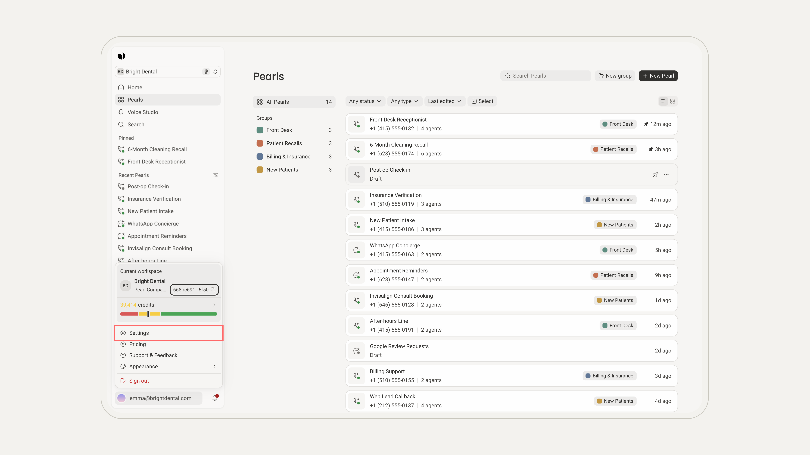</Frame>

<Frame>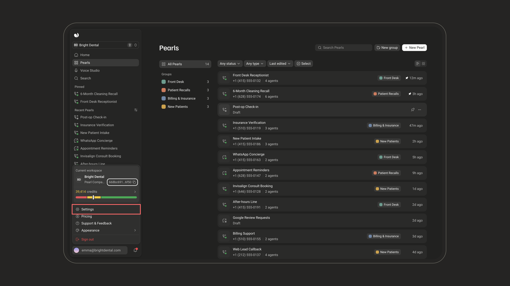</Frame>

In the Settings window, open **Phone Numbers** (under **Channels**). It lists every number in your workspace.

<Frame>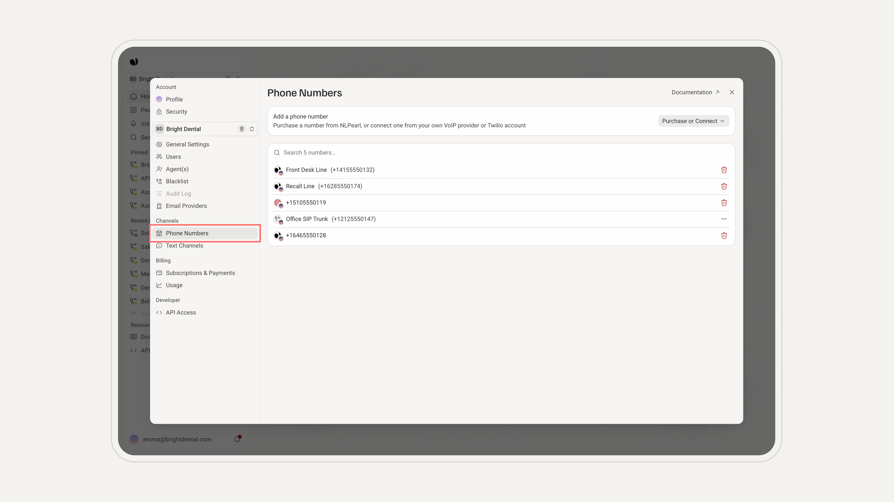</Frame>

<Frame>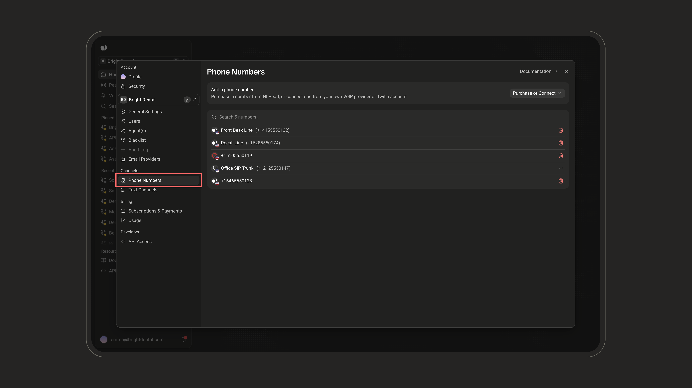</Frame>

</Step>

<Step title="Click Purchase or Connect">

Click **Purchase or Connect** at the top right of the list, then choose **Purchase NLPearl Number**.

<Frame>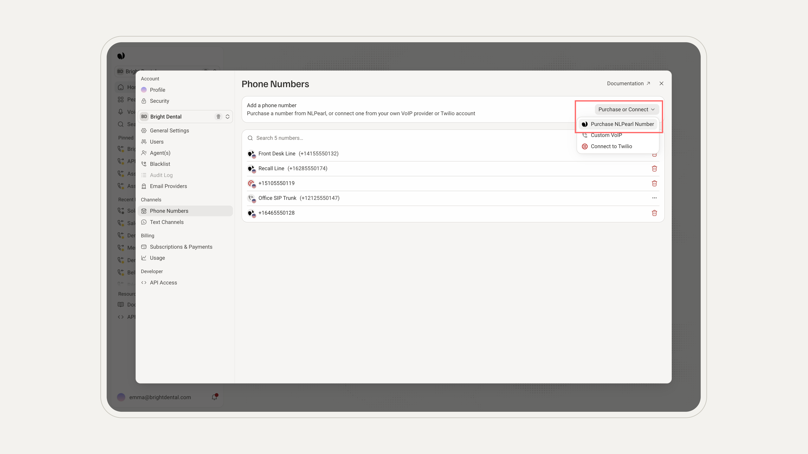</Frame>

<Frame>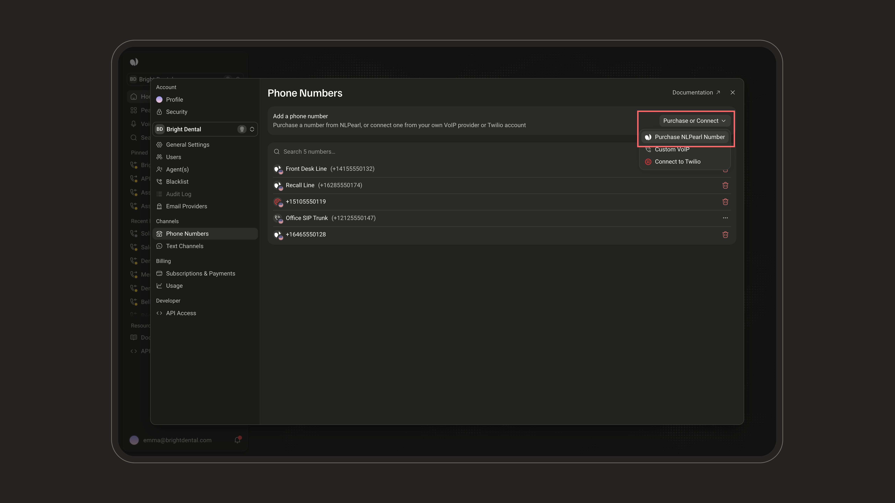</Frame>

</Step>

<Step title="Select Phone Numbers">

The **Purchase phone numbers** window opens. The list on the left shows available US numbers, each with its monthly price.

Click **Add to cart** next to each number you want. The button turns into **Remove**, which takes the number back out of the cart.

<Frame>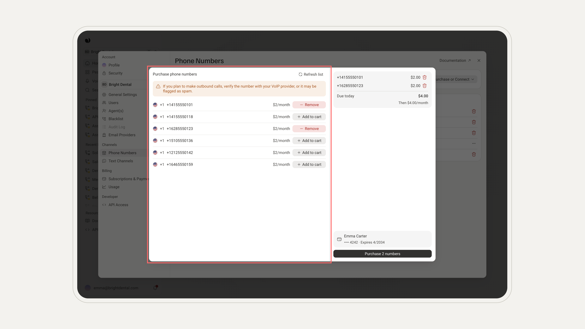</Frame>

<Frame>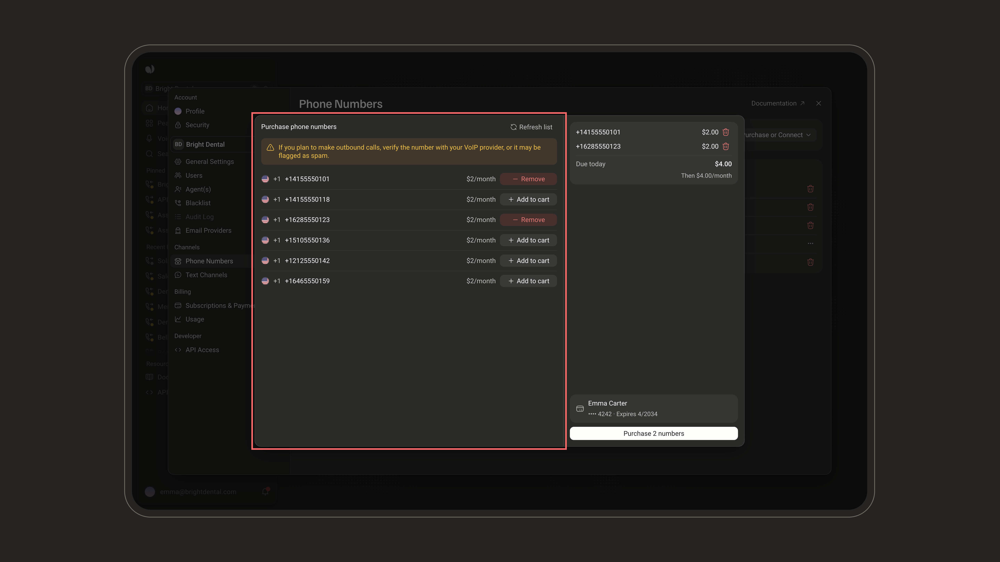</Frame>

<Note>
**Not finding a number you like?** Click **Refresh list** at the top of the window to get a new selection of available numbers.

<Frame>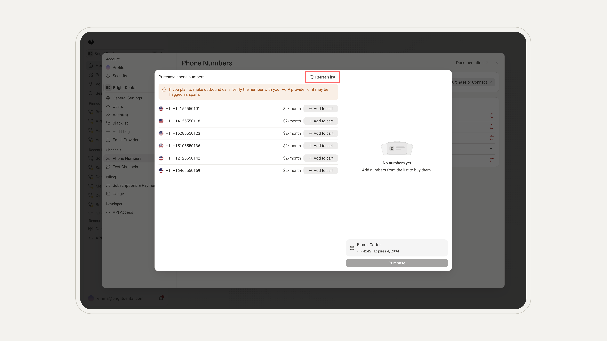</Frame>

<Frame>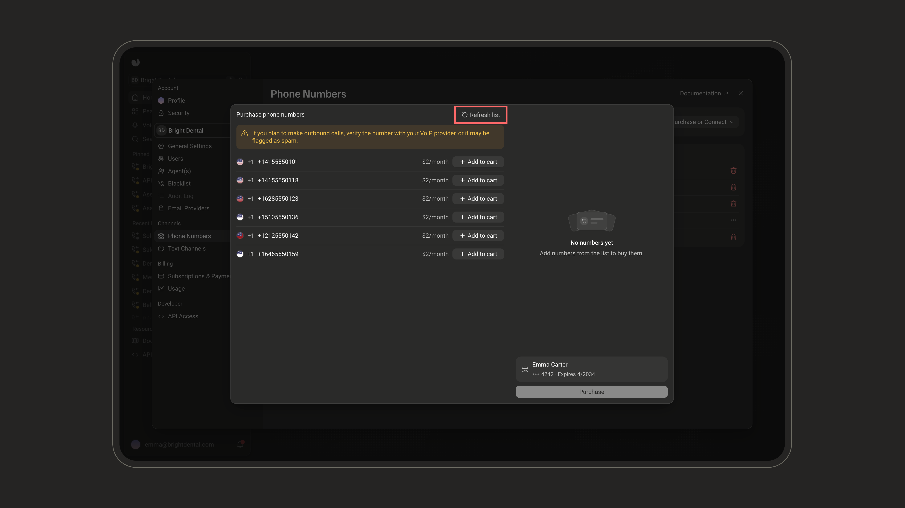</Frame>

</Note>

</Step>

<Step title="Review Your Cart">

The cart on the right lists every number you added.

- Each line shows a number and its monthly price. To remove a number, click the **trash icon** next to it.
- **Due today** shows what you pay now, and **Then $X/month** the recurring cost. Both update as you add or remove numbers.
- Numbers covered by your plan show **Free with plan** (see [Payment and Billing](#payment-and-billing)).
- The card that will be charged is shown at the bottom, above the purchase button.

<Frame>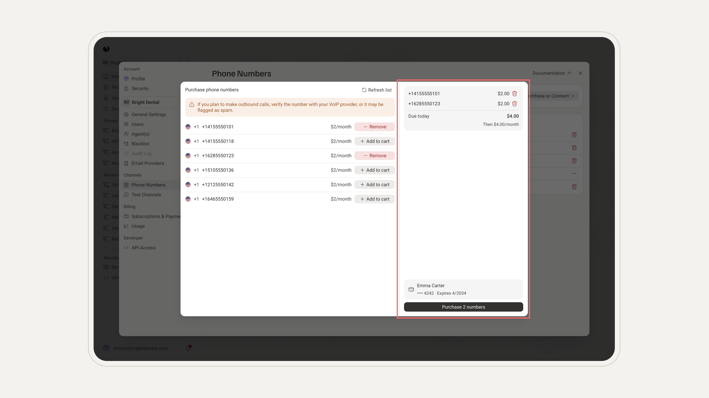</Frame>

<Frame>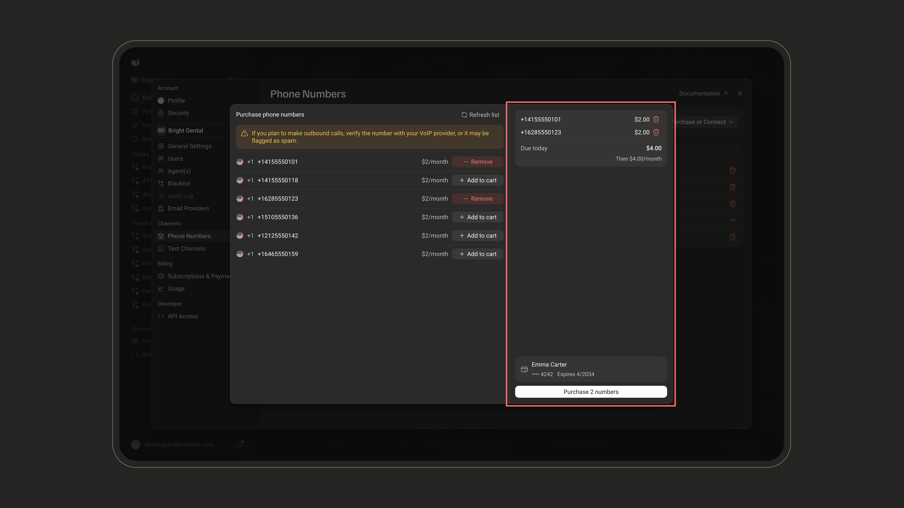</Frame>

</Step>

<Step title="Complete the Purchase">

When you're happy with your selection, click the purchase button at the bottom of the cart (for example, **Purchase 2 numbers**). The numbers are added to your account right away and appear in your **Phone Numbers** list, ready to use.

</Step>

<Step title="Assign the Number to a Pearl">

Open the Pearl that should use the number, inbound or outbound, and click **Settings** at the top right of its page.

In the **Phone Number** row, click the current number (or **Choose a number** if none is set). The menu groups your numbers by source (**NLPearl**, **Twilio**, **SIP**), with a search field at the top. Pick a number: it is saved right away.

Need another number? **Buy or connect a number**, at the bottom of the menu, lets you add one without leaving the page.

<Frame>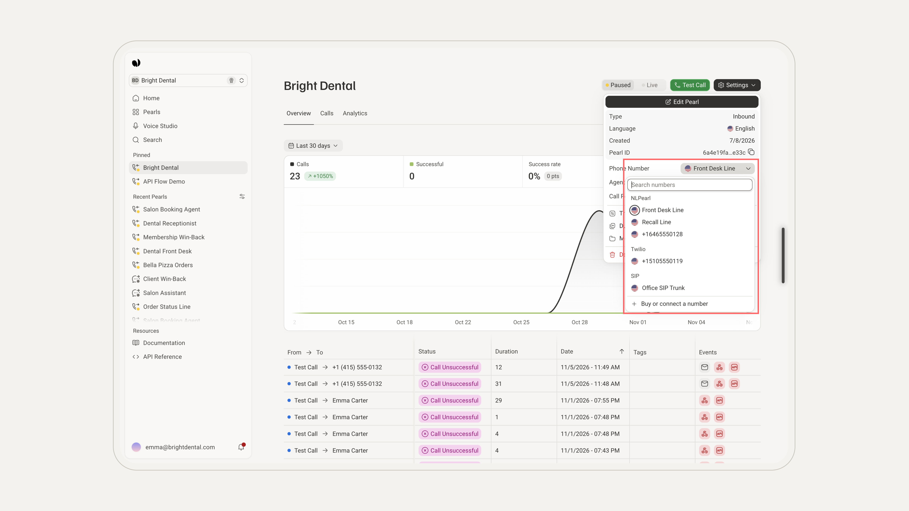</Frame>

<Frame>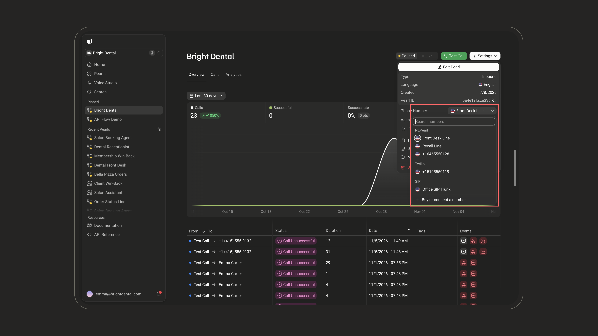</Frame>

</Step>
</Steps>

<Card title="Deleting Phone Numbers" icon="circle-info" iconType="light">

If you no longer need a phone number, you can schedule it for deletion from your Settings.

In **Settings → Phone Numbers**, click the **trash icon** at the end of the number's row. In the **Delete this number?** window, check the number and click **Delete number**.

<Frame>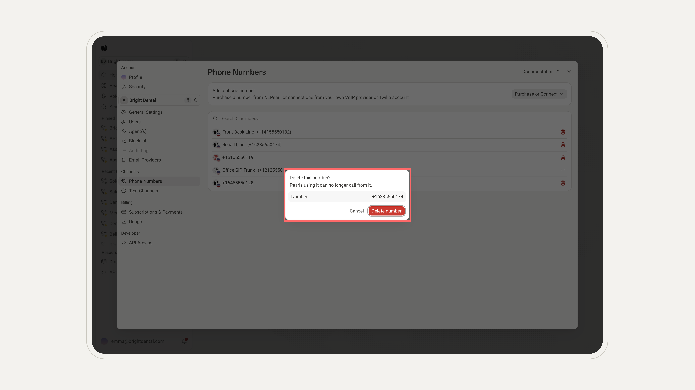</Frame>

<Frame>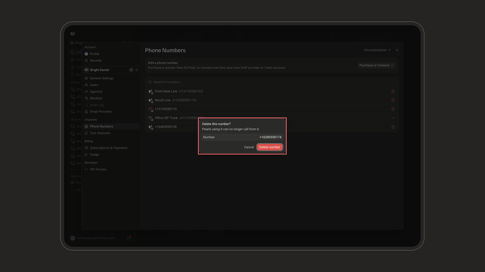</Frame>

The deletion is scheduled, not immediate. The number remains active until its **billing anniversary date**, and its status shows **Active till** that date. After that, it is automatically removed from your account.

<Warning>
Once the number is removed, Pearls using it can no longer call from it. Assign them another number before that date.
</Warning>

</Card>
---

### Payment and Billing

Phone numbers are billed on a monthly basis, charged to the **credit card** saved on your account. Once the transaction is processed, you'll receive an invoice by email.

<Note>
**Subscription Inclusions**:  
If your plan includes phone numbers and you haven't used your allowance yet, those numbers appear as **Free with plan** in the cart, at no extra cost. If you add more numbers than your plan includes, use **Make this free** on a number to choose which one uses your included allowance.
</Note>

---

<Warning>
### Important Considerations

- **Monthly Billing Cycle**: Phone numbers are billed on a monthly cycle starting from the date of purchase.
- **Country Code Limitations**: Currently, only US phone numbers are available for direct purchase. An NLPearl number can only call and transfer to numbers from its own country. For other countries, consider alternative integration options.
- **Payment Method**: Keep a valid credit card on file to avoid interruptions in service.
</Warning>

---

<Card title="Need Phone Numbers from Other Countries?" icon="circle-info" iconType="light">
  
   

<CardGroup cols={2}>
  <Card
    title="Twilio Integration"
    icon="object-intersect"
    iconType="light"
    href="/pages/twilio_integration"
  >
    Explore our **Twilio Integration** to access a broader range of international phone numbers.
  </Card>
  <Card
    title="Custom VoIP Integration"
    icon="code-branch"
    iconType="light"
    href="/pages/custom_voip"
  >
    Consider the **Custom VoIP Integration** if you have specific VoIP services you wish to use.
  </Card>
</CardGroup>
</Card>

