PearlVibe is a powerful AI-assisted flow editor that allows you to design and visualize conversation flows in a user-friendly, visual interface. Whether you're creating customer surveys, support dialogues, or interactive voice responses, PearlVibe helps you craft natural and personalized conversations.

  <Frame>
    

      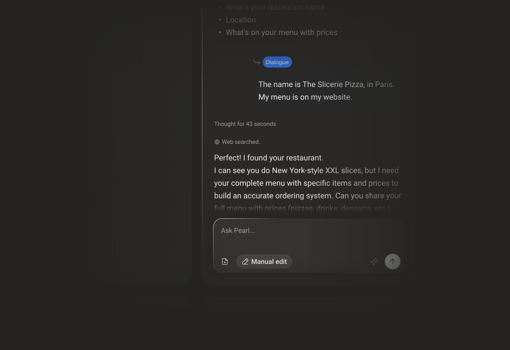
    

  </Frame>

  <Frame>
    

      
    

  </Frame>

---

## Overview

### What is PearlVibe?

PearlVibe is an AI‑assisted flow editor for building your agents - both **voice** (phone) and **text** agents. You build your Pearl as a decision tree made of nodes (dialogue, actions, integrations…) and transitions (what happens next depending on user intent, answers, or conversation outcome).

<iframe
  src="https://www.youtube.com/embed/tTYdxBLxpZ0"
  title="NLPearl - AI Voice Agents"
  frameBorder="0"
  allow="accelerometer; autoplay; clipboard-write; encrypted-media; gyroscope; picture-in-picture"
  allowFullScreen
  style={{ width: '100%', aspectRatio: '16/9', borderRadius: '0.5rem' }}
></iframe>

<Info>
You can work in two complementary ways:

| View | Description |
|------|-------------|
| **Chat (default)** | You describe what you want in natural language (e.g. "Add a post‑call SMS when the booking is confirmed"). In **Build** mode, PearlVibe creates or edits the nodes and transitions for you; in **Ask** mode, it answers and advises without touching your flow. |
| **Manual edit** | You open a node by hand to configure it and its transitions yourself, for full control. Every setting is visible and editable. |
</Info>

### What can you build with PearlVibe?

With PearlVibe, you can design both **voice** (phone) and **text** (chat) flows:

| Flow Type | Use Cases |
|-----------|-----------|
| **Inbound flows** | Support and customer care lines, order tracking, FAQs, triage, appointment management, etc. |
| **Outbound campaigns** | Sales campaigns, payment reminders, debt collection, upsell flows, satisfaction surveys, and more. |

<Info>
Each of these works the same way whether your Pearl is **voice** or **text** — you build the flow once, and the editor adapts labels and available nodes to your Pearl's channel.
</Info>

### Key benefits

<Check>
- **Build in minutes instead of days** – Describe what you want in the chat, let Pearl build it for you in **Build** mode, then refine visually.
- **Safe versioning** – Work in a separate version with autosave while your live version keeps running in production.
- **Visual understanding of calls** – Use test calls and live node highlighting to see exactly how calls traverse your flow.
- **Structured but flexible** – Combine high‑level "vibes" (global instructions, personality) with precise node and transition logic.
</Check>

---

## Header

The editor's controls sit along its top edge. Above the chat, on the left, you find the **Pearl icon** (it opens the Pearl menu), the editable **Pearl title** with its autosave indicator, the **version selector**, and the **+** button. Across the rest of the top edge run the **navigation tabs**, then — on the right — the **Variables & credentials** (`{ }`) button, **Test Call**, and the **Publish** button. Each of these is detailed below.

  <Frame>
    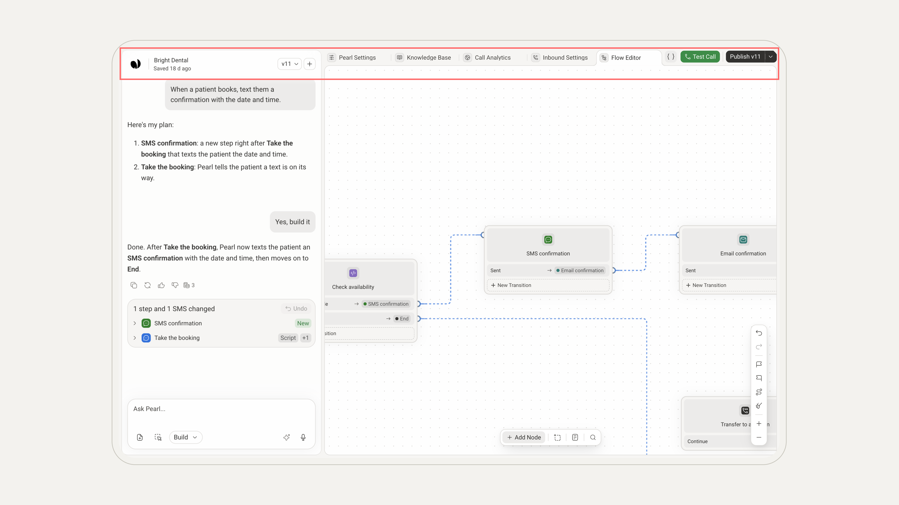
  </Frame>

  <Frame>
    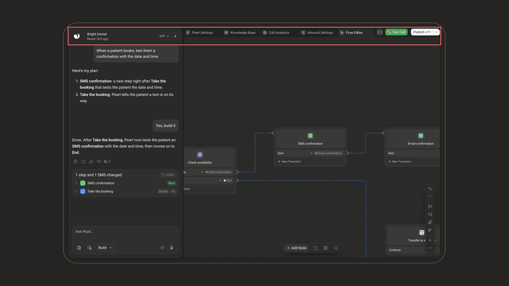
  </Frame>

<Note>
When you open a node by hand, the top of the chat column shows that node instead (see [Manual edit](#chat-sidebar)). During a followed test call and in the Studio, the header is hidden.
</Note>

<AccordionGroup>

<Accordion title="Pearl Title & Menu" icon="tag">
The top-left corner shows the Pearl's **title** as an inline, editable field (it reads **Untitled Pearl** by default). Click it to rename your Pearl — this is the label you'll reuse across the platform and in your workspace. Just below, an autosave indicator shows the save status (**Auto Save** while it saves, then for example **Saved 2 min ago**).

  <Frame>
    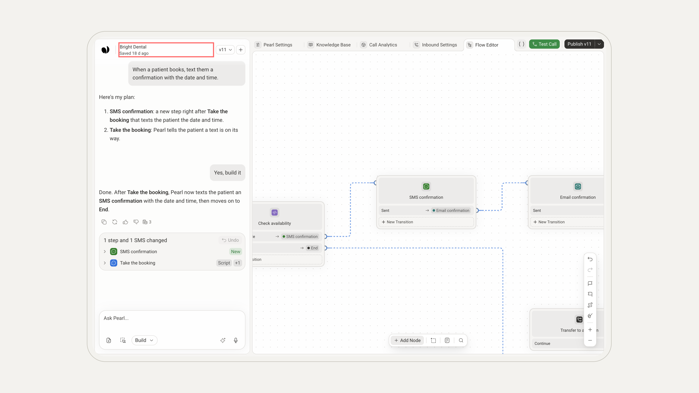
  </Frame>

  <Frame>
    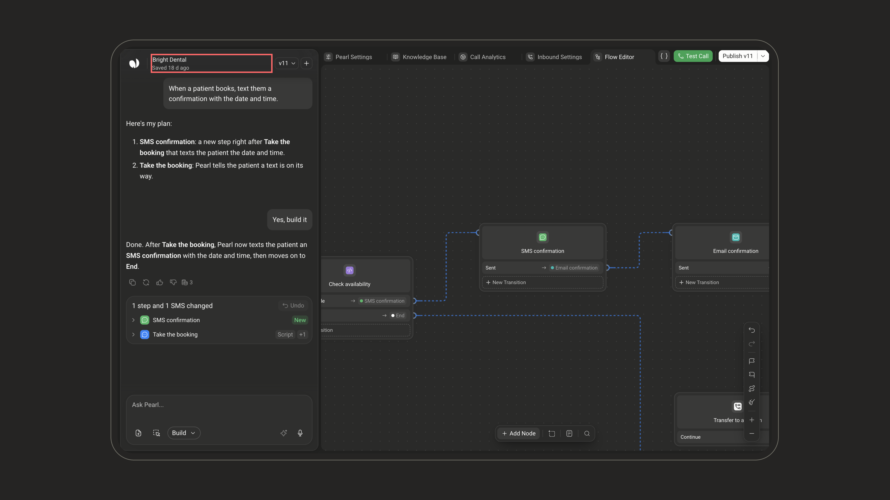
  </Frame>

**Pearl menu**

The Pearl icon next to the title opens a menu with quick actions for the whole Pearl.

  <Frame>
    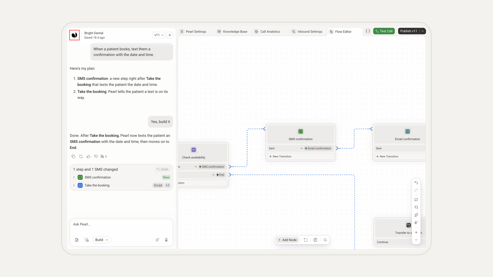
  </Frame>

  <Frame>
    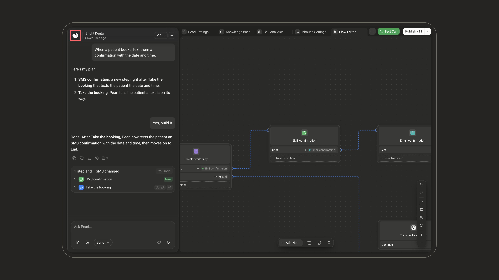
  </Frame>

The menu starts with the Pearl's name and ID, which you can copy. From there you can:

| Item | What it does |
|------|--------------|
| **Go back to Dashboard** | Leave the editor for your dashboard. |
| **Go back to Overview** | Open the Pearl's page. Shown once a version has been published. |
| **Settings** | Open your workspace settings. |
| **Duplicate Pearl** | Make a copy of this Pearl. You choose the version to copy first. |
| **Delete Pearl** | Delete this Pearl. |
| **Credits** | Your credit balance (shown if you can access billing). |
| **Appearance** | Theme, palette, and other display preferences. |
| **Documentation** / **Support & Feedback** | Open this documentation, or send us a message. |

  <Frame>
    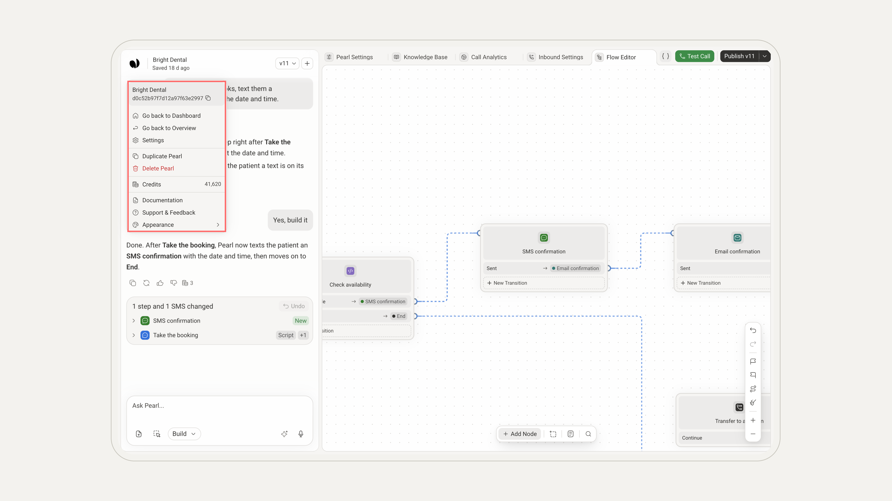
  </Frame>

  <Frame>
    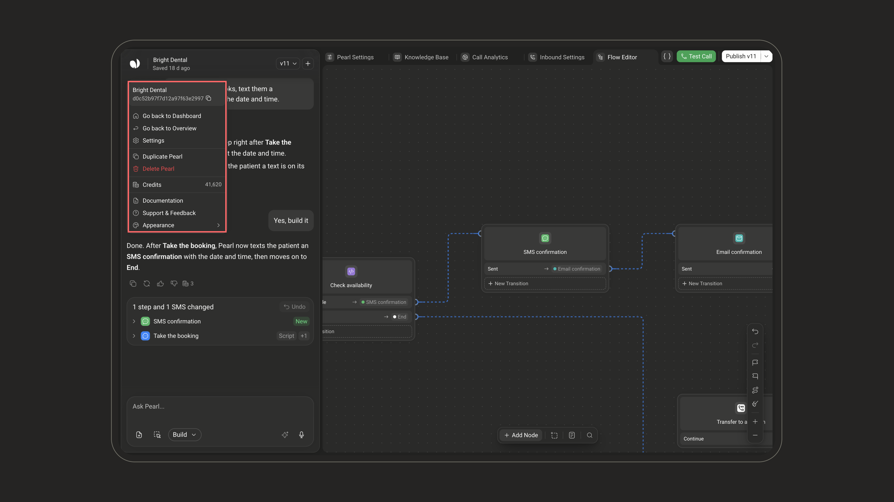
  </Frame>

</Accordion>

<Accordion title="Versioning & Publishing" icon="code-branch">

PearlVibe is built for safe iteration: you can experiment freely without breaking your live calls. Your work is organized into **versions** (v1, v2, v3…), and the one currently handling calls is the **Published** version — the live one.

**Autosave**

Every change you make is saved automatically. The indicator under the title reads **Auto Save** while it saves, then **Saved N min ago**, so you never lose work and can come back later.

---

**Versions & history**

The version selector next to the title shows the version you're on (for example **v35**). It turns blue when you're on the live version.

  <Frame>
    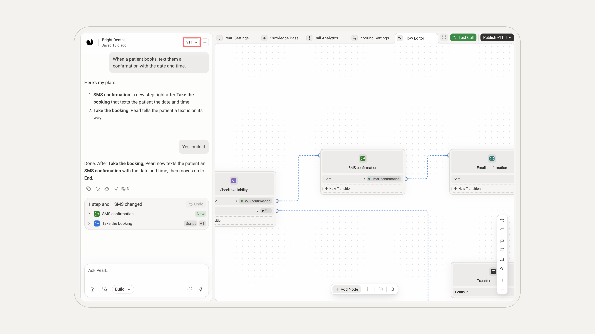
  </Frame>

  <Frame>
    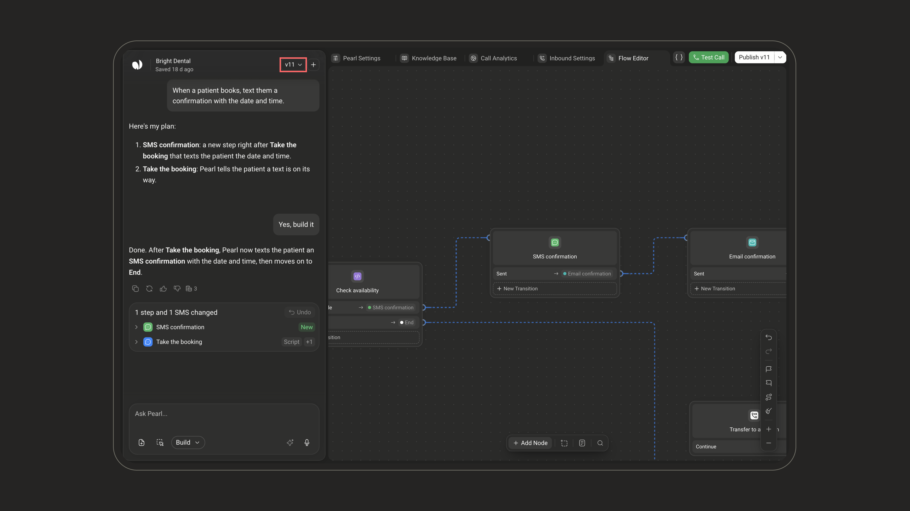
  </Frame>

Open it to browse the full **version history**: search for a version, see when each one was last edited, and spot the **Published** one at a glance. Each row also lets you:

- **Label** the version with a name of your own (up to 20 characters), so it's easy to recognize later (e.g. "stable", "summer promo").
- **Copy** it, to paste it into another Pearl (see below).
- **Delete** it. You can also tick several versions and delete them together.

Click a version to switch to it. Your next changes go to that version.

  <Frame>
    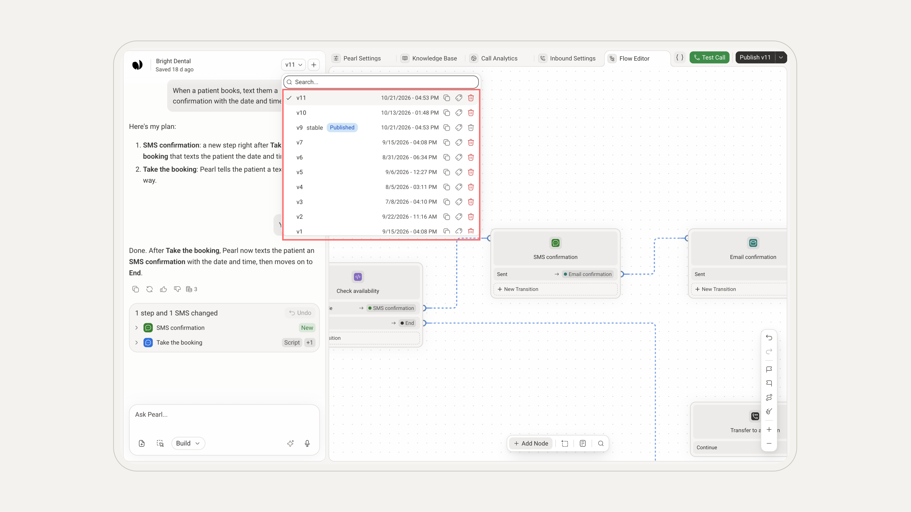
  </Frame>

  <Frame>
    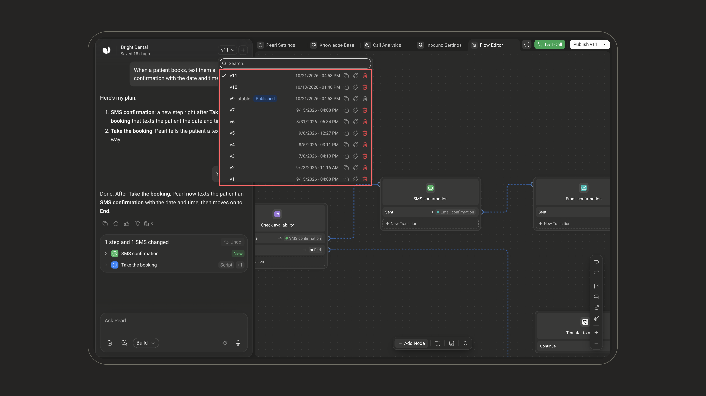
  </Frame>

<Note>
The Published version can't be deleted, and a Pearl always keeps at least two versions. A Pearl holds up to 99 versions: past that, PearlVibe asks you to delete some before creating a new one.
</Note>

---

**Editing the live version**

You never edit the live version in place. As soon as you change something on it — by hand or through the chat — PearlVibe creates the next version for your change, and a notification confirms it (**New version created**), with a **Discard** button if you didn't mean it. The live version keeps handling calls, untouched, until you publish.

**Creating a new version**

You can also start a version yourself with the **+** button next to the version selector.

  <Frame>
    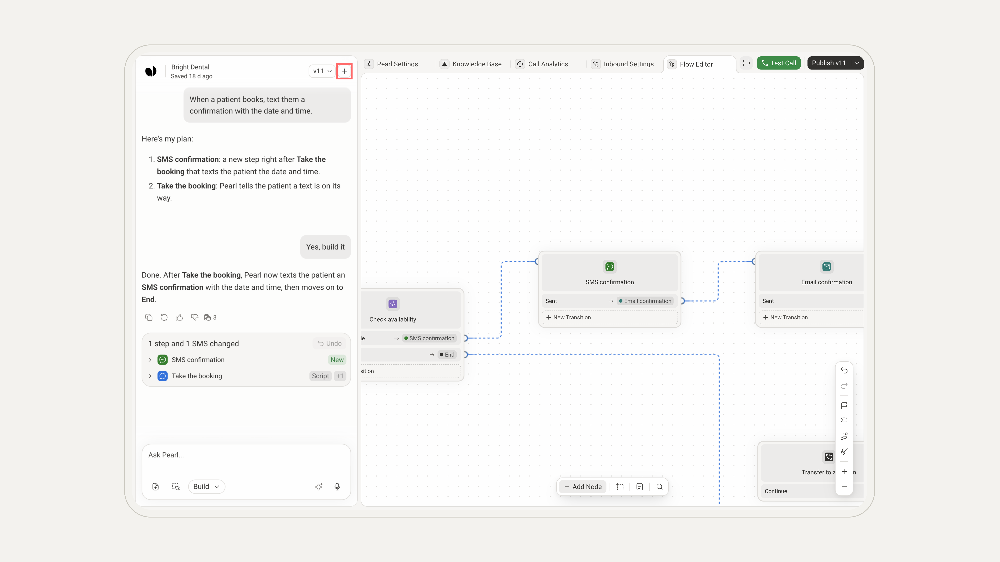
  </Frame>

  <Frame>
    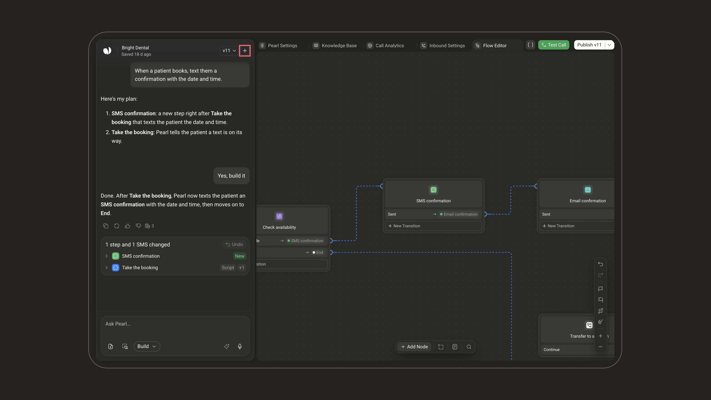
  </Frame>

In the **Create New Version** dialog, pick the existing version to use as the base, then click **Create**.

  <Frame>
    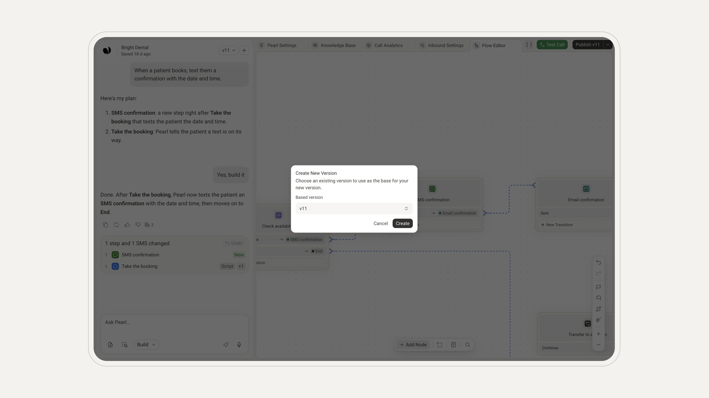
  </Frame>

  <Frame>
    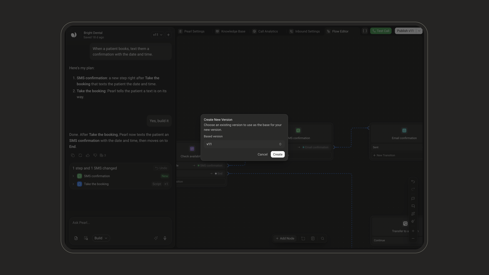
  </Frame>

---

**Copying a version to another Pearl**

To reuse a flow in another Pearl, first copy the version: open the version history and click the version's **copy** icon (*Copy to paste into another Pearl*). It turns into a check mark once the version is copied. You can also use **Copy** in the menu of the **Publish** button, for the version you're on.

  <Frame>
    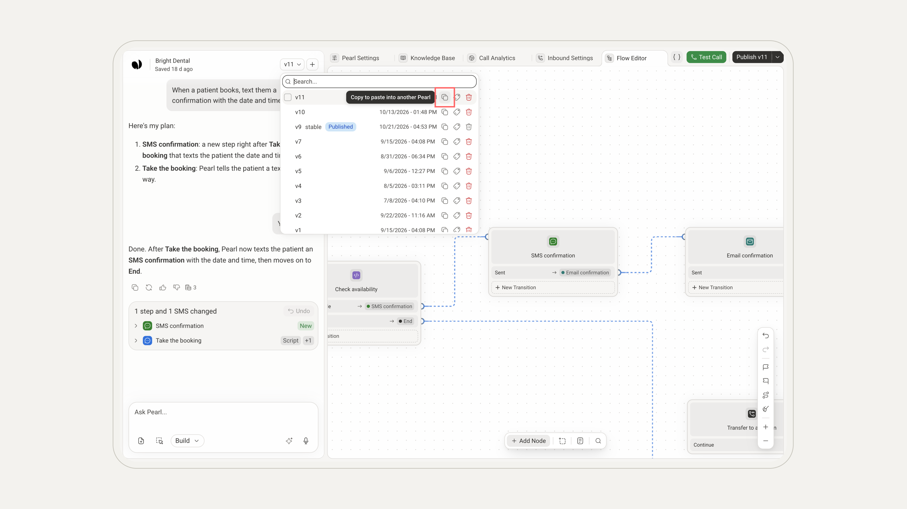
  </Frame>

  <Frame>
    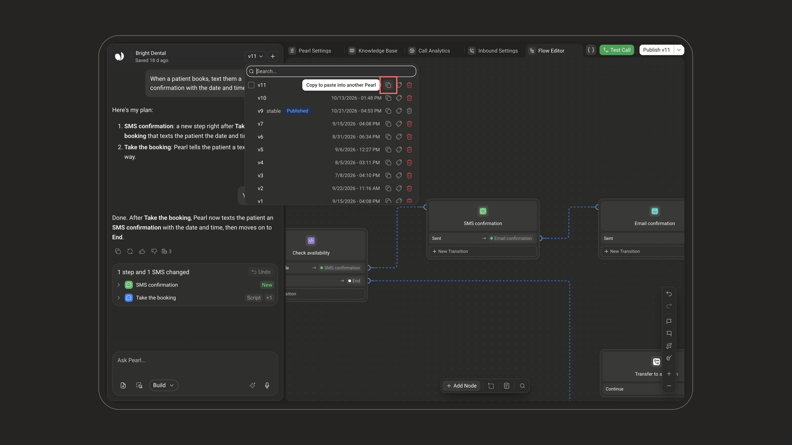
  </Frame>

Then open the version history of the other Pearl: a **Copied version** row appears at the bottom of the list, with a **Paste** button.

  <Frame>
    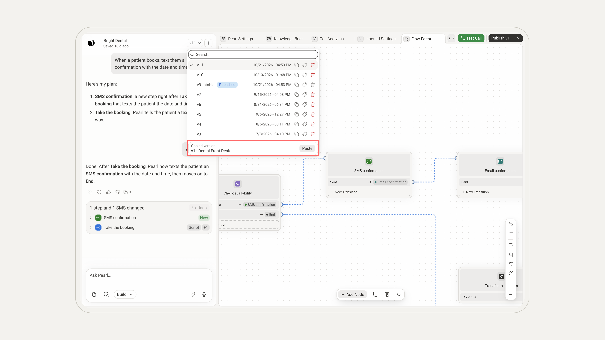
  </Frame>

  <Frame>
    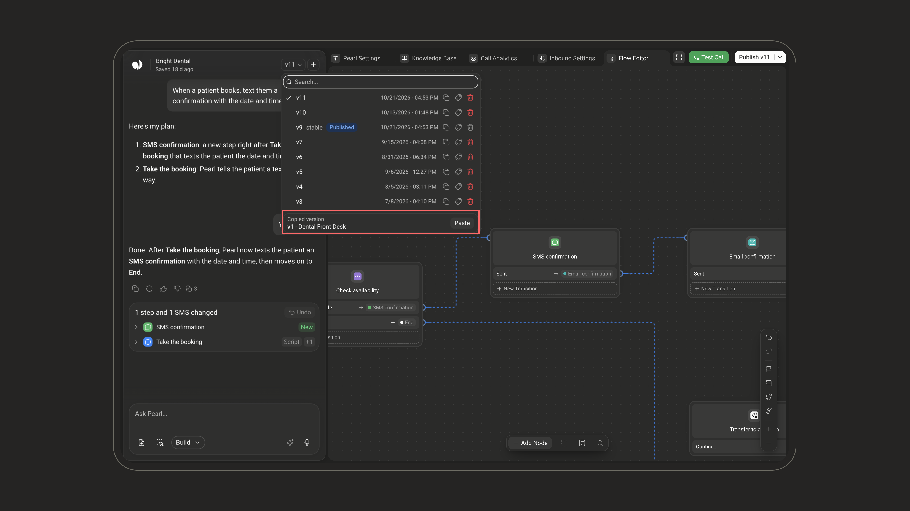
  </Frame>

**Paste** creates a new version of that Pearl with the copied flow and its credentials, and opens it. The Published version keeps handling calls until you publish the new one.

<Note>
You can paste only into another Pearl of the same account and of the same type (voice or text). A copy is pasted once: to reuse the same version in a third Pearl, copy it again.
</Note>

<Tip>
To reuse only part of a flow, copy its nodes instead — see **Selecting, copying & pasting nodes** below.
</Tip>

---

**Publishing**

The button on the right of the header follows the version you're on:

| Button | When |
|--------|------|
| **Publish v36** | You're on a version that isn't live yet. Click it, confirm, and this version becomes the new **Published** version and starts handling calls. |
| **Live** | You're on the live version: there is nothing to publish. |
| **Errors & Tasks (N)** | The version you're editing still has issues to fix (see **Tasks & Errors** below). |

  <Frame>
    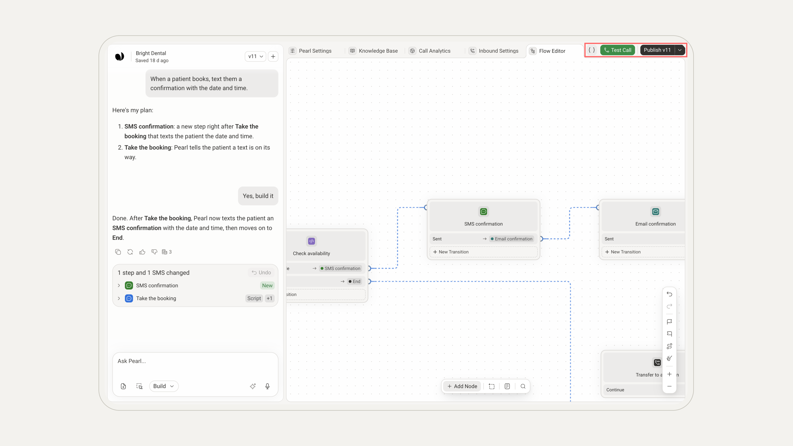
  </Frame>

  <Frame>
    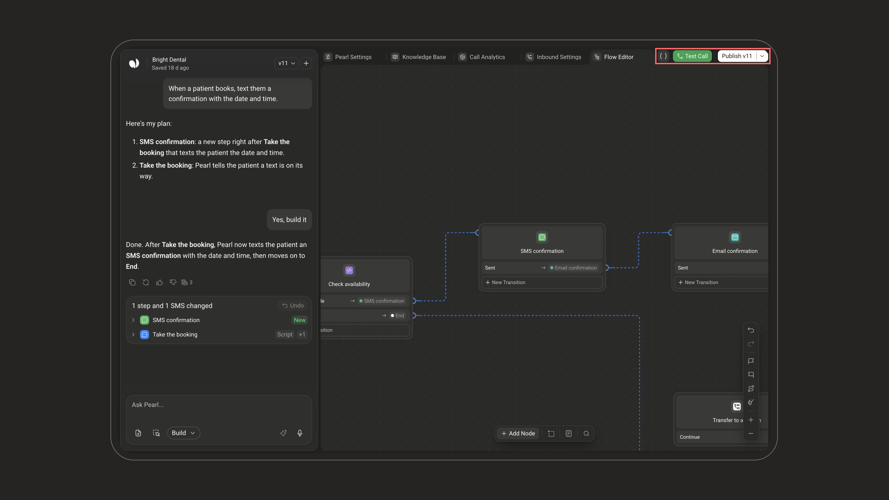
  </Frame>

The arrow next to it opens the version's other actions:

- **Rename** — give the version a label.
- **Copy** — copy it to paste into another Pearl.
- **Discard** — go back to the live version and delete this one, with all its changes.

  <Frame>
    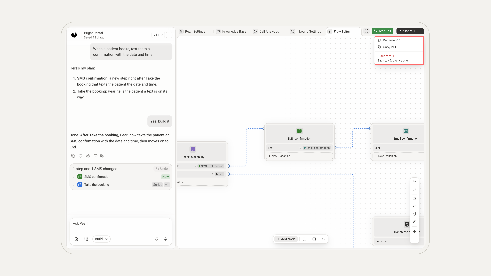
  </Frame>

  <Frame>
    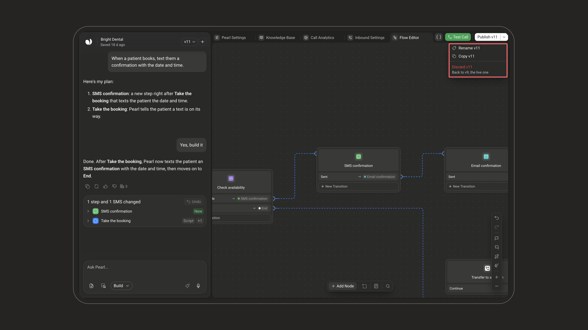
  </Frame>

The version you are editing and the **Published** version drift apart as soon as you change anything, and they stay apart until you publish again. You don't have to keep track of that yourself: ask in the chat whether what you are editing still matches what is live, and Pearl compares the two for you (see [Chat Sidebar](#chat-sidebar)).
</Accordion>

<Accordion title="Variables & Credentials" icon="plug">
Variables and credentials are what connect your Pearl to the rest of your stack. Both live in one dialog, opened by the **Variables & credentials** (`{ }`) button in the top-right of the header, with a **Variables** and a **Credentials** section on its left.

**Variables**

Create, edit, and organize the variables used in your conversation flows. Use **Add variable** to create one, search them, or filter them by type.

  <Frame>
    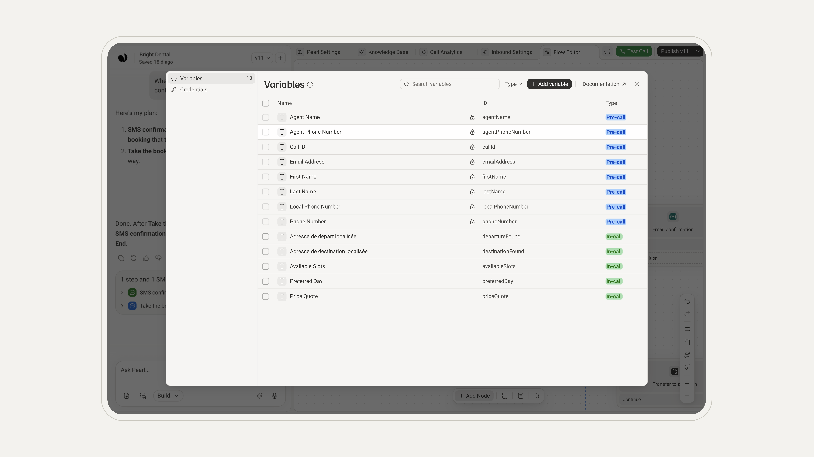
  </Frame>

  <Frame>
    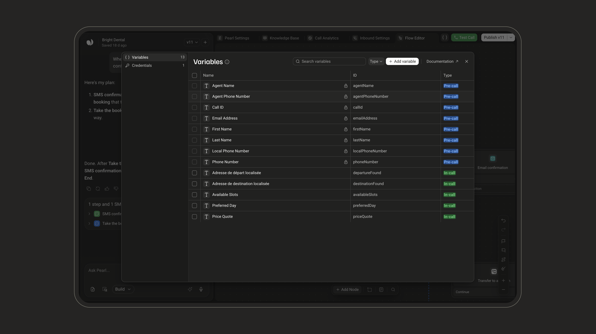
  </Frame>

<Info>
See the [Variables documentation](/pages/variables) for more details.
</Info>

---

**Credentials**

Credentials are where your integrations live: the accounts and keys your Pearl uses to reach external systems.

  <Frame>
    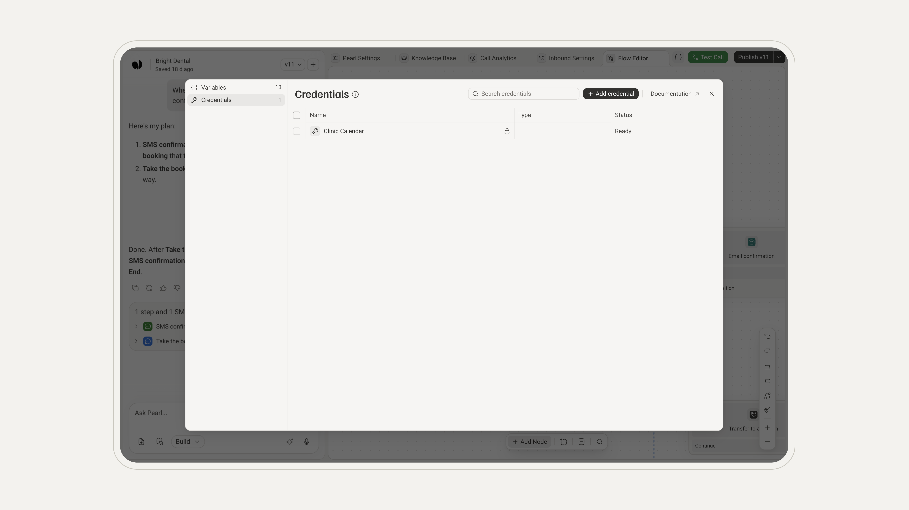
  </Frame>

  <Frame>
    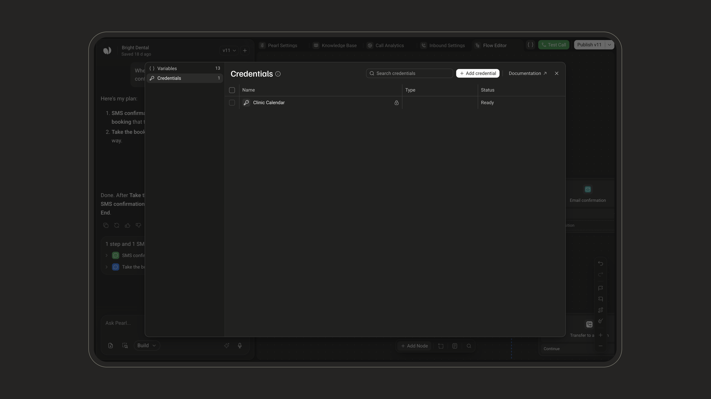
  </Frame>

From here you can:
- **Add a credential** — pick a service from the catalog (e.g. Salesforce, HubSpot, Google Calendar), or add one manually.
- **Configure authentication** — API key, bearer token, basic auth, or OAuth 2 (**Connect**).
- **Edit** or delete a credential. A credential that is ready to use is marked **Ready**.

Integration nodes use these credentials. In the **Add Node** picker, every integration of the catalog is listed, and those you already have a credential for are marked **Connected** (see [Integration Nodes](#central-canvas)).
</Accordion>

<Accordion title="Tasks & Errors" icon="circle-exclamation">
As your flows grow, PearlVibe helps you keep them valid, connected, and fully configured.

<Warning>
**Error detection**

PearlVibe automatically scans your Pearl for common issues, such as:
- Transitions not connected to any node (**Missing Transition**).
- Nodes that nothing leads to (**Missing Inbound Transition**).
- API nodes without an endpoint or description.
- Settings left incomplete in the other tabs, and credentials that need attention.

When such issues are detected on the version you're editing, the **Publish** button in the header is replaced by a red **Errors & Tasks (N)** button that signals how many items need your attention.
</Warning>

  <Frame>
    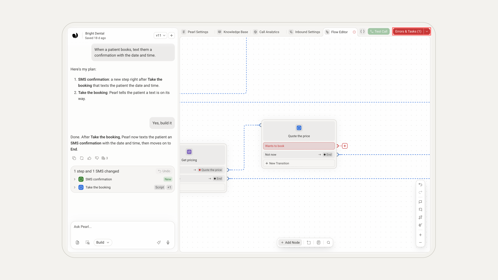
  </Frame>

  <Frame>
    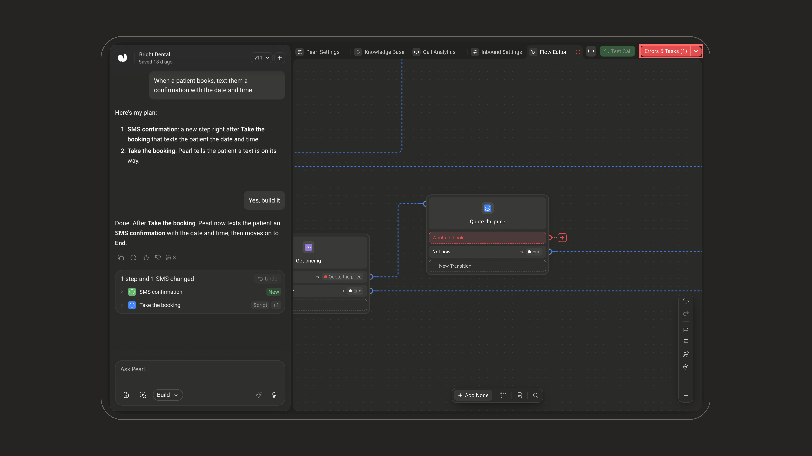
  </Frame>

**Tasks & Errors panel**

Clicking the **Errors & Tasks** button opens a right-hand **Tasks & Errors** panel that groups every issue in one place, by area (Flow Editor, Pearl Settings, Knowledge Base, Analytics, Inbound and Outbound Settings, Credentials), each with its count. Each row names the affected node and what's missing (e.g. "Missing Transition: Budget provided", "Missing Inbound Transition"). A tab with an issue also shows an error icon.

  <Frame>
    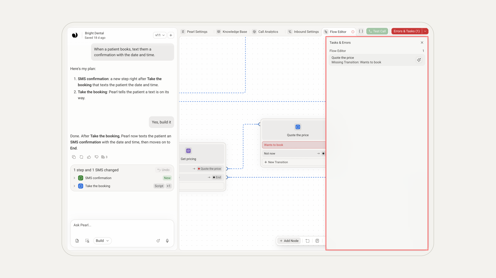
  </Frame>

  <Frame>
    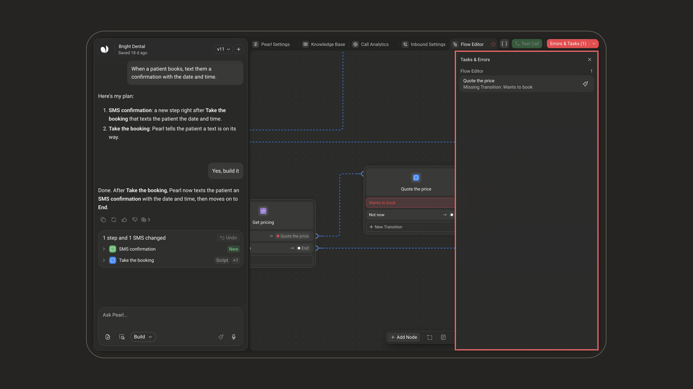
  </Frame>

For each issue:
- Click the row to jump to the affected node.
- Click **Fix With Pearl** to send the issue to the chat, where Pearl works out the fix.

A credential that needs attention can be fixed right in the panel.

  <Frame>
    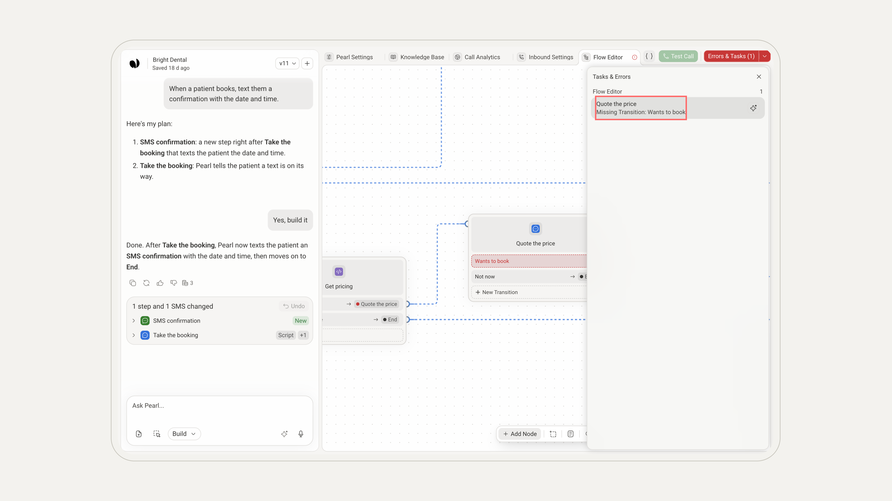
  </Frame>

  <Frame>
    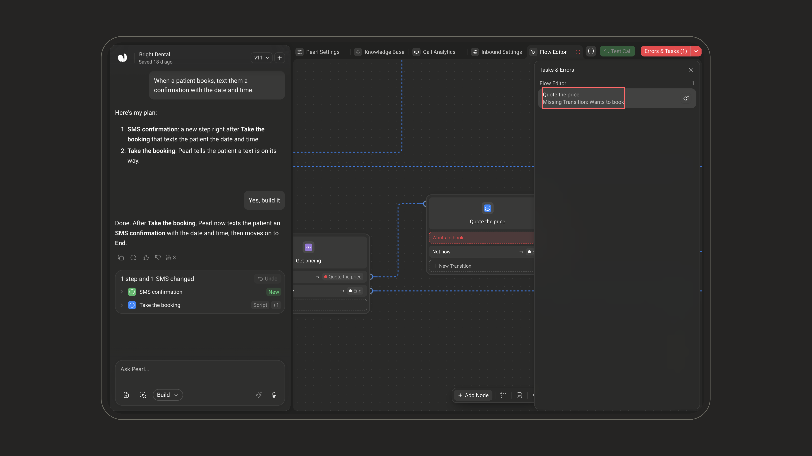
  </Frame>

**On the canvas**

Affected nodes are flagged in red, with a **!** on their icon, and a transition that leads nowhere is shown in red, so you can spot exactly what needs attention.

  <Frame>
    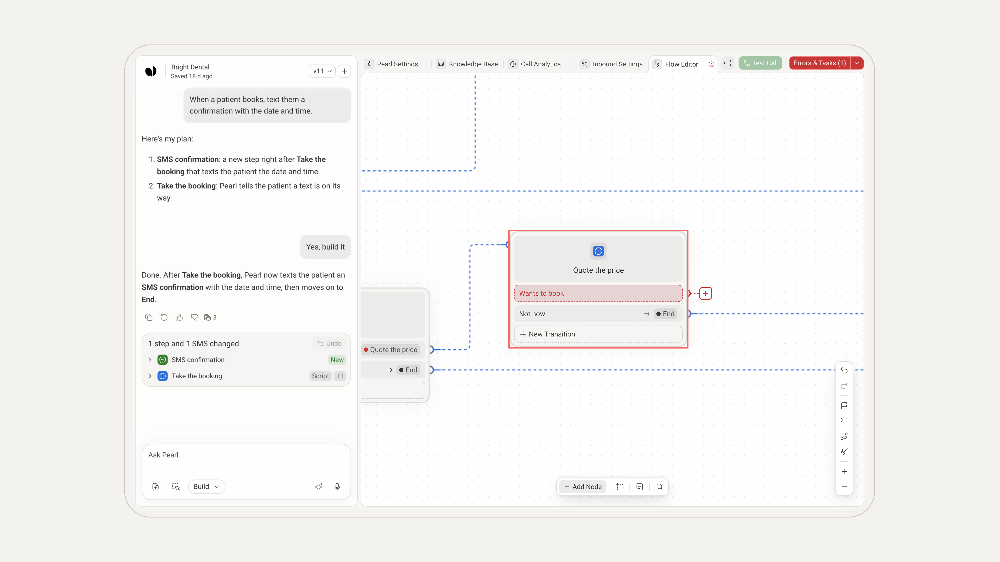
  </Frame>

  <Frame>
    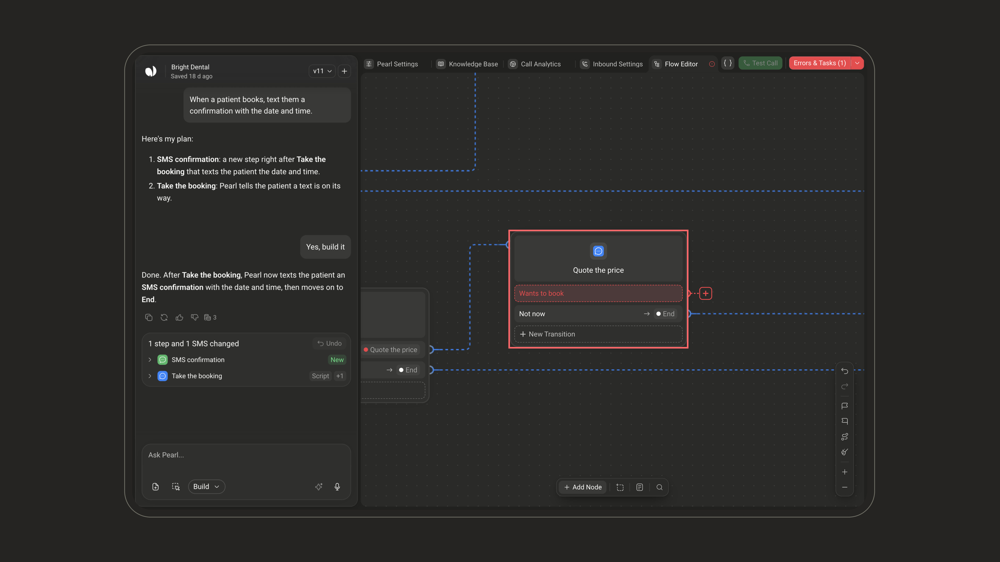
  </Frame>

You can also fix an issue from the node itself: hovering a node with an issue reveals a **Fix With Pearl** action, which sends the same request to the chat.

  <Frame>
    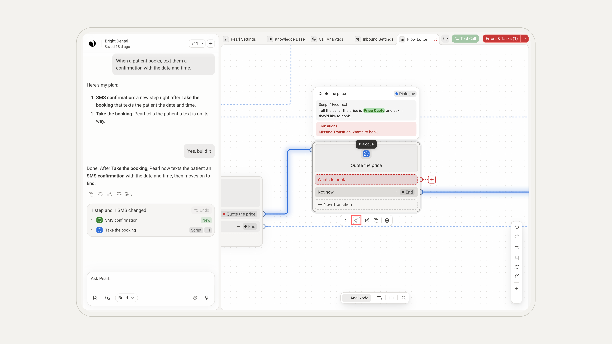
  </Frame>

  <Frame>
    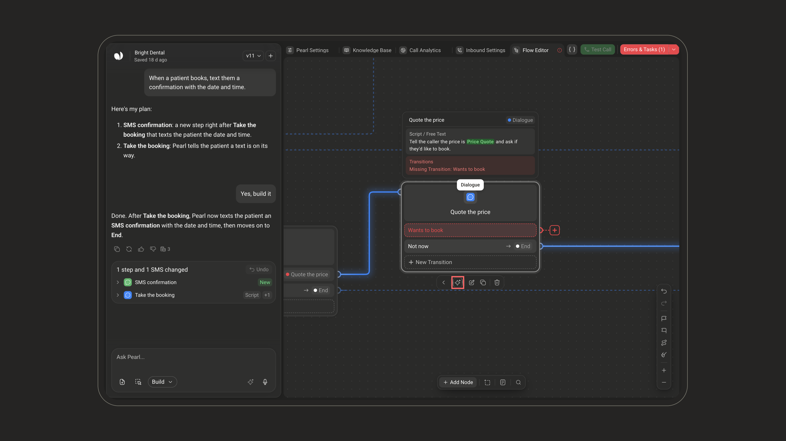
  </Frame>

<Tip>
You can either fix issues manually or let Pearl fix them for you in the chat.
</Tip>
</Accordion>

<Accordion title="Test Calls & Debugging" icon="phone-volume">
Test calls are the safest way to validate your Pearl before and after publishing.

<Note>
On **text** Pearls, these controls read **Test Chat** and **Past Chats** instead of **Test Call** and **Past Calls**: you enter a phone number and click **Start chat**.
</Note>

**Launching a Test Call**

Click **Test Call** in the header. A panel opens on the right, with two tabs at its top: **Test Call** (test your agent) and **Past Calls** (your call history). The button is unavailable while your Pearl has errors to fix.

  <Frame>
    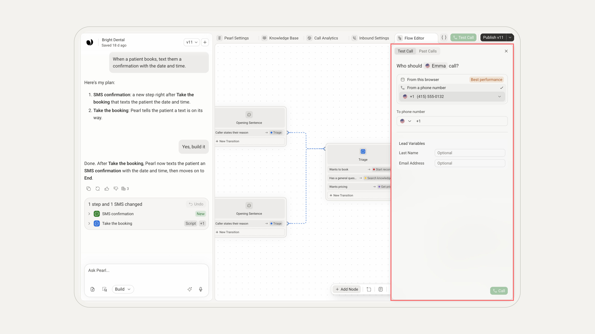
  </Frame>

  <Frame>
    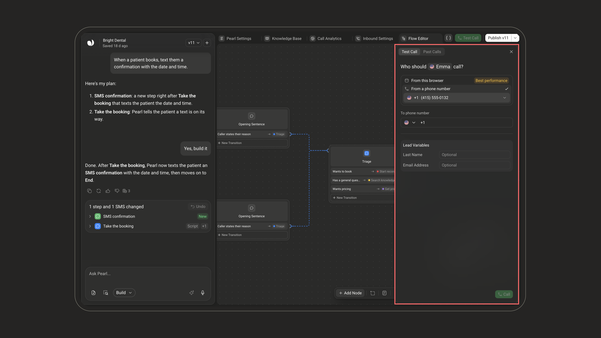
  </Frame>

First choose how to call:
- **From a phone number** — pick the number Pearl calls from (**From phone number**), and enter the number to call (**To phone number**).
- **From this browser** — talk to Pearl through your computer's microphone and speakers (see below).

Then, optionally, tick **Reset Pearl's memory** for a fresh test, and prefill the **Opening Sentences**, **Lead Variables**, and **Pre-Call API Variables**. Click **Call** with the number: Pearl calls it using the version you're currently editing. When the call ends, a notification lets you open it (**View call**).

<Note>
Without a subscription, test calls are limited to your verified phone number.
</Note>

**Testing from your browser**

You don't need a phone to test a voice Pearl. Choose **From this browser**: you pick your **Microphone**, the phone number becomes optional, and you click **Call in browser**.

  <Frame>
    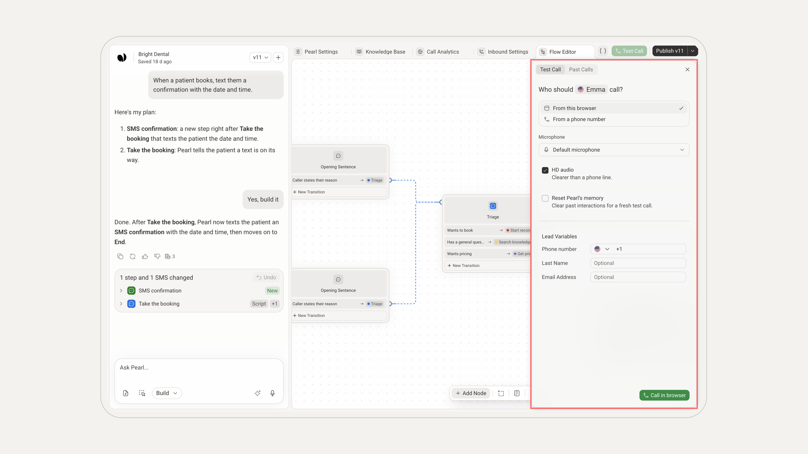
  </Frame>

  <Frame>
    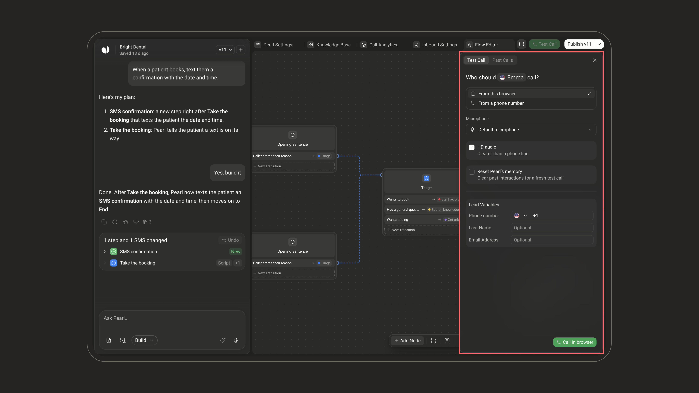
  </Frame>

| Option | Description |
| --- | --- |
| **HD audio** checked (default) | High-definition audio (24 kHz) in both directions. |
| **HD audio** unchecked | Phone-line audio (8 kHz), as a real caller hears Pearl. Use it to judge how your Pearl really sounds on the phone. |

Once connected, the call continues in a small floating window that stays on screen while you move around the platform. It shows the call duration and the node Pearl is on, lets you **Follow the flow** on the canvas, and has controls to mute your microphone or end the call. The call then appears in **Past Calls** like any other test call.

  <Frame>
    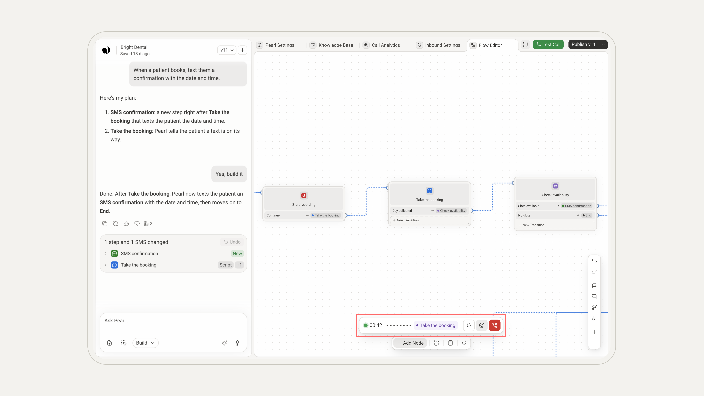
  </Frame>

  <Frame>
    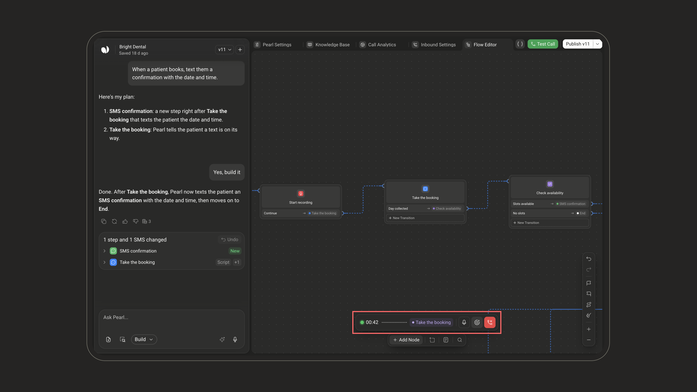
  </Frame>

<Note>
Your browser asks for microphone access the first time. If no microphone is found, **Call in browser** stays disabled.
</Note>

---

**Live Node Tracing**

During a phone test call, a **Ringing…** pill (then the call duration) appears with a **Stop Following** button, and the nodes in the canvas light up one after another as the conversation progresses, so you can visually follow the path the call is taking through your flow.

  <Frame>
    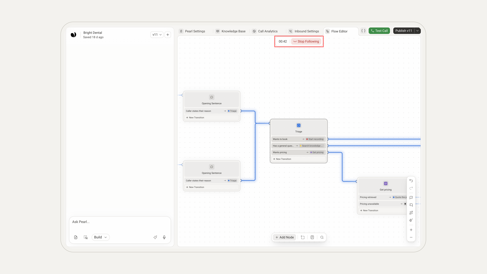
  </Frame>

  <Frame>
    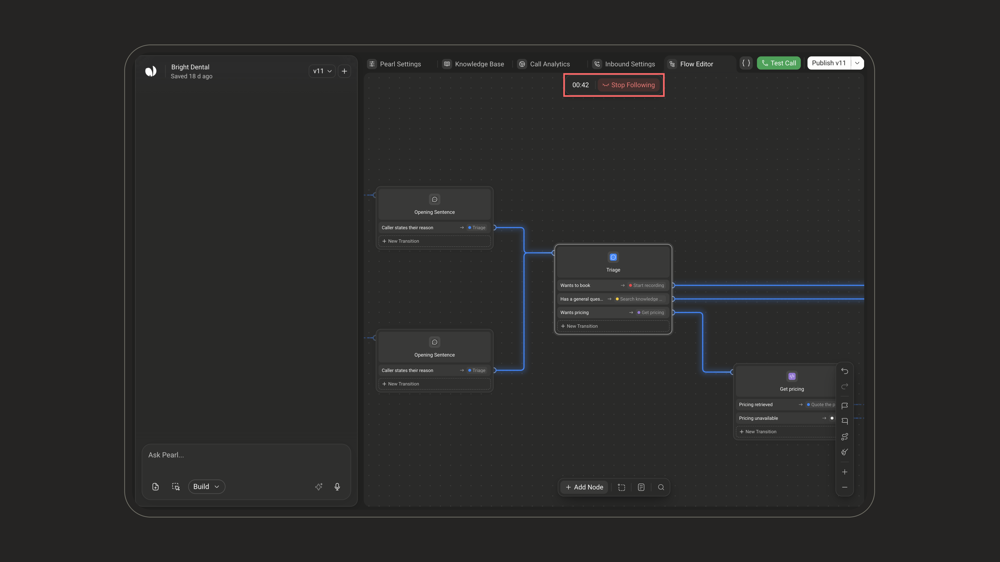
  </Frame>

<Tip>
This helps you understand why a certain question was asked, see which transition was taken at each step, and debug misrouted calls or unexpected behaviors.
</Tip>

---

**Past Calls**

The **Past Calls** tab lists your previous test calls, grouped by day (Today, Yesterday, then by date). A blue dot marks a call you haven't opened yet. Open any entry to inspect its details and verify that your flow — including post-call automation — behaved as expected.

  <Frame>
    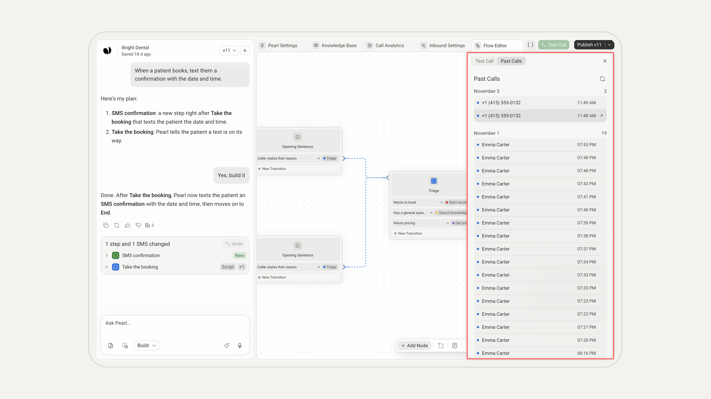
  </Frame>

  <Frame>
    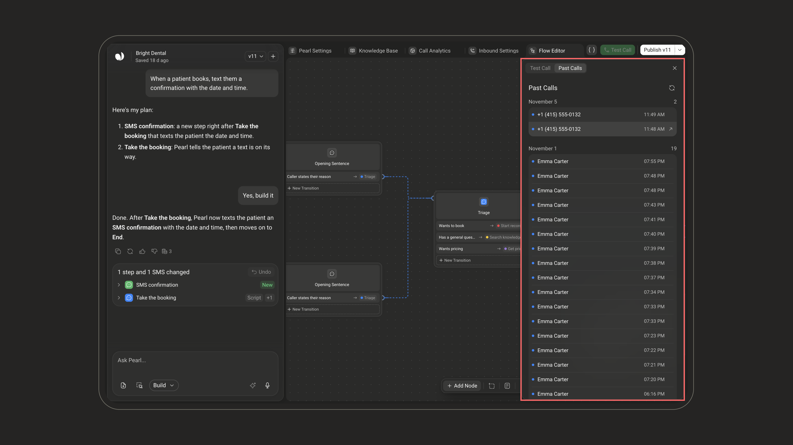
  </Frame>

<Tip>
Open a past call and click **PearlVibe** (*Review this call with PearlVibe*) to bring the call into the chat and ask about it (see **Investigating your flow and your calls** below).
</Tip>

<Info>
To learn more about post-call actions, see the [Post-Call documentation](/pages/postcall) — or, for text Pearls, the [Post-Chat documentation](/pages/text/postchat).
</Info>

</Accordion>

</AccordionGroup>

---

## Chat Sidebar

The chat sidebar is where you work on your Pearl — by talking to PearlVibe in natural language, either to ask it about your flow and your calls or to have it create and edit the flow for you, or by opening a node to configure it by hand.

  <Frame>
    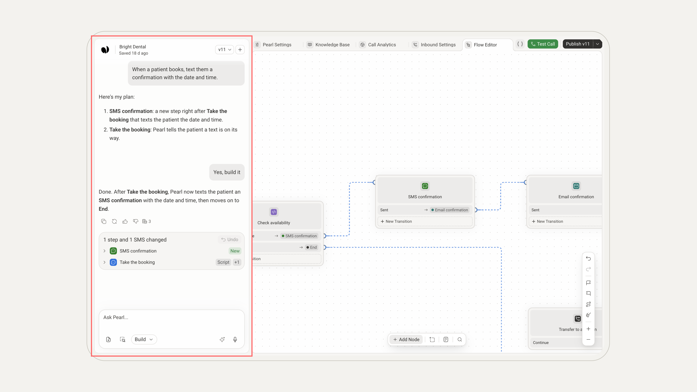
  </Frame>

  <Frame>
    
  </Frame>

It combines two complementary views:

| View | Description |
|------|-------------|
| **Chat** | Describe what you want in natural language. This is the default view, and it has two modes: **Ask**, which only answers and advises, and **Build**, which changes your flow. |
| **Manual edit** | Explicit, hands-on configuration of one node. |

The Chat view is covered in two parts below: building your flow, and using the chat to investigate it.

<Note>
Click a node on the canvas and it joins the chat's context: what you ask next is about that node — unless it is explicitly global (like General Instructions), or you are asking about the flow as a whole, a past call, or the Published version (see **Investigating your flow and your calls** below).
</Note>

<AccordionGroup>
<Accordion title="Chat" icon="comments">

This is the default view. You describe what you want in natural language, and Pearl either answers you or builds it into your current version — depending on the mode you are in.

**Ask and Build**

The composer carries a pill showing the current mode. Click it to open the mode menu and switch. The chat opens in **Build**.

  <Frame>
    
  </Frame>

  <Frame>
    
  </Frame>

| Mode | What it does |
|------|--------------|
| **Ask** | Investigates, checks, and advises. It reads your flow and your calls and answers your questions, but it never changes anything. |
| **Build** | Makes the changes you ask for, after you confirm them. |

The same sentence gives you two different outcomes. "Add an SMS step after the booking step" in **Ask** gets you a description of the change and a **Switch to Build** button, and your flow is left untouched. The same sentence in **Build** gets you a short plan, a confirmation, and then the step itself in the editor.

<Note>
Building on the live version first creates a new version for the changes, so the live configuration keeps running untouched.
</Note>

**Typical operations you can perform:**

These are all **Build** mode operations — in **Ask**, Pearl describes what it would do instead of doing it.

| Operation | Example |
|-----------|---------|
| **Create or delete nodes** | "Add a qualification step after the greeting." |
| **Edit a node's content and behavior** | "Make the opening more formal and mention our summer offer." |
| **Add, rename, or reconnect transitions** | "Add a 'Not interested' branch that ends the call politely." |
| **Attach actions** | "Send a confirmation SMS after a successful booking." (API calls, SMS, email, transfers, etc.) |
| **Configure post-call logic** | "Log the outcome to the CRM once the call ends." |

**The composer**

Type your instruction in the composer — its placeholder reads **Ask Pearl...**, or names what's in context (for example **Ask about Qualify Budget...**). For example: "Split this node into three outcomes based on payment status.", "After a successful payment, send a confirmation SMS and end the call.", "Create a post-call node that logs the outcome to the CRM." Press **Enter** or click **Send** (**Shift + Enter** adds a line): in **Build**, Pearl answers with its plan and updates the editor once you confirm; in **Ask**, it answers without touching your flow.

  <Frame>
    
  </Frame>

  <Frame>
    
  </Frame>

The composer includes a few helpers:

- **Upload** — attach supporting material (FAQs, pricing sheets, policy docs, playbooks…) to enrich the Pearl's knowledge and reference it in node prompts. You can also drop files onto the chat.

  <Frame>
    
  </Frame>

  <Frame>
    
  </Frame>

Accepted formats: `.pdf`, `.docx`, `.txt`, `.jpg`, `.jpeg`, `.png`, `.webp`, `.gif`, `.mp3`, `.m4a`, `.wav`, `.ogg`, `.webm` — up to **10 files** and 25 MB per message.

<Tip>
You can attach a **recording of a real conversation** (e.g. an `.mp3` or `.wav` call, up to 15 minutes) and ask PearlVibe to build the flow from it — in **Build** mode, it turns the exchange into nodes and transitions for you.
</Tip>

- **Enhance Prompt** — rewrite your instruction into a clearer, more structured request before it runs. It works once your instruction is at least 50 characters long.

  <Frame>
    
  </Frame>

  <Frame>
    
  </Frame>

- **Record** — dictate your instruction instead of typing it (up to 5 minutes). The microphone shows while the composer is empty; click **Stop & transcribe** and the text lands in the composer.

  <Frame>
    
  </Frame>

  <Frame>
    
  </Frame>

**Context**

When you click a node on the canvas, it appears as a tile inside the composer. Any instruction you send is interpreted in the context of that node (for example: "Change the greeting", "Add a failure transition that transfers to support"). You can add several nodes; remove one with its **×**.

  <Frame>
    
  </Frame>

  <Frame>
    
  </Frame>

To ask about more than nodes, use the selection button in the composer (*Select parts of your flow to ask questions, review issues, or make changes*): pick nodes, settings, variables, credentials, or calls, and ask about them together.

  <Frame>
    
  </Frame>

  <Frame>
    
  </Frame>

**Reviewing what Pearl builds**

In **Build** mode, Pearl shows what it is about to change and asks you to confirm before applying it (for example **Yes, build it**), next to a **Dismiss** button — or you can answer it directly in the composer.

  <Frame>
    
  </Frame>

  <Frame>
    
  </Frame>

When Pearl needs a decision, it can present interactive choices right in the chat (for example, which CRM to connect), with **Other** to answer in your own words and **Skip**.

  <Frame>
    
  </Frame>

  <Frame>
    
  </Frame>

While Pearl works, the chat shows what it is doing, and **Stop generation** lets you interrupt it.

Once applied, each batch of edits appears as a card that sums up what changed in a sentence (for example "3 steps and 1 SMS changed"), followed by its first changes and **Show N more**. The card covers the flow and the Pearl's settings alike. Hover a row to highlight its node on the canvas, or click **Show in flow**.

  <Frame>
    
  </Frame>

  <Frame>
    
  </Frame>

Open a row to see exactly what changed: the text with its additions and removals marked word by word, or the result alone.

  <Frame>
    
  </Frame>

  <Frame>
    
  </Frame>

If you don't want to keep a batch, click **Undo** on its card and confirm with **Undo changes**.

  <Frame>
    
  </Frame>

  <Frame>
    
  </Frame>

<Warning>
Undo also removes every later change, made by PearlVibe or by you. Inbound and Outbound settings stay as they are. Only the most recent batches can be undone.
</Warning>

Under each answer, you can **Copy** it, **Regenerate** it, rate it (**Good response** / **Bad response**), and see the credits it used.

  <Frame>
    
  </Frame>

  <Frame>
    
  </Frame>

<Tip>
Chat is the recommended entry point to quickly build or refactor a flow, especially for large or complex trees.
</Tip>
</Accordion>
<Accordion title="Investigating your flow and your calls" icon="magnifying-glass">

Pearl can read your flow and your calls, not only change them. Ask it a question about either and it goes and reads the material itself. All of this works in **Ask** mode as well as in **Build**, since none of it changes your flow.

**Reading a past call**

Ask *"Look at my last test call and tell me what happened"* and Pearl reads the call itself — the lines that were exchanged, the nodes the call went through, and what your API steps returned. You don't have to open the call and go through the transcript yourself.

  <Frame>
    
  </Frame>

  <Frame>
    
  </Frame>

It works the same way on a text Pearl — ask about your last test chat instead.

You can also start from the call itself: open it in **Past Calls** and click **PearlVibe** (*Review this call with PearlVibe*). The call joins the chat as a tile in the composer and the chat switches to **Ask**, ready for your question.

  <Frame>
    
  </Frame>

  <Frame>
    
  </Frame>

**Asking why something went wrong**

You can go straight to the question instead of to the evidence: *"Investigate why my agent skipped the booking."* Pearl pulls up the relevant calls on its own and answers from what it finds in them.

**What changed since the published version**

Pearl knows both the version you are editing and the **Published** one that is handling your calls, and it can compare them. Ask *"What changed since the published version?"* after editing a node, or *"Is what I'm editing still the same as what is live?"*, and it tells you exactly what you have changed since.

**Checking the flow for problems**

*"Check my flow for problems"* gets you a structural review: steps that lead nowhere, steps that nothing reaches, a flow with no ending, API results that nothing uses. If your Pearl has already taken calls, it also reports which API steps behaved inconsistently across them.

<Tip>
This is the quickest way to use your call history: instead of opening past calls one by one, ask Pearl what happened in them.
</Tip>
</Accordion>
<Accordion title="Manual edit" icon="sliders">
To configure a node by hand, click it on the canvas: it joins the chat as a tile in the composer. Click the pencil on that tile (**Manual edit**).

  <Frame>
    
  </Frame>

  <Frame>
    
  </Frame>

You can also hover the node on the canvas and click **Edit Manually** in its action bar.

  <Frame>
    
  </Frame>

  <Frame>
    
  </Frame>

The node then takes the place of the chat. Its header shows its type, its name (click it to rename the node), and the Pearl and version you're editing, with **Show on canvas** and a **More** menu to **Duplicate** or **Delete** the node.

It is split into two tabs: **Edit** and **Transitions**. A node only shows the tabs that apply to it: an End Call node has no Edit tab, and a Transfer Call or Hand-Off node has no Transitions tab.

**The Edit tab**

Exposes all the settings specific to the current node type (Script / Free Text, Instructions, variables…). What you see here depends on the node: Dialogue, Knowledge Base, API, SMS, Email, Transfer Call, Hand-Off, or an integration.

  <Frame>
    
  </Frame>

  <Frame>
    
  </Frame>

In short, the Edit tab is where you configure what this node does internally, based purely on its type.

<Note>
Routing to other nodes is not handled here, but in the Transitions tab. Post-call actions are edited one by one, from the post-call node on the canvas.
</Note>

**The Transitions tab**

Defines how the conversation can exit this node. Each transition has a **Condition** (for example "Agreed to future contact") and the next node (**Node Chosen**); you add new ones with **New Transition**.

  <Frame>
    
  </Frame>

  <Frame>
    
  </Frame>

From here you can:
- **Create transitions** – Add exits such as "Success", "Failure", "No answer", "Customer asks for human", etc.
- **Connect transitions** – Choose the target node for each transition to shape the path of the conversation.
- **Edit or delete transitions** – Rename transitions, change their destination, or remove them when they are no longer needed.

**Saving your changes**

Changes made by hand wait for you to save them: an **Unsaved Changes** bar offers **Discard** and **Save Changes**.

  <Frame>
    
  </Frame>

  <Frame>
    
  </Frame>

**Back to chat**

When you're done, click **Back to chat** (the arrow at the top of the node) to return to the chat.

  <Frame>
    
  </Frame>

  <Frame>
    
  </Frame>

<Info>
Once saved, a change made by hand shows in the visual flow and is fully understood by Pearl.

You can switch between the chat and a node opened by hand as often as you like — save or discard your changes first.
</Info>
</Accordion>
</AccordionGroup>

---

## Central Canvas

The central canvas displays your flow as a graph of nodes and transitions.

  <Frame>
    
  </Frame>

  <Frame>
    
  </Frame>

| Element | Description |
|---------|-------------|
| **Nodes** | Each node represents a step in the conversation (a message, an action, or a set of actions). |
| **Transitions** | Each transition represents a possible path from one node to another, based on its condition. |

**From the canvas you can:**

| Action | Description |
|--------|-------------|
| **Add, connect, branch, disconnect** | Create nodes and wire transitions to shape the flow, right on the canvas. |
| **Move, pan & zoom** | Navigate large trees comfortably. |
| **Search** | Find a node by name or content, or by the name of a transition. |
| **Reorganize** | Re-lay out the flow automatically (auto-layout). |
| **Go to Start / End** | Jump straight to the beginning or end of the flow. |
| **Hover preview** | See a quick summary of what a node does. |
| **Quick actions** | Fix, edit, duplicate, or delete a node in place. |
| **Select, copy & paste** | Select several nodes, delete them, or copy them into this Pearl or another one. |
| **Studio** | Follow a route through the flow and export the flow as an image or a PDF. |
| **Undo / Redo** | Roll your latest manual changes back and forth. |

<Note>
The canvas has no minimap — use zoom, pan, **Reorganize**, and **Search** to move around instead.
</Note>

**Right toolbar**

The vertical toolbar on the right groups the navigation controls: **Undo manual changes** / **Redo manual changes**, **Go to Start** / **Go to End**, **Studio**, **Reorganize** (auto-layout), and **Zoom In** / **Zoom Out**.

  <Frame>
    
  </Frame>

  <Frame>
    
  </Frame>

<Note>
Undo and Redo apply to the changes you make by hand. To roll back what PearlVibe built, use **Undo** on its card in the chat.
</Note>

<AccordionGroup>

<Accordion title="Node Types Overview" icon="shapes">
PearlVibe supports several node types:

| Node Type | Description |
|-----------|-------------|
| **Start node** | Entry point of the flow. It starts with an **Opening Sentence** or a **Pre Call API**. |
| **In‑Call nodes** | Dialogue and actions that occur while the caller is on the line. |
| **Integration nodes** | Interactions with external systems (CRM, ticketing, booking…). |
| **End Call node** | The node that ends the conversation. |
| **Post‑Call Actions** | Actions executed after the call has ended. |

<Info>
**Understanding Node Types: Pre-Call, In-Call & Post-Call**

Your Pearl flow is built around three categories of nodes, each designed for a specific moment in the call lifecycle. Knowing the difference is essential to avoid misusing an action or expecting behavior that can't happen at that stage.

**1. Pre-Call Nodes: Before the call starts**

These nodes run prior to dialing or answering. They're ideal for preparing context: fetching customer data, checking availability, validating an ID, loading account information. They cannot interact with the caller and cannot create or import leads.

**2. In-Call Nodes: During the conversation**

These nodes control everything that happens while the caller and the agent are connected. Dialogue, decision logic, sending SMS/emails, API calls, and CRM updates all happen here in real time. This is the core of your conversational flow.

**3. Post-Call Nodes: After the call ends**

Once the call is finished, these nodes handle asynchronous tasks: writing CRM logs, creating leads, triggering webhooks, updating databases, or launching follow-up workflows. They cannot affect what happened during the call, only what happens after.
</Info>

</Accordion>

<Accordion title="Start Node" icon="play">
Every flow begins with a Start node. It controls how the conversation is initiated.

  <Frame>
    
  </Frame>

  <Frame>
    
  </Frame>

You choose how it starts, right on the Start node:

| Configuration | Description |
|---------------|-------------|
| **Opening Sentence** | A standard greeting and first question, for example: "Hi, you've reached [Company]. How can I help you today?" |
| **Pre Call API** | Before the Pearl speaks, it can call an external API (for example to fetch order details, check account status, or pre‑qualify the caller). The API response can then change the opening sentence, route the caller toward different branches, or preload variables and context. On text Pearls this is labeled **Pre Chat API**. |

<Info>
**The Pearl says the opening sentence almost word for word.** In a Dialogue node, your text is only a guide: the Pearl adapts it to what the customer says.
</Info>

<Note>
The Pre Call API cannot be used to import leads into your Pearl. Its purpose is strictly to enrich or prepare contextual data before the call starts.
</Note>
</Accordion>

<Accordion title="In‑Call Nodes" icon="phone">
In‑Call nodes represent the actions and dialogues that happen during the conversation. In the **Add Node** picker they're split into **Conversation** (Dialogue, Knowledge Base) and **Actions** (SMS, API, Email, Transfer Call, Hand-Off).

  <Frame>
    
  </Frame>

  <Frame>
    
  </Frame>

| Node Type | Description |
|-----------|-------------|
| **Dialogue** | The Pearl speaks, listens, and interprets the customer's response according to your instructions. |
| **Knowledge Base** | Answer questions using your Pearl's configured knowledge base. |
| **SMS** | Send a text message during the call (e.g. a confirmation code, a link, or a summary). *Voice only — hidden on text Pearls.* |
| **API** | Call an external API (e.g. update a record, check availability, create a ticket). |
| **Email** | Trigger an email to the customer or your team. |
| **Transfer Call** | Transfer the caller to a human agent or another phone number. *Voice only — hidden on text Pearls.* |
| **Hand-Off** | Hand the conversation over to a human. *Text Pearls only.* |

<Note>
Integration-specific actions (e.g. Google Calendar, Salesforce) appear in a separate **Integrations** section of the picker — see below.
</Note>
</Accordion>

<Accordion title="Integration Nodes" icon="plug">
Integration nodes let your Pearl interact directly with external tools and services without writing any API code yourself. Technically, each one is an **API node pre-configured with an integration credential** — it handles authentication, request formatting, and data mapping for you. They appear in the **Integrations** section of the **Add Node** picker, in every tab.

  <Frame>
    
  </Frame>

  <Frame>
    
  </Frame>

The picker lists the whole catalog. Integrations you already have a credential for are marked **Connected**; picking another one lets you connect it.

**Integration node variants:**

| Variant | Description |
|---------|-------------|
| **Pre-Call** | Executed before the call starts, as the flow's Pre Call API (e.g. looking up the caller in your CRM). |
| **In-Call** | Executed while the caller is still on the line (e.g. checking a CRM record before answering). |
| **Post-Call** | Executed after the call ends (e.g. logging call results into a ticketing system). |

**What Integration Nodes Do**

Integration nodes encapsulate tasks such as:

| Category | Examples | Tasks |
|----------|----------|-------|
| **CRM operations** | Salesforce, HubSpot, Pipedrive… | Create or update records, attach call results, sync contact data. |
| **Helpdesk platforms** | Zendesk, Freshdesk, Gorgias… | Create tickets, update statuses, push conversation summaries. |
| **Booking engines** | Google Calendar, Cal.com, Microsoft Outlook… | Check availability, create reservations, cancel or modify bookings. |
| **Search & data services** | Algolia, Elasticsearch, Airtable… | Query product/catalog data, validate inputs, or retrieve structured info. |
| **Payments & billing** | Square, Paddle… | Check payment status, initiate a payment link workflow, validate customer identity. |
| **Custom Integrations** | Any configured integration | Any service you add a credential for can be used through an API node. |

**How They Work**

| Feature | Description |
|---------|-------------|
| **Secure Credentials** | Credentials are stored securely (API keys, tokens, IDs…) in **Variables & credentials**. |
| **Available as Node** | Every integration of the catalog is available as a node; you connect it the first time you use it. |
| **Simple Configuration** | The node exposes only the required parameters, no API documentation or coding needed. |
| **Data Mapping** | Returned data can be mapped to variables and used later in the conversation. |

**Available Integrations**

  
 ActiveCampaign

  
 Airtable

  
 Algolia

  
 Anthropic

  
 Asana

  
 AssemblyAI

  
 Backblaze

  
 Baserow

  
 Bitly

  
 Brevo

  
 Cal.com

  
 Clearbit

  
 ClickUp

  
 Cloudflare

  
 Cohere

  
 Contentful

  
 Convertkit

  
 Creatio

  
 Customer.io

  
 Datadog

  
 DeepL

  
 DigitalOcean

  
 Discord

  
 Elasticsearch

  
 Freshdesk

  
 Ghost

  
 Go High Level

  
 Google

  
 Google Calendar

  
 Google Docs

  
 Google Sheet

  
 Gorgias

  
 Grafana

  
 Groq

  
 Help Scout

  
 Hetzner

  
 HubSpot

  
 HuggingFace

  
 Hunter

  
 InfluxDB

  
 Intercom

  
 JotForm

  
 Keap

  
 Lemlist

  
 Magento

  
 Mailchimp

  
 MailerLite

  
 Mailgun

  
 Mailjet

  
 Mandrill

  
 Matrix

  
 Mattermost

  
 MessageBird

  
 Metabase

  
 Microsoft Outlook

  
 MinIO

  
 Mistral AI

  
 Mocean

  
 MongoDB

  
 MQTT

  
 MSG91

  
 MySQL

  
 Netlify

  
 New Relic

  
 NocoDB

  
 Notion

  
 OpenAI

  
 OpenRouter

  
 OpenWeatherMap

  
 Pabbly

  
 Paddle

  
 PagerDuty

  
 Perplexity

  
 Pinecone

  
 Pipedrive

  
 Plivo

  
 PostgreSQL

  
 PostHog

  
 Postmark

  
 Pushover

  
 Qdrant

  
 RabbitMQ

  
 Redis

  
 Replicate

  
 Rocketchat

  
 Salesforce

  
 Salesforce Marketing Cloud

  
 Salesforce Sandbox (Test)

  
 SendGrid

  
 Sendy

  
 Sentry

  
 Serp

  
 ServiceNow

  
 Shopify

  
 SIGNL4

  
 Slack

  
 SparkPost

  
 Square

  
 Stability AI

  
 Strapi

  
 Supabase

  
 Telegram

  
 Todoist

  
 Together AI

  
 Trello

  
 Twilio

  
 Typeform

  
 Vercel

  
 Vonage

  
 Wasabi

  
 Weaviate

  
 WooCommerce

  
 WordPress

  
 Wufoo

  
 Yourls

  
 Zendesk

  
 Zendesk Sell

  
 Zoho

  
 Zoom

  
 Zulip

</Accordion>

<Accordion title="End Call & Post‑Call Nodes" icon="phone-hangup">

**End Call node**

This node closes the conversation gracefully (e.g. "Thanks for your time, goodbye."). It is typically the last in‑call node. On text Pearls it's labeled **End Chat**.

  <Frame>
    
  </Frame>

  <Frame>
    
  </Frame>

**Post‑Call Actions**

Each transition of the End Call node leads to a **Post-Call Actions** node, which lists the actions to run once the call has ended, such as:
- Sending a summary SMS.
- Writing a detailed log into your CRM.
- Triggering a webhook.
- Sending internal notifications to your team.

Add an action with **Add Action**; hover an action to edit or delete it.

<Info>
Post‑call actions support many of the same actions as In‑Call nodes but are not constrained by real‑time conversation. In the **Add Node** picker, the Post-Call tab offers **SMS**, **API**, and **Email**, plus your integrations. On text Pearls, SMS isn't available.
</Info>

  <Frame>
    
  </Frame>

  <Frame>
    
  </Frame>

</Accordion>

<Accordion title="Node Structure" icon="layer-group">
Each node shares a common structure.

**Header**

- An icon in the color of the node's type (or the integration's logo). A red **!** appears on it when the node has an issue.
- The node's name, which you can edit in place to reflect its role ("Payment check", "Qualification", "Post‑call CRM update"…). Start, Opening Sentence, Pre Call API, and End Call keep their names.

  <Frame>
    
  </Frame>

  <Frame>
    
  </Frame>

**Transitions list**

Under the header, you see the list of transitions for this node (e.g. "Success", "Failure", "No match", "Ask for human"), each with the node it leads to. Hover a transition to:
- **Go to Node** — jump to the node it leads to.
- **Disconnect** it from that node.

  <Frame>
    
  </Frame>

  <Frame>
    
  </Frame>

**Connecting nodes on the canvas**

You can shape the flow without opening a node:
- **New Transition**, at the bottom of a node, adds a transition: type its condition and press **Enter**.
- Drag the dot of a transition onto a node to connect it, or drag a connected dot to another node to reroute it.
- Drop the dot in an empty spot, or click it, to open the node picker right there: the node you pick arrives connected.
- A transition that leads nowhere is shown in red, with a delete button.

  <Frame>
    
  </Frame>

  <Frame>
    
  </Frame>

**Quick actions**

Hovering a node reveals its action bar:

| Action | What it does |
|--------|--------------|
| **Go to Previous Node** | Jump to the node that leads here. |
| **Fix With Pearl** | Send the node's issues to the chat. Shown when the node has an issue. |
| **Edit Manually** | Open the node by hand (see [Manual edit](#chat-sidebar)). |
| **Duplicate** | Add a copy of the node. |
| **Delete** | Delete the node, after confirmation. |

  <Frame>
    
  </Frame>

  <Frame>
    
  </Frame>

<Note>
The Start node has no action bar, and End Call and Opening Sentence can't be duplicated or deleted.
</Note>

**Selecting a node**

Click a node to select it: it is outlined, its incoming and outgoing transitions light up in blue, and the rest of the flow fades back. The selected node also joins the chat's context; remove it with the **×** in its corner (*Remove from chat*). A node opened by hand is outlined in blue, and a node with an issue in red.

  <Frame>
    
  </Frame>

  <Frame>
    
  </Frame>

<Tip>
Hover a transition to light up the path it takes and the node it leads to.
</Tip>

**Hover preview**

When you hover the header of a node, a preview card shows a short summary of what it does — its main content (script, instructions, message, endpoint…) and any missing transition. The card doesn't open on Start, End Call, post-call nodes, or the selected node.

  <Frame>
    
  </Frame>

  <Frame>
    
  </Frame>

</Accordion>

<Accordion title="Selecting, copying & pasting nodes" icon="clone">
**Selecting several nodes**

Click **Select area (V)** in the bottom toolbar and draw a rectangle around the nodes you want, or **Shift**-click or **⌘**-click to add nodes one by one. With nodes selected, the toolbar offers **Delete (⌫)** and **Clear selection (Esc)**.

  <Frame>
    
  </Frame>

  <Frame>
    
  </Frame>

**Copying and pasting nodes**

Press **⌘C** (**Ctrl+C**) to copy the selected nodes, then **⌘V** (**Ctrl+V**) on a canvas to paste them — in the same flow, or in any other Pearl of your account.

- Transitions between the copied nodes come along; the others arrive unconnected, ready to be wired.
- The variables the nodes use are added to the Pearl if it doesn't have them yet.
- Credentials are matched in the Pearl you paste into; if none fits, PearlVibe asks you to choose one again on that node.
- Start, Opening Sentence, Pre Call API, and End Call are never copied. In a text Pearl, SMS and Transfer Call nodes are left out.

<Tip>
To reuse a whole flow rather than a few nodes, copy a version instead (see **Versioning & Publishing** above).
</Tip>
</Accordion>

<Accordion title="Studio" icon="route">
The **Studio** button in the right toolbar opens a view of your flow made for reading and sharing it. The navigation tabs and the toolbars step aside, and a bar with the Studio's tools appears on the canvas.

  <Frame>
    
  </Frame>

  <Frame>
    
  </Frame>

| Mode | What it shows |
|------|---------------|
| **Whole flow** | Every node and transition. |
| **Route** | One path through the flow, lit on the canvas and told step by step in a **Route** panel: what each step says or does, and the answer or outcome that leads to the next one. |

In **Route**:
- Click an answer between two steps to take another branch, or **Route here** on a node off the path to go there.
- **Play the route (Space)** walks through it step by step.
- Save a route under a name (*Save this route as…*) to come back to it later in this browser; **Start again** clears it.

**Export**

The **Export** menu follows the mode:

| From | Export |
|------|--------|
| **This route** | **Copy as text** (each step and the answer taken), **Image** (the route's nodes and transitions), or **PDF report** (the route, then each step and its answer). |
| **Whole flow** | **Image** (every node and transition), or **PDF documentation** (the agent, its data, and a sheet per node). |

  <Frame>
    
  </Frame>

  <Frame>
    
  </Frame>

Click **Exit Studio** to go back to the editor.
</Accordion>

<Accordion title="Bottom tools" icon="toolbox">
The toolbar at the bottom of the canvas groups four controls.

  <Frame>
    
  </Frame>

  <Frame>
    
  </Frame>

| Tool | Description |
|------|-------------|
| **Add Node** | Open the node picker to browse and insert new nodes into the flow. |
| **Select area (V)** | Select several nodes at once (see **Selecting, copying & pasting nodes** above). |
| **General Instructions** | Open a dialog to define global guidance for the whole flow. |
| **Search** | Search across all nodes by name or content and jump directly to the node you need. |

**Add Node**

  <Frame>
    
  </Frame>

  <Frame>
    
  </Frame>

The **Add Node** picker is organized by moment in the conversation — **Pre-Call**, **In-Call** (open by default), and **Post-Call** tabs, labeled **Pre-Chat / In-Chat / Post-Chat** on text Pearls. Each tab lists its nodes as tiles, with a line on what each one does, and ends with the **Integrations** section. Use **Search nodes and integrations** to find one; if nothing matches, **Integrate with Pearl** asks PearlVibe to set up the integration for you.

| Tab | Addable nodes |
|-----|---------------|
| **Pre-Call** | Pre Call API (Pre Chat API on text). |
| **In-Call** | **Conversation**: Dialogue, Knowledge Base — **Actions**: SMS\*, API, Email, Transfer Call\*, Hand-Off (text only). |
| **Post-Call** | SMS\*, API, Email. |

Every tab ends with **Integrations**: an API node pre-filled with an integration credential.

  <Frame>
    
  </Frame>

  <Frame>
    
  </Frame>

<Note>
\*On **text** Pearls, **SMS** and **Transfer Call** are hidden from the picker (post-chat SMS included), while **Hand-Off** is available only on text. The **Opening Sentence** isn't in the picker: you choose it on the Start node.
</Note>

**General Instructions**

The **General Instructions** button opens a dialog where you define global guidance for the whole flow — persona, tone, strategy, and guardrails. These act as a "meta prompt" layered on top of individual nodes.

  <Frame>
    
  </Frame>

  <Frame>
    
  </Frame>

General Instructions hold up to 7,500 characters. They are saved as you type; **Done** closes the dialog.

  <Frame>
    
  </Frame>

  <Frame>
    
  </Frame>

**Search**

Search across your nodes by name, content, or transition name (**Search nodes...**), then click a result to jump to the node.

  <Frame>
    
  </Frame>

  <Frame>
    
  </Frame>

</Accordion>

</AccordionGroup>

---

## Top Navigation tabs

The top navigation switches between the main workspaces of your Pearl. **Flow Editor** is the PearlVibe editor covered on this page; the other tabs configure your Pearl's identity, knowledge, analytics, and how it handles conversations. **Inbound Settings** and **Outbound Settings** show when your Pearl takes incoming conversations or runs outbound campaigns. A tab with an issue to fix shows an error icon.

  <Frame>
    
  </Frame>

  <Frame>
    
  </Frame>

 

<CardGroup cols={2}>
  <Card title="Pearl Settings" icon="user-gear" href="/pages/agent_customization">
    Set your agent's name, language, voice, personality, and timezone.
  </Card>
  <Card title="Knowledge Base" icon="book" href="/pages/knowledge_base">
    Give Pearl the company context and knowledge it needs to answer accurately.
  </Card>
  <Card title="Call Analytics" icon="chart-line" href="/pages/pearl_analytics">
    Define success, apply indicator tags, and track your Pearl's performance. Labeled **Chat Analytics** on text Pearls.
  </Card>
  <Card title="Inbound Settings" icon="phone-arrow-down-left" href="/pages/inbound">
    Configure how your Pearl answers incoming calls or chats.
  </Card>
  <Card title="Outbound Settings" icon="phone-arrow-up-right" href="/pages/outbound">
    Configure how your Pearl runs outbound campaigns.
  </Card>
</CardGroup>
