

  <Frame>
    

      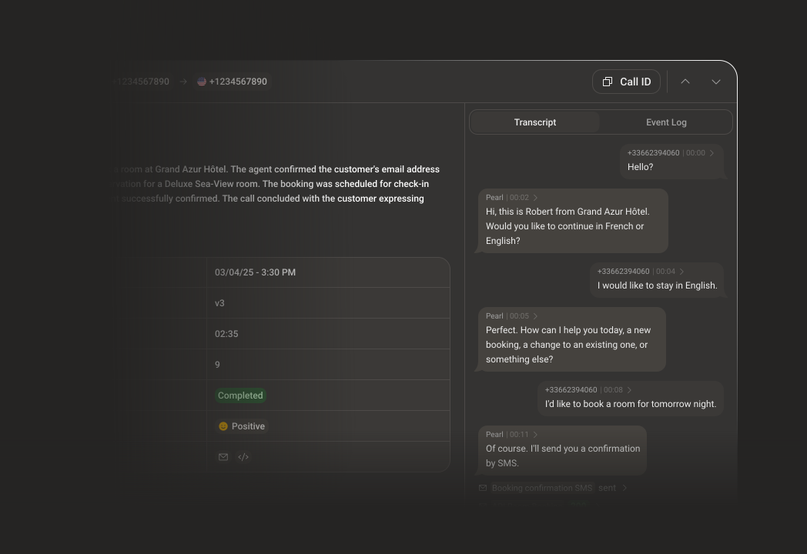
    

  </Frame>

  <Frame>
    

      
    

  </Frame>

---

## What is a Post-Call?  
In NLPearl, a **post-call** is the view of a single phone conversation handled by Pearl. It centralizes all key information captured before, during, and after the call to ensure full traceability, improve quality, and support human follow‑up when needed.

To open one, go to your Pearl's page, open the **Calls** tab, and click a call: it opens in a panel on the right. Use the arrows at the top right, or the **↑ / ↓** keys, to move to the previous or next call. A call can also be opened from the **Calls** column of a lead's details.

<Frame>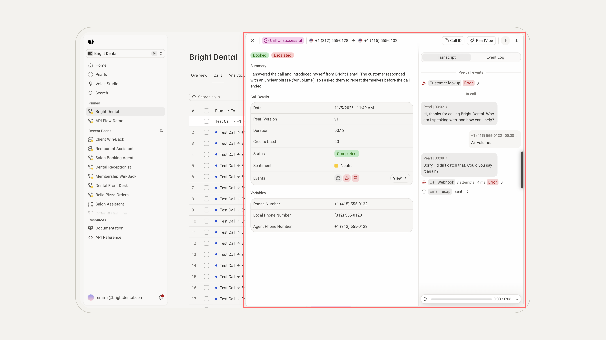</Frame>

<Frame>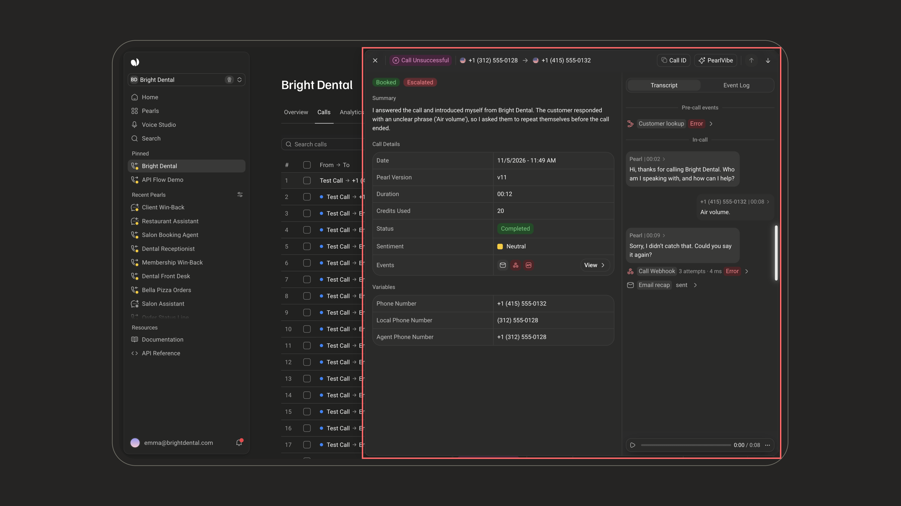</Frame>

<Note>
The view also works while a call is still in progress: you can follow it live, and end it with the hang-up button at the top (*Hang up this ongoing call*). The call then shows **Hangup: Ended manually** in its details.
</Note>

---

## What Does the Post-Call Include?

A post-call provides multiple key sections to review and analyze the outcome of a conversation:

### Call ID
A unique identifier for each call. Click **Call ID** at the top right of the panel to copy it; hover it to see the full ID. Paste it in the search field of the **Calls** tab to find that call again.

<Frame>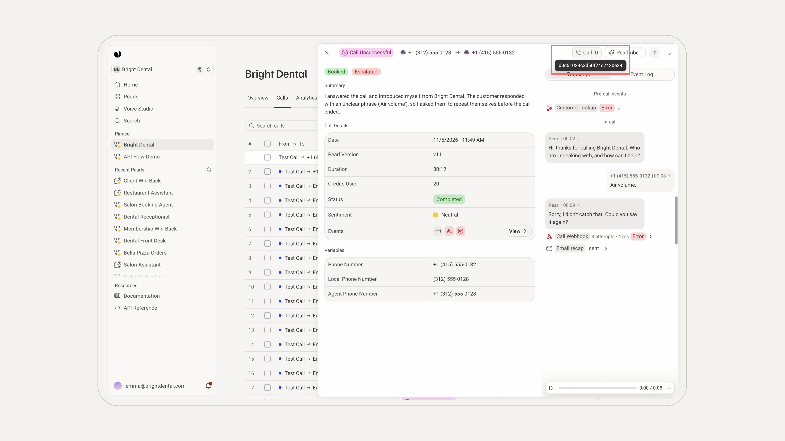</Frame>

<Frame>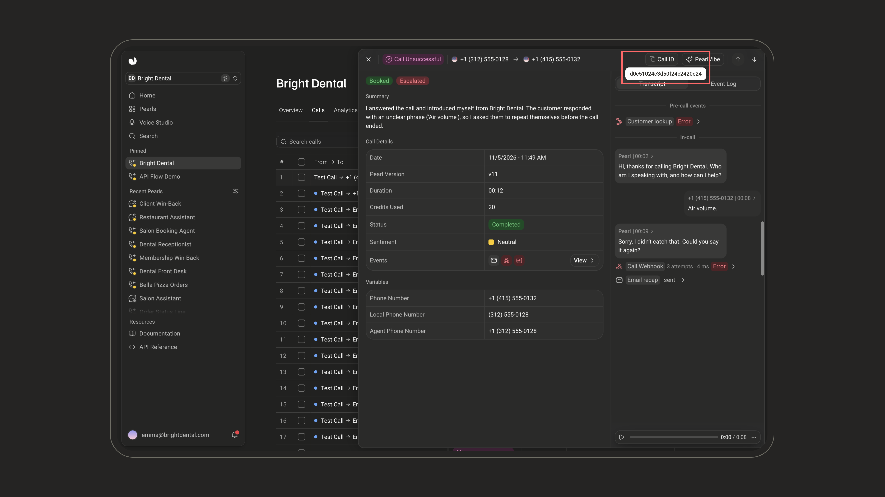</Frame>

<Tip>
Next to it, the **PearlVibe** button (*Review this call with PearlVibe*) opens your Pearl's [PearlVibe](/pages/pearl_vibe) chat with this call as context, to understand what happened and improve your flow.
</Tip>

---

### Call Details  

This section summarizes the essential metadata captured during the call, such as timing, the Pearl version used, credits consumed, and the overall outcome.

| Field | Description |
|-------|-------------|
| **Date** | The exact date and time the call took place. |
| **Pearl Version** | The version of the Pearl that handled the call. |
| **Callback** | The callback time confirmed to the caller, with its time zone (when a [callback](/pages/outbound#callback-requests) was booked). |
| **Lead Name** | The name of the person called, when known. |
| **Duration** | The length of the call, in mm:ss. |
| **Transfer Duration** | Time spent with a human agent after a transfer. |
| **Queue Duration** | Time the caller spent waiting in the holding line before being answered. |
| **Credits Used** | The number of credits consumed by the call. |
| **SMS Credits Used** | The number of credits consumed by SMS messages sent during the call. |
| **Status** | The technical call status (e.g. Completed, Busy, No Answer). |
| **Hangup** | **Ended manually** when someone ended the call from this view. |
| **Sentiment** | The detected sentiment of the customer during the conversation. |
| **Events** | A shortcut to the actions triggered during the call — click **View** to jump to the Event Log. |

<Note>
Some fields only appear when they apply: **Callback** when a callback was booked, **Lead Name** when the name is known, **Transfer Duration** when the call was transferred, **Queue Duration** when the caller was queued, **SMS Credits Used** when at least one SMS was sent, and **Hangup** when the call was ended manually.
</Note>

<Frame>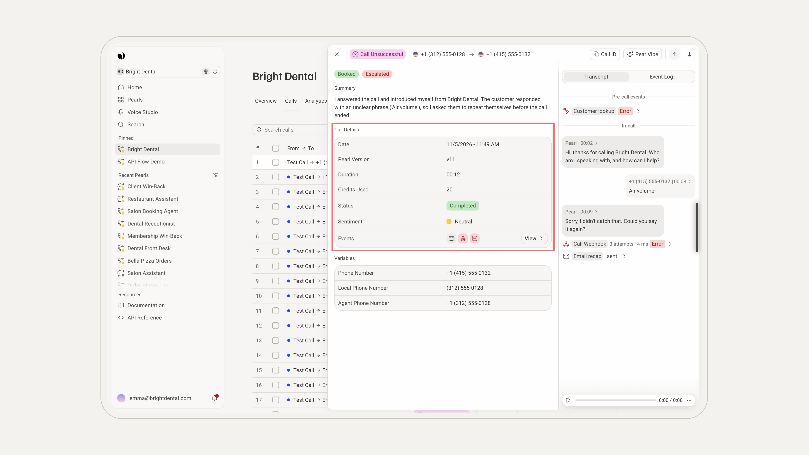</Frame>

<Frame>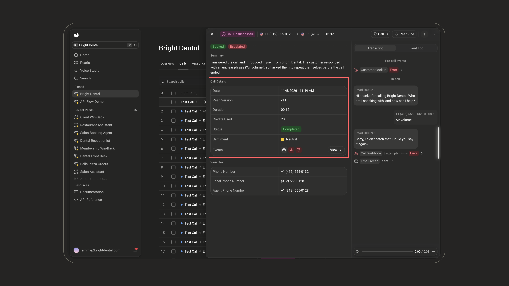</Frame>

---

**Call Status**  
The technical status of the call (whether the user answered or not), shown as the **Status** field in the [Call Details](#call-details) section above. Possible values include:

| Status        | Description                                                                 |
|---------------|-----------------------------------------------------------------------------|
| `In Queue`    | The call is waiting to be placed or answered.                               |
| `In Progress` | The call is currently ongoing or being connected.                          |
| `Completed`   | The call was successfully connected and ended normally.                    |
| `Busy`        | The receiver was already on another call or rejected the call.             |
| `Failed`      | The call could not be established due to an error or network issue.        |
| `No Answer`   | The call rang but no one picked up before the timeout.                     |
| `Canceled`    | The call was canceled before it connected.                                 |

<Info>Call Status refers to the telephony-level result of the call connection, such as whether the call was picked up, missed, busy, or failed to connect.</Info>

---

**Conversation Status**  
Indicates the outcome of the conversation from a business or process perspective. It is shown as a colored badge in the header, next to the caller and receiver numbers. Possible values include:

<Frame>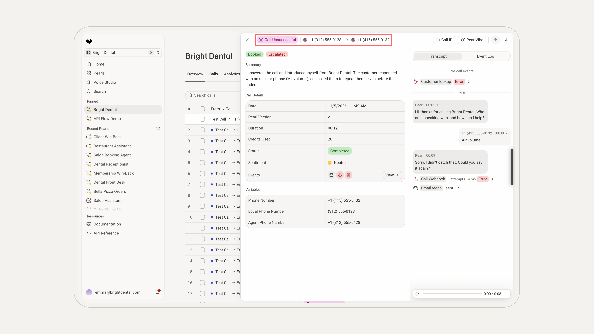</Frame>

<Frame>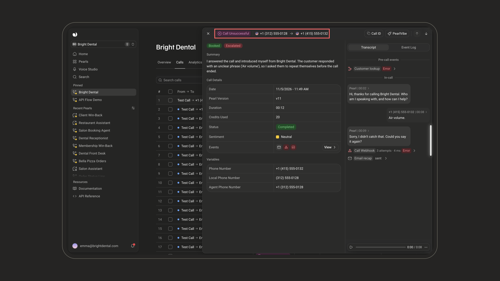</Frame>

| Status               | Description                                                            |
|----------------------|------------------------------------------------------------------------|
| `Call Successful`    | The conversation achieved its expected outcome.                       |
| `Call Unsuccessful`  | The conversation failed to meet its objective.                        |
| `Completed`          | The conversation was conducted and finalized, regardless of outcome.  |
| `Voicemail Left`     | A voicemail was successfully left. *(Outbound only)*                  |
| `Need Retry`         | The contact attempt failed and will be retried. The **x/y** chip next to it shows the attempts made. *(Outbound only)* |
| `Unreachable`        | The lead couldn't be reached after all retry attempts were exhausted (also used for an unanswered test call). |
| `In Queue` / `On Call` | The call is waiting or in progress.                                |
| `Queue Abandon`      | The caller hung up while waiting in the holding line.                 |
| `Blacklisted`        | The number is on your [blacklist](/pages/blacklist), so the call was not handled. |
| `Error`              | The call failed or was canceled.                                      |

<Card icon="circle-info" iconType="light">
  <b>Important distinctions about Conversation Status</b>:

  - `Voicemail Left` and `Need Retry` only apply to **outbound** activities.
  
  - The difference between `Call Successful`, `Call Unsuccessful`, and `Completed` depends on whether a **Success Definition** is set for the Pearl:
    - If a **Success Definition** is set:
      - `Call Successful` → the Success Definition criteria were met during the conversation.
      - `Call Unsuccessful` → the conversation did not meet the Success Definition criteria.
    - If **no Success Definition** is set:
      - `Completed` → the conversation was completed without any Success Definition evaluation.
</Card>

<Note> For more information on Success Definitions, see [Pearl Analytics](/pages/pearl_analytics#define-the-success-of-your-pearl).</Note>

---

**Tags**  
  The [Indicator Tags](/pages/pearl_analytics#indicator-tags) this call received, shown as colored chips at the top of the left column. Pearl assigns them automatically, based on the conditions you set for each tag.

<Frame>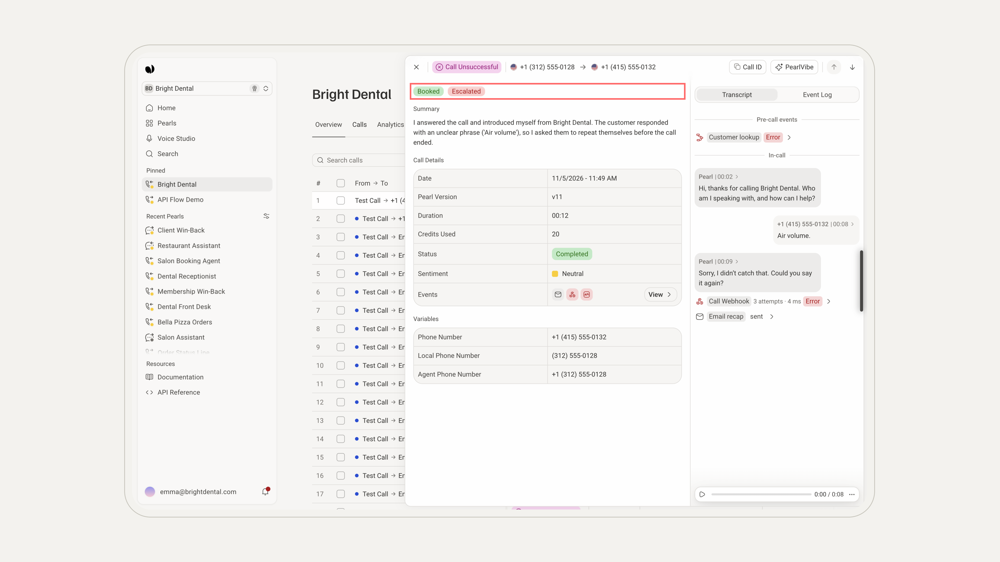</Frame>

<Frame>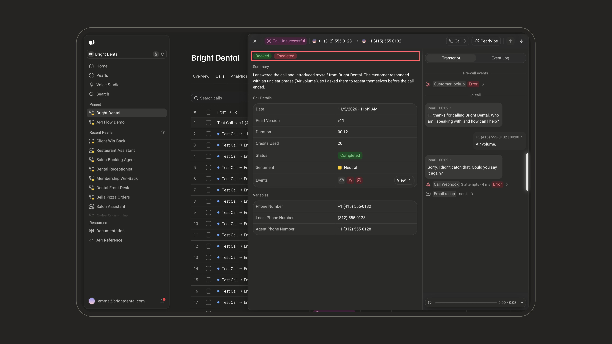</Frame>

---

**Events**  
  A log of the actions triggered by Pearl during the call. Each event includes a timestamp, the action details, and an execution status. The **Events** row in Call Details shows one icon per event (hover it for its name) — click **View** to jump straight to the **Event Log**.

  Possible event types include:

| Event Type          | Description                                                                    |
|---------------------|--------------------------------------------------------------------------------|
| `Call Transferred`  | The call was transferred to another destination.                              |
| `SMS Sent`          | A text message was sent to the customer.                                      |
| `Email Sent`        | An email was sent during the call.                                            |
| `API Request`       | An API was called — before the call (**Pre Call API Request**), during it (**API Request**), or after it (**Post Call API Request**). |
| `Appointment Booked` | An appointment was booked in the calendar.                                   |
| `Slack`             | A Slack notification was sent.                                                |
| `Call Webhook` / `Lead Webhook` | A [webhook](/pages/webhooks) was sent, with its number of attempts, response time, and status code. |
| `Callback request`  | A callback was **Scheduled**, **Cancelled**, or **Not taken**, with the requested time and reason. |
| `Call Recorded`     | The call recording was captured.                                              |
| `Hand-Off`          | The conversation was handed off to a human (text agents).                     |

<Info>
Each event carries an execution status: the **HTTP status code** for API calls (or **Error** when no response came back), otherwise **sent** / **failed**. Failed events are flagged in red.
</Info>

<Frame>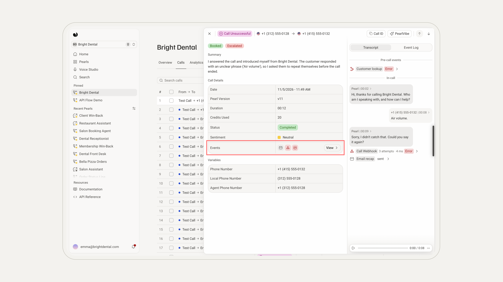</Frame>

<Frame>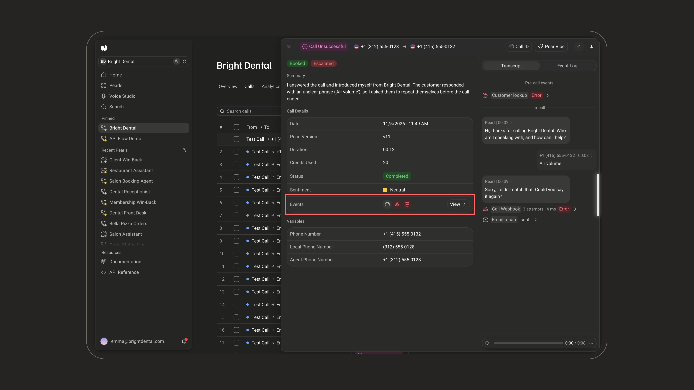</Frame>

---

**Sentiment**  
  An automatic classification of the customer's tone and emotional state throughout the conversation, shown as the **Sentiment** row of Call Details. Possible values include:

| Sentiment Value       | Description                                                       |
|------------------------|-------------------------------------------------------------------|
| `Positive`             | The conversation was clearly positive in tone and emotion.        |
| `Slightly Positive`    | The overall tone was mostly positive, with minor neutral moments. |
| `Neutral`              | The sentiment was balanced or emotionless.                       |
| `Slightly Negative`    | The tone leaned slightly negative, but not strongly so.           |
| `Negative`             | The conversation had a clearly negative emotional tone.           |

<Frame>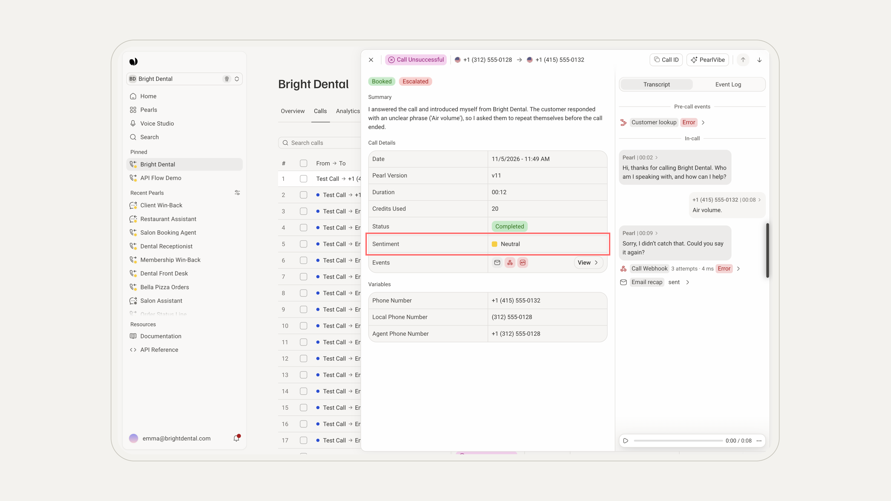</Frame>

<Frame>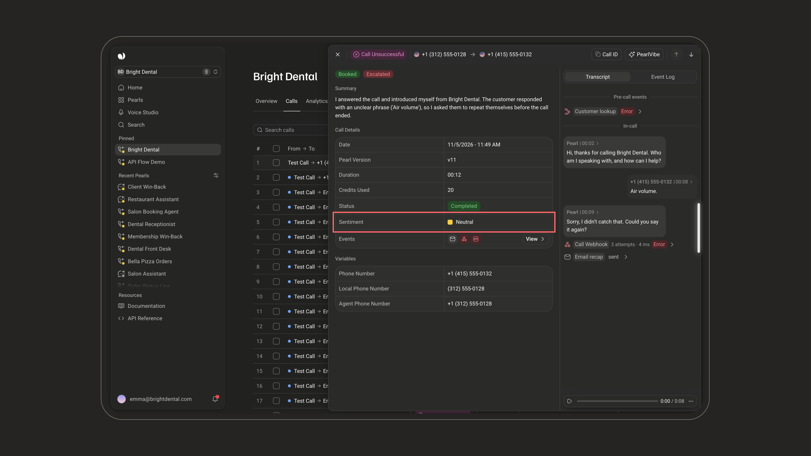</Frame>

---

### Summary  

A concise, human‑readable recap of the conversation, generated by Pearl and shown at the top of the left column. This includes:
- What the customer requested
- What was confirmed or declined
- The overall outcome of the interaction

<Frame>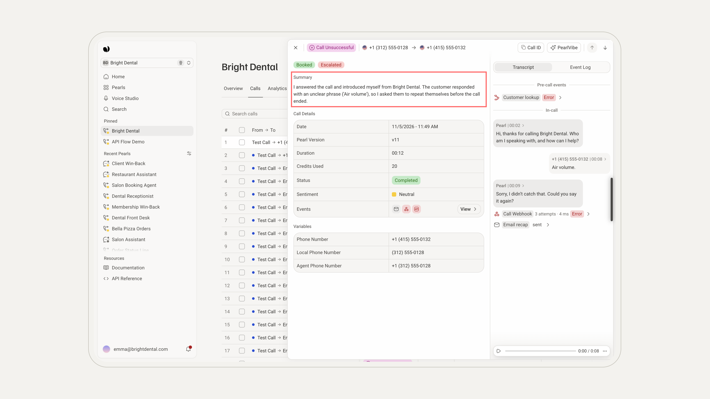</Frame>

<Frame>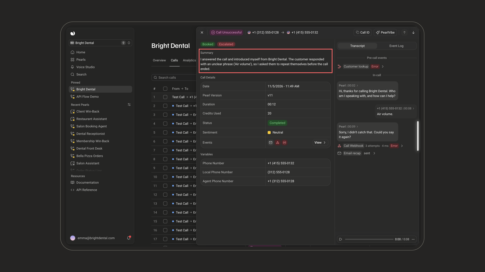</Frame>

---

### Transcript & Event Log

A toggle at the top of the right-hand column switches between the **Transcript** and the **Event Log**.

**Transcript** — a full text version of the conversation between the customer and Pearl. Events show up inline as compact rows: click one to open it in the Event Log. Dividers separate **Pre-call events**, the conversation (**In-call**), and **Post-call events** when there are any. Click a timestamp to play the recording from that moment. Useful for reviewing the interaction, auditing, and training.

<Frame>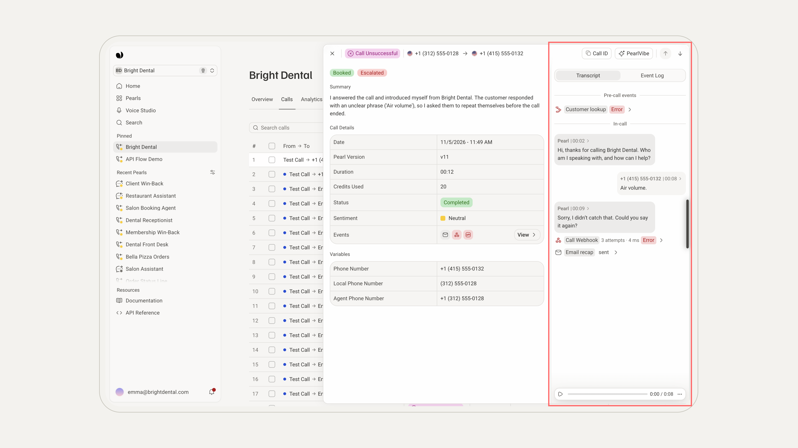</Frame>

<Frame>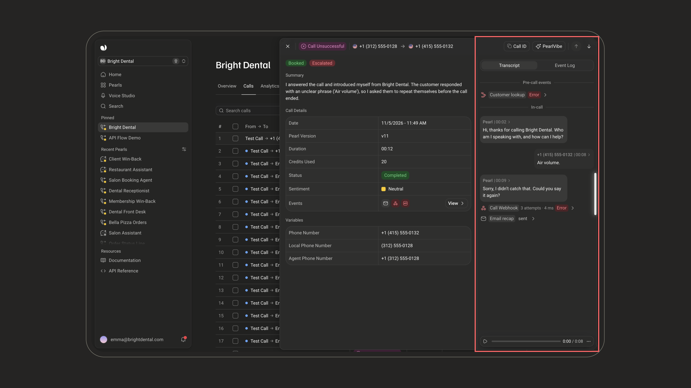</Frame>

**Event Log** — the list of all actions triggered by Pearl around the call. Each entry shows the action, its status, and expands to show its details: for an API request, the method and URL, the error, the response, the body, and the headers. Use it to verify that every automated operation ran and inspect its output.

<Frame>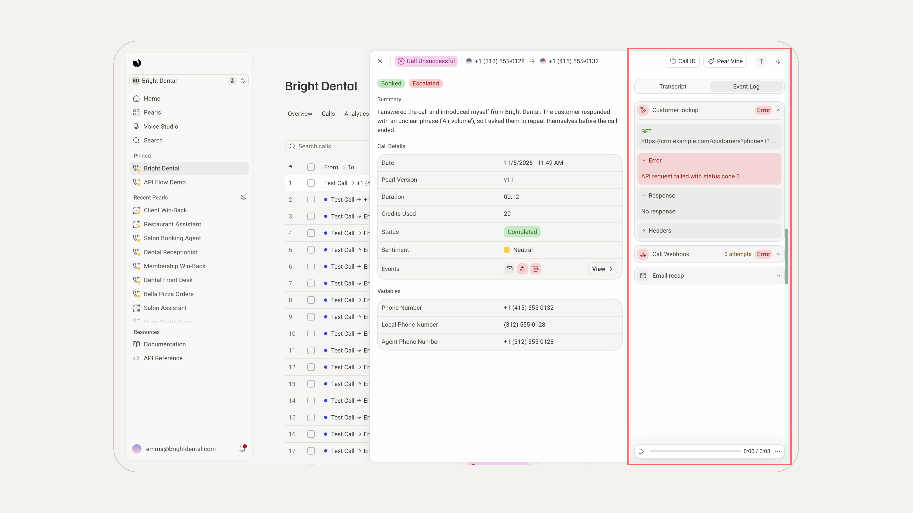</Frame>

<Frame>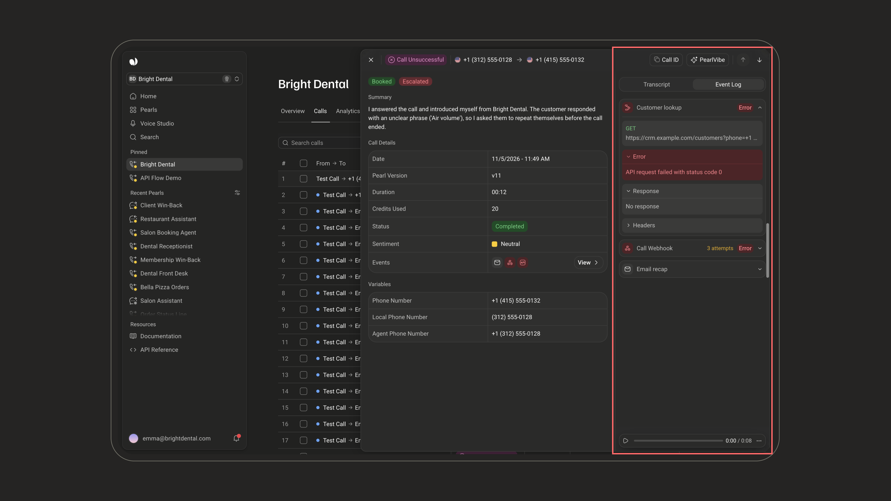</Frame>

---

### Variables

This section, labeled **Variables** in the UI, lists every variable of your Pearl that has a value for this call: data provided before the call (such as the lead's details) and data collected during it.  
Examples:
- Delivery type
- Selected options (e.g. “Dessert: Cheesecake”)
- Customer preferences

Variables displayed here are based on those defined in your **Pearl configuration**. When [Mask Sensitive Info](/pages/inbound#mask-sensitive-info) is on, masked values show as `****`.

<Frame>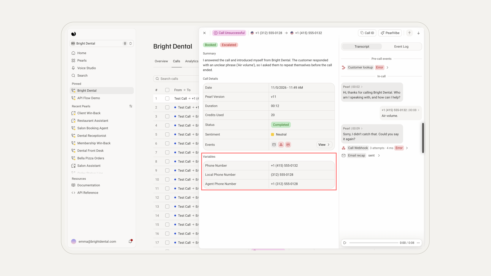</Frame>

<Frame>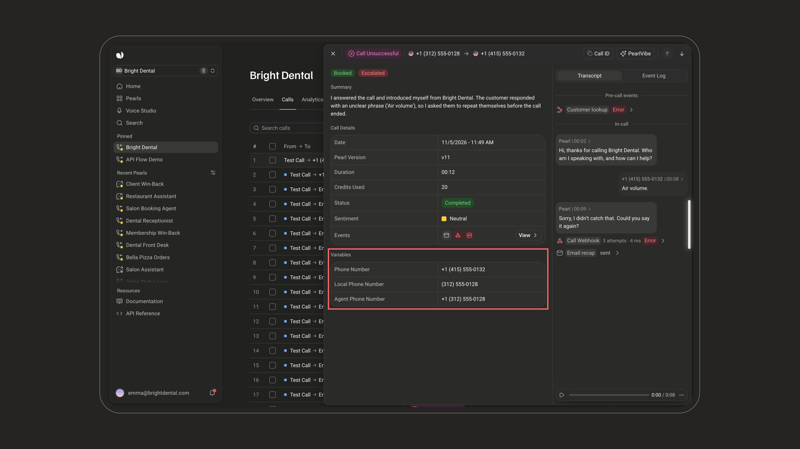</Frame>

 
<Info> 
You can learn more about creating variables in the Pearl [here](/pages/variables).
</Info>

---

### Recording

The **recording player** sits at the bottom of the right-hand column, so you can listen to the entire conversation again for audit, training, or operational purposes. Clicking a timestamp in the **Transcript** plays the recording from that exact moment.

- **Play / Pause**, the position bar, and the time.
- **Speed**: 1×, 1.5×, or 2× (for recordings of 30 seconds or more).
- The **⋯** menu: **Mute**, **Show who speaks**, and **Download** (the recording as an `.ogg` file).

<Frame>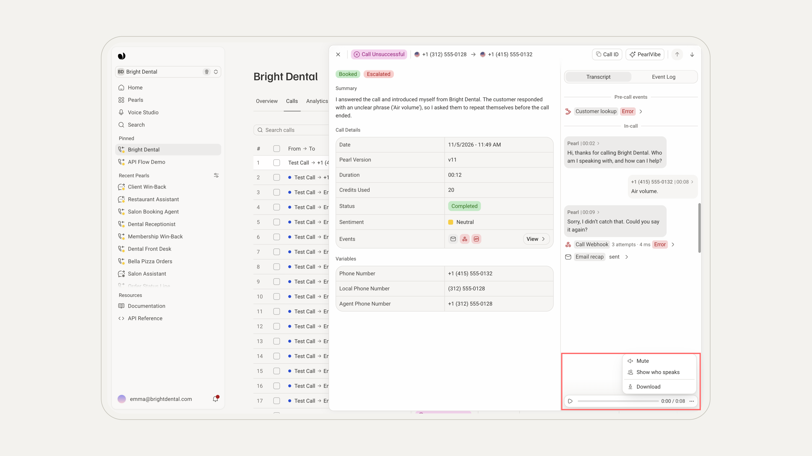</Frame>

<Frame>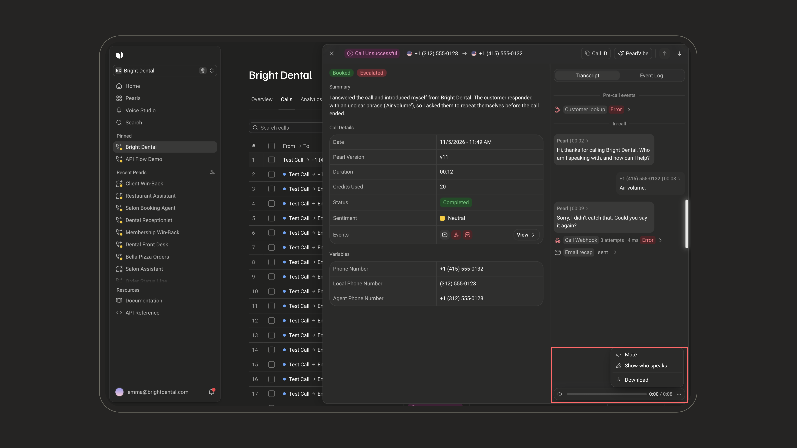</Frame>

<Note>
The audio player only appears when the **Call Status** is `Completed` **and** recording is enabled for the activity. If the recording can't be loaded, the player says so and offers **Try again**.
</Note>

<Warning>If you wish to **disable call recording**, you can manage this setting from the activity configuration (whether **inbound** or **outbound**).</Warning>
👉 For more information on recording settings, see [Inbound Recording](/pages/inbound#recording-options) or [Outbound Recording](/pages/outbound#recording-options).

If you're unable to listen to your recording and you imported a phone number from your Twilio account by connecting it to the platform, it is possible that you cannot access the recording because you have not disabled the 'HTTP Basic Authentication' option in your Twilio settings. For more information see [Disable HTTP Auth from Twilio](/pages/twilio_integration#disabling-http-basic-authentication-for-media-access)

---

<Tip>
**Navigation & shortcuts** — a few actions make it faster to move around and act on a call:

- **Open the linked Lead** — for outbound calls, the **Lead** button opens the lead's details in a popover directly from the call.
- **Move between calls** — use the **Previous** / **Next** arrows or the **↑ / ↓** keyboard keys to jump to the previous or next call without leaving the post-call view.
- **Jump to the Event Log** — click **View** on the Events row in Call Details to switch straight to the Event Log tab.
</Tip>

---

## Why the Post-Call Matters

<CardGroup cols={2}>

<Card title="Traceability" icon="check" iconType="light">
  Every call leaves a documented trace for accountability.
</Card>

<Card title="Faster Follow‑Up" icon="check" iconType="light">
  Helps support and operations teams follow up efficiently with customers.
</Card>

<Card title="Quality & Analytics" icon="check" iconType="light">
  Enables continuous improvement through quality review, sentiment tracking, and conversation analysis.
</Card>

<Card title="Auditing & Compliance" icon="check" iconType="light">
  Provides an auditable record of AI-driven conversations to meet regulatory or internal policy needs.
</Card>
</CardGroup>

---

By consolidating all these elements, the **post-call view** provides a complete overview of each AI-handled conversation, ensuring transparency, traceability, and actionable insights for your team.
