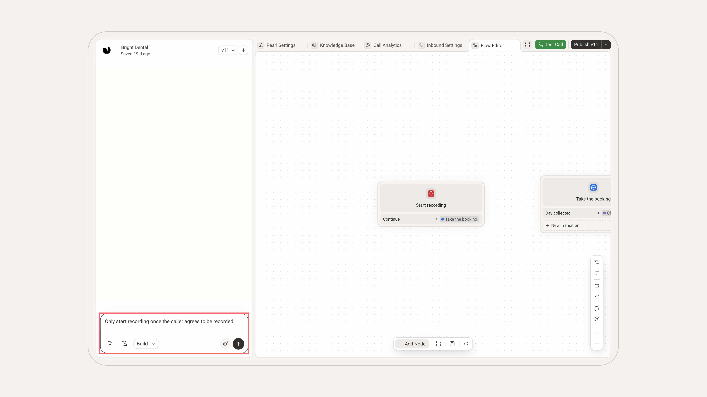
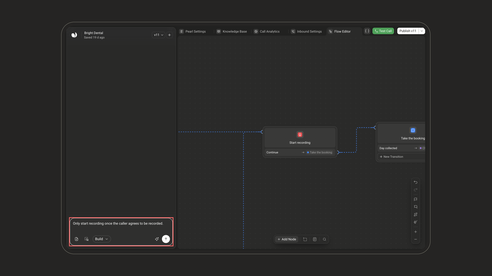
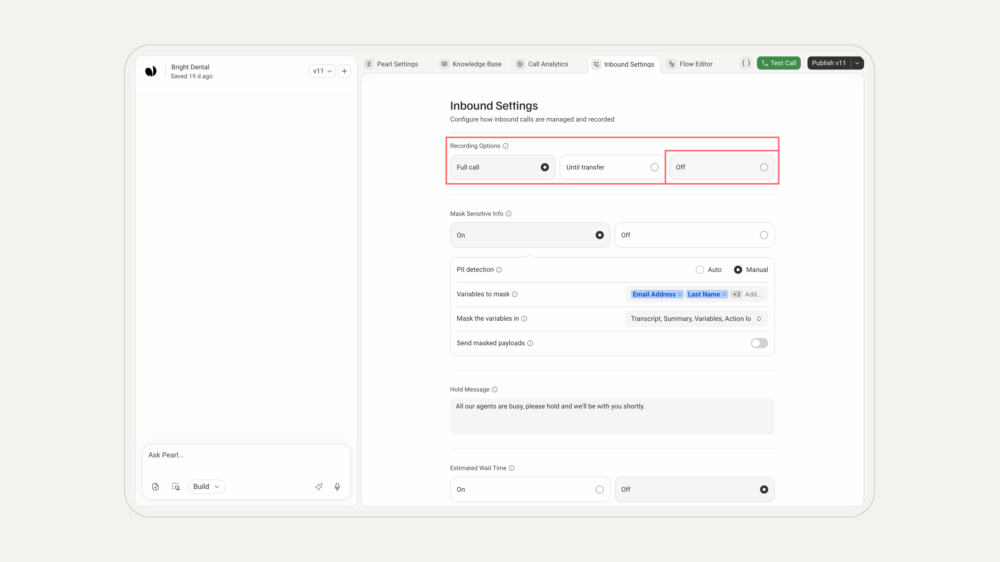
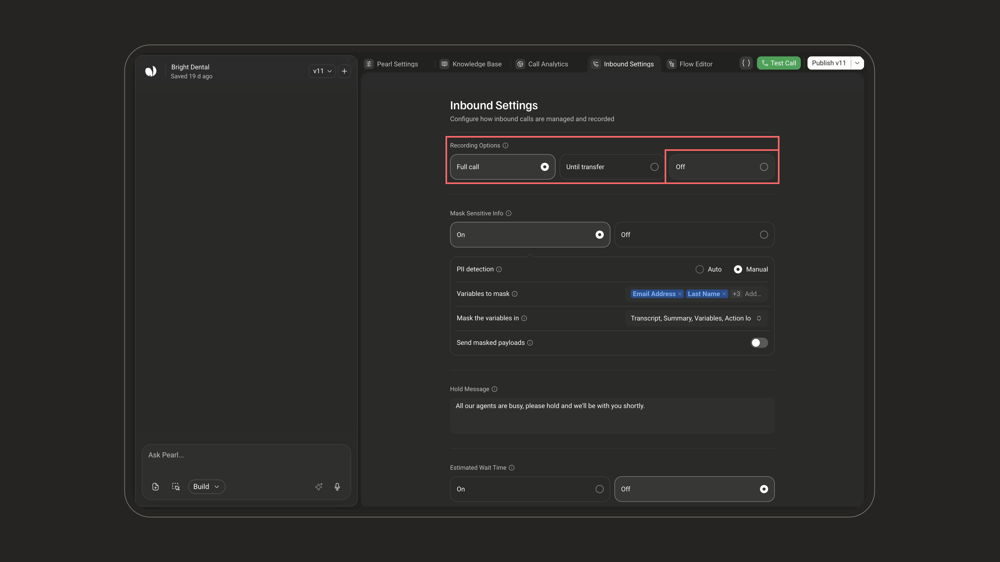
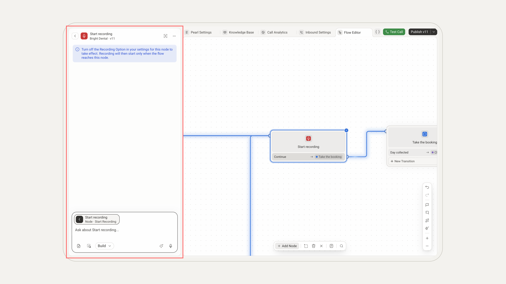
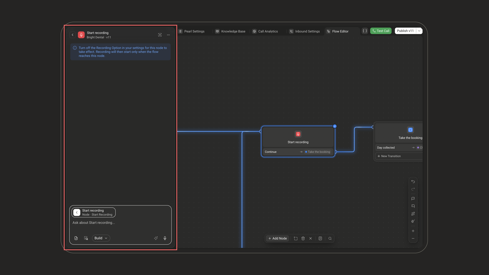
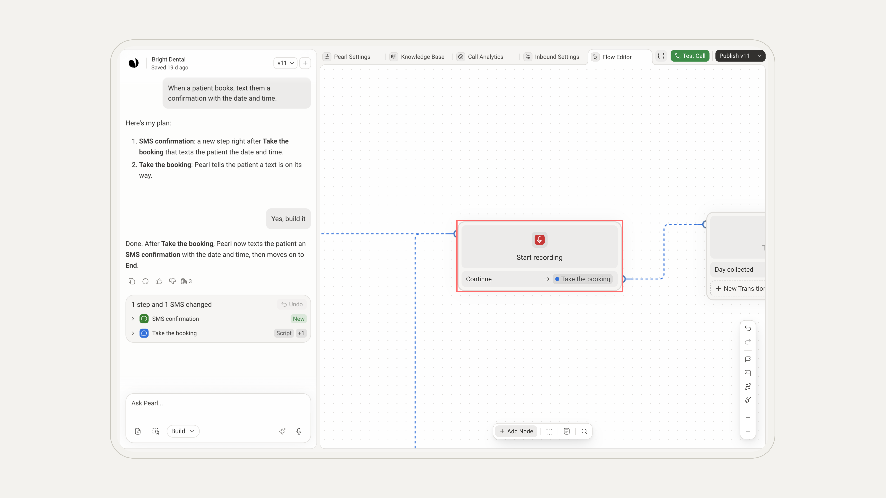
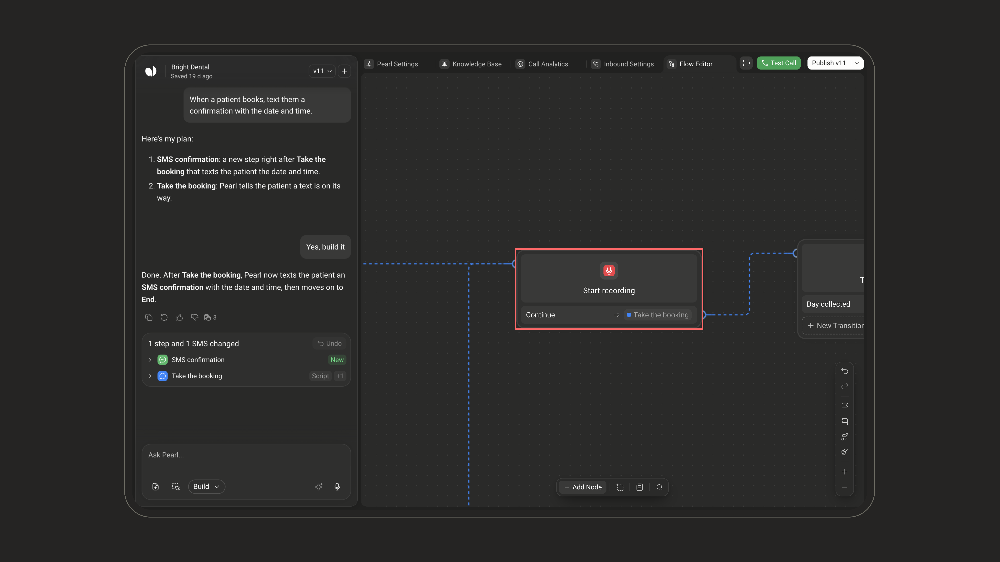

<Callout icon="phone" color="#2563EB" iconType="regular">Available on **voice Pearls** only.</Callout>

<div className="block dark:hidden">
  <Frame>
    <div className="p-1">
      
    </div>
  </Frame>
</div>

<div className="hidden dark:block">
  <Frame>
    <div className="p-1">
      
    </div>
  </Frame>
</div>

The **Start Recording** node gives you control over when call recording begins in a voice flow.

## What it does

Starts recording at the exact point where Pearl reaches this node.

Recording is usually set for the whole call, in the **Recording Options** of your **Inbound Settings** or of your outbound campaign. With Start Recording, the call begins unrecorded and recording starts only once the flow reaches the node, for example after the caller agrees to be recorded.

### Adding Start Recording

Start Recording isn't in the node picker: ask **PearlVibe** for it in the chat, in **Build** mode. Say where recording should begin; PearlVibe adds the node there and turns automatic recording off for you.

```text Example prompt for PearlVibe
Only start recording once the caller agrees to be recorded.
```

<div className="block dark:hidden"><Frame></Frame></div>
<div className="hidden dark:block"><Frame></Frame></div>

## When to use it

Use Start Recording when recording should begin only after a specific moment in the call:

| Use case | Recording begins |
| --- | --- |
| **Disclosure** | Once Pearl informs the caller the call may be recorded |
| **Consent** | Once the caller agrees to be recorded |
| **Specific branches** | Only on selected paths of the flow |
| **Compliance** | When a process requires recording to begin later in the call |

## How it works

When automatic recording is on, recording begins at the start of the call and you don't need this node. To start recording from the flow instead:

<Steps>
  <Step title="Turn off automatic recording">
    In **Inbound Settings**, or in your outbound campaign's settings, set **Recording Options** to **Off**, so recording starts only from the flow. PearlVibe does it when it adds the node; check it if you change the flow later.

    The other choices record from the start: **Full call** (including the person the call is transferred to) and **Until transfer**, plus **Pearl only** for outbound campaigns.

    <div className="block dark:hidden"><Frame></Frame></div>
    <div className="hidden dark:block"><Frame></Frame></div>

    <Warning>
    Once automatic recording is off, any call that does not reach the Start Recording node will **not** be recorded. Make sure every path that requires a recording leads to the node.
    </Warning>
  </Step>
  <Step title="Ask for consent (optional)">
    Add a [Dialogue](/pages/dialogue) node before Start Recording to explain the recording policy and collect the caller's answer. Start Recording does not ask for permission by itself.
  </Step>
  <Step title="Route the consent path">
    Use a conditional transition to send callers who agree to the **Start Recording** node.
  </Step>
  <Step title="Place the node">
    Put **Start Recording** exactly where recording should begin. It has no fields: its panel only reminds you to turn off **Recording Options**.

    <div className="block dark:hidden"><Frame></Frame></div>
    <div className="hidden dark:block"><Frame></Frame></div>

    Once recording starts, the call goes on through the node's **Continue** transition, which you connect on the canvas to the next step.

    <div className="block dark:hidden"><Frame></Frame></div>
    <div className="hidden dark:block"><Frame></Frame></div>
  </Step>
</Steps>

<Info>
Recordings are always active during test calls, regardless of this node or your recording options.
</Info>
