

  <Frame>
    

      
    

  </Frame>

  <Frame>
    

      
    

  </Frame>

---

Use account security settings to manage how users access your workspace, how long sessions stay active, and how administrators review important account activity.

<CardGroup cols={2}>
  <Card title="Session timeout" icon="clock" iconType="light">
    Automatically log users out after a period of inactivity.
  </Card>
  <Card title="Two-factor authentication" icon="shield" iconType="light">
    Add an extra verification step when you log in.
  </Card>
  <Card title="Audit log" icon="list" iconType="light">
    Track workspace activity and security-related events.
  </Card>
  <Card title="Enterprise SSO" icon="building-lock" iconType="light">
    Connect enterprise identity providers through Single Sign-On.
  </Card>
</CardGroup>

---

## Accessing Your Settings

All the settings on this page live in your **Settings**. To open them, click your **profile card** at the bottom-left corner of the sidebar, then select **Settings**.

<Frame>
  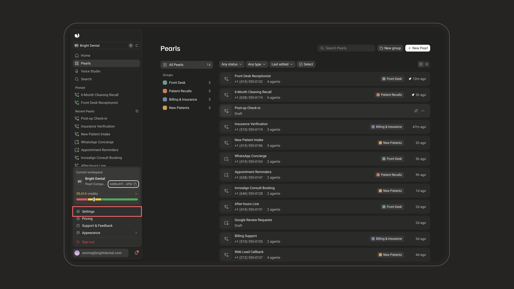
</Frame>

From there, use the left menu: **Security** (under *Account*) for two-factor authentication and your password, and **General Settings** or **Audit Log** (under *Workspace*) for the session timeout, public recordings, and the activity log.

---

## Customizing Your Session Timeout

The session timeout sets how long a session stays active before the user is logged out for inactivity. This helps protect your account if you forget to log out, especially on a shared or public device.

The value is set in **minutes**, from **30 minutes** to **7 days** (10,080 minutes).

<Note>
  This is a **workspace-level** setting: it applies to **all members** of the workspace. Changing it requires the **Manage advanced settings** permission (see [Users & Workspaces](/pages/users_workspaces)). A new value applies from each member's next sign-in.
</Note>

<Steps>
  <Step title="Open General Settings">
    Go to **Settings > General Settings**, under *Workspace*.
  </Step>

  <Step title="Set the Session Timeout">
    In the **Session Timeout** field, enter the duration in minutes, then press **Enter** or click outside the field. The value is saved right away.

    
<Frame>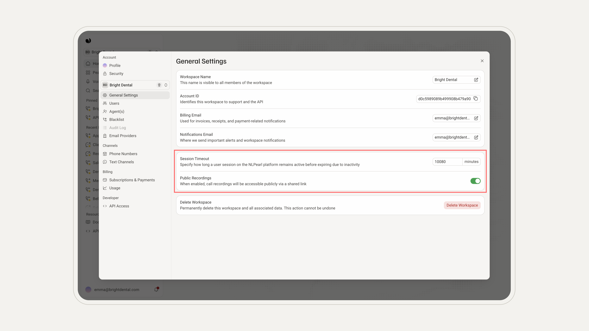</Frame>

    
<Frame>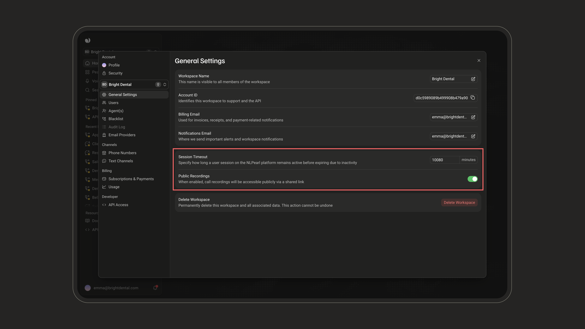</Frame>

  </Step>
</Steps>

<Tip>
  Shorter session timeouts are recommended for shared devices, public computers, or workspaces with stricter security policies.
</Tip>

### Public recordings

Right under the session timeout, the **Public Recordings** switch controls who can listen to your call recordings. When it's on, call recordings are accessible publicly through a shared link. Changing it requires the same **Manage advanced settings** permission.

<Warning>
  Anyone who has the link to a public recording can listen to it. Leave **Public Recordings** off unless you need to share recordings outside the platform.
</Warning>

---

## Reviewing Workspace Activity with Audit Logs

The **Audit Log** helps administrators review important activity and security events in the workspace: sign-ins, configuration changes, published Pearls, and other account-level events.

<Info>
  Opening the Audit Log requires the **View audit log** permission, and a plan that includes it: it isn't available on the **Starter** and **Companion** plans.
</Info>

To open it, go to **Settings > Audit Log**, under *Workspace*.

<Frame>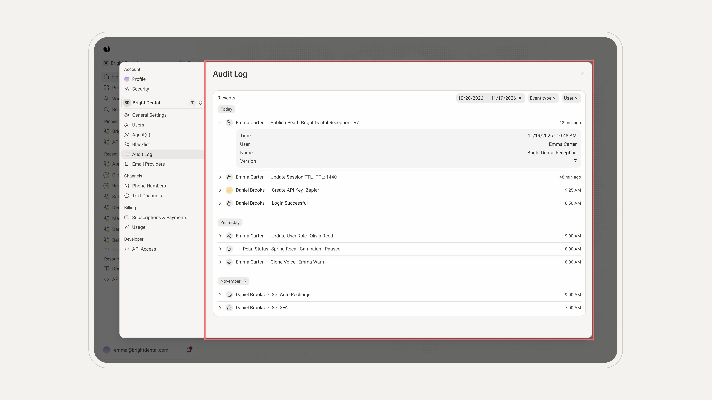</Frame>

<Frame>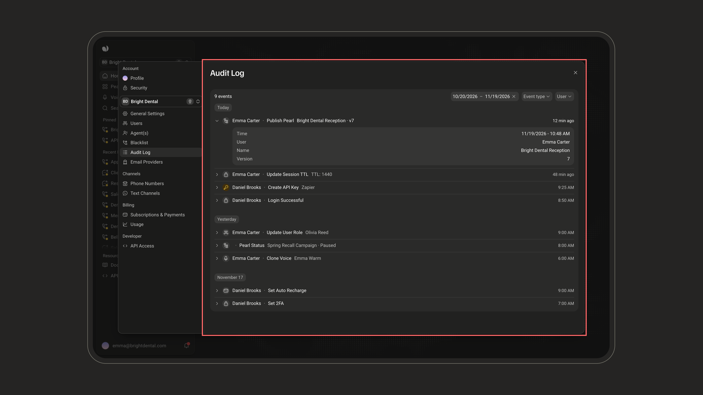</Frame>

Events are listed by day (**Today**, **Yesterday**, then the date). Each row shows:

- **who** triggered the event: a workspace member, or **System** for automatic actions;
- the **event type**, such as *Publish Pearl* or *Login Successful*;
- **what** it applies to, when there is one: a Pearl's name, a status, a version;
- **when** it happened.

Click a row to see its details: the exact **Time**, the **User**, and the data recorded with the event. Click **Load more** at the bottom to see older events.

Use the filters at the top to narrow the log:

- **Period**: a date range (the last 30 days by default).
- **Event type**: one kind of event.
- **User**: the events of one workspace member.

### Recorded event types

The audit log records the following events. The **Event type** filter uses the same labels shown below.

#### Pearls

| Event type | Description |
| --- | --- |
| Publish Pearl | A Pearl was published. |
| Create Pearl Version | A new version of a Pearl was created. |
| Delete Pearl Version | A version of a Pearl was deleted. |
| Pearl Status | A Pearl's status was changed. |
| Pearl Retention | A Pearl's data retention settings were changed. |
| Pearl Total Agents | The number of agents assigned to a Pearl was changed. |
| Pearl Budget | A Pearl's budget was changed. |
| Pearl Phone Number | A Pearl's phone number was changed. |
| Transfer Pearl | A Pearl was transferred. |
| Delete Pearl | A Pearl was deleted. |

#### API keys

| Event type | Description |
| --- | --- |
| Create API Key | An API secret key or an OAuth 2.0 app was created. |
| Update API Key | An OAuth 2.0 app's scopes were changed. |
| Rotate API Key Secret | An OAuth 2.0 app's client secret was rotated. The secret value is not stored in the log. |
| Delete API Key | An API secret key or an OAuth 2.0 app was deleted. |
| Reveal API Key | An API key was revealed. The secret value is not stored in the log. |

#### Users and roles

| Event type | Description |
| --- | --- |
| Invite User | A user was invited to the workspace. |
| User Join | A user joined the workspace. |
| Invitation Canceled | A pending invitation was canceled. |
| Update User Role | A user's role was changed. |
| Update Account Information | Workspace account information was changed. |
| Remove User from Account | A user was removed from the workspace. |
| User Left Account | A user left the workspace. |
| Create Role | A workspace role was created. |
| Update Role | A workspace role or its permissions were changed. |
| Delete Role | A workspace role was deleted. |

#### Security

| Event type | Description |
| --- | --- |
| Login Attempt | A user attempted to sign in. |
| Login Successful | A user signed in successfully. |
| Update Session TTL | The workspace session timeout was changed. |
| Set 2FA | Two-factor authentication settings were changed. |
| Change Password | A user changed their password. |
| Delete Account | The workspace account was deleted. |
| Add to Blacklist | One or more phone numbers were added to the blacklist. |
| Remove from Blacklist | One or more phone numbers were removed from the blacklist. |

#### Billing and agents

| Event type | Description |
| --- | --- |
| Purchase Agents | Agents were purchased. |
| Delete Agent | An agent was removed. |
| Set Billing Details | Workspace billing details were changed. |
| Set Payment Method | The workspace payment method was changed. |
| Set Subscription | The workspace subscription was changed. |
| Cancel Subscription | The workspace subscription was canceled. |
| Purchase Credits | Credits were purchased. |
| Set Auto Recharge | Automatic credit recharge settings were changed. |

#### Phone numbers

| Event type | Description |
| --- | --- |
| Purchase Phone Numbers | One or more phone numbers were purchased. |
| Release Phone Number | A phone number was released. |
| Add Phone Number | A bring-your-own phone number was added. |
| Update Phone Number | A phone number's settings were changed. |
| Update SIP Configuration | SIP settings for a phone number were changed. |
| Set Twilio Credentials | Workspace Twilio credentials were changed. |

#### Text channels and integrations

| Event type | Description |
| --- | --- |
| Create Text Channel | A text channel was created. |
| Update Text Channel | A text channel was changed. |
| Delete Text Channel | A text channel was deleted. |
| Rotate Channel Secret | A text channel secret was rotated. |
| Reveal Channel Secret | A text channel secret was revealed. The secret value is not stored in the log. |
| Connect WhatsApp | A WhatsApp integration was connected. |
| Add WhatsApp Number | A phone number was added to a WhatsApp integration. |
| Disconnect WhatsApp | A WhatsApp integration was disconnected. |
| Set Email Credentials | Email credentials were configured. |
| Delete Email Credentials | Email credentials were removed. |
| Connect Slack | A Slack integration was connected. |
| Connect Calendar | A calendar integration was connected. |

#### Data and groups

| Event type | Description |
| --- | --- |
| Import Leads | Leads were imported into a Pearl. |
| Refresh Leads | Leads of a Pearl were set back to *New*, to be contacted again. |
| Delete Leads | Leads were deleted from a Pearl. |
| Delete Calls | Calls were deleted from a Pearl. |
| Export Calls | Calls were exported from a Pearl. |
| Group Retention | A group's contact retention settings were changed. |
| Delete Contacts | Group contacts were purged by the retention policy. |

#### Voices

| Event type | Description |
| --- | --- |
| Clone Voice | A voice was cloned in the Voice Studio. |
| Delete Voice | A cloned voice was deleted. |
| Share Voice | A cloned voice was published. |

---

## Enterprise Single Sign-On (SSO)

Single Sign-On (SSO) is available for Enterprise workspaces. It allows your team to authenticate through your company identity provider and centralize access management.

<Info>
  To enable SSO for your workspace, contact us at [support@nlpearl.ai](mailto:support@nlpearl.ai). Please include your workspace name, company domain, and preferred identity provider if available. SSO is set up for your company's email domain.
</Info>

Once SSO is enabled, members sign in through their identity provider instead of entering a password:

<Steps>
  <Step title="Click Sign in with SSO">
    On the login screen, click **Sign in with SSO**.

    
<Frame>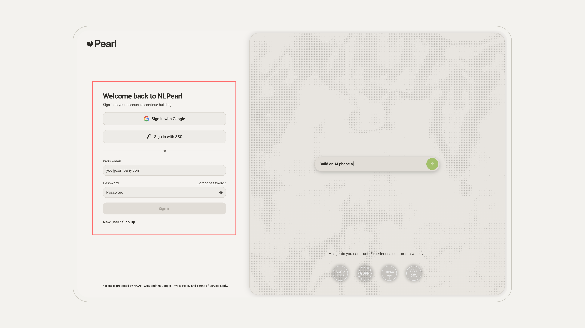</Frame>

    
<Frame>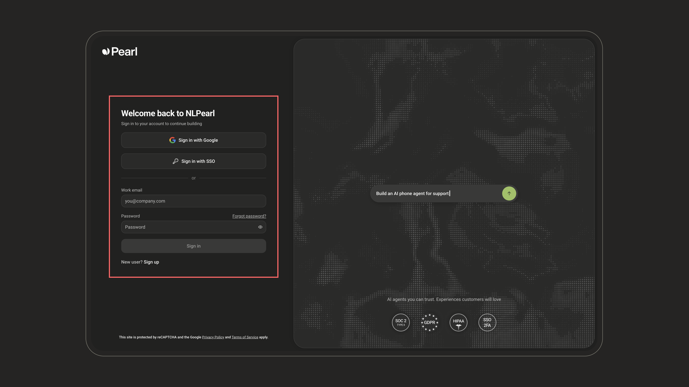</Frame>

  </Step>

  <Step title="Enter your company email">
    Enter your **Company Email** and click **Sign in**. Your identity provider opens in a new window: sign in there to finish. If you have two-factor authentication turned on, you're then asked for your code.

    
<Frame>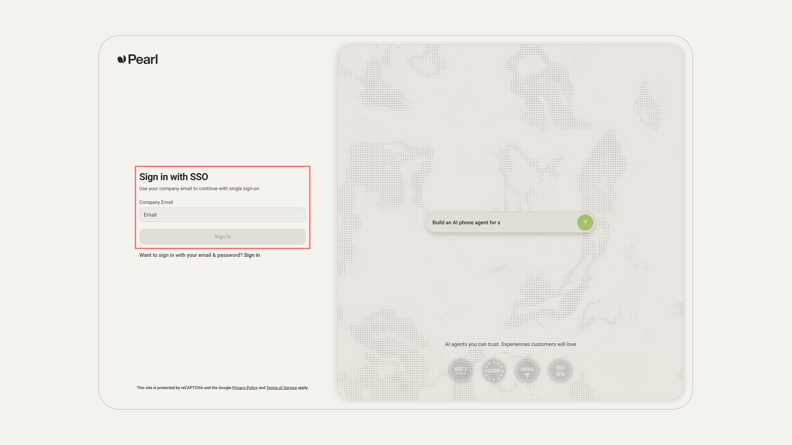</Frame>

    
<Frame>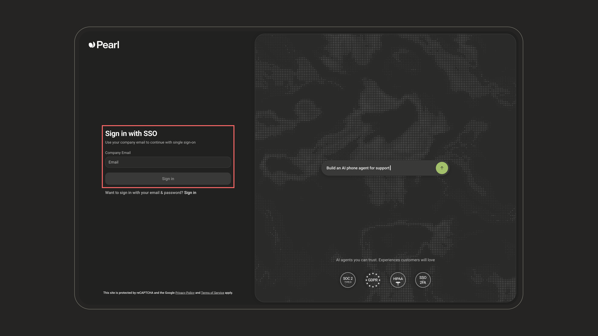</Frame>

  </Step>
</Steps>

---

## Setting Up Two-Factor Authentication (2FA)

Two-Factor Authentication (2FA) adds an additional step to the login process to strengthen your account's security. Instead of relying solely on your password, which could be guessed, leaked, or stolen, 2FA requires a second form of verification that only you should have access to.

This second factor is a temporary code generated by an authenticator app on your phone, such as Google Authenticator. If you can't reach your app, you can also receive the code by **SMS** at login. Even if someone knows your password, they can't access your account without that code.

<Note>
  2FA is set **for each user**: every member turns it on for their own account. There's no setting that requires it for a whole workspace.
</Note>

<Steps>

<Step title="Open the Platform Security page">
Click your **profile card** at the bottom-left corner of the sidebar, open **Settings**, then select **Security**, under *Account*. The **Platform Security** page has two cards: **Two-Factor Authentication** and **Reset Password**.

<Frame>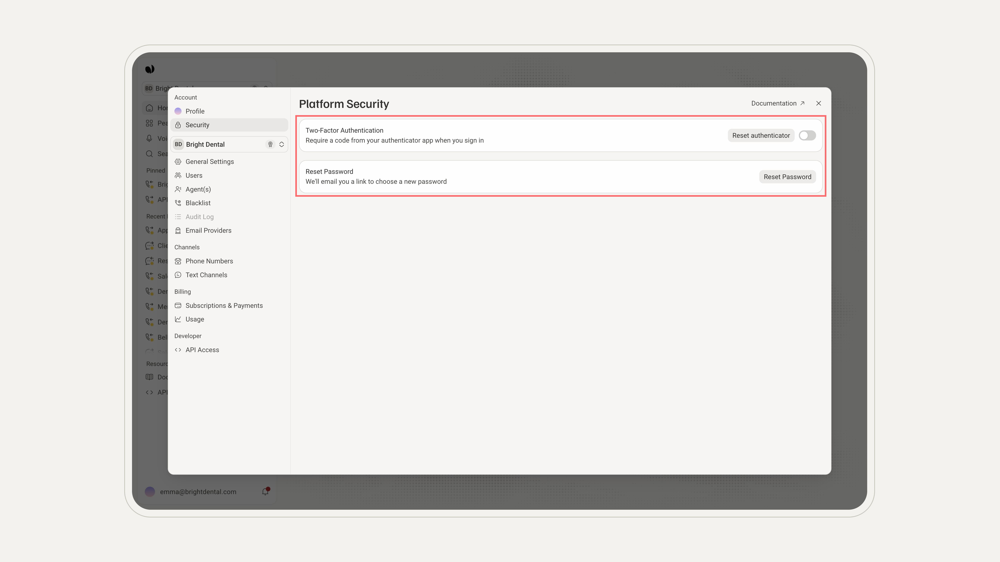</Frame>

<Frame>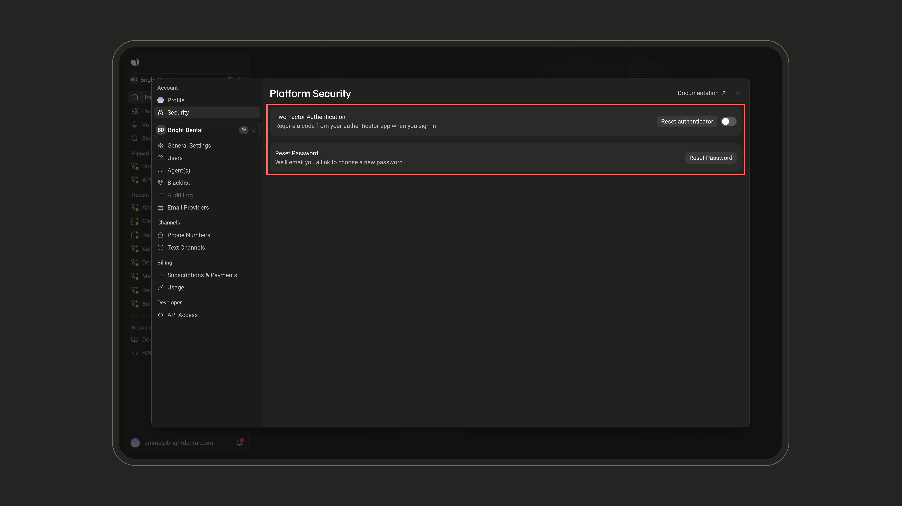</Frame>

</Step>

<Step title="Open the setup window">
In the **Two-Factor Authentication** card, click **Set up authenticator** (**Reset authenticator** once 2FA is already set up).

The **Secure your NLPearl account with 2FA** window opens: the steps to follow on the left, with links to **Google Authenticator**, **Microsoft Authenticator**, and **Authy**, and the QR code to scan on the right.

<Frame>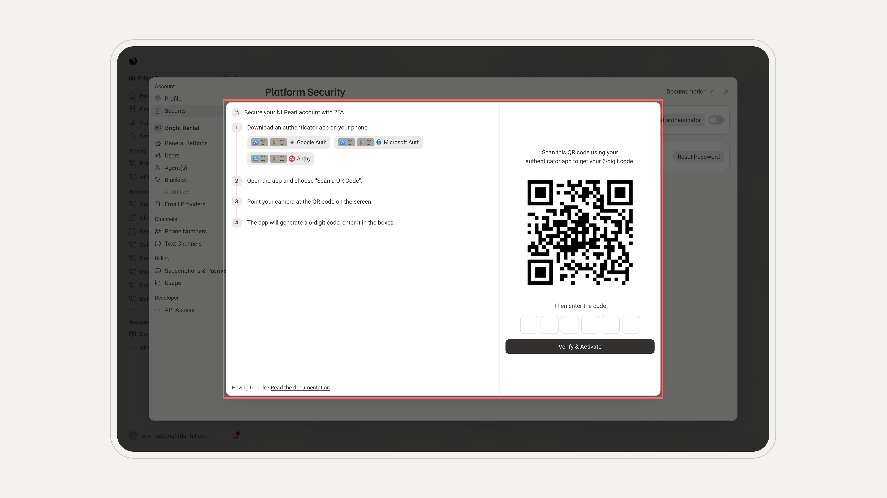</Frame>

<Frame>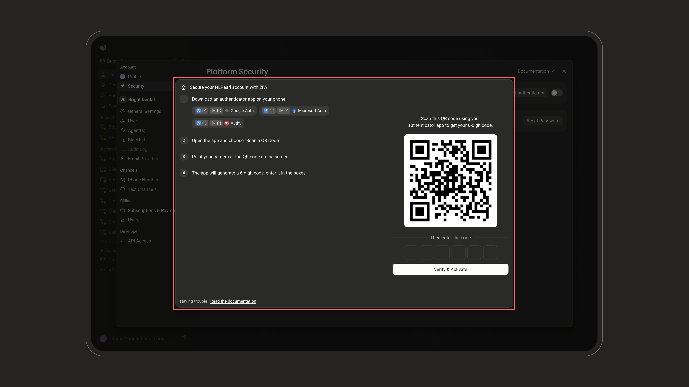</Frame>

</Step>

<Step title="Download an authenticator app">
On your phone, install an authenticator app such as **Google Authenticator**, **Microsoft Authenticator**, or **Authy**.

<Frame>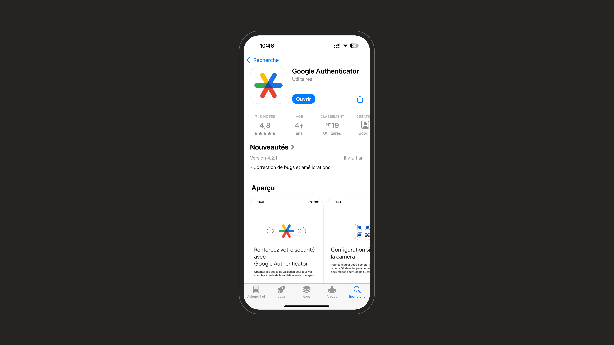</Frame>

<Frame></Frame>

</Step>

<Step title="Scan the QR code">
Open the app, tap the **+** button, and choose **Scan a QR code**. Point your camera at the QR code shown in the setup window.

<Frame>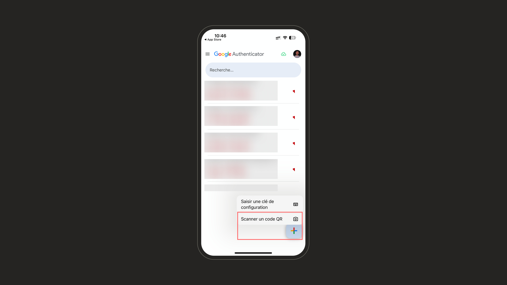</Frame>

<Frame></Frame>

</Step>

<Step title="Enter the 6-digit code">
The app generates a **6-digit code** that refreshes every few seconds. Enter it in the boxes under **Then enter the code** and click **Verify & Activate**.

<Frame>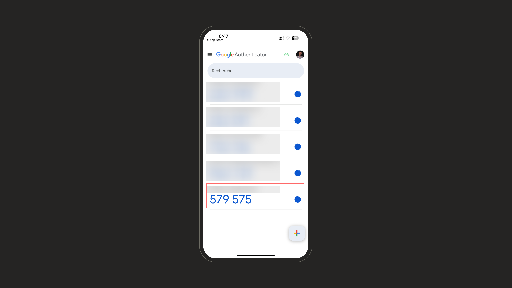</Frame>

<Frame></Frame>

<Check>
Once the code is verified, 2FA is turned on for your account. You'll be asked for a code at every login.
</Check>
</Step>

<Step title="Turn 2FA on or off">
Use the switch in the **Two-Factor Authentication** card to turn 2FA on or off at any time. Turning it off asks you to confirm (**Turn off two-factor sign-in?**): click **Turn off**. Your authenticator stays configured, so you can turn 2FA back on without scanning again.

<Frame>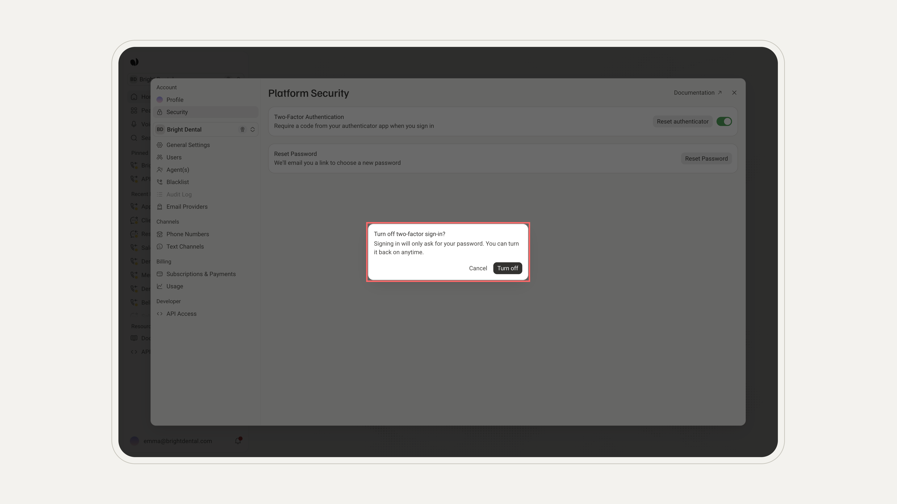</Frame>

<Frame>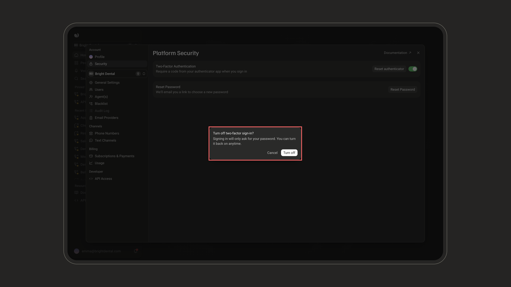</Frame>

<Note>
Got a new phone or lost access to your authenticator app? Click **Reset authenticator** and set up the new app with the QR code. The new app replaces the old one only once you've entered its code and clicked **Verify & Activate**: if you close the window before, nothing changes.
</Note>
</Step>

<Step title="How it works at login">
Once 2FA is on, every login opens the **Two-Factor Authenticator** window after your password:

- Enter the current 6-digit code from your **authenticator app**.
- If you can't reach your app, click **Click Here** next to *Need help? Get your code via SMS* to receive the code by text instead. It's sent to the phone number in your **Profile**, so make sure it's up to date.

<Frame>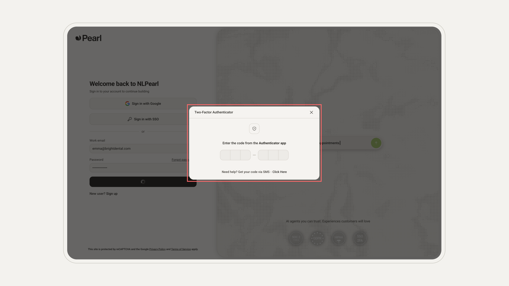</Frame>

<Frame>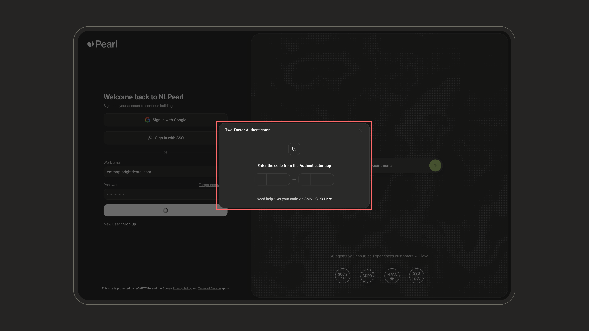</Frame>

</Step>

</Steps>

---

## Resetting Your Password

You can change your account password at any time from the **Platform Security** page:

1. In the **Reset Password** card, click **Reset Password**. We email you a link to choose a new password.
2. Open the link from the email, enter your new password on the **Reset your password** page, and confirm.
