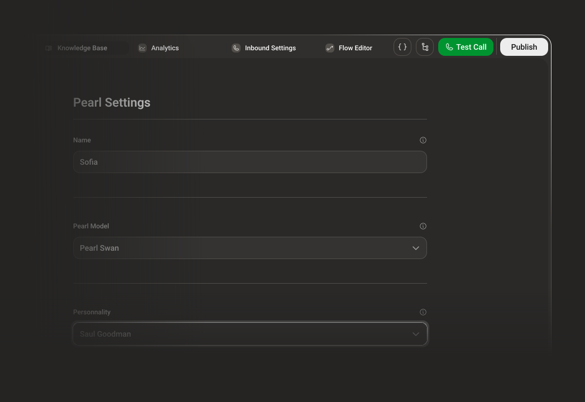
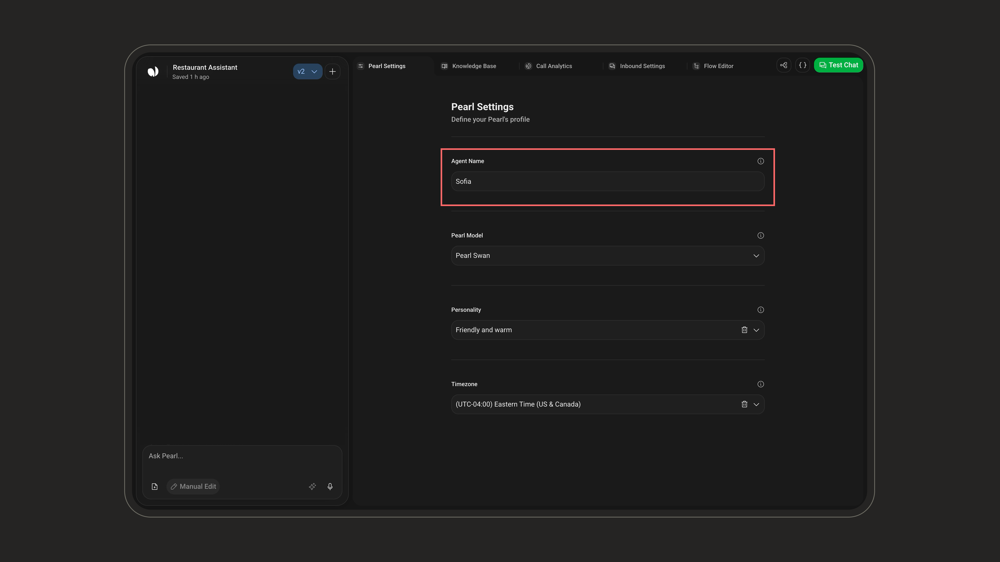
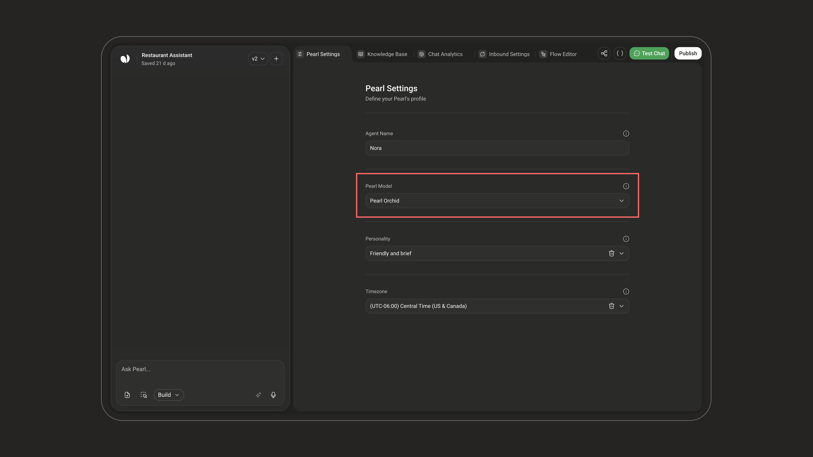
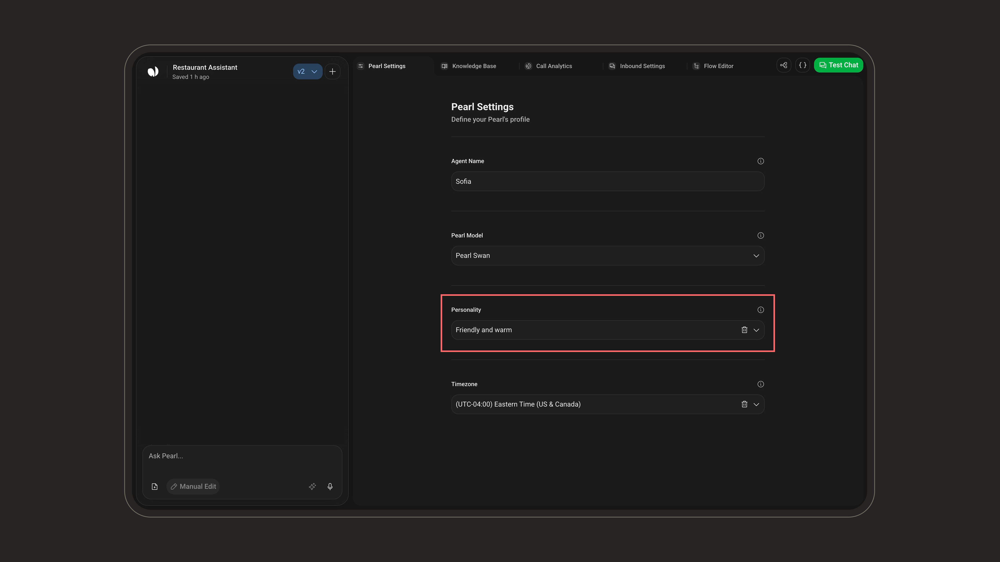
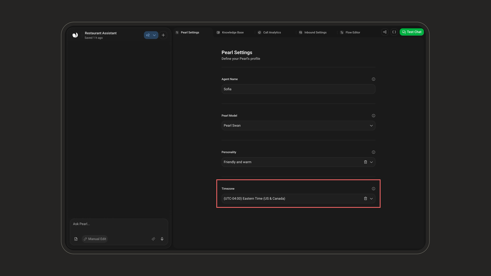

  <Frame>
    

      
    

  </Frame>

  <Frame>
    

      
    

  </Frame>

In this step, you can customize your chat agent's identity and behavior by setting its **name**, **personality**, **timezone**, and **Pearl Model**.

---

## Agent Name

To define your agent's identity:

- **Agent Name** – Set your Pearl's name (e.g., *Joe*, *Victoria*). This is the name it will use when chatting with customers. Max **25 characters**, required.

<Frame>
  
</Frame>

---

## Pearl Model

The **Pearl Model** defines the intelligence, speed, and cost profile of your agent. Chat agents can run on two models: **Pearl Orchid** and **Pearl Swan**.

<Frame>
  
</Frame>

<Card>
<Tabs>
  <Tab title="Pearl Orchid">
    <Info>
    **High Reasoning · Higher Latency · +1 credit/message**
    </Info>
    Our most advanced text agent model, surpassing Pearl Swan in intelligence and built to excel across any use case. It is the default model of every text Pearl built with PearlVibe.

    Use it when you need:
    - The best answer quality on complex or open-ended conversations.
    - Reliable reasoning across many steps, tools, and integrations.
  </Tab>
  <Tab title="Pearl Swan">
    <Info>
    **Medium Reasoning · Higher Latency · Standard Rate**
    </Info>
    Our standard model for chat agents, built to handle any text-based use case with reliable reasoning and natural responses.

    Use it when you want:
    - A dependable model at the standard rate.
    - High-volume conversations with clear, predictable flows.
  </Tab>
</Tabs>
</Card>

<Note>
Pearl Orchid and Pearl Swan are available only for chat agents. Voice models (Flame, Hydra, Arrow, Trident, Oyster) cannot be selected on a text Pearl.
</Note>

---

## Personality

Your AI agent can take on a wide range of personalities, from natural and professional to wild, fictional, or downright iconic.

<Frame>
  
</Frame>

<Tip>
**Create your own personality.** You're not limited to the predefined list. Type any description in the **Personality** field and select **Use "&lt;your text&gt;" as a custom personality** to define your own.
</Tip>

<Note>
Choose wisely. Your agent's personality will shape how it behaves in every interaction. Personality is optional, only **Agent Name** and **Timezone** are required.
</Note>

The personalities below are **examples** to give you a feel for the range available. The full list is loaded in the app and may evolve over time.

| Personality Name             | Description (vibe / reference)                            |
|-----------------------------|------------------------------------------------------------|
| Natural                     | Neutral and balanced, default tone.                      |
| Friendly Consultant         | Warm, helpful, and a touch conversational.                |
| Aggressive Closer           | Direct, assertive, always aiming for a "yes."             |
| Donald Trump                | Bold, confident, and controversial.                       |
| Joe Biden                   | Soft-spoken, empathetic, with a hint of grandpa energy.   |
| Wolf of Wall Street         | Energetic, persuasive, and money-focused.                 |
| Elon Musk                   | Visionary, quirky, and matter-of-fact.                    |
| Kevin Hart                  | Fast-talking and hilarious.                              |
| The Rock                    | Charismatic and full of hype.                            |
| Jar Jar Binks               | Clumsy comic relief with a chaotic syntax.               |
| Yoda                        | Wise, reversed sentence order, it has.                   |
| Tommy Shelby               | Cold, calculated, Peaky Blinders style.                  |
| Saul Goodman                | Slick, legal hustler energy.                             |
| Heisenberg (Walter White)   | Dark, serious, calculated: "I am the danger."           |
| Jesse Pinkman               | Street-smart, informal, frequent "yo."                   |
| Optimus Prime               | Heroic, formal, and noble.                              |
| Megatron                   | Villainous and authoritarian.                           |
| Son Goku                    | Cheerful and battle-ready.                               |
| Daenerys Targaryen          | Regal, determined, breaker of chains.                    |
| Hermione Granger            | Book-smart, precise, articulate.                         |
| Mulan                       | Brave, focused, honorable.                               |
| Lady Gaga                   | Glamorous and creatively intense.                        |
| Tony Stark (Iron Man)       | Witty, tech-savvy, and full of sarcasm.                  |
| Elsa (Frozen)               | Calm, regal, with an icy edge.                           |
| Michael Scott (The Office)  | Awkward, unpredictable, tries to be funny.               |
| Moana                       | Adventurous, optimistic, and kind.                       |
| Frida Kahlo                 | Artistic, deep, and passionate.                          |
| Jack Sparrow                | Eccentric and unpredictable.                            |
| Indiana Jones               | Adventurous and confident.                              |
| Beyoncé                     | Empowered, elegant, and commanding.                      |
| Sherlock Holmes             | Analytical, detached, brilliant.                        |
| Tiana (The Princess & Frog) | Driven, grounded, and focused.                          |
| Charlie Chaplin             | Silent-era charm with expressive tone.                   |
| Katniss Everdeen            | Stoic, focused, and fiercely independent.               |
| Groot                       | Repetitive but expressive ("I am Groot").                |
| Deadpool                    | Chaotic, irreverent, 4th-wall-breaking.                 |
| The Joker                   | Unhinged, theatrical, and darkly funny.                 |
| Loki                        | Mischievous, cunning, and charismatic.                  |
| Bugs Bunny                  | Witty, cheeky, and playful.                             |
| Pee-wee Herman              | Eccentric and unpredictable.                            |
| Dr. Evil                   | Satirical villain, comically ambitious.                 |
| Borat Sagdiyev              | Naive, awkward, hilariously inappropriate.              |
| Albert Einstein             | Brilliant, theoretical, with quirky logic.              |
| Dorothy Gale                | Innocent, curious, with wonder in her tone.             |

---

## Timezone

Define the timezone of the agent. This influences time-related actions, such as booking meetings.

<Frame>
  
</Frame>
