<div className="block dark:hidden">
  <Frame>
    <div className="p-1">
      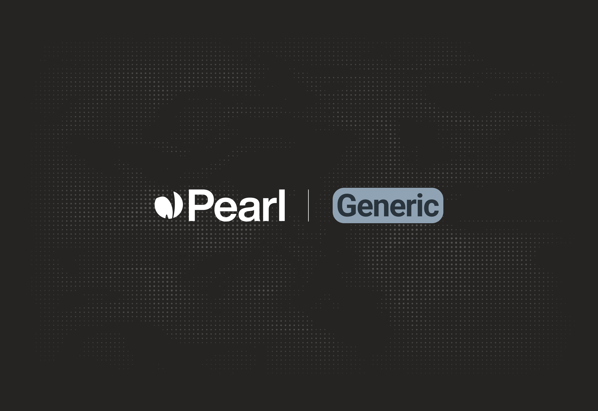
    </div>
  </Frame>
</div>

<div className="hidden dark:block">
  <Frame>
    <div className="p-1">
      
    </div>
  </Frame>
</div>

---

## Generic Channel

The **Generic** channel connects your own messaging system to a Pearl Text agent. Use it with a web chat, mobile app, CRM inbox, or any custom platform instead of one of NLPearl's built-in integrations.

The integration uses two webhooks:

```text
Your system  ──POST──▶  NLPearl inbound URL      (user messages and control actions)
Your system  ◀──POST──  Your outbound URL        (Pearl replies and events)
```

The exchange is asynchronous. When you send a user message, NLPearl immediately returns `202 Accepted`. Pearl's reply is delivered shortly afterward as a separate `POST` request to your outbound URL.

---

## Set Up the Channel

<Steps>
  <Step title="Open Text Channels">
    On the platform, open **Settings → Text Channels**, click **Connect Channel**, and choose **Generic**.

    <div className="block dark:hidden"><Frame>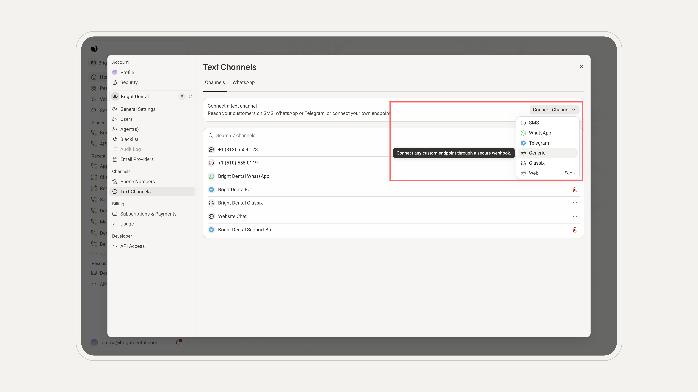</Frame></div>
    <div className="hidden dark:block"><Frame>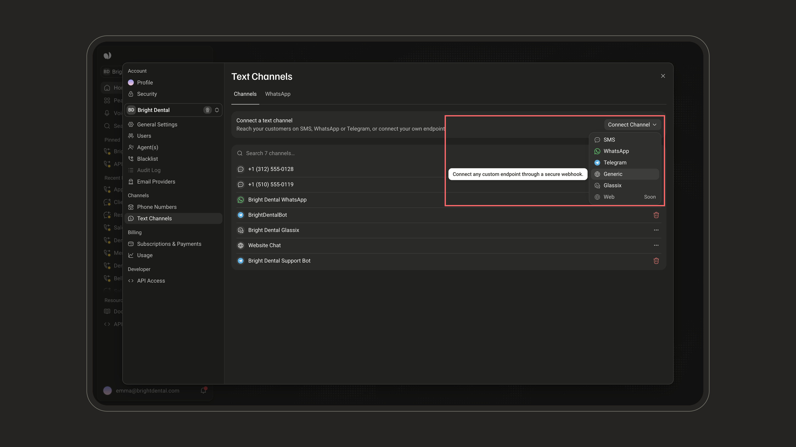</Frame></div>
  </Step>
  <Step title="Configure your endpoint">
    The **Connect Generic Channel** window opens. Under **Channel details**, enter what NLPearl will use to send events to your system:

    | Setting | Description |
    |---|---|
    | **Channel name** | A name that helps you identify this connection on the platform (required). |
    | **Outbound URL** | An HTTPS endpoint that receives Pearl replies, typing indicators, handoffs, and conversation events. |
    | **Auth header** *(optional)* | A custom header name and value that NLPearl includes in every request to your outbound URL, such as your own bearer token. Fill in both, or leave both empty. |

    Then click **Connect channel**.

    <Note>
      If your outbound URL is behind a firewall, allow the NLPearl IP addresses listed in [IP Whitelisting](/pages/ip_whitelist).
    </Note>

    <div className="block dark:hidden"><Frame>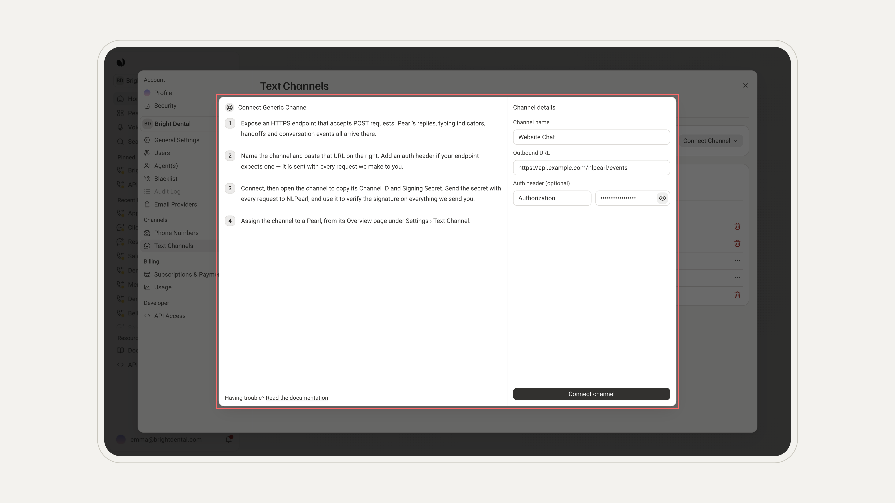</Frame></div>
    <div className="hidden dark:block"><Frame>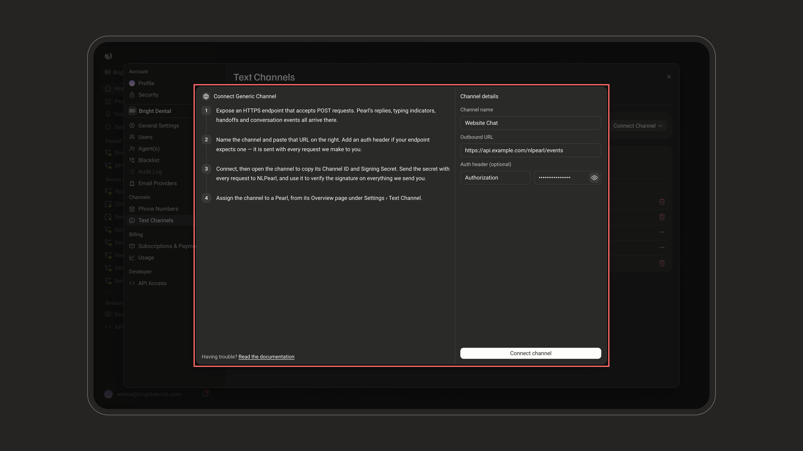</Frame></div>
  </Step>
  <Step title="Save your channel credentials">
    In the list of **Text Channels**, click the **⋯** menu of your channel, then **Manage**. The **Generic channel** window shows the credentials required by your integration:

    | Value | Description |
    |---|---|
    | **Channel ID** | Identifies the channel and forms part of its inbound URLs. Copy it with its copy button. |
    | **Signing secret** | Authenticates requests in both directions. Send it with every request to NLPearl, and use it to verify requests sent to your outbound URL. It is masked: use **Show** to reveal it, or copy it directly. |

    **Edit** lets you change the channel name, the outbound URL, or the auth header later.

    <div className="block dark:hidden"><Frame>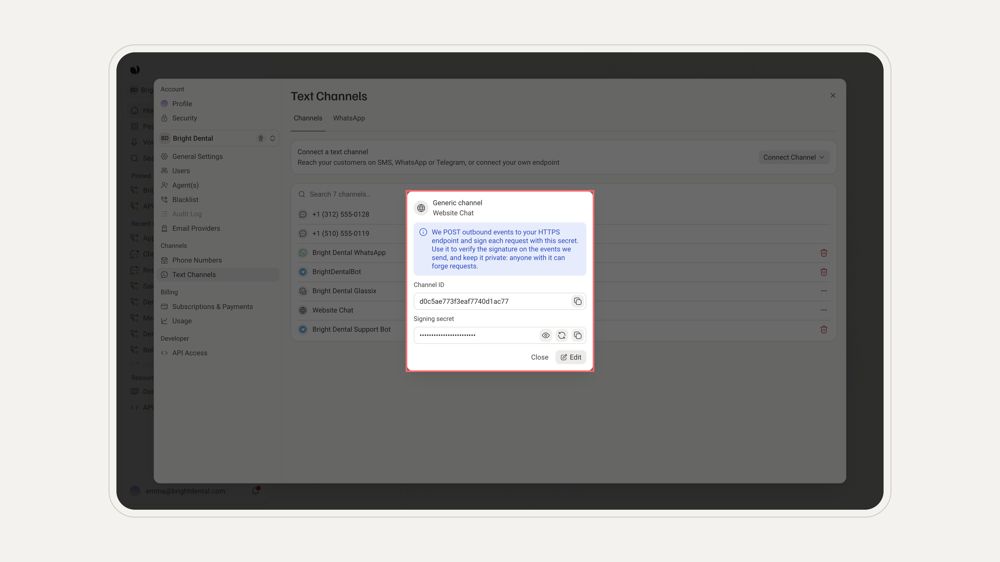</Frame></div>
    <div className="hidden dark:block"><Frame>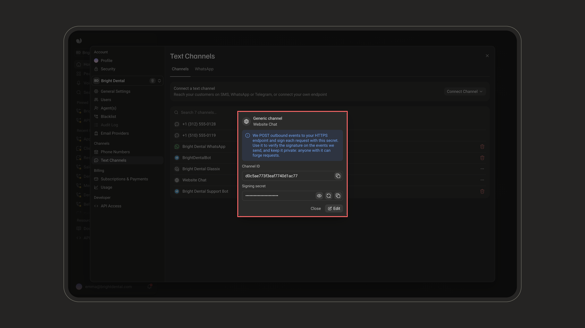</Frame></div>

    <Warning>
      Treat the signing secret like a password. Never expose it in client-side code or commit it to source control.
    </Warning>
  </Step>
  <Step title="Assign the channel to a Pearl">
    Open the Pearl that should handle these conversations, click **Settings** on its page, and pick the Generic channel in **Text Channel**.

    <div className="block dark:hidden"><Frame>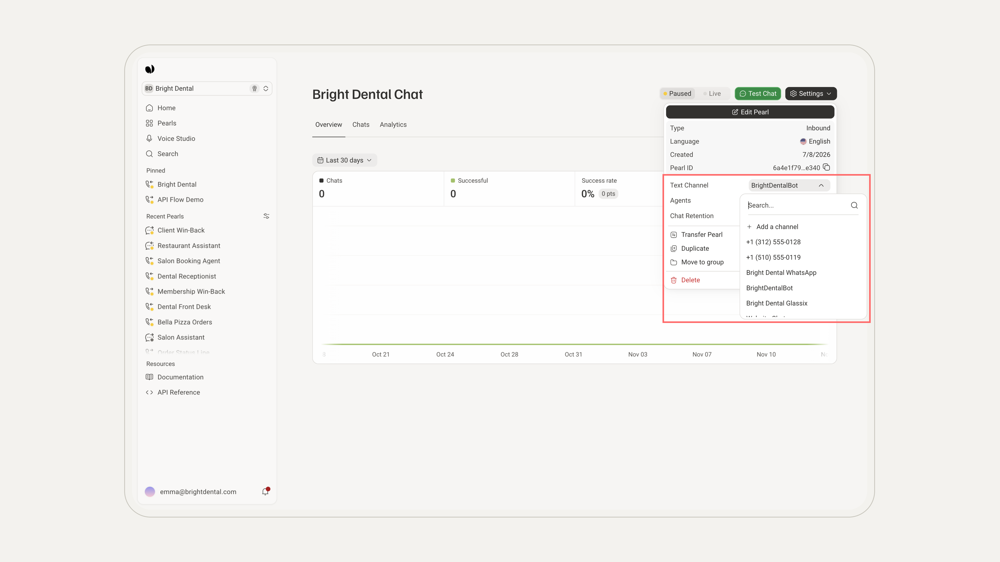</Frame></div>
    <div className="hidden dark:block"><Frame>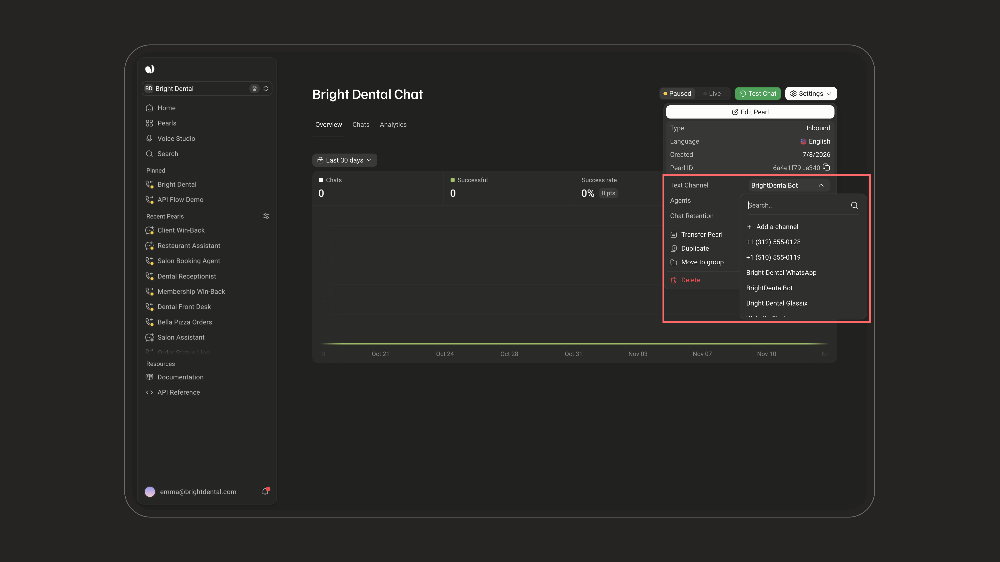</Frame></div>

    <Note>
    A Generic channel can serve **one Pearl** at a time. If it is already connected to another Pearl, disconnect it there first.
    </Note>
  </Step>
</Steps>

Your inbound base URL is:

```text
https://text.inbound.platform.nlpearl.ai:8443/Generic/{channelId}
```

---

## Send Requests to NLPearl

Send every request as JSON and include the channel secret:

```http
Content-Type: application/json
X-Pearl-Secret: <your-channel-secret>
```

### Send a User Message

Send a user message to:

```http
POST {baseUrl}/Message
```

```json
{
  "messageId": "m-12345",
  "chatId": "+1234567890",
  "senderName": "Jane Doe",
  "timestamp": "2026-07-17T09:30:00Z",
  "text": "Hi, I need help with my order",
  "attachments": [
    {
      "url": "https://your.cdn.example/receipt.jpg",
      "contentType": "image/jpeg",
      "filename": "receipt.jpg"
    }
  ]
}
```

| Field | Required | Description |
|---|---|---|
| `chatId` | Yes | Your conversation identifier, phone number, or end-user ID. Messages with the same value belong to the same conversation. Maximum 200 characters. |
| `messageId` | No | Your unique message identifier. Include it so NLPearl can deduplicate retries. Maximum 200 characters. |
| `senderName` | No | The sender name displayed in the transcript. |
| `timestamp` | No | The message time as an ISO 8601 timestamp. Defaults to the current time. |
| `text` | No | The message text, up to 8,000 characters. |
| `attachments` | No | Up to five publicly accessible image, audio, PDF, or text files. Each file can be up to 20 MB. |

<Info>
`chatId` is the conversation key. Every message with the same `chatId` belongs to the same conversation, and every outbound event for that conversation includes it.
</Info>

Possible responses:

| Status | Meaning |
|---|---|
| `202` | The message was accepted for asynchronous processing. |
| `400` | The payload is invalid, or the channel is not connected to a running Pearl. |
| `401` | The channel secret is invalid. |
| `404` | The channel does not exist. |
| `500` | A transient error occurred. You can safely retry when you provide a stable `messageId`. |

<Note>
A message whose `chatId` is on your [blacklist](/pages/blacklist) is answered with `200` but not processed: Pearl doesn't reply.
</Note>

### Return Control to Pearl

After a human handoff, return the conversation to Pearl:

```http
POST {baseUrl}/HandoffToPearl
```

```json
{
  "chatId": "+1234567890"
}
```

### End a Conversation

Close a conversation:

```http
POST {baseUrl}/EndConversation
```

```json
{
  "chatId": "+1234567890"
}
```

### Take Over a Conversation

Let a human agent take control at any time, without waiting for Pearl to hand off:

```http
POST {baseUrl}/TakeOver
```

```json
{
  "chatId": "+1234567890"
}
```

Pearl goes silent while your agent handles the conversation. Because you initiated the takeover, NLPearl does **not** send a `handoff` event. When your agent is finished, call `/HandoffToPearl` to resume Pearl or `/EndConversation` to close the conversation.

### Record a Manual Reply

Add a reply your human agent sent from your own system to the NLPearl transcript, so Pearl resumes with full context:

```http
POST {baseUrl}/ManualMessage
```

```json
{
  "chatId": "+1234567890",
  "text": "Sure, I can help you with that."
}
```

NLPearl records the message but does **not** deliver it, since your platform already sent it to the user. This is valid only while the conversation is handed off — after a `handoff` event or your own `/TakeOver` — and otherwise returns `400`.

<Warning>
`/ManualMessage` has no retry deduplication. If a request times out and you resend it, the message is recorded twice.
</Warning>

These control actions return `200` when successful, `400` when `chatId` is missing, or `404` when no active conversation exists for the supplied `chatId`.

---

## Receive Events from NLPearl

NLPearl sends each event to your outbound URL as a `POST` request with this envelope:

```json
{
  "type": "message",
  "channelId": "6a59f7e02254e81f5533f11d",
  "chatId": "+1234567890",
  "timestamp": "2026-07-17T09:30:02.1234567Z",
  "data": {}
}
```

### Event Types

| `type` | `data` | Meaning |
|---|---|---|
| `message` | `{ "messageId", "text" }` | Pearl's reply. Deliver it to your user. |
| `typing` | None | Pearl is composing a response. You can display a typing indicator. |
| `handoff` | `{ "reason", "riskReason"? }` | Pearl handed the conversation to a human. `reason` can be `agent_handoff`, `risk`, `max_turns_reached`, or `manual`. |
| `ai_resumed` | None | Pearl resumed control of the conversation. |
| `conversation_ended` | None | The conversation was closed by Pearl, because of inactivity, or through `EndConversation`. |

<Note>
New event types may be added over time. Ignore types your integration does not recognize.
</Note>

### Acknowledge Message Delivery

Your HTTP response controls delivery retries for `message` events:

| Your status | NLPearl behavior |
|---|---|
| `2xx` | The message is marked as delivered. |
| `429` | Delivery is retried with backoff. |
| `408`, `5xx`, or timeout | Delivery is retried with backoff, then marked as failed if all attempts fail. |
| Other `4xx` | The failure is treated as permanent and is not retried. |

Other event types, including `typing` and `handoff`, are best-effort notifications and are not retried.

---

## Verify Webhook Signatures

NLPearl includes these headers in every request to your outbound URL:

```http
X-Pearl-Timestamp: 1784281802
X-Pearl-Signature: 3f1a9c...
```

The signature is the hexadecimal result of:

```text
HMAC-SHA256(secret, "{timestamp}.{rawBody}")
```

Verify the signature and reject old timestamps to protect your endpoint against forged requests and replay attacks:

```js
const crypto = require("crypto");

function verifyPearlWebhook(req, rawBody, secret) {
  const timestamp = req.headers["x-pearl-timestamp"];
  const signature = req.headers["x-pearl-signature"];

  if (!timestamp || !signature) {
    return false;
  }

  const expected = crypto
    .createHmac("sha256", secret)
    .update(`${timestamp}.${rawBody}`)
    .digest("hex");

  const signatureBuffer = Buffer.from(signature, "hex");
  const expectedBuffer = Buffer.from(expected, "hex");

  return (
    signatureBuffer.length === expectedBuffer.length &&
    crypto.timingSafeEqual(signatureBuffer, expectedBuffer) &&
    Math.abs(Date.now() / 1000 - Number(timestamp)) < 300
  );
}
```

<Warning>
Compute the HMAC over the raw request body bytes before parsing the JSON. Re-serializing a parsed body can change its bytes and invalidate the signature.
</Warning>

If you configured a custom authentication header, NLPearl includes it alongside the signature headers.

---

## Handle Human Handoffs

A handoff can start in two ways: Pearl steps aside on its own and sends a `handoff` event, or your agent takes control directly with `/TakeOver`. Either way, Pearl stays silent until the conversation is returned to it.

<Steps>
  <Step title="Start the handoff">
    Pearl sends a `handoff` event with the reason it stepped aside, or your agent calls `/TakeOver` to step in directly. No `handoff` event is sent for your own takeover.
  </Step>
  <Step title="Keep the transcript in sync">
    Let your human agent communicate with the user in your own system. Continue sending the user's messages to `/Message`, and record your agent's replies with `/ManualMessage`. Pearl remains silent while handed off, but the transcript and inactivity timers stay up to date, so Pearl resumes with full context.
  </Step>
  <Step title="Finish the handoff">
    Call `/HandoffToPearl` when Pearl should resume, or `/EndConversation` when the conversation is complete. Your endpoint then receives `ai_resumed` or `conversation_ended`, respectively.
  </Step>
</Steps>

---

## Rotate the Secret

Open the Generic channel window (**⋯** → **Manage** in **Text Channels**) and click **Rotate** beside the **Signing secret**. Confirm with **Rotate secret** to generate a new one.

<div className="block dark:hidden"><Frame>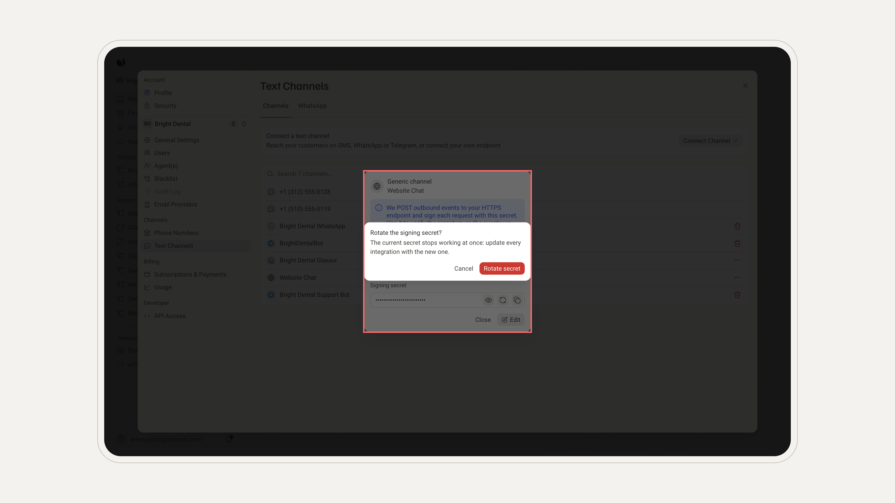</Frame></div>
<div className="hidden dark:block"><Frame>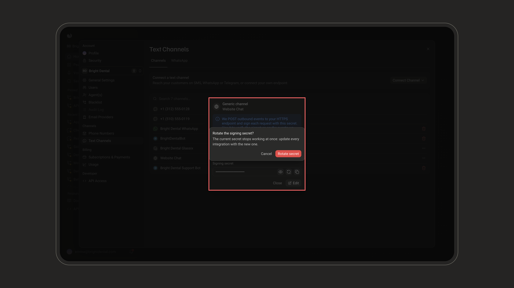</Frame></div>

The previous secret becomes invalid immediately.

Update the secret used for both the `X-Pearl-Secret` request header and webhook signature verification at the same time. Otherwise, your inbound requests and outbound webhook verification will fail until both sides use the new value.

---

## Limits

| Limit | Value |
|---|---|
| Text length | 8,000 characters |
| Attachments per message | 5 |
| Attachment size | 20 MB each |
| `chatId` length | 200 characters |
| `messageId` length | 200 characters |

<Warning>
The channel must be assigned to a running Pearl. If the Pearl is stopped or no Pearl is connected, inbound calls return `400` with `"This channel is not connected to a Pearl."`.
</Warning>

---

<Card title="Inbound" icon="inbox-in" iconType="light" href="/pages/text/inbound">
  Configure how your Pearl handles incoming conversations, inactivity, transcripts, and webhooks.
</Card>
