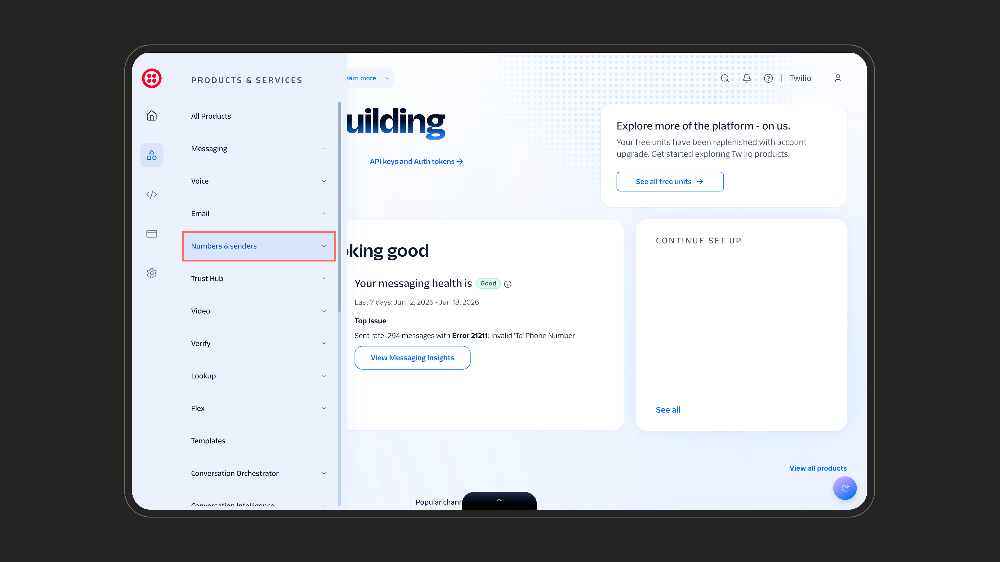
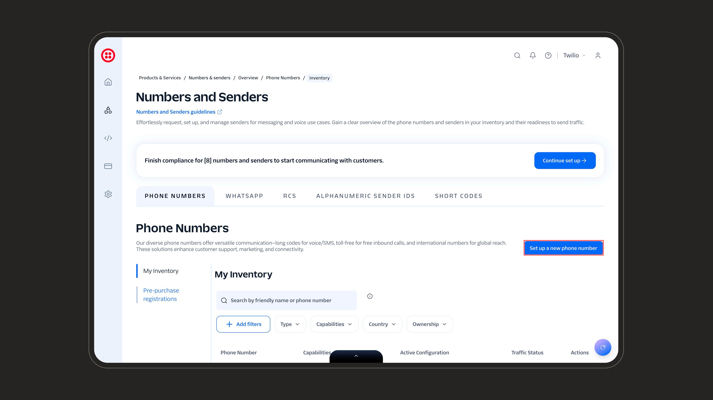
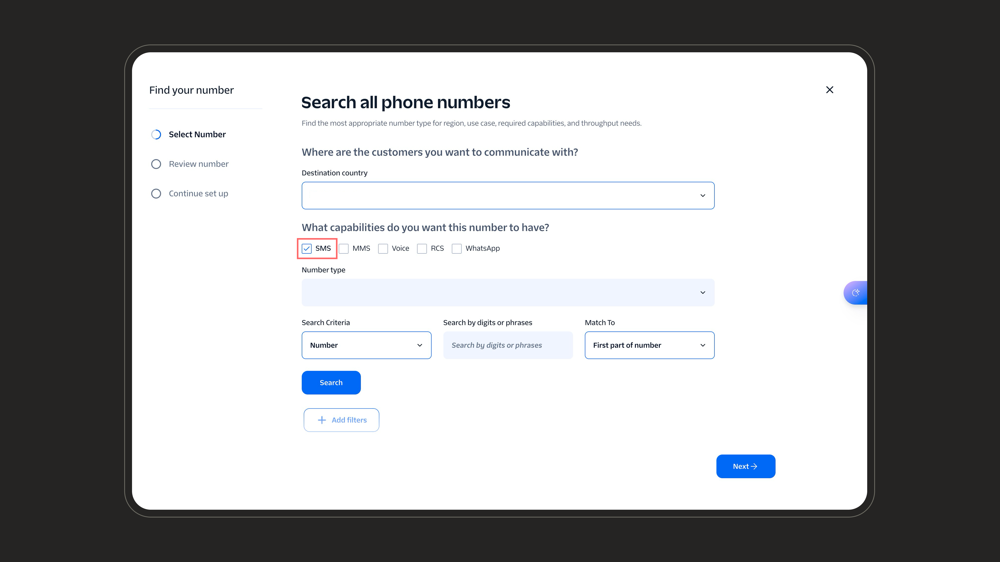
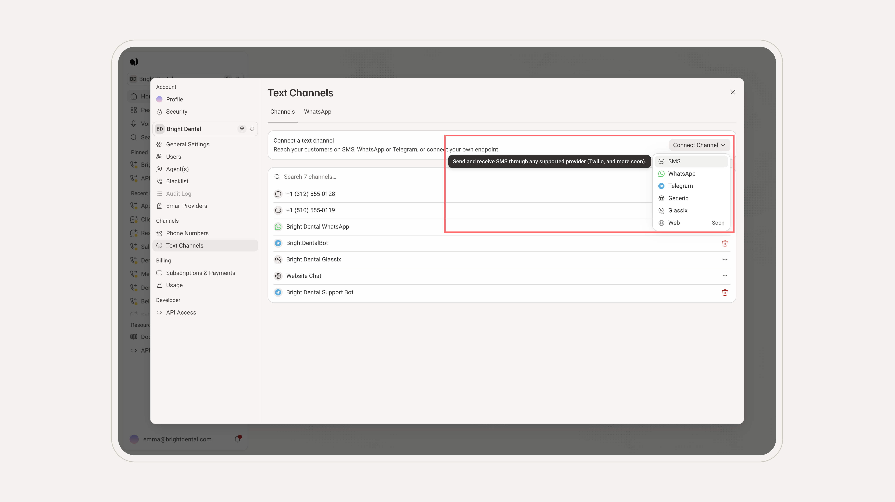
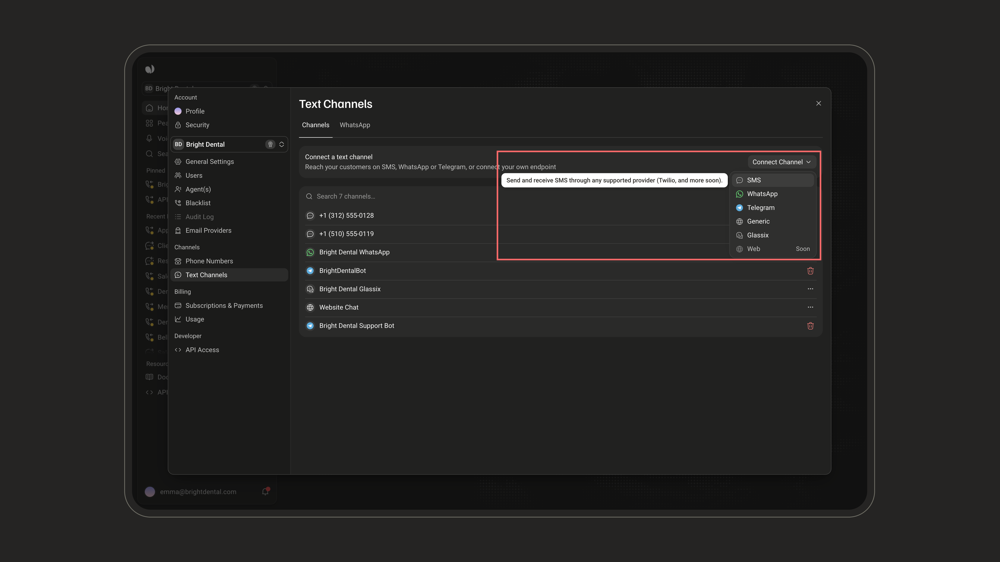

  <Frame>
    

      
    

  </Frame>

  <Frame>
    

      
    

  </Frame>

---

## SMS Channel

Connect your Pearl Text agent to **SMS** to handle conversations over standard text messaging. SMS runs through **Twilio**: you connect your Twilio account to NLPearl, import a Twilio number that can send SMS, and pick that number as your Pearl's channel. Messages are billed by Twilio, on your Twilio account.

<Info>
SMS works for both [inbound](/pages/text/inbound) conversations, where the customer messages you first, and [outbound](/pages/text/outbound) campaigns, where Pearl reaches out proactively.
</Info>

---

### Step 1 - Buy a phone number for SMS

You need a Twilio number with the **SMS** capability. If you already have one, skip to Step 2. Otherwise, buy one in the [Twilio Console](https://www.twilio.com/console), in three steps.

<Steps>
  <Step title="Open Numbers & senders">
    In the Twilio Console, open the **Products & Services** menu and select **Numbers & senders**.

    
<Frame></Frame>

    
<Frame></Frame>

  </Step>
  <Step title="Set up a new phone number">
    Open the **Phone Numbers** tab and click **Set up a new phone number** on the top right to start the purchase flow.

    
<Frame></Frame>

    
<Frame></Frame>

  </Step>
  <Step title="Select an SMS-enabled number">
    Choose the **destination country** where your customers are, then under **capabilities** make sure **SMS** is checked. Search for a number, pick one, and complete the purchase.

    
<Frame></Frame>

    
<Frame></Frame>

  </Step>
</Steps>

---

### Step 2 - Connect Twilio and import the number

In NLPearl, open **Settings → Text Channels**, click **Connect Channel**, and choose **SMS**.

<Frame></Frame>

<Frame></Frame>

This opens the same **Connect your Twilio account** window as the [Twilio Integration](/pages/twilio_integration) used for voice numbers:

- If your Twilio account isn't connected yet, enter your Twilio credentials, as described in the Twilio Integration guide.
- Then click **Add to account** next to your SMS number to import it into NLPearl.

<Card title="Twilio Integration" icon="object-intersect" iconType="light" href="/pages/twilio_integration">
  Connect your Twilio account and import your Twilio numbers into NLPearl.
</Card>

<Note>
Every imported number that has the SMS capability becomes an SMS channel, shown by its name or its number. A number without SMS can't be used as a text channel.
</Note>

---

### Step 3 - Assign the number to your Pearl

Open your text Pearl's page, click **Settings**, and pick the number in **Text Channel**. It is saved right away, and the number's incoming SMS are routed to your Pearl.

<Warning>
A number can serve **one active Pearl** at a time. If it is already used by another active Pearl, NLPearl asks you to choose another number.
</Warning>

<CardGroup cols={2}>
  <Card title="Inbound" icon="inbox-in" iconType="light" href="/pages/text/inbound#connect-a-channel">
    Deploy your agent on inbound channels to answer incoming SMS instantly.
  </Card>
  <Card title="Outbound" icon="paper-plane" iconType="light" href="/pages/text/outbound#connect-a-channel">
    Launch outbound SMS campaigns to reach customers proactively.
  </Card>
</CardGroup>
