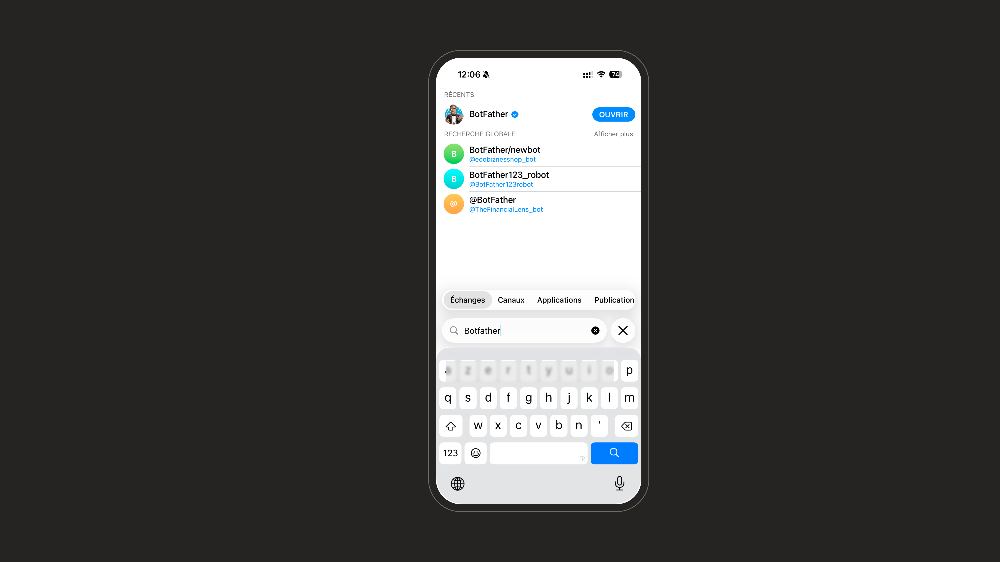
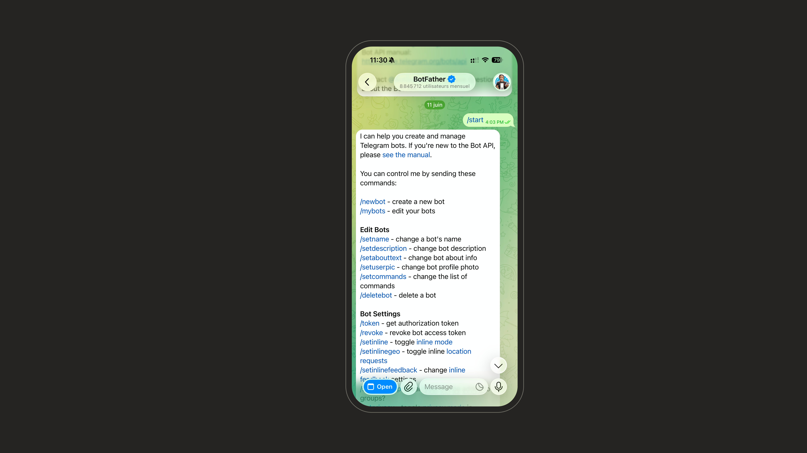
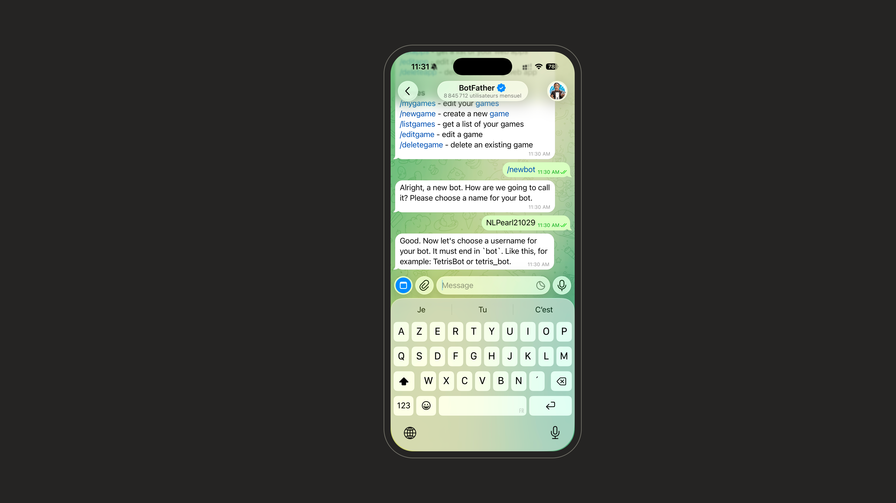
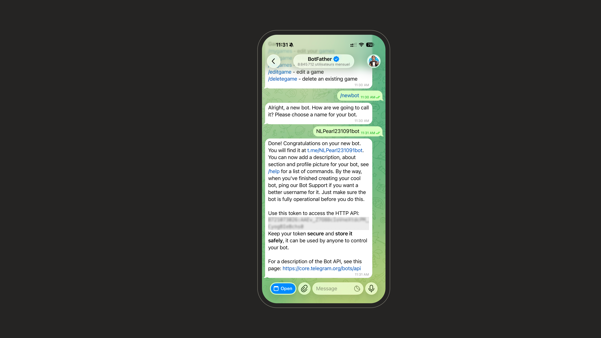
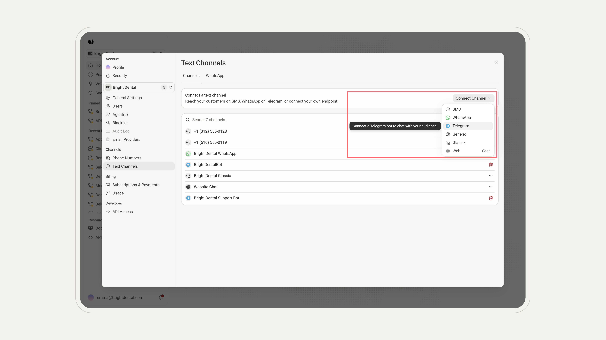
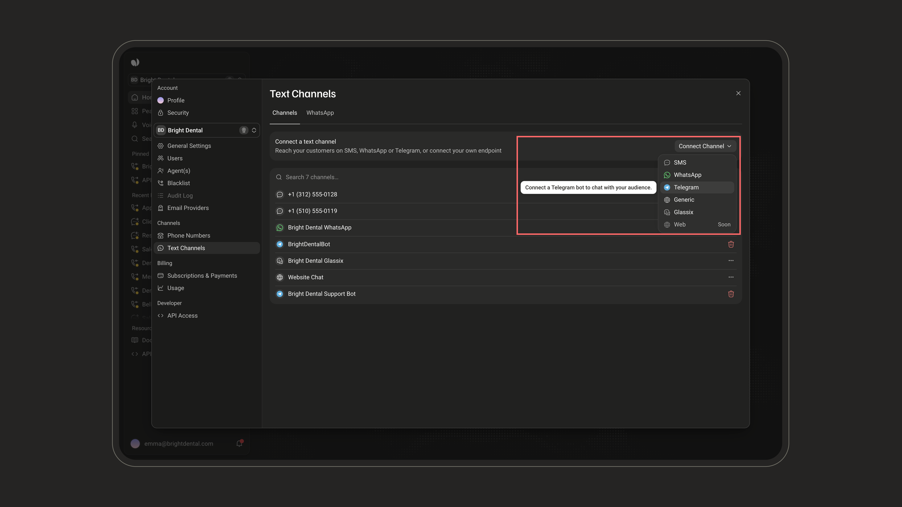
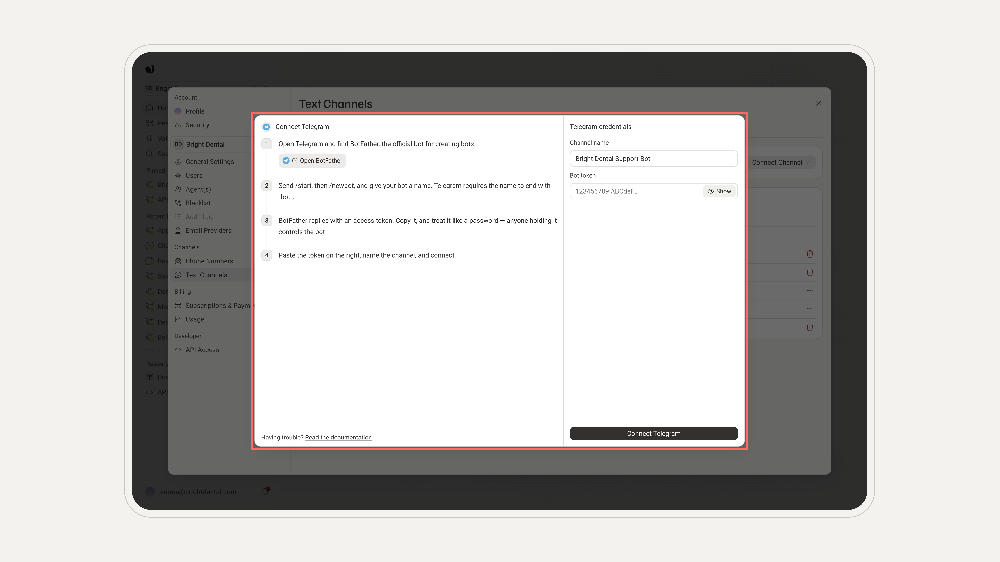
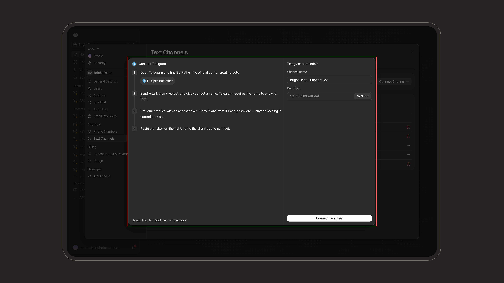
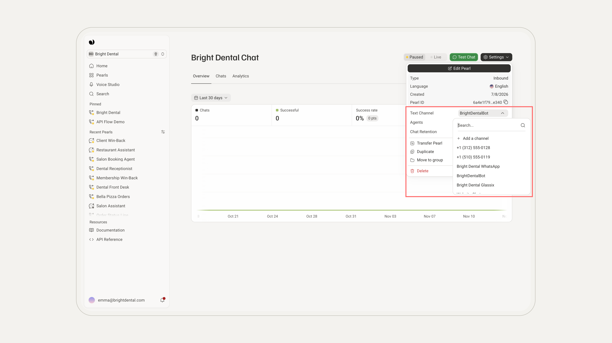
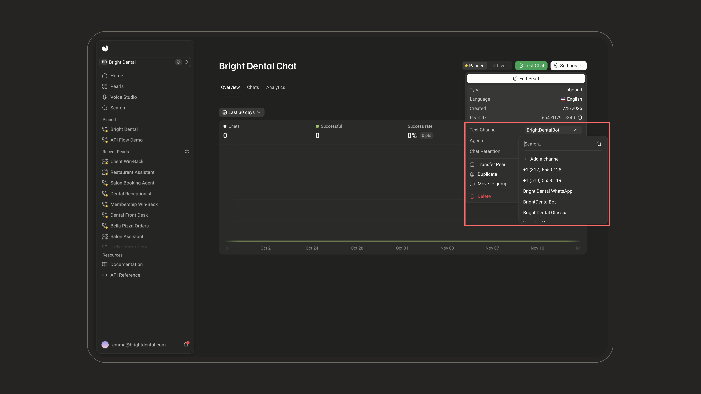

  <Frame>
    

      
    

  </Frame>

  <Frame>
    

      
    

  </Frame>

---

## Telegram Channel

Connect your Pearl Text agent to **Telegram** through a Telegram bot. Pearl replies using the flow, knowledge, and actions defined in your Pearl, in [inbound](/pages/text/inbound) conversations.

<Note>
Telegram is available for inbound only: a Telegram bot can't start a conversation, it can only answer users who message it first.
</Note>

To connect Telegram, you first create a bot directly inside the Telegram app using **BotFather**, then paste the bot token into the platform and assign the bot to your Pearl.

---

### Step 1 - Create your Telegram bot

<Steps>
  <Step title="Create a Telegram account">
    If you don't have one yet, download Telegram and create an account.
  </Step>
  <Step title="Find BotFather">
    In Telegram's contact search, look for **BotFather** (the official Telegram bot for creating bots) and open the conversation.

    
<Frame></Frame>

    
<Frame></Frame>

  </Step>
  <Step title="Start the conversation">
    Send the `/start` command to BotFather. It replies with the list of available commands.

    
<Frame></Frame>

    
<Frame></Frame>

  </Step>
  <Step title="Create a new bot">
    Send the `/newbot` command. BotFather will ask you to choose a name for your bot.

    <Note>
    The name must always **end with `bot`** (for example `MySupportBot` or `my_support_bot`).
    </Note>

    
<Frame></Frame>

    
<Frame></Frame>

  </Step>
  <Step title="Save your token">
    Once the bot is created, BotFather sends you a message containing the link to talk to your bot and an **access token**. Keep this token - you'll need it to connect the bot to the platform.

    <Warning>
    Treat the token like a password. Anyone with it can control your bot, so don't share it publicly.
    </Warning>

    
<Frame></Frame>

    
<Frame></Frame>

  </Step>
</Steps>

---

### Step 2 - Connect Telegram on the platform

<Steps>
  <Step title="Open Text Channels">
    On the platform, open **Settings → Text Channels**, click **Connect Channel**, and choose **Telegram**.

    
<Frame></Frame>

    
<Frame></Frame>

  </Step>
  <Step title="Enter the bot details">
    The **Connect Telegram** window opens, with a reminder of the BotFather steps on the left (and an **Open BotFather** shortcut). Under **Telegram credentials**, fill in:

    - **Channel name**: a name to identify this bot in NLPearl (required, up to 100 characters).
    - **Bot token**: the access token you received from BotFather (e.g. `123456789:ABC…`).

    Click **Connect Telegram**. The bot now appears in your list of text channels.

    
<Frame></Frame>

    
<Frame></Frame>

  </Step>
  <Step title="Assign the bot to a Pearl">
    Open the Pearl you want to use for [inbound](/pages/text/inbound) conversations, click **Settings** on its page, and pick the bot in **Text Channel**. This is when NLPearl starts receiving the bot's messages.

    
<Frame></Frame>

    
<Frame></Frame>

    <Note>
    A bot can serve **one Pearl** at a time. If it is already used by another Pearl, NLPearl asks you to choose another one.
    </Note>
  </Step>
  <Step title="Test your bot">
    Make sure your Pearl is **Live**, then send a message to your bot on Telegram: Pearl replies following your flow.
  </Step>
</Steps>

---

<Card title="Inbound" icon="inbox-in" iconType="light" href="/pages/text/inbound">
  Deploy your agent on inbound channels to answer incoming Telegram messages instantly.
</Card>
