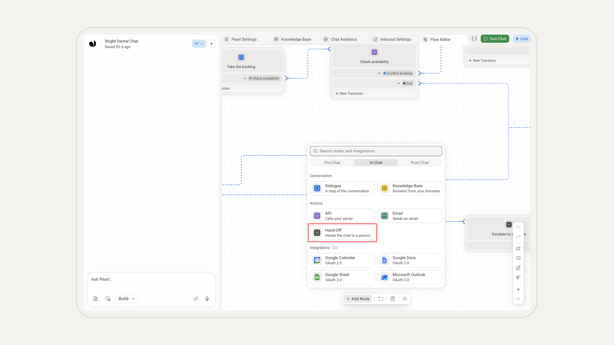
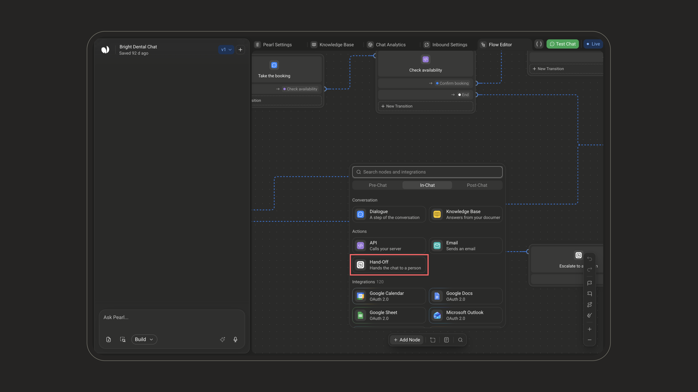
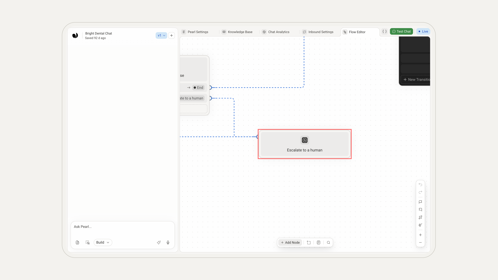
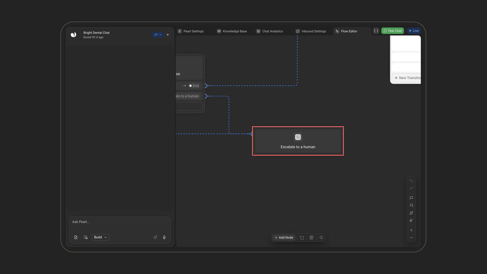
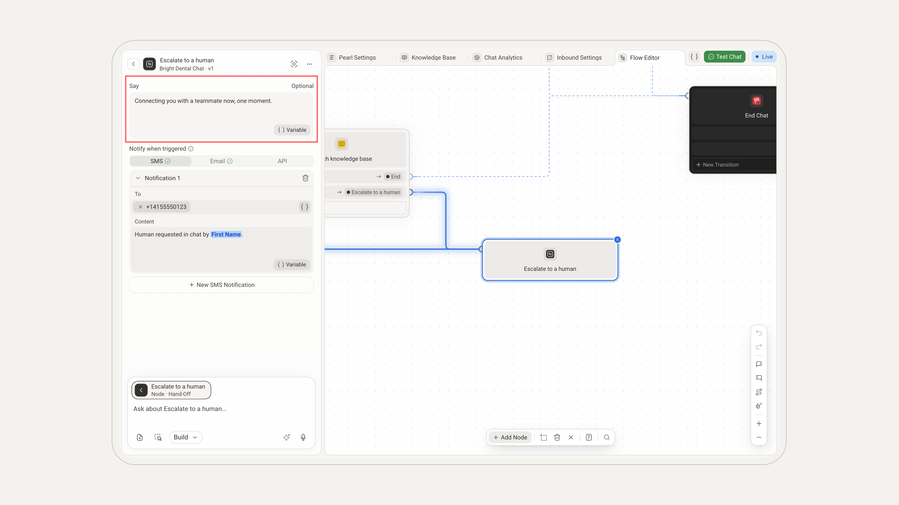
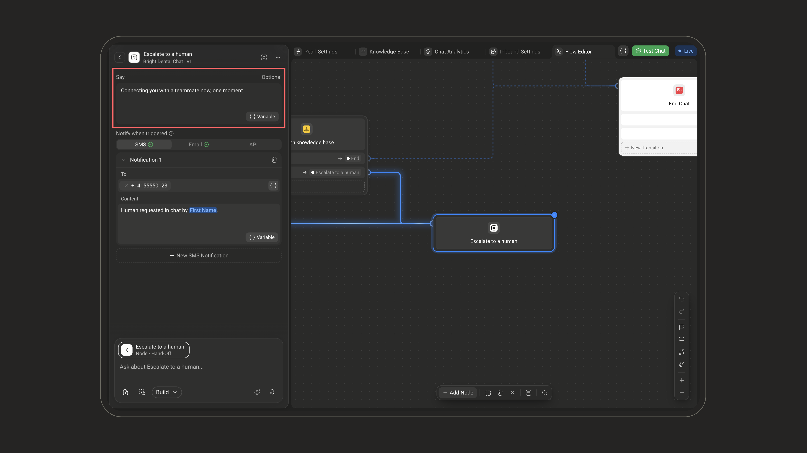
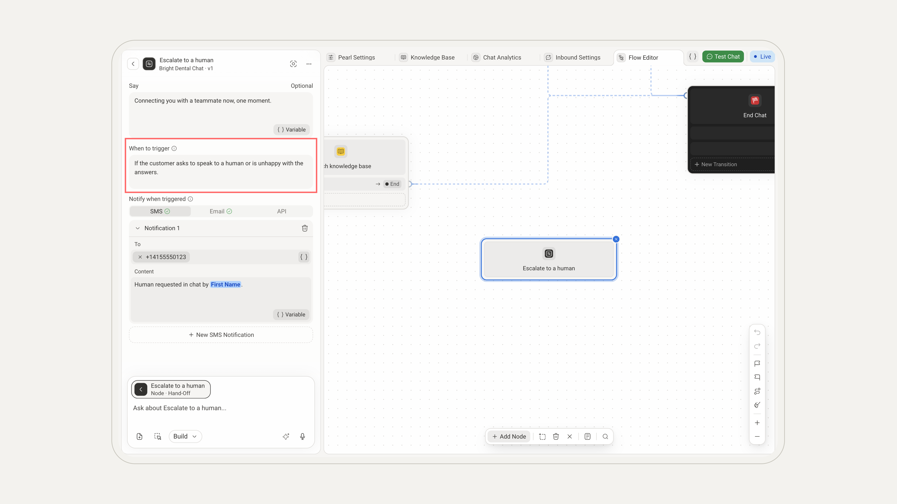
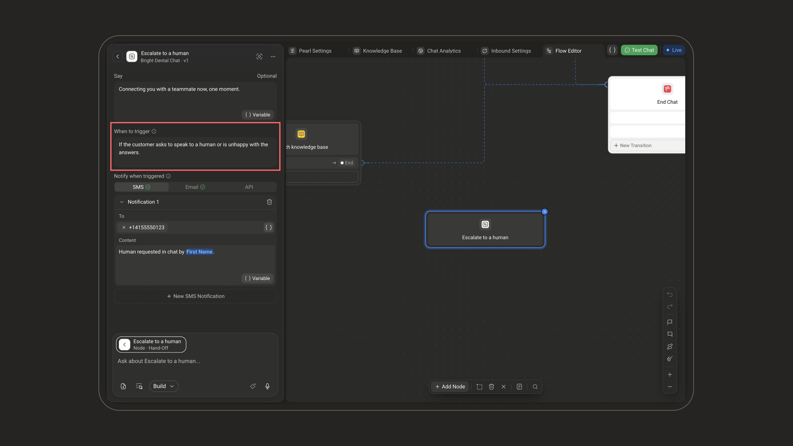
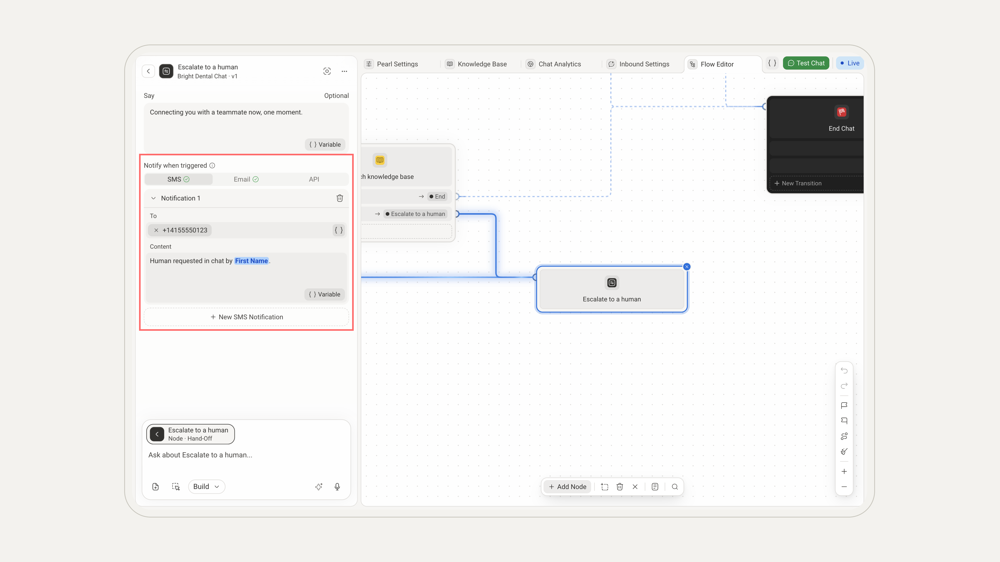
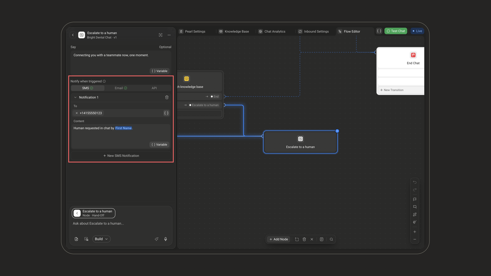

<Callout icon="comments" color="#9333EA" iconType="regular">Available on **text Pearls** only. Voice Pearls use the [**Transfer Call**](/pages/transfer_call) node.</Callout>

  <Frame>
    

      
    

  </Frame>

  <Frame>
    

      
    

  </Frame>

The **Hand-Off** node passes the conversation from Pearl to one of your human agents. When it triggers, Pearl stops replying in the chat, your team is notified, and the conversation waits for a human to pick it up from the NLPearl platform.

## What it does

Hands the text conversation from Pearl over to a human agent, and notifies your team by SMS, email, or API.

## When to use it

Escalate to a person, route to sales or support, or step in when Pearl can't help.

<Info>
  It's the text-chat equivalent of transferring a call to a live agent. A hand-off only stops Pearl from replying, it does **not** close or end the conversation. The customer can keep writing, and their messages wait for you in the conversation.
</Info>

## Adding a Hand-Off node

In the [PearlVibe editor](/pages/pearl_vibe), click **Add Node** and pick **Hand-Off** in the **Actions** section of the **In-Chat** tab. You can also ask PearlVibe to add one for you in the chat (**Build** mode).

<Frame></Frame>

<Frame></Frame>

To configure the node by hand, click it on the canvas and open it with the pencil of its tile in the chat (**Manual edit**), or hover it and click **Edit Manually**. Your changes are kept once you click **Save Changes**.

---

## When it triggers

There are two ways to reach a Hand-Off node:

| Trigger | How it works | Best for |
| --- | --- | --- |
| **From a previous node** | Connect a transition from any node to the Hand-Off node. The hand-off runs when the flow follows that transition. | A fixed step in your flow, e.g. right after a "Talk to sales" choice. |
| **With a condition** | Leave the node with **no** incoming transition: a **When to trigger** field appears. Describe in plain language when Pearl should hand off (e.g. *"If the client asks to speak to a human."*). Pearl evaluates it throughout the conversation. Up to 250 characters, required. | Catching intent that can come up at any point. |

<Tip>
  **When to trigger** only appears on a node with no incoming transition. To combine both, use two Hand-Off nodes: one reached by a transition for the obvious path, and a floating one with a condition to catch everything else.
</Tip>

<Frame></Frame>

<Frame></Frame>

---

## How to configure

<Steps>
  <Step title="Say (optional)">
    Have Pearl send one last message before it stops replying, for example to let the customer know a human is taking over. Up to 500 characters, and you can insert variables with **Variable**. Leave it empty for a silent hand-off.

    
<Frame></Frame>

    
<Frame></Frame>

  </Step>
  <Step title="When to trigger (floating nodes only)">
    On a node with no incoming transition, describe when Pearl should hand off. See [When it triggers](#when-it-triggers).

    
<Frame></Frame>

    
<Frame></Frame>

  </Step>
  <Step title="Notify your team">
    In **Notify when triggered**, alert your team so someone picks the conversation up quickly. **At least one channel is required.** Pick **SMS**, **Email**, or **API**, then add up to **3 notifications of each**, and mix them freely: **New SMS Notification** (and its email and API equivalents) adds another one.

    
<Frame></Frame>

    
<Frame></Frame>

    <Card title="Notification channels">
      <Tabs>
        <Tab title="SMS">
          | Field | Description |
          | --- | --- |
          | **To** | One or more phone numbers to text, in international format (`+` followed by the digits). |
          | **Content** | The message to send. Up to 1,000 characters; supports variables. |
        </Tab>
        <Tab title="Email">
          | Field | Description |
          | --- | --- |
          | **From** | The sender address. Defaults to Pearl's default email address. |
          | **Recipient Emails** | One or more recipients. *Required.* |
          | **CC** | Optional addresses to copy. |
          | **Subject** | The email subject. *Required.* |
          | **Content** | The email body. Up to 2,000 characters; supports variables. |
        </Tab>
        <Tab title="API">
          | Field | Description |
          | --- | --- |
          | **Name** | A label for this call, for your own reference. |
          | **URL** | The endpoint to call, with the HTTP method (GET, POST, …). *Required.* |
          | **Headers** | Optional key/value pairs sent with the request. |
          | **Credentials** | Enable to include authentication credentials with the request. |
          | **Test the API** | Send a test request to confirm your setup before saving. |

          See the [API node](/pages/api_action) for the details of each field.
        </Tab>
      </Tabs>
    </Card>

    <Note>
      Up to **3 notifications per channel**, so up to 3 SMS, 3 emails, and 3 API calls. Validation flags *"Select at least one notification channel"* when none is set.
    </Note>
  </Step>
</Steps>

<Tip>
  Most fields accept variables through the **Variable** button: the farewell message, SMS and email content, even the API URL, so you can drop in details like the customer's name or the conversation reference.
</Tip>

---

## Take over the conversation

After a hand-off, pick the conversation up yourself from the NLPearl platform: open the conversation and reply in **Reply as agent…**. When you're done, click **Hand back** to let Pearl take over again and continue replying automatically.

You can also step in before any hand-off: while Pearl is handling a chat, click **Take over** to take control and reply instead of Pearl.
