

  <Frame>
    

      
    

  </Frame>

  <Frame>
    

      
    

  </Frame>

---

## Setting Up Inbound Activities

Once you have created a Pearl, you can enable it to handle inbound conversations. Inbound settings are configured inside your Pearl, under **Inbound Settings**, so your Pearl replies to incoming messages following the conversational flow you defined.

<Info>
**What are inbound activities?**

Inbound activities are used when the end user starts the conversation. Pearl replies using the flow, knowledge, and actions defined in your Pearl.
</Info>

---

## Connect a Channel

Unlike a voice activity, an inbound text activity isn't tied to a phone number, it's connected to a **messaging channel**. First set up the channel in your workspace settings, then open your Pearl's page, click **Settings**, and pick it in **Text Channel**. Each channel is dedicated to your activity and can receive conversations from anywhere, at any time.

<Frame>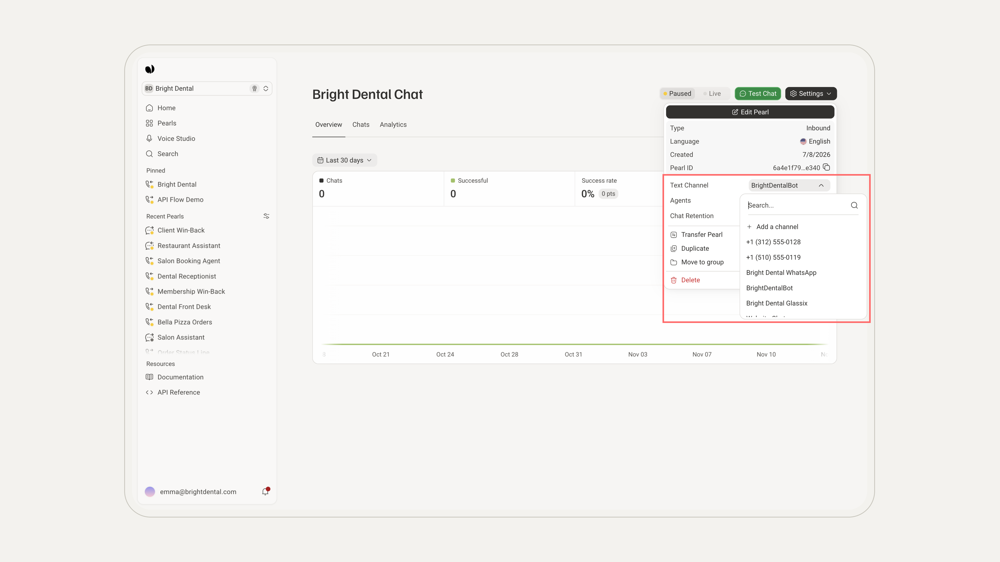</Frame>

<Frame>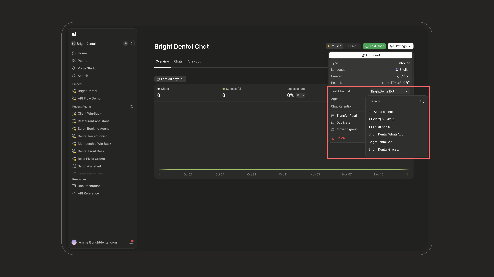</Frame>

NLPearl supports built-in channels such as **WhatsApp**, **Telegram**, **SMS**, and **Glassix**, as well as a **Generic** channel for custom messaging systems. Follow the dedicated guides to set one up:

<CardGroup cols={2}>

<Card title="WhatsApp" icon="whatsapp" iconType="light" href="/pages/text/channels/whatsapp">
  Connect your WhatsApp Business account through Meta - keep your number in the app or dedicate it to Pearl.
</Card>

<Card title="SMS" icon="comment-sms" iconType="light" href="/pages/text/channels/sms">
  Connect your Pearl to SMS through Twilio to text with your customers.
</Card>

<Card title="Telegram" icon="telegram" iconType="light" href="/pages/text/channels/telegram">
  Connect your Pearl to Telegram by linking a bot created with BotFather.
</Card>

<Card title="Generic" icon="webhook" iconType="light" href="/pages/text/channels/generic">
  Connect a web chat, mobile app, CRM inbox, or custom platform through asynchronous webhooks.
</Card>

</CardGroup>

---

## Inbound Settings

Configure how your Pearl handles incoming conversations from the **Inbound Settings** tab of your Pearl, in the [PearlVibe](/pages/pearl_vibe) flow editor. Changes are saved automatically in your Pearl's draft: publish the Pearl to use them in live conversations.

<Warning>
These settings apply to **text** Pearls only. A voice Pearl has a different set of inbound options.
</Warning>

### Message Limit

The maximum number of messages Pearl sends before automatically handing the conversation off to a human. You can set between **5 and 1000** messages (default **100**).

<Frame>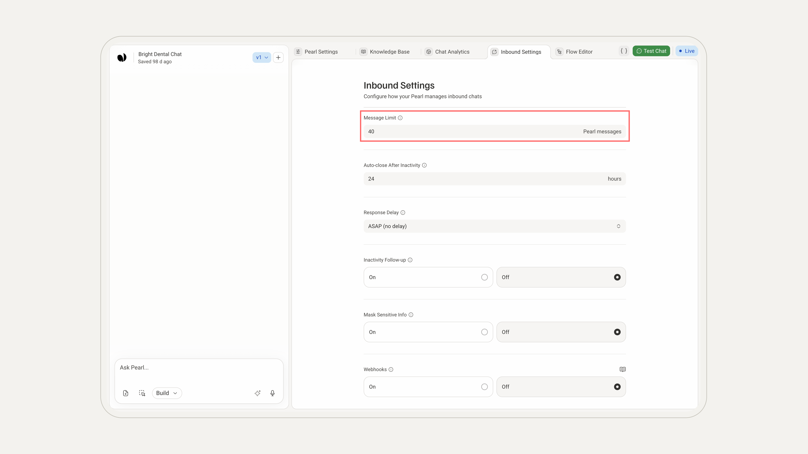</Frame>

<Frame>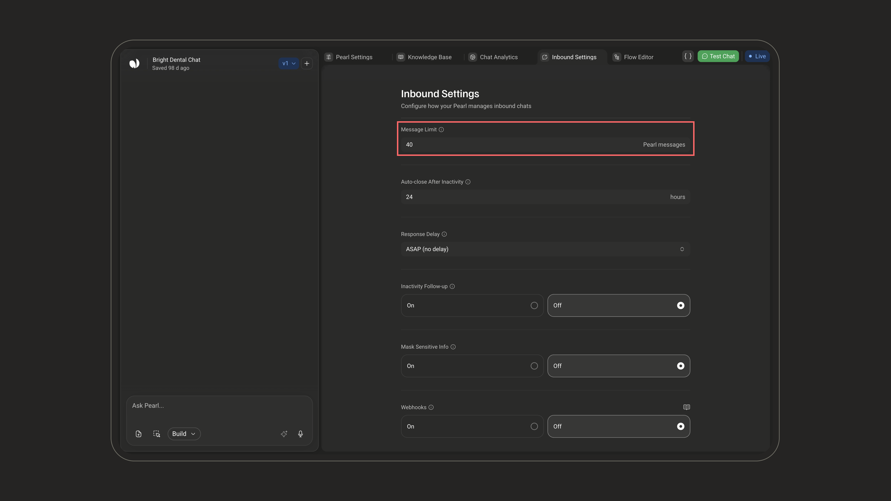</Frame>

---

### Auto-close After Inactivity

How long a conversation can stay inactive before Pearl closes the chat and triggers the post-chat summary. You can set between **1 and 72 hours** (default **24 hours**).

<Frame>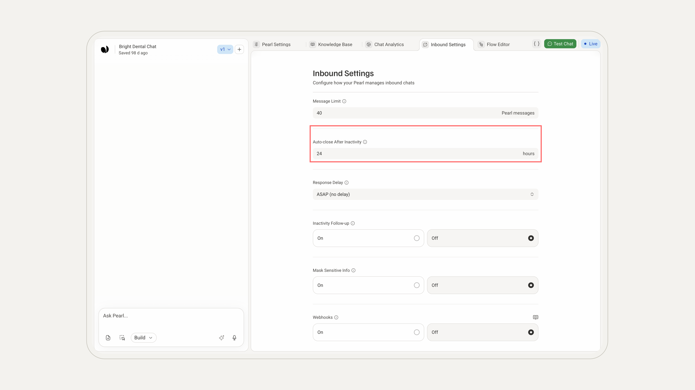</Frame>

<Frame>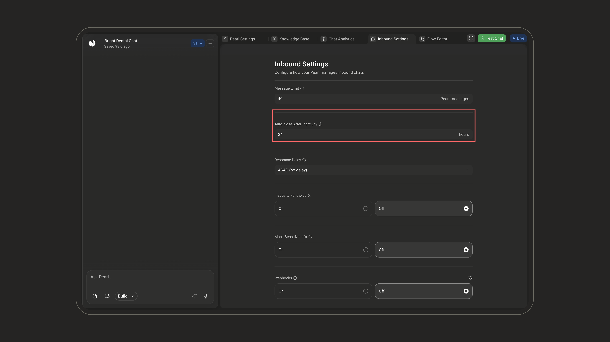</Frame>

---

### Response Delay

How long Pearl waits before replying. When a customer sends several messages in a row, Pearl answers them together instead of replying to each one.

Choose from **ASAP (no delay)** up to **5 minutes**, in 30-second steps (default **ASAP**, which means Pearl replies as soon as it is ready).

<Frame>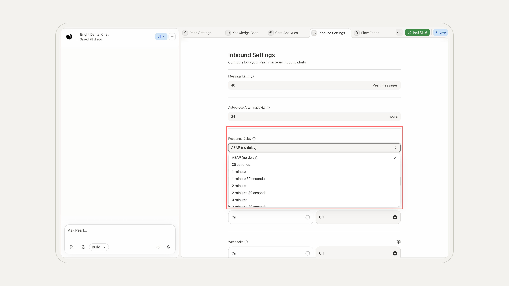</Frame>

<Frame>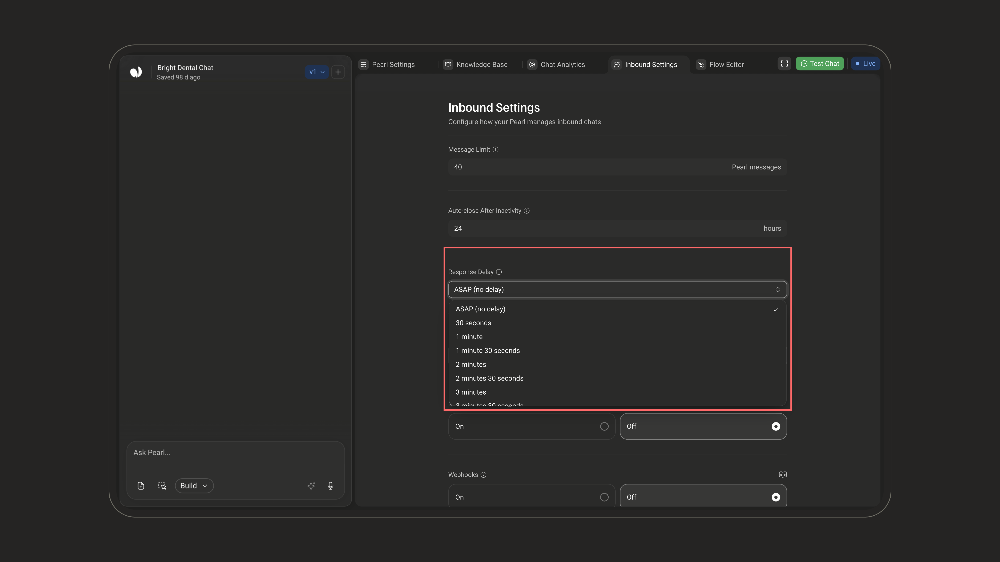</Frame>

<Note>
  Inbound and outbound each have their own response delay. Setting one does not change the other.
</Note>

---

### Inactivity Follow-up

When **On** (default **Off**), Pearl sends follow-up messages when the end user stops replying after Pearl's last message, to re-engage the conversation.

<Frame>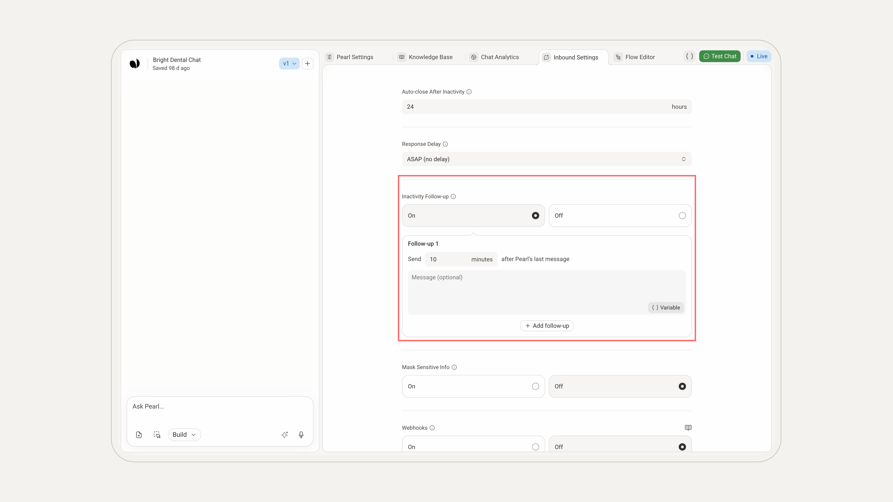</Frame>

<Frame>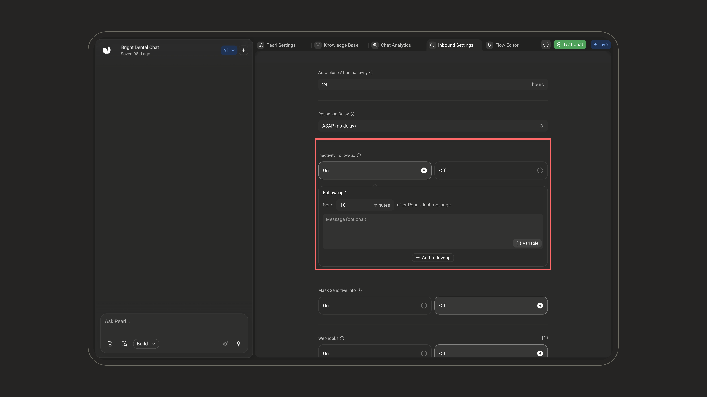</Frame>

- **Up to 3 follow-ups**: each one is a **delay** plus an optional **message** (up to 1,000 characters). Click **Add follow-up** to add the next one.
- **Minimum delay**: at least **5 minutes** between follow-ups for inbound.
- **Default**: a single follow-up sent after **10 minutes**.
- **Within the auto-close time**: the delays of all follow-ups together can't exceed [Auto-close After Inactivity](#auto-close-after-inactivity) (*"Total delay … exceeds the auto-close limit"*).

<Note>
Leave a message empty and Pearl writes the follow-up itself, from the conversation so far. A message you write can use your variables (e.g. the customer's first name) to keep the re-engagement personal.
</Note>

---

### Mask Sensitive Info

Replace personal details with `****` in everything that is kept after the conversation. The transcript is always kept: **Off** stores it as-is, **On** masks it and opens the masking settings below.

<Frame>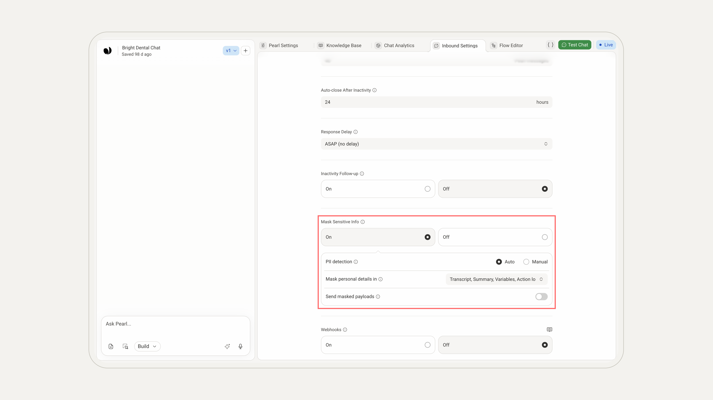</Frame>

<Frame>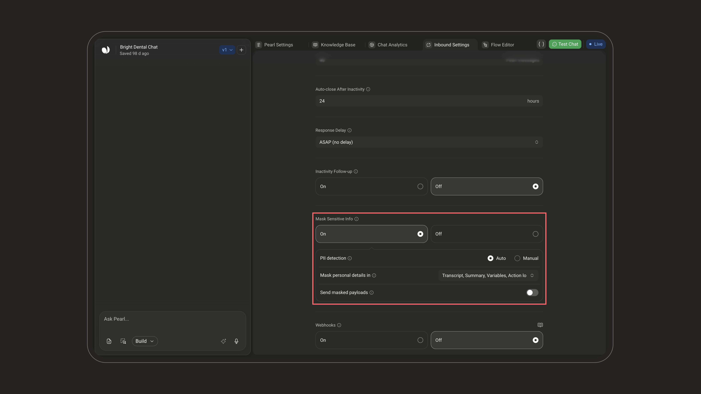</Frame>

| Setting | Description |
| --- | --- |
| **PII detection** | **Auto** (default) lets the AI decide what is personal information, such as names, phone numbers, or card numbers. **Manual** masks only the variables you pick, the same way in every conversation. |
| **Variables to mask** | *Manual only.* The variables whose values are masked. Their values are replaced with `****` wherever they appear, including inside other variables. With no variable selected, nothing is masked (a warning tells you so). |
| **Mask personal details in** | Where masking applies: **Transcript**, **Summary**, **Variables**, and **Action logs** (all checked by default, at least one stays checked). Unchecked parts keep the original values. In Manual mode, this setting reads **Mask the variables in**. |
| **Send masked payloads** | **On**: webhooks and post-chat actions receive the masked values (`****`). **Off** (default): they receive the original values. |

<Info>
With **Auto** detection, if a customer writes *"My credit card number is 1234-5678-9012-3456"*, the transcript stores it as *"My credit card number is \*\*\*\*"*, so you can review interactions safely without exposing sensitive data.
</Info>

---

### Webhooks

Send conversation lifecycle events to an external endpoint. Turn **Webhooks** **On** (default **Off**), then fill in the webhook line (labelled **Calls**, as on voice Pearls):

<Frame>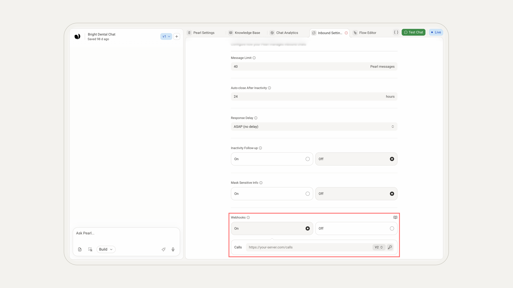</Frame>

<Frame>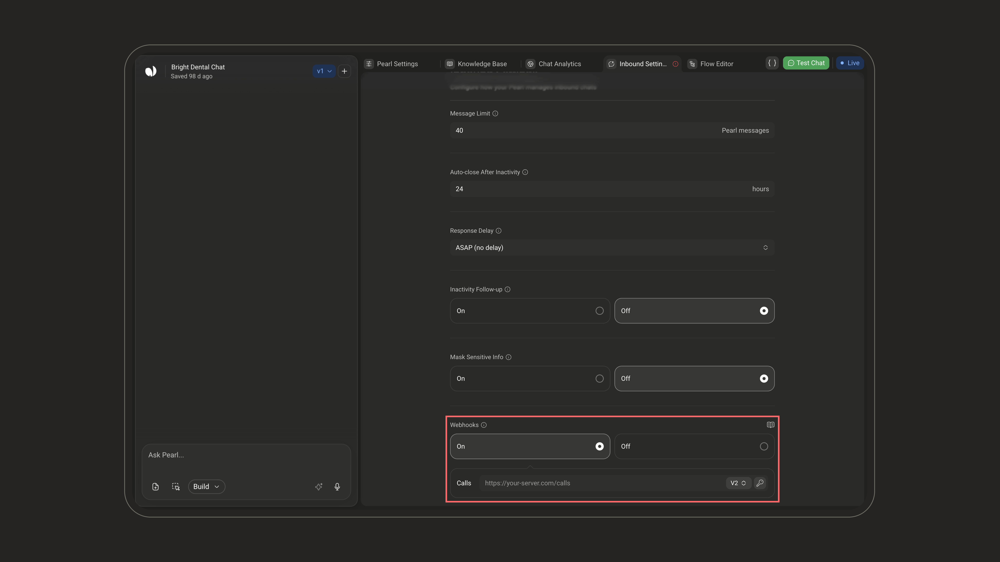</Frame>

- **URL**: your endpoint. It is called at key points in the conversation lifecycle (when the chat starts and when it ends), with details like the outcome and any data collected during the conversation.
- **Version** (the `V1`/`V2` pill): the payload format, default **V2**. Keep V1 only if you have an older integration built against it.
- **Signature** (the key icon): optionally sign the requests with one of your tokens (or create a **New token**) so your endpoint can verify they come from NLPearl. **No signature** sends them unsigned.

<Note>
If your endpoint is behind a firewall, allow the NLPearl IP addresses listed in [IP Whitelisting](/pages/ip_whitelist).
</Note>

<Tip>
Use Webhooks only if external tools need event notifications. For actual automations, rely on **Post-Chat Actions** tied to how the conversation ended.
</Tip>

<Card
  title="Webhooks"
  icon="webhook"
  iconType="light"
  href="/pages/webhooks"
>
  Learn how to configure webhooks, authenticate requests, and handle the events NLPearl sends.
</Card>

---

## Project-Level Settings

A few settings live at the **Project** level rather than in the Inbound Settings screen. Open them with the **Settings** button on your Pearl's page: next to **Text Channel**, you'll find **Agents** and **Chat Retention**.

### Agents

Sets how many **simultaneous agents** handle this Pearl's incoming conversations, i.e. how many chats can be handled at the same time, capped by your account's agent quota. A higher number lets your Pearl take more concurrent conversations. Click the **Agents** value and pick a number: it is saved right away.

<Card
  title="Agents"
  icon="users"
  iconType="light"
  href="/pages/agents"
>
  Learn how to manage the agents assigned to your inbound and outbound activities.
</Card>

---

### Retention

Click the **Chat Retention** value to open the retention window. Set the **Retention period** in days (leave it empty to keep conversations **Forever**), then choose what is removed when they expire: delete all conversation data (on by default), or turn it off to pick the **Transcript**, **Summary**, or collected **Variables**. Click **Save** to apply.

<Frame>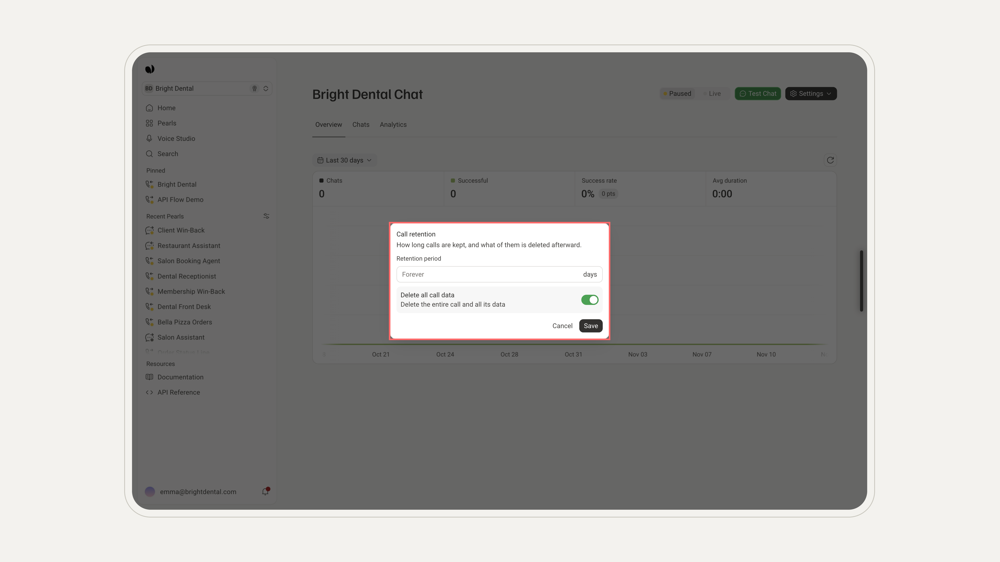</Frame>

<Frame>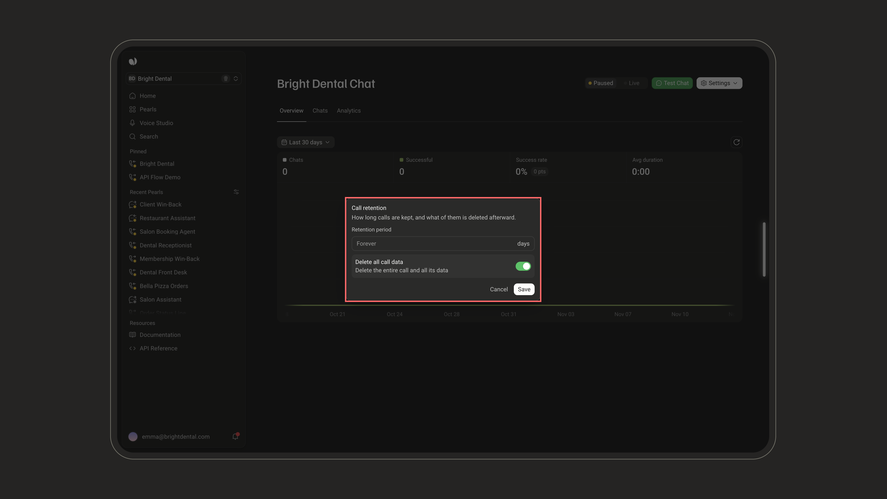</Frame>

<Note>
The window is shared with voice Pearls: it's titled *Call retention* and also lists **Recording**, which doesn't apply to conversations.
</Note>

---

<Info>
### Monitoring and Adjusting Your Inbound Activities

While basic monitoring of conversation logs and reports can be done via our API, any changes to the setup or its settings must be handled directly on the platform.
</Info>
