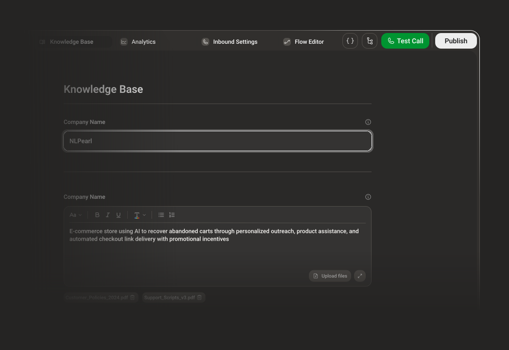
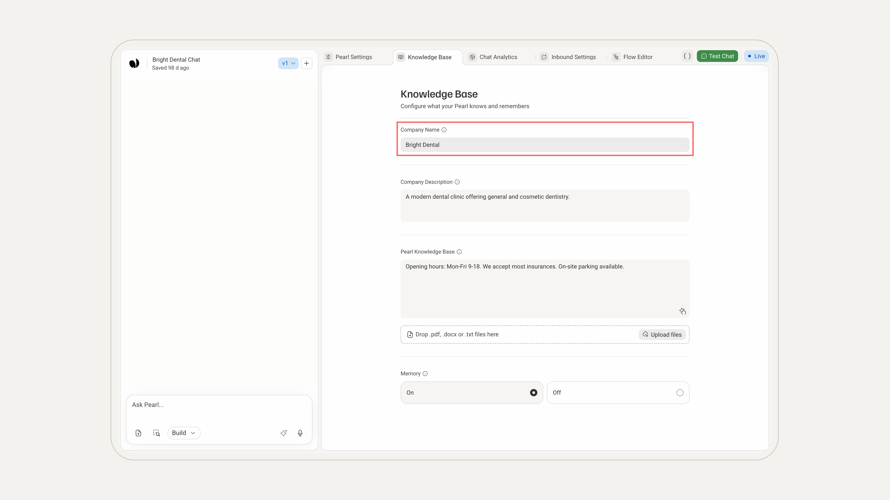
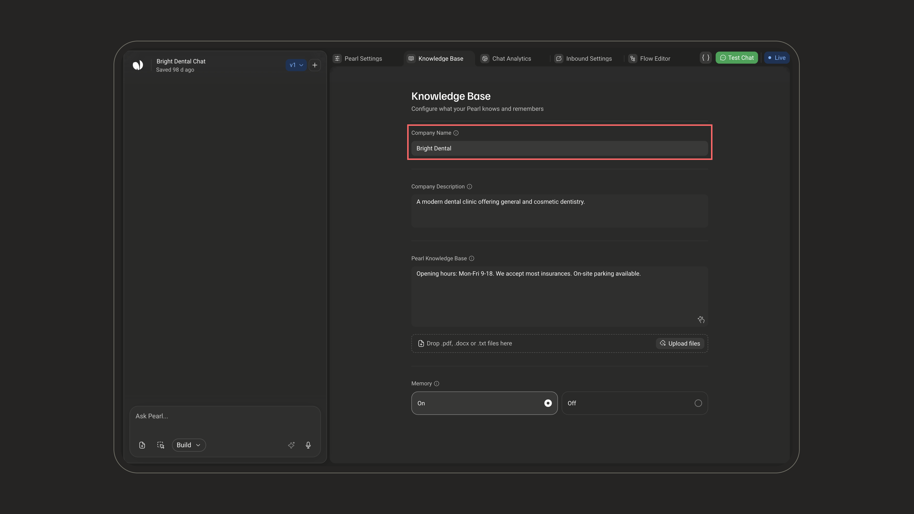
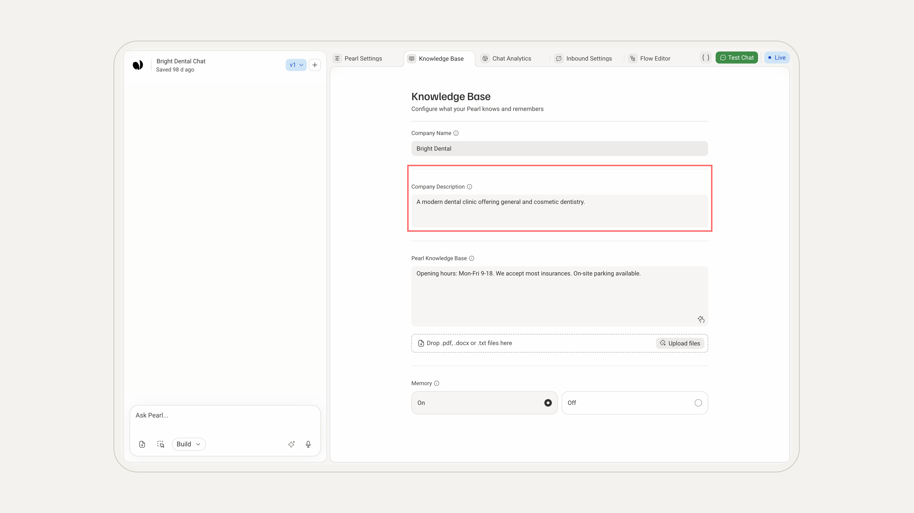
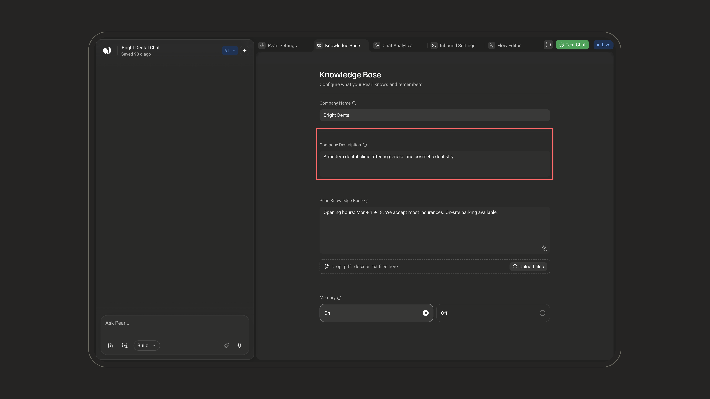
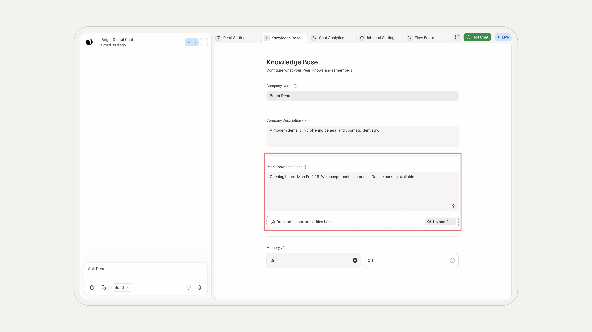
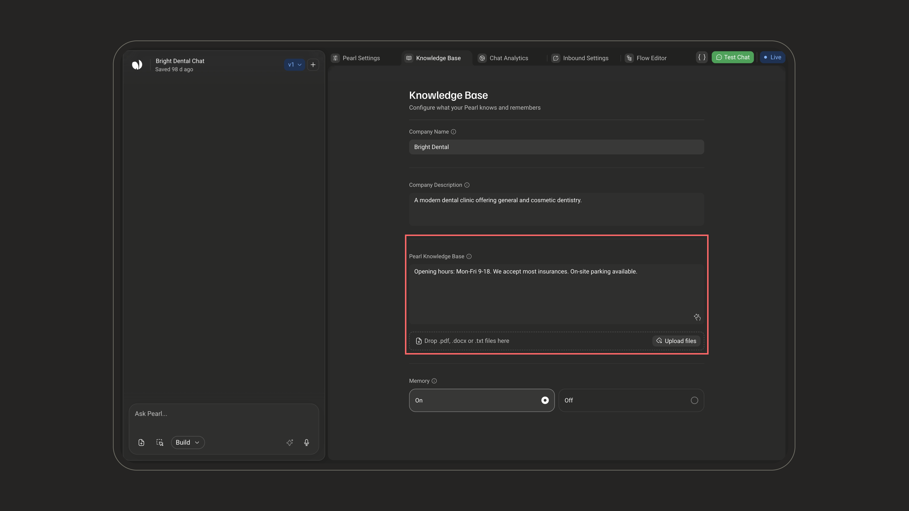
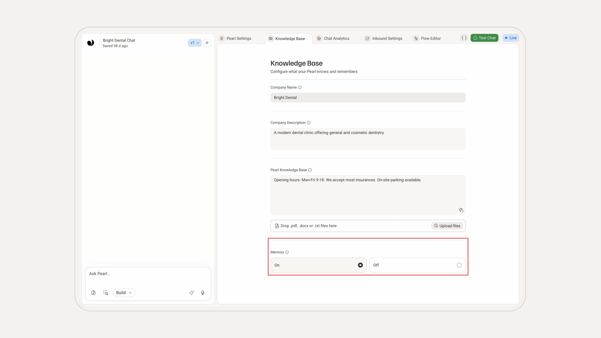
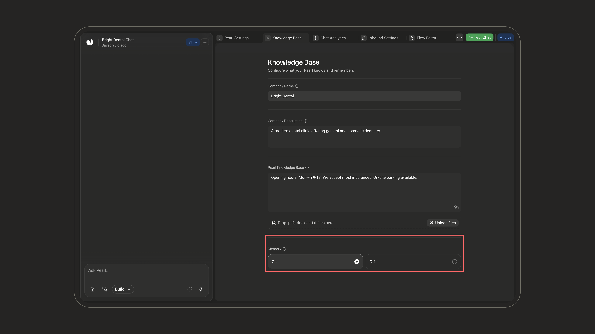

  <Frame>
    

      
    

  </Frame>

  <Frame>
    

      
    

  </Frame>

Before your Pearl can answer questions accurately, it needs context. This step helps define the essential background information your agent will rely on during conversations.

---

## Company Name

These settings live in the **Knowledge Base** tab of your Pearl's editor (**Edit Pearl** in the **Settings** of the Pearl's page). Changes are saved automatically in your Pearl's draft: publish the Pearl to use them in live conversations.

Give your Pearl the name of the company it represents. This name may be used when Pearl introduces itself or provides company-related information. It's **required**, up to **100 characters**. Not representing a company? Write the name of the entity your agent says it's from.

<Frame></Frame>

<Frame></Frame>

---

## Company Description

Add a brief company description including your industry, mission, or key services. This allows Pearl to answer questions with more contextual relevance. It's **required**, up to **500 characters**: a few sentences are enough.

<Frame></Frame>

<Frame></Frame>

---

## Pearl Knowledge Base

This is where you teach Pearl what it needs to know to respond with relevance and accuracy. Add detailed information about your services, pricing, opening hours, locations, and any key operational data.

<Frame></Frame>

<Frame></Frame>

- **Text**: type directly in the field (optional). The expand icon at its bottom right opens it in a larger editor.
- **Files**: drop `.pdf`, `.docx`, or `.txt` files anywhere on the section, or click **Upload files**. Each file shows as a chip with its size (and its progress while uploading); click its **×** to remove it.

<Note>
**Background knowledge, not a script.** The Knowledge Base is passive reference data: Pearl consults it **only when needed** to answer accurately. It doesn't dictate the conversation flow, that's handled by the Flow Editor.
</Note>

<Note>
Both options live in the same area and can be combined: type your information directly in the **text field** and/or **upload reference files**. Multiple documents can be added if needed.
</Note>

Whether you're describing how your subscription plans work, listing available services, or clarifying your business hours, this section allows Pearl to access structured information that supports more precise answers.

<Info>
This is the same knowledge that powers the [Knowledge Base node](/pages/knowledge_base_node) in the Flow Editor. What you add here is what your Pearl draws on during conversations.
</Info>

### Files and limits

These caps apply **per Pearl**: they cover every file attached to that Pearl's Knowledge Base, not each file individually.

| Limit | Value |
|---|---|
| Number of files | 50 |
| Supported formats | `.pdf`, `.docx`, `.txt` |
| Total size of all files | 25 MB (no per-file cap) |
| Total text extracted from files | 2,000,000 characters |
| Free-text field | 20,000 characters (counted separately) |

There is no page limit and no character cap on an individual document, only the shared 25 MB and 2,000,000-character totals apply. The free-text field has its own 20,000-character budget and does **not** consume the 2,000,000 characters reserved for files.

<Note>
Text Pearls get twice the file budget of voice Pearls, which are capped at 1,000,000 characters.
</Note>

<Tip>
Once the text extracted from your files passes **100,000 characters**, a usage gauge appears next to your files (e.g. *4% of 2M characters*). It turns red if you go over the limit.
</Tip>

<Warning>
Pearl uses the **text extracted** from your `.pdf`, `.docx`, and `.txt` files. Standalone image files can't be uploaded here, so make sure anything Pearl needs to answer with exists as text in the document.
</Warning>

---

## Memory

When enabled, Pearl remembers the user or lead, allowing it to seamlessly continue conversations from where they left off. Choose **On** or **Off** (off by default).

<Frame></Frame>

<Frame></Frame>

How it works:
- After each conversation, Pearl adds what it learned to a short **profile** of that person, built from the conversation summaries.
- The profile is kept **per contact** and per Pearl: the person's phone number on SMS and WhatsApp, or their sender ID on other channels. At the start of the next conversation with the same contact, Pearl reads it and picks up from there.
- Pearls in a [group](/pages/pearl_groups) with **Shared Memory** turned on share the same profiles.
- A conversation with no way to identify the contact is neither remembered nor recognized.

<Tip>
This feature is particularly useful for:
- Multi-step processes  
- Follow-ups  
- Any scenario where continuity matters
</Tip>

<Card>
### Example use case: Hospitality

Let's say a guest checks into a hotel. Once they've mentioned it in a conversation, Pearl can:
- Remember their room number  
- Greet them by name  
- Recall their preferences (like "extra towels" or "no wake-up call")  
- Offer a smooth, personalized experience every time they chat
</Card>

<Info>
**Resetting Memory**

Memory is never cleared automatically. To give a contact a fresh start, reset its memory through the API (**Reset Memory**, with the phone number).

This is especially important in contexts like hospitality: when a guest checks out, have your system reset the memory of their number, so the next guest starts with a clean experience.
</Info>
