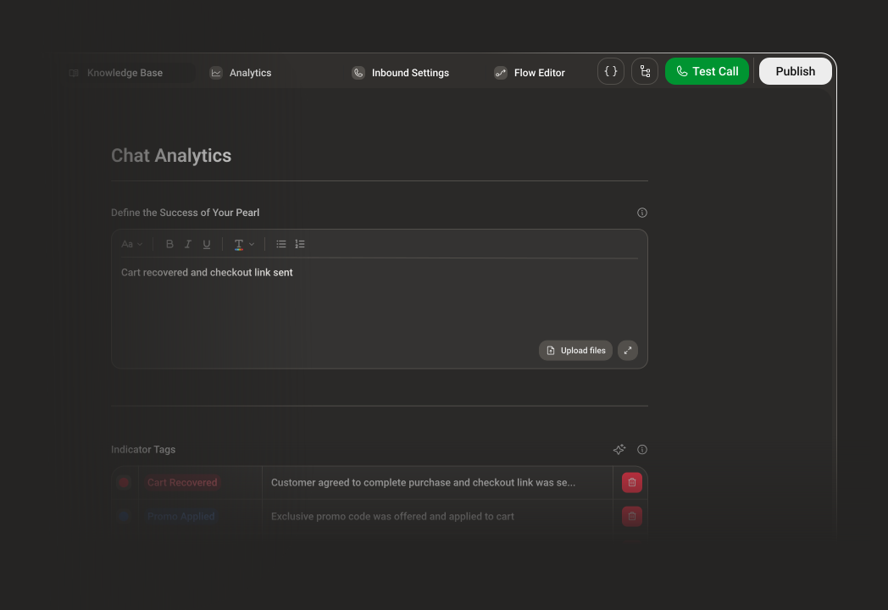
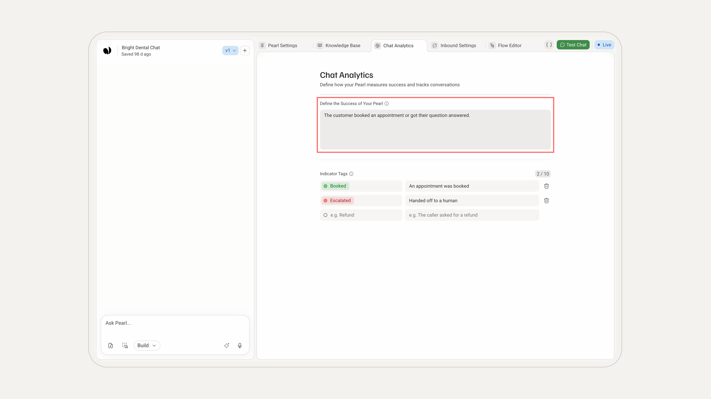
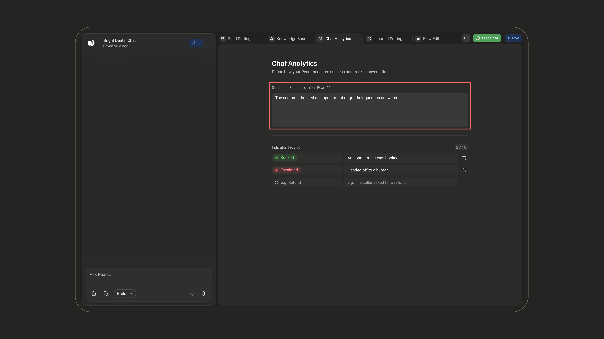
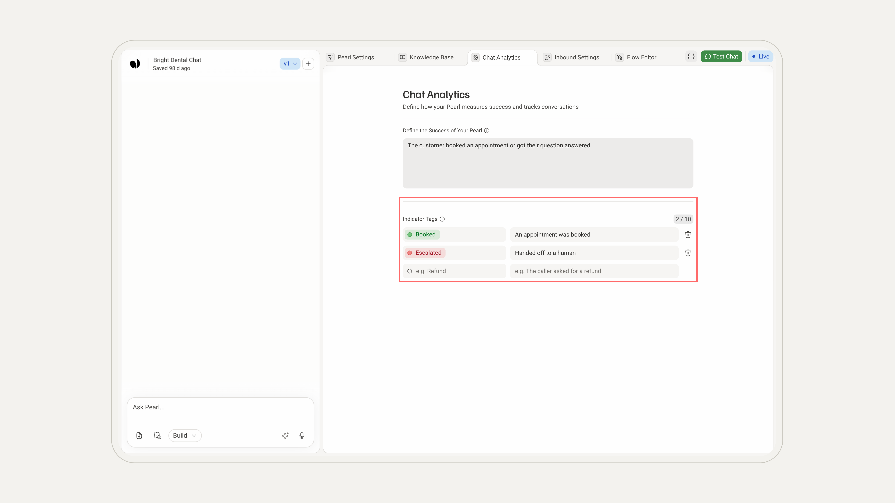
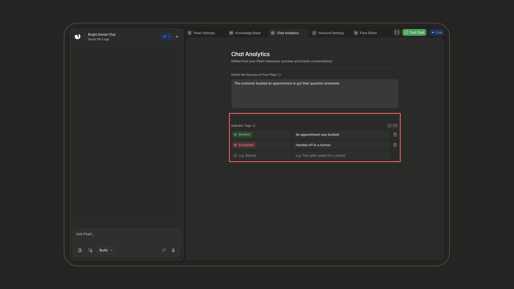

  <Frame>
    

      
    

  </Frame>

  <Frame>
    

      
    

  </Frame>

Use this section to track, evaluate, and act on your Pearl's performance. Define what success looks like and apply custom tags to key conversation moments. These settings live in the **Chat Analytics** tab of your Pearl's editor.

<Note>
Other charts in your Chat Analytics dashboard are tracked automatically and don't depend on this setup step.
</Note>

---

## Define the Success of Your Pearl

Specify what constitutes a successful conversation for your Pearl, such as booking a meeting, confirming interest, or qualifying a lead. This success definition will be reflected in your campaign analytics and lead statuses, helping you sort and follow up efficiently.

The success criteria is **free text**, up to **250 characters**.

<Frame></Frame>

<Frame></Frame>

<Info>
**In your Chat Analytics dashboard**, without a success definition, conversations are counted as **Completed**. Once defined, they split into **Successful** (green) and **Unsuccessful** (pink), and the **Success Rate** chart tracks the percentage of conversations that met your criteria over time. Until then, Completed conversations count toward the success rate, so it doesn't measure your goal yet.
</Info>

---

## Indicator Tags

Use **Indicator Tags** to label and categorize key moments in a conversation. They help you structure your data, identify important insights, and filter your leads with precision.

<Frame></Frame>

<Frame></Frame>

You can create up to **10 tags**. Each tag includes:

- **Name**: A clear label, required (max **25 characters**), e.g. `"Interested"`, `"Mentioned Competitor"`.
- **Color**: Used for visual sorting. Each tag must use a **unique color**, a color already assigned to another tag can't be reused.
- **Assignment rule (When to assign)**: A short description of when the tag should be applied, required (max **300 characters**).

Tags are assigned automatically during the conversation, based on the conditions you define.

<Card>
### Example

You're asking leads what they usually drink in the morning. You might define:

- **Tag**: `Coffee`  
  - **Color**: Brown  
  - **When to assign**: If the lead mentions drinking coffee

- **Tag**: `Tea`  
  - **Color**: Green  
  - **When to assign**: If the lead mentions drinking tea

These tags will then appear in your lead data and conversation logs, making it easy to segment and analyze responses.
</Card>

<Info>
Indicator Tags are not just for display. They're functional: you can filter your conversations by tag and segment your leads with them.    
In your **Chat Analytics dashboard**, they feed the **Tags** chart, showing each tag's name, its chosen color, and how many conversations it was applied to.
</Info>
