

  <Frame>
    

      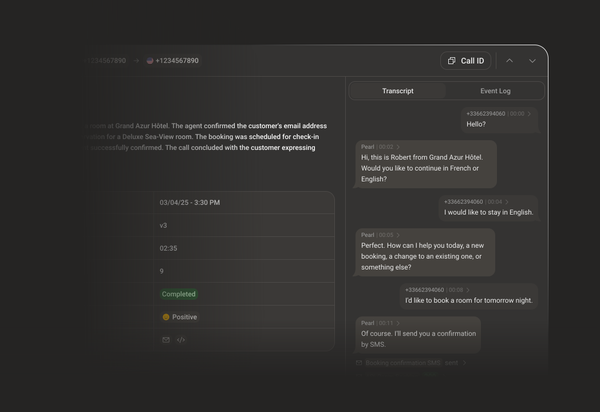
    

  </Frame>

  <Frame>
    

      
    

  </Frame>

---

## What is a Post-Chat?
In NLPearl, a **post-chat** is the view of a single conversation handled by your text Pearl. It centralizes all key information captured before, during, and after the conversation to ensure full traceability, improve quality, and support human follow‑up when needed.

To open one, go to your Pearl's page, open the **Chats** tab, and click a conversation: it opens in a panel on the right. Use the arrows at the top right, or the **↑ / ↓** keys, to move to the previous or next conversation. A conversation can also be opened from the **Chats** column of a lead's details.

<Frame>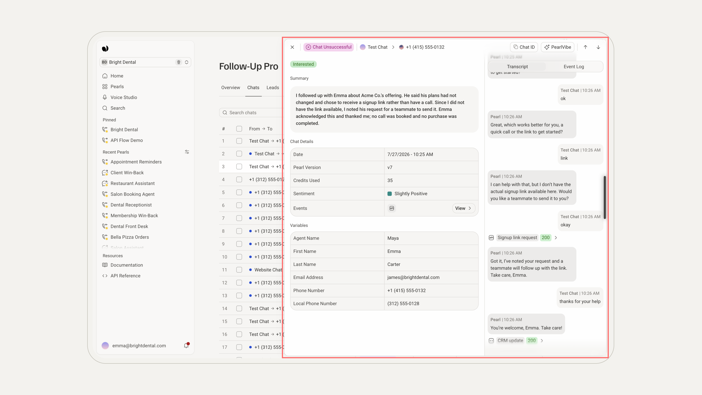</Frame>

<Frame>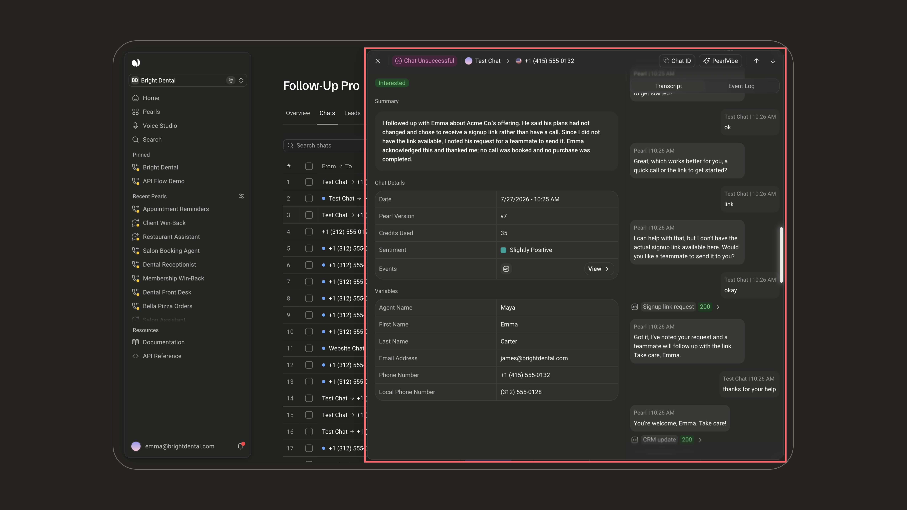</Frame>

<Note>
The view also works while a conversation is still ongoing: you can follow it live, generate a summary, take over from Pearl, or close the conversation (see below).
</Note>

---

## What Does the Post-Chat Include?

A post-chat provides multiple key sections to review and analyze the outcome of a conversation:

### Chat ID
A unique identifier for each conversation. Click **Chat ID** at the top right of the panel to copy it; hover it to see the full ID. Paste it in the search field of the **Chats** tab to find that conversation again.

<Frame>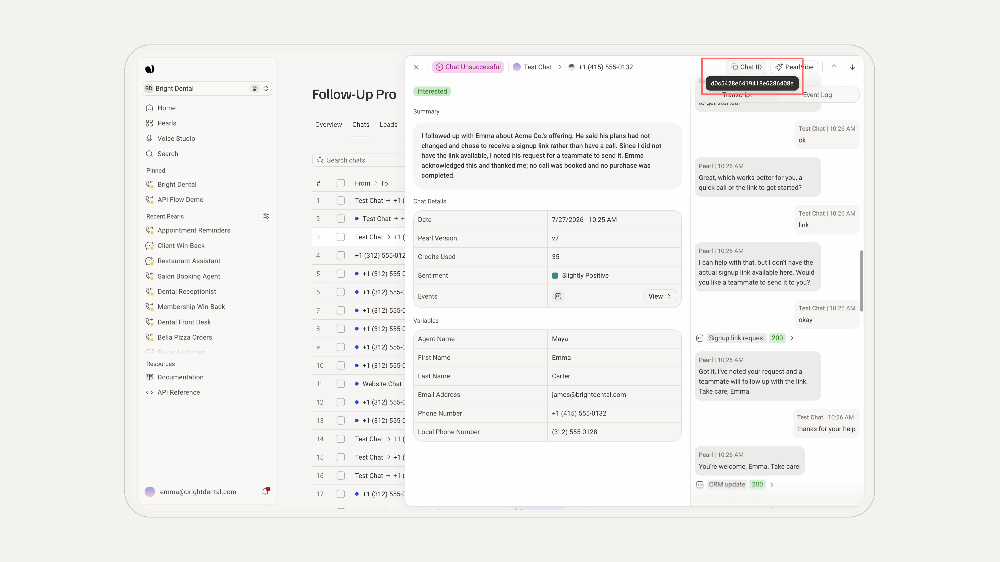</Frame>

<Frame>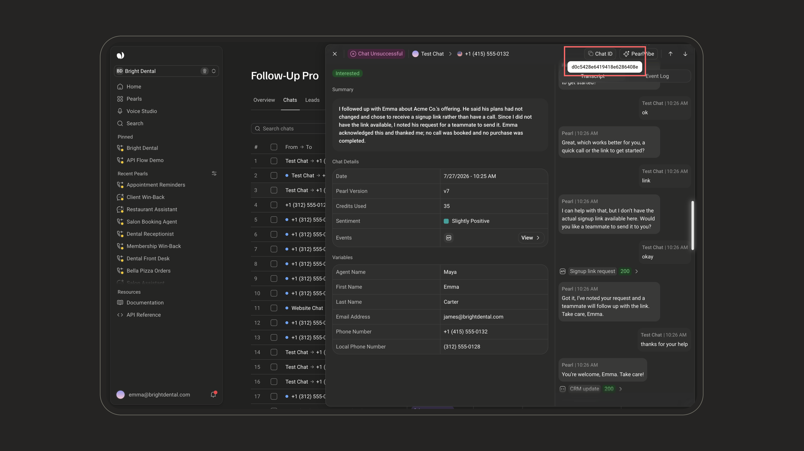</Frame>

<Tip>
Next to it, the **PearlVibe** button (*Review this chat with PearlVibe*) opens your Pearl's [PearlVibe](/pages/pearl_vibe) chat with this conversation as context, to understand what happened and improve your flow.
</Tip>

---

### Chat Details

This section summarizes the essential metadata captured during the conversation, such as timing, the Pearl version used, credits consumed, and the overall outcome.

| Field | Description |
|-------|-------------|
| **Date** | The exact date and time the conversation took place. |
| **Pearl Version** | The version of the Pearl that handled the conversation. |
| **Lead Name** | The name of the person Pearl talked with, when known. |
| **Duration** | The length of the conversation. |
| **Queue Duration** | Time the conversation spent waiting before being picked up. |
| **Transfer Duration** | Time spent with a human agent after a hand-off. |
| **Credits Used** | The number of credits consumed by the conversation. |
| **SMS Credits Used** | The number of credits consumed by SMS messages sent during the conversation. |
| **Sentiment** | The detected sentiment of the customer during the conversation. |
| **Events** | A shortcut to the actions triggered during the conversation — click **View** to jump to the **Event Log**. |

<Note>
Some fields only appear when they apply: **Lead Name** when the name is known, **Queue Duration** when the conversation was queued, **Transfer Duration** when it was handed off, and **SMS Credits Used** when at least one SMS was sent.
</Note>

<Frame>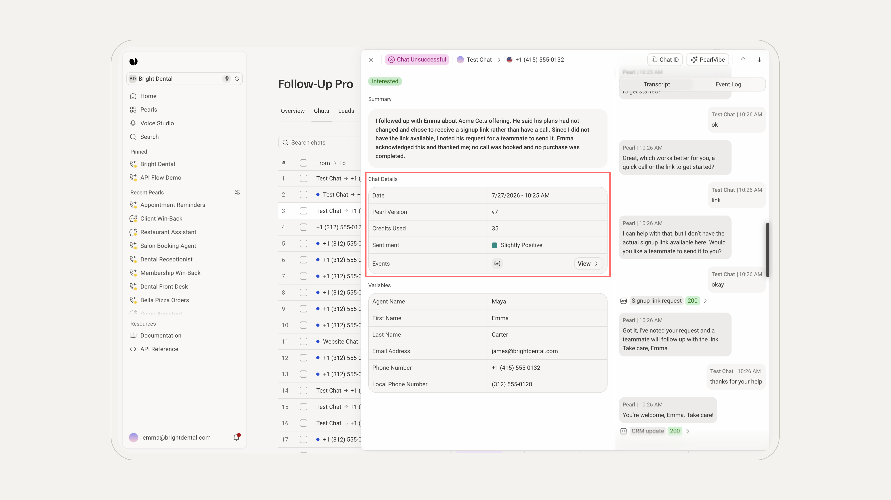</Frame>

<Frame>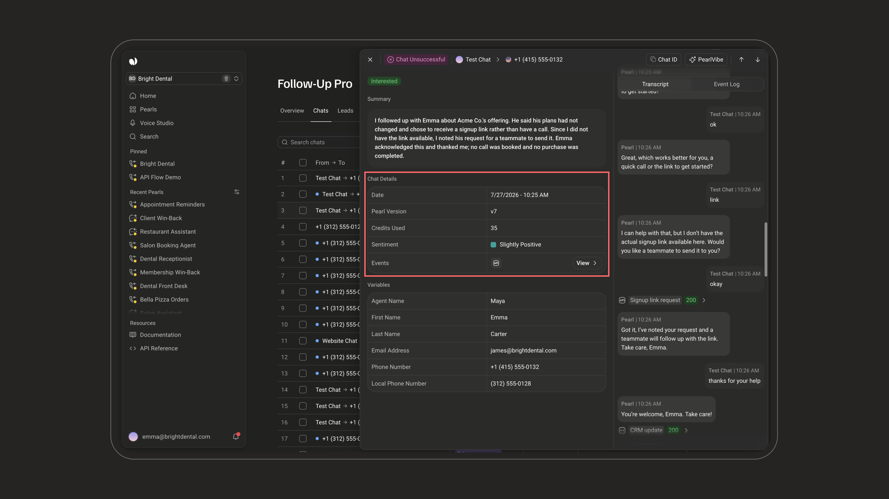</Frame>

---

### Conversation Status

Indicates the outcome of the conversation from a business or process perspective. It is shown as a colored badge in the header, next to the participants (the customer and the channel used). For chats, this is the **only** status displayed.

<Frame>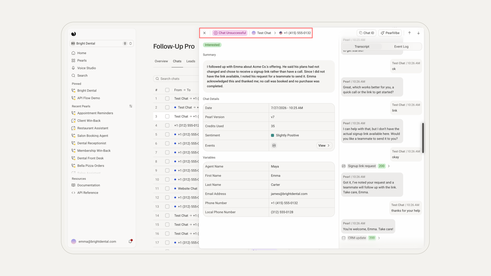</Frame>

<Frame>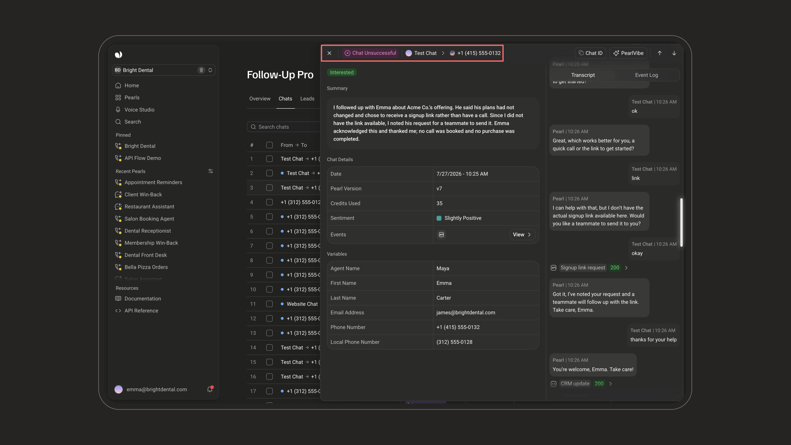</Frame>

| Status | Description |
|--------|-------------|
| `In Chat Queue` | The conversation is waiting to be picked up. |
| `In Chat` | The conversation is currently ongoing. |
| `Chat Successful` | The conversation achieved its expected outcome. |
| `Chat Unsuccessful` | The conversation failed to meet its objective. |
| `Completed` | The conversation was conducted and finalized, regardless of outcome. |

<Card icon="circle-info" iconType="light">
  <b>Important distinctions about Conversation Status</b>:

  The difference between `Chat Successful`, `Chat Unsuccessful`, and `Completed` depends on whether a **Success Definition** is set for the Pearl:
  - If a **Success Definition** is set:
    - `Chat Successful` → the Success Definition criteria were met during the conversation.
    - `Chat Unsuccessful` → the conversation did not meet the Success Definition criteria.
  - If **no Success Definition** is set:
    - `Completed` → the conversation was completed without any Success Definition evaluation.
</Card>

<Note>
For more information on Success Definitions, see [Pearl Analytics](/pages/text/pearl_analytics#define-the-success-of-your-pearl).
</Note>

While a conversation is **In Chat**, a **✕** button next to the badge lets you **close it manually**: *"Closing this chat will mark it as closed in Pearl's system, like closing a ticket."* Use it when the exchange is finished. Closing is different from a [takeover](#human-takeover), which only pauses Pearl's replies.

<Frame>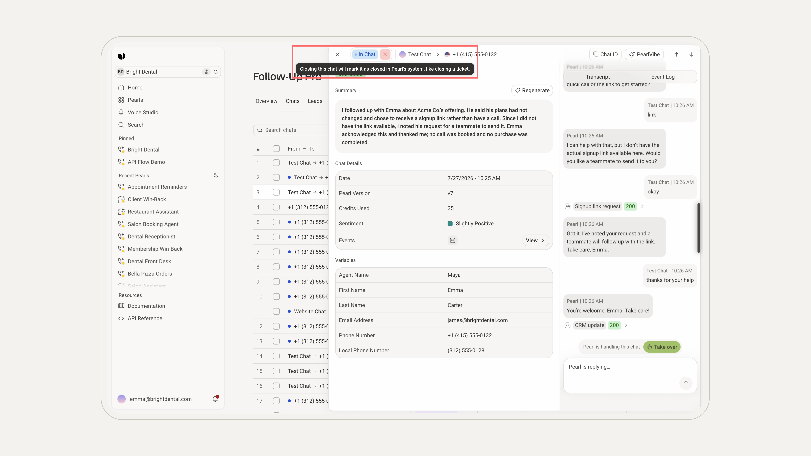</Frame>

<Frame>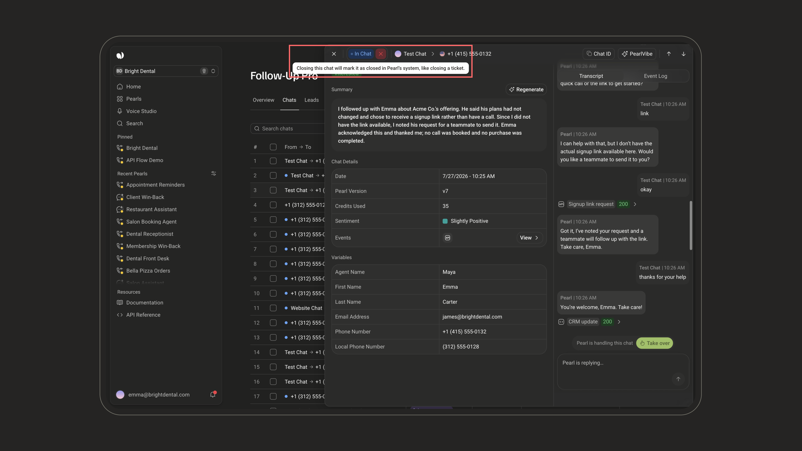</Frame>

<Note>
Unlike voice calls, a chat has no separate technical status: the telephony-level **Call Status** doesn't apply to conversations and isn't shown in the post-chat.
</Note>

---

### Tags
The [Indicator Tags](/pages/text/pearl_analytics#indicator-tags) this conversation received, shown as colored chips at the top of the left column. Pearl assigns them automatically, based on the conditions you set for each tag.

<Frame>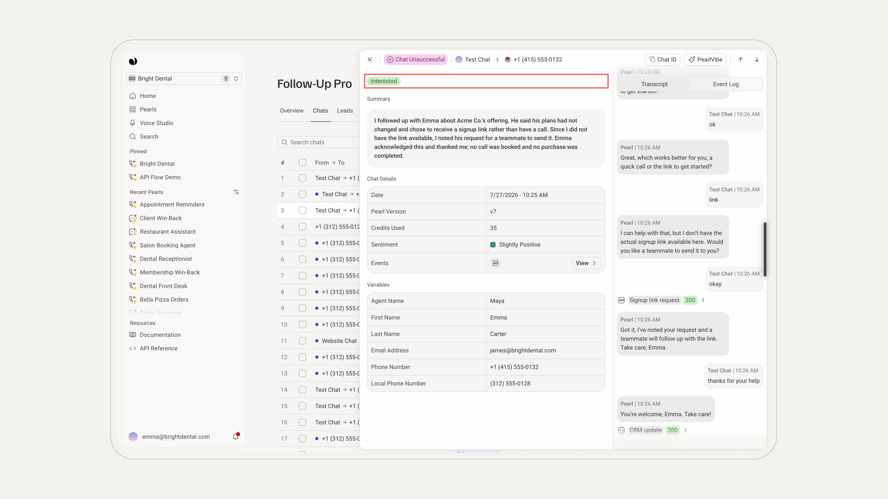</Frame>

<Frame>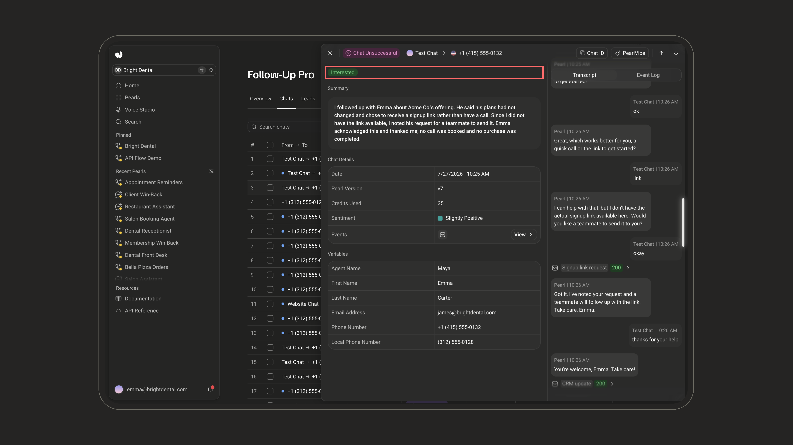</Frame>

---

### Events
A log of the actions triggered by Pearl during the conversation. Each event includes a timestamp, the action details, and an execution status. The **Events** row in Chat Details shows one icon per event (hover it for its name) — click **View** to jump straight to the **Event Log**.

Possible event types include:

| Event Type | Description |
|------------|-------------|
| `Hand-Off` | The conversation was handed off to a human agent. |
| `Email Sent` | An email was sent during the conversation. |
| `API Request` | An API was called — before the conversation (**Pre Call API Request**), during it (**API Request**), or after it (**Post Call API Request**). |
| `Appointment Booked` | An appointment was booked in the calendar. |
| `Slack Sent` | A Slack notification was sent. |
| `Webhook Sent` | A [webhook](/pages/webhooks) was sent, with its number of attempts, response time, and status code. |

<Info>
Each event carries an execution status: the **HTTP status code** for API calls (or **Error** when no response came back), otherwise **sent** / **failed**. Failed events are flagged in red, with a name ending in *Failed* (e.g. *API Request Failed*).
</Info>

<Frame>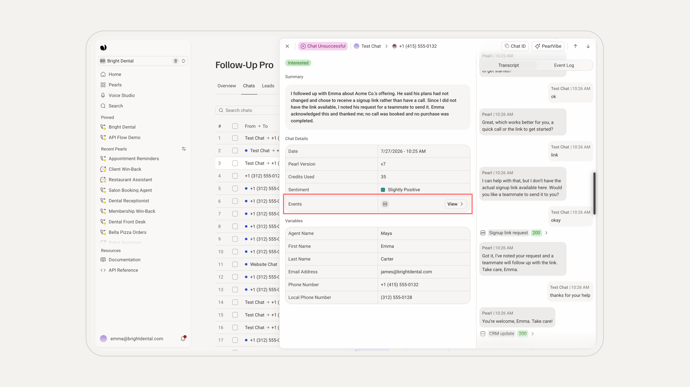</Frame>

<Frame>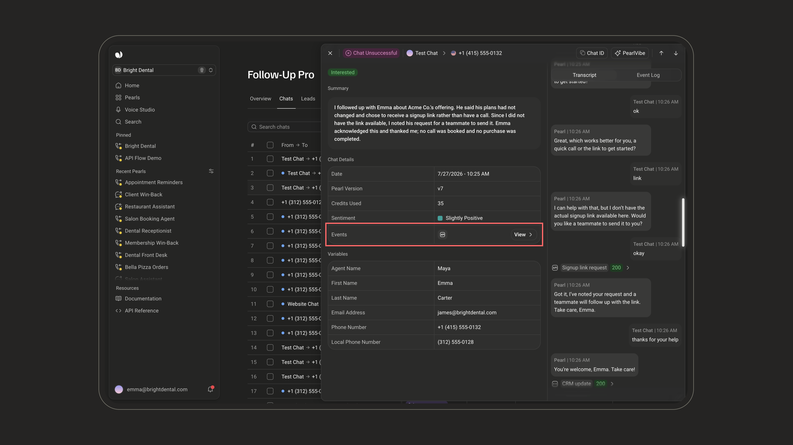</Frame>

---

### Sentiment Analysis
An automatic classification of the customer's tone and emotional state throughout the conversation, shown as the **Sentiment** row of Chat Details. Possible values include:

| Sentiment Value | Description |
|-----------------|-------------|
| `Positive` | The conversation was clearly positive in tone and emotion. |
| `Slightly Positive` | The overall tone was mostly positive, with minor neutral moments. |
| `Neutral` | The sentiment was balanced or emotionless. |
| `Slightly Negative` | The tone leaned slightly negative, but not strongly so. |
| `Negative` | The conversation had a clearly negative emotional tone. |

<Frame>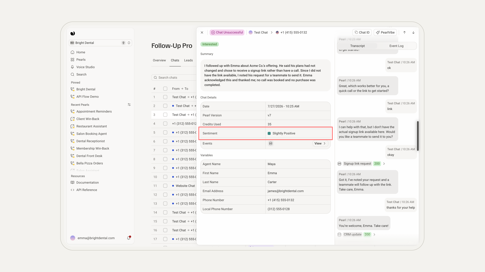</Frame>

<Frame>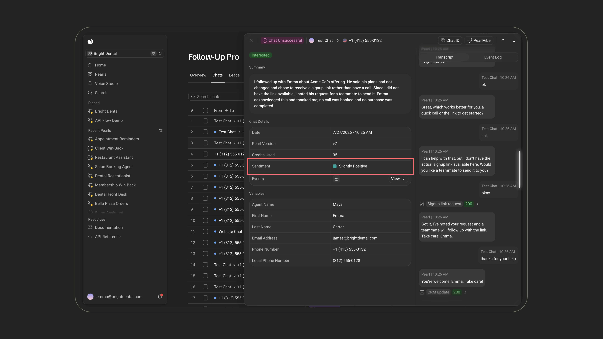</Frame>

---

### Summary

A concise, human‑readable recap of the conversation, generated by Pearl and shown at the top of the left column. It includes:
- What the customer requested
- What was confirmed or declined
- The overall outcome of the interaction

<Frame>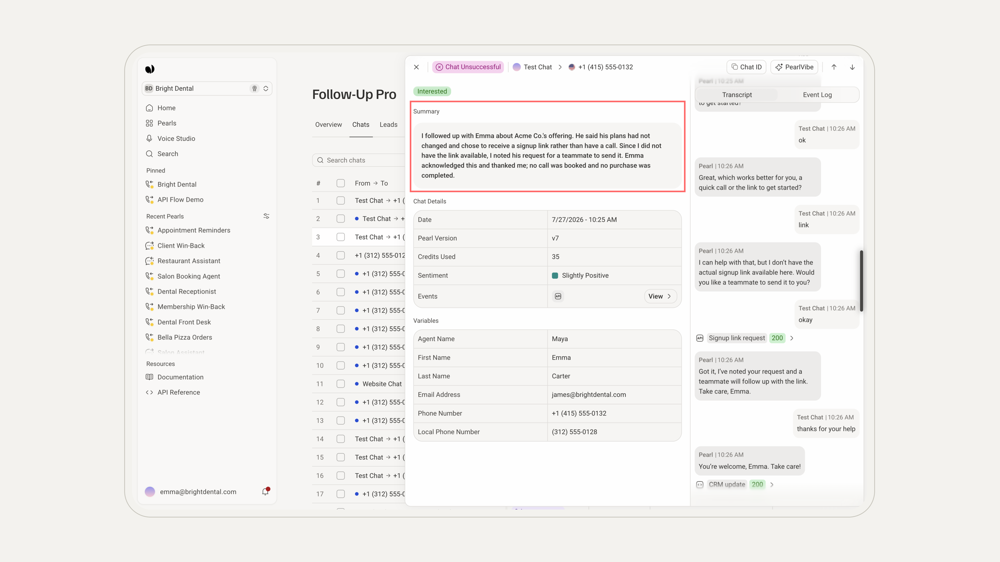</Frame>

<Frame>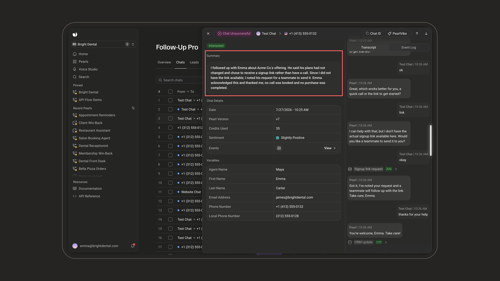</Frame>

Once a conversation is **closed or completed**, the summary is generated **automatically**. While a chat is still **In Chat**, there is no summary yet (*No summary yet*): click **Generate Summary** to get one now, without waiting for the conversation to end. Once a summary exists, **Regenerate** refreshes it while the chat goes on.

<Frame>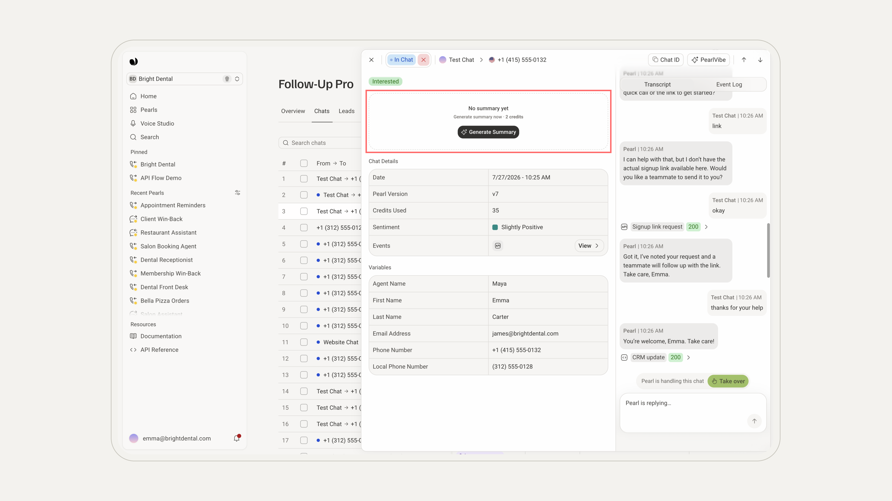</Frame>

<Frame>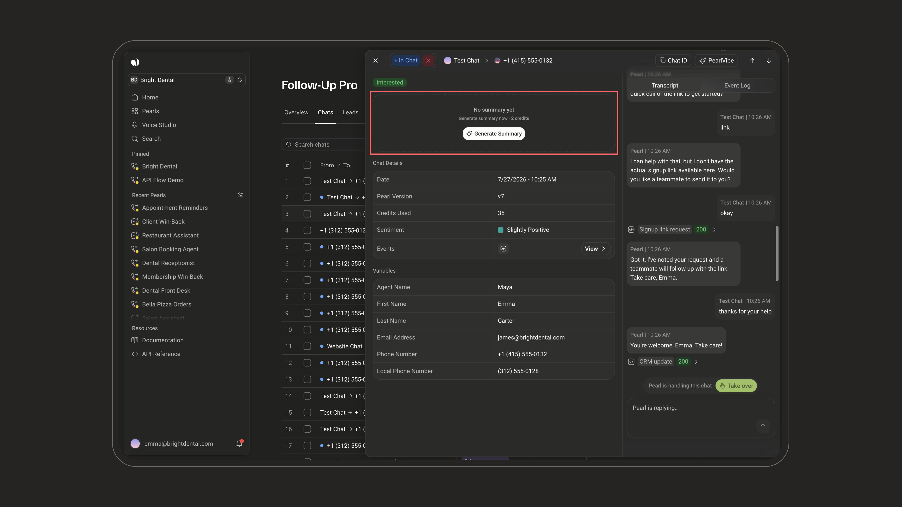</Frame>

<Note>
Generating a summary **on demand** (while the chat is ongoing) costs **2 credits**. The automatic summary produced when the conversation ends is included.
</Note>

---

### Transcript & Event Log

A toggle at the top of the right-hand column switches between the **Transcript** and the **Event Log**.

**Transcript** — a full text version of the conversation between the customer and Pearl. Events show up inline as compact rows: click one to open it in the Event Log. Dividers separate **Pre-chat events**, the conversation (**In-chat**), and **Post-chat events** when there are any. Useful for reviewing the interaction, auditing, and training.

- **Delivery status**: each message shows its delivery state — **Pending**, **Sent**, or **Failed** — with a matching icon.
- **Attachments**: messages can include attachments (images, files) shared during the conversation.

<Frame>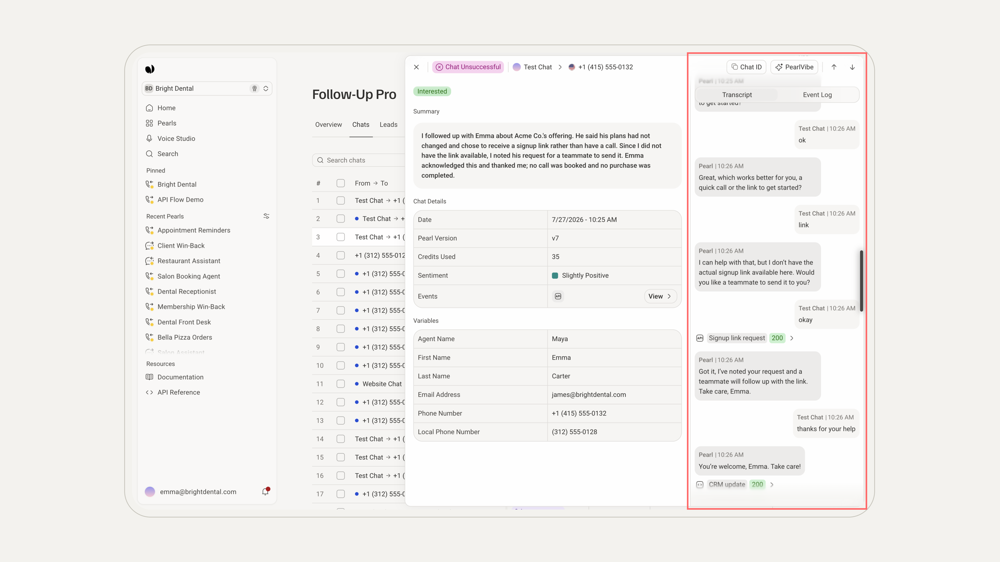</Frame>

<Frame>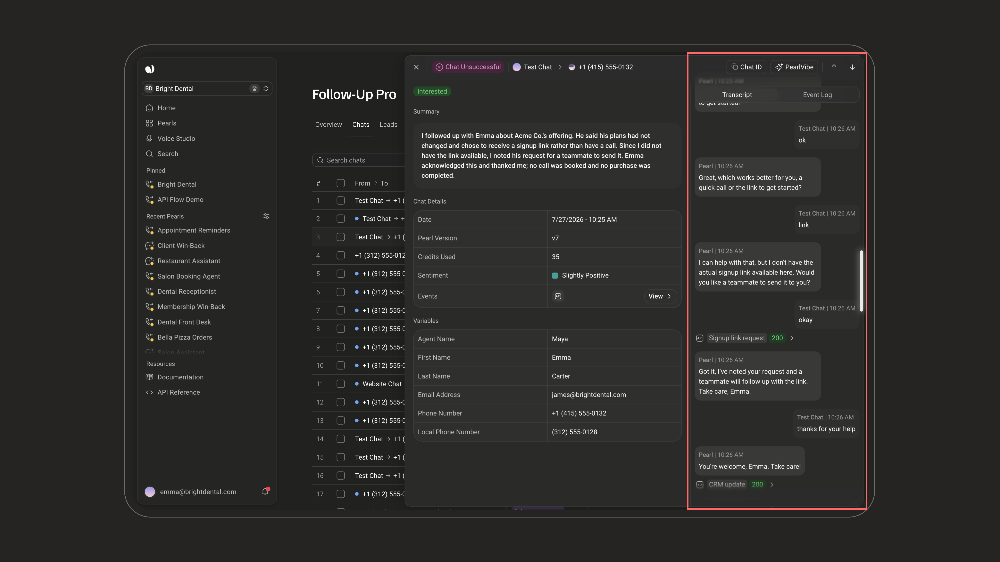</Frame>

**Event Log** — the list of all actions triggered by Pearl around the conversation. Each entry shows the action, its status, and expands to show its details: for an API request, the method and URL, the error, the response, the body, and the headers. Use it to verify that every automated operation ran and inspect its output.

<Frame>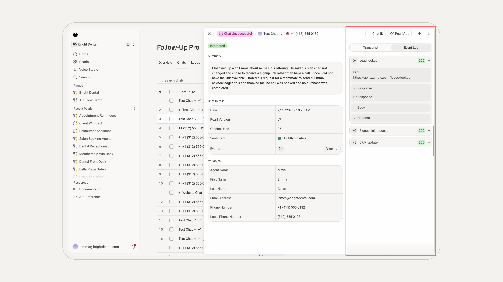</Frame>

<Frame>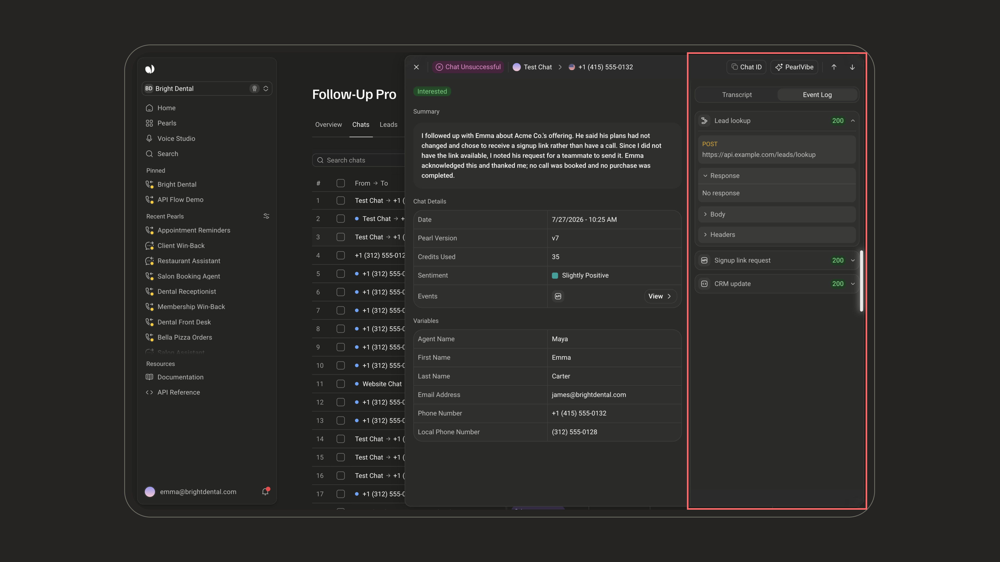</Frame>

---

### Variables

This section, labeled **Variables** in the UI, lists every variable of your Pearl that has a value for this conversation: data provided before the conversation (such as the lead's details) and data collected during it.
Examples:
- Delivery type
- Selected options (e.g. “Dessert: Cheesecake”)
- Customer preferences

When [Mask Sensitive Info](/pages/text/inbound#mask-sensitive-info) is on, masked values show as `****`.

<Frame>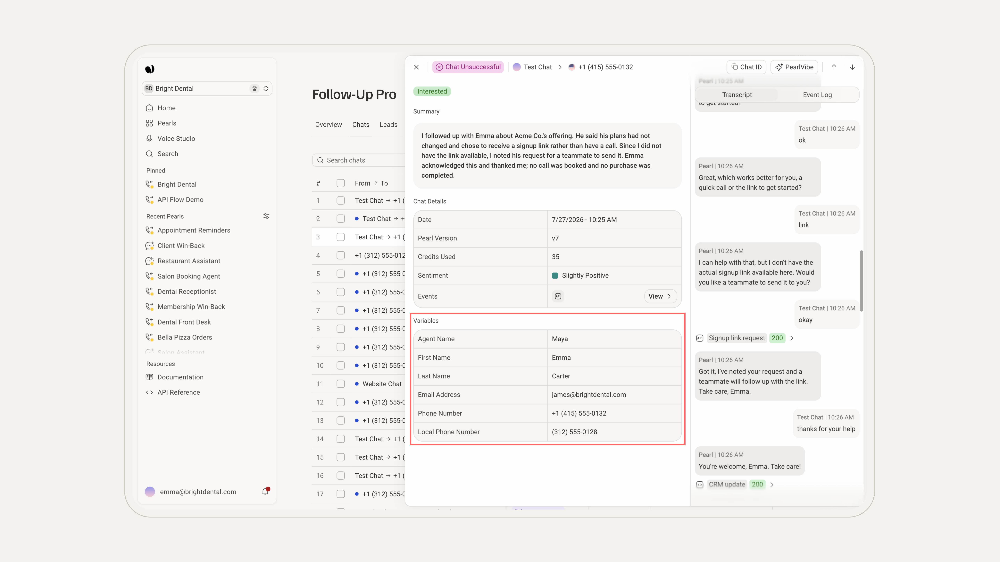</Frame>

<Frame>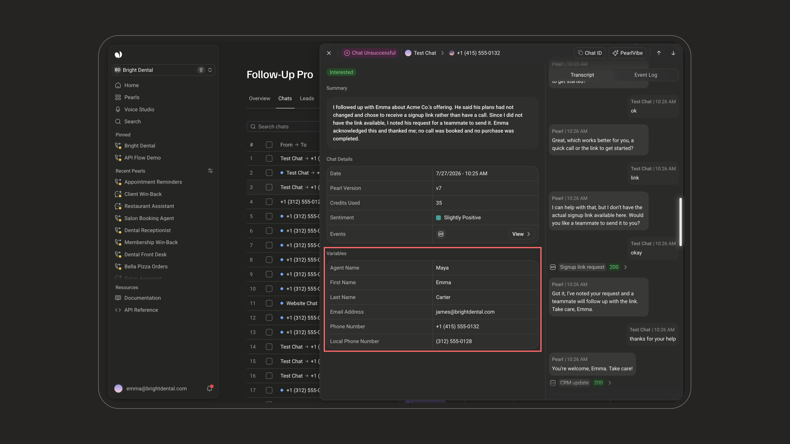</Frame>

<Info>
You can learn more about creating variables in the Pearl [here](/pages/variables).
</Info>

---

### Human Takeover

While a conversation is **In Chat**, a human agent can step in and **take over** directly from the post-chat, then hand it back to Pearl once done. The full context (transcript, variables, and events) stays available throughout.

This is useful when:
- The customer explicitly asks to speak with a human
- The request falls outside what Pearl is configured to handle
- A sensitive or high-value conversation needs a personal touch

<Note>
A takeover is a **manual** action you trigger from this view. It's different from a **human hand-off**, which Pearl performs **automatically** based on a node configured in your flow — logged as a *Hand-Off* event.
</Note>

<Card title="Hand-Off Node" icon="headset" iconType="light" href="/pages/text/handoff_action">
  Learn how to configure automatic hand-off to a human agent from your Pearl flow.
</Card>

<Steps>
  <Step title="Pearl is handling the chat">
    While Pearl is in control, the bottom of the transcript shows *"Pearl is handling this chat"* and the composer is locked (*"Pearl is replying…"*). Click **Take over** (*Take control of this chat and reply instead of Pearl*) to step in.

    
<Frame>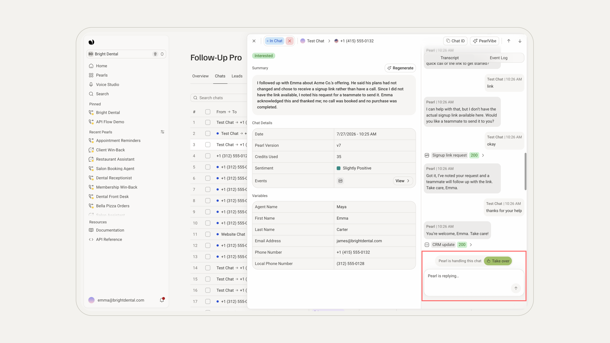</Frame>

    
<Frame>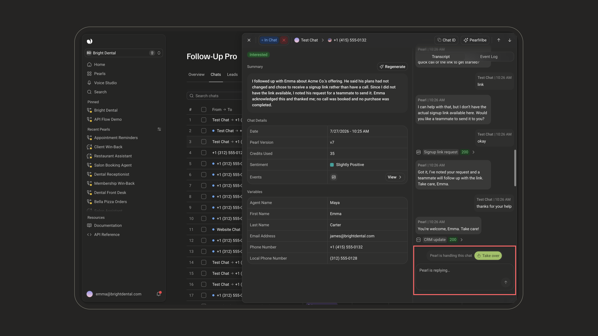</Frame>

  </Step>

  <Step title="The agent is in control">
    Once you take over, Pearl stops replying and the bottom of the transcript shows who took over. The composer unlocks to **Reply as agent…**, so you can type messages to the customer in real time (attachments can't be sent from this composer). When you're finished, click **Hand back** (*Let Pearl take over again and continue replying automatically*) to return control to Pearl.

    
<Frame>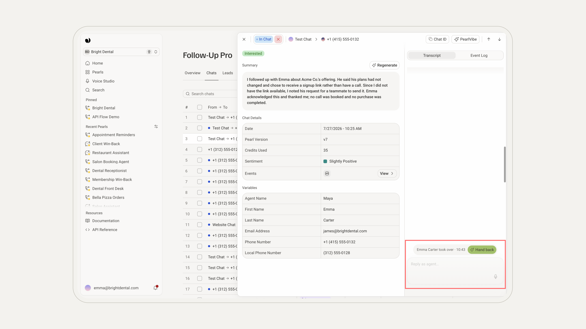</Frame>

    
<Frame>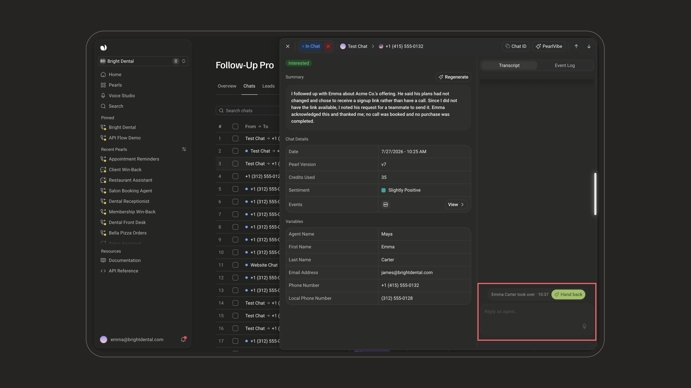</Frame>

  </Step>
</Steps>

<Note>
A takeover does **not** close the conversation. Pearl simply stops responding so the human agent can reply, and everything stays logged in the post-chat for full traceability. To end the conversation, use the **✕** next to the status badge (see [Conversation Status](#conversation-status)).
</Note>

---

<Tip>
**Navigation & shortcuts** — a few actions make it faster to move around and act on a conversation:

- **Open the linked Lead** — for outbound conversations, the **Lead** button opens the lead's details in a popover directly from the conversation.
- **Move between conversations** — use the **Previous** / **Next** arrows or the **↑ / ↓** keyboard keys.
- **Jump to the Event Log** — click **View** on the Events row in Chat Details to switch straight to the Event Log.
</Tip>

---

## Why the Post-Chat Matters

<CardGroup cols={2}>

<Card title="Traceability" icon="check" iconType="light">
  Every conversation leaves a documented trace for accountability.
</Card>

<Card title="Faster Follow‑Up" icon="check" iconType="light">
  Helps support and operations teams follow up efficiently with customers.
</Card>

<Card title="Quality & Analytics" icon="check" iconType="light">
  Enables continuous improvement through quality review, sentiment tracking, and conversation analysis.
</Card>

<Card title="Auditing & Compliance" icon="check" iconType="light">
  Provides an auditable record of AI-driven conversations to meet regulatory or internal policy needs.
</Card>
</CardGroup>

---

By consolidating all these elements, the **Post-Chat** view provides a complete overview of each AI-handled conversation, ensuring transparency, traceability, and actionable insights for your team.
