

  <Frame>
    

      
    

  </Frame>

  <Frame>
    

      
    

  </Frame>

Connect your Twilio account to NLPearl.AI and use your existing Twilio numbers for inbound and outbound campaigns. This gives you access to phone numbers from a wide range of countries, with local regulatory compliance handled directly by Twilio.

---

### How to Integrate Your Twilio Account

<Steps>

<Step title="Go to Phone Numbers Settings">

Click your **profile** at the bottom-left corner of the sidebar, then click **Settings**.

<Frame>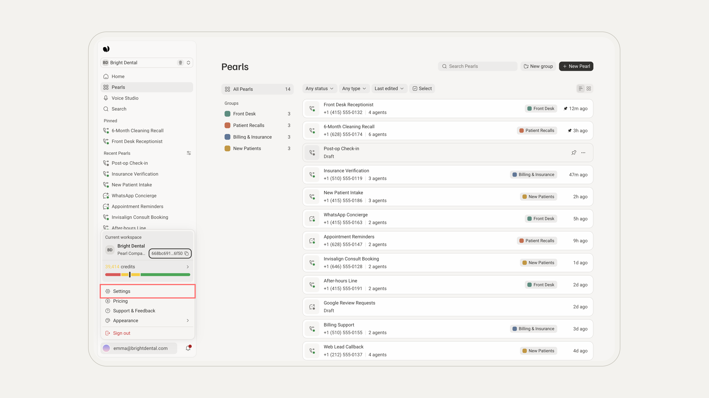</Frame>

<Frame>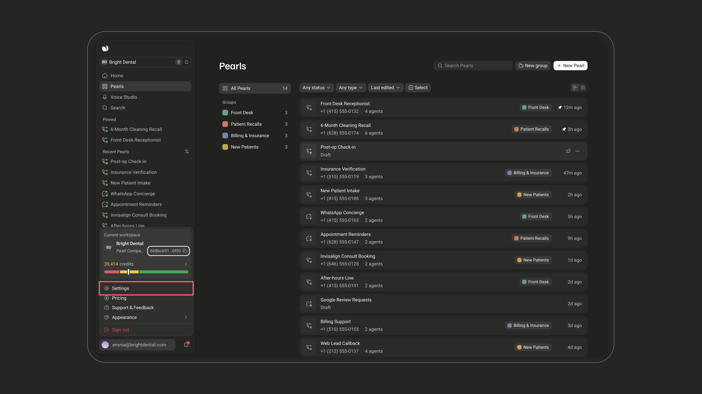</Frame>

In the Settings window, open **Phone Numbers** (under **Channels**).

<Frame>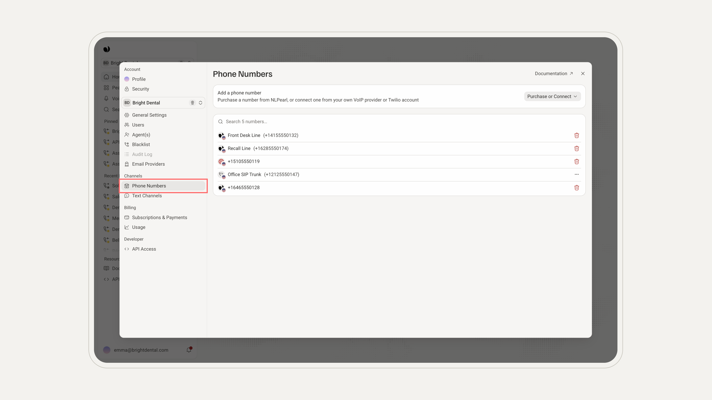</Frame>

<Frame>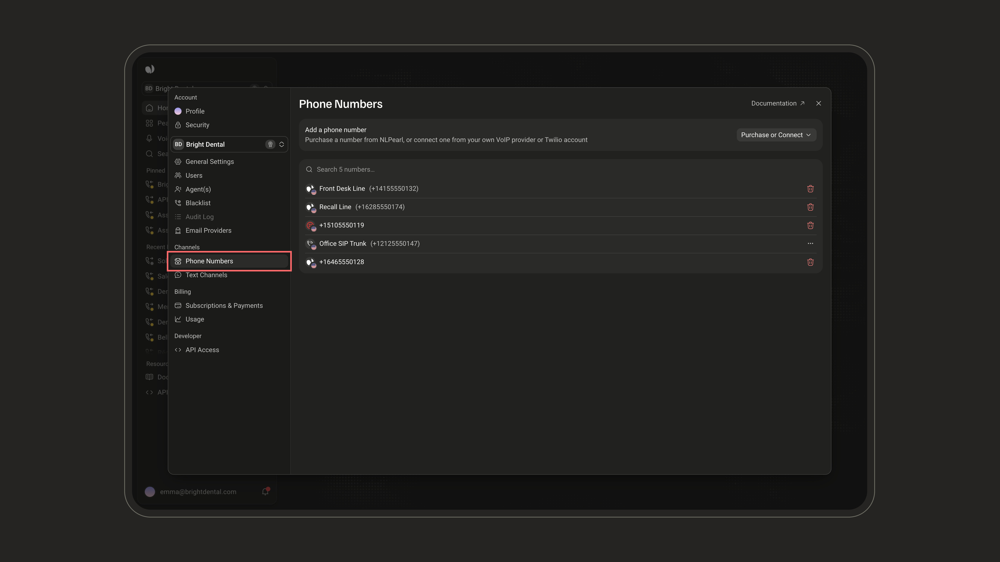</Frame>

</Step>

<Step title="Open the Twilio Connection">

Click **Purchase or Connect** at the top right of the list, then choose **Connect to Twilio**.

<Frame>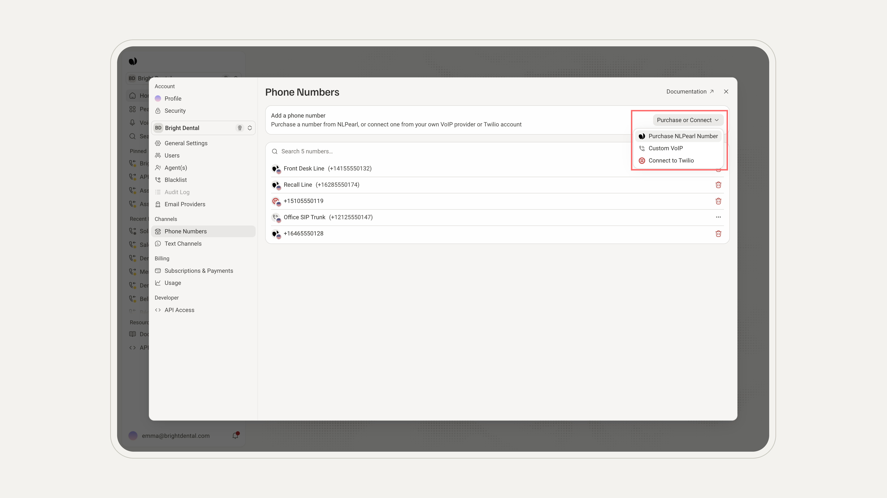</Frame>

<Frame>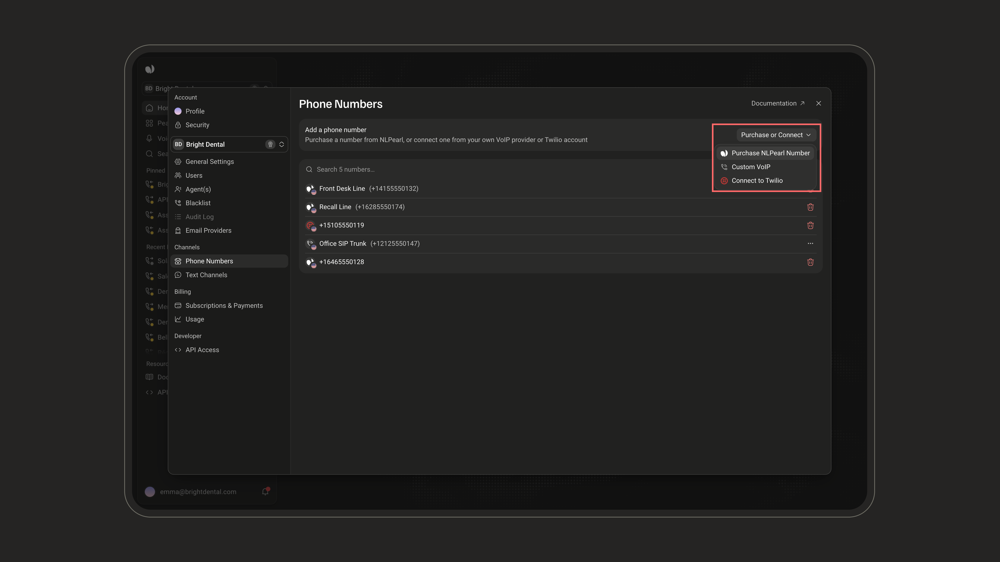</Frame>

</Step>

<Step title="Enter Your Twilio Credentials">

The **Connect your Twilio account** window opens. On the left, choose how you connect: **With API credentials** or **With Account SID + Auth token**. The steps below your choice walk you through each value, with shortcuts to the right pages of your Twilio Console.

Fill in the **Twilio credentials** on the right, then click **Connect Twilio**.

<Tabs>

<Tab title="API Credentials (recommended)">

The most secure option. It uses a scoped API key instead of your main Auth Token.

| Field | What to enter |
|-------|---------------|
| **Account SID** | Your Account SID (it starts with `AC`), from **Account Info** in your Twilio Console. |
| **Auth token or API key secret** | The API key's **Secret**. |
| **API key SID** | The API key's **SID** (it starts with `SK`). |

<Frame>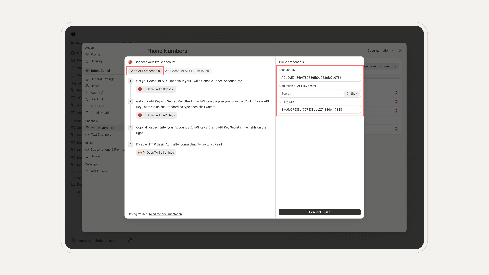</Frame>

<Frame>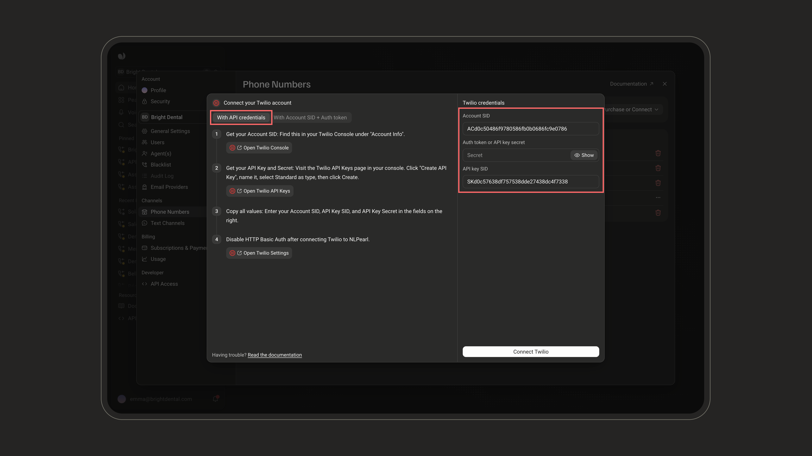</Frame>

<Note>
**How to generate a Twilio API Key**

<Steps>
<Step title="Go to Twilio API Keys Settings">
Visit the [Twilio API Keys page](https://www.twilio.com/console/project/api-keys) in your console, then click **Create API Key** in the top-right corner.

<Frame>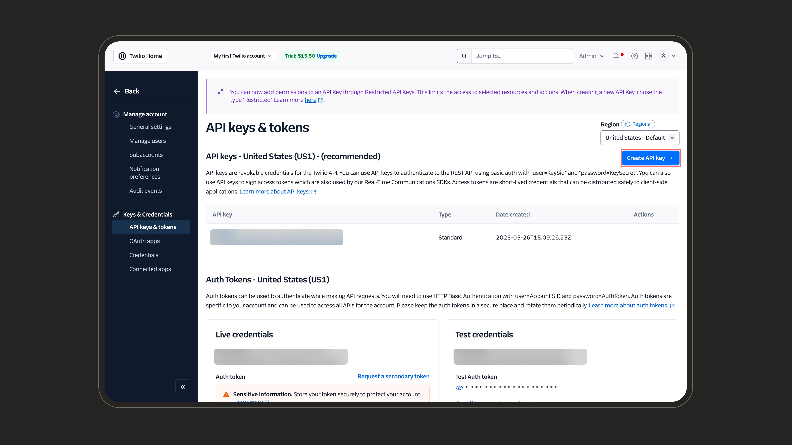</Frame>

<Frame></Frame>

</Step>

<Step title="Select Standard Key Type">
Give your key a name and select **Standard** as the key type. Then click **Create**.

NLPearl needs a **Standard** key: a **Restricted** key is refused when you connect.

<Frame>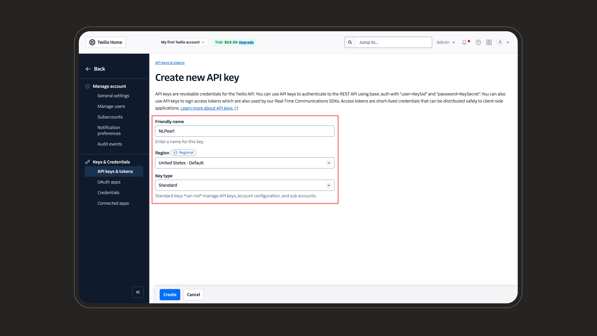</Frame>

<Frame></Frame>

</Step>

<Step title="Copy the SID and Secret">
Twilio now displays both the **SID** and the **Secret**.

<Warning>
The **Secret** is shown only once, so copy and store it somewhere safe before closing the page.
</Warning>

<Frame>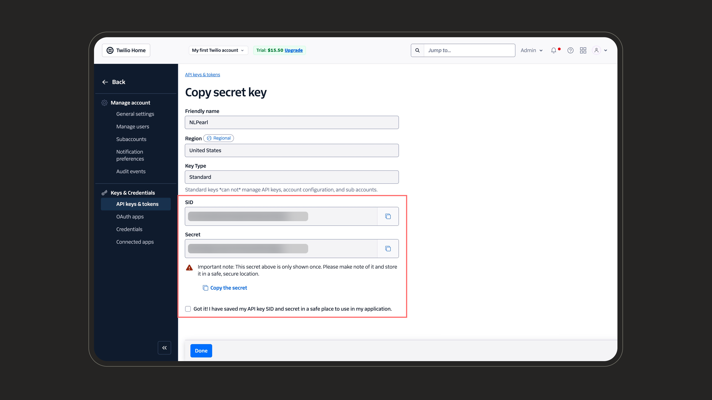</Frame>

<Frame></Frame>

</Step>
</Steps>
</Note>

</Tab>

<Tab title="Account SID + Auth Token">

The simplest option. Connect directly with your main Twilio credentials.

| Field | What to enter |
|-------|---------------|
| **Account SID** | Your Account SID (it starts with `AC`), from **Account Info** in your Twilio Console. |
| **Auth token or API key secret** | Your **Auth Token**, from **Account Info** (click **Show** to reveal it). |
| **API key SID** | Leave it empty. |

<Frame>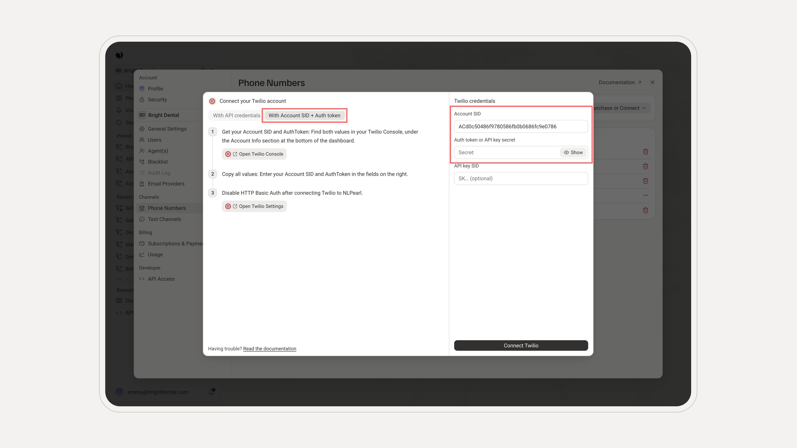</Frame>

<Frame>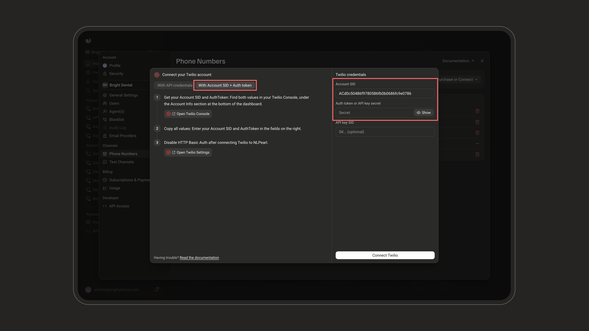</Frame>

<Note>
Both values live in the **Account Info** panel on your Twilio Console dashboard.

<Frame>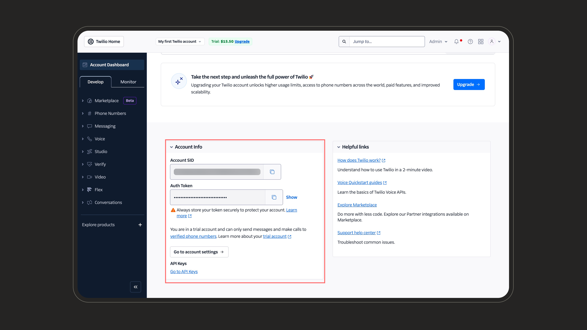</Frame>

<Frame></Frame>

</Note>

</Tab>

</Tabs>

NLPearl checks your credentials with Twilio before saving them. If Twilio refuses them, nothing is saved: correct the values and click **Connect Twilio** again.

<Tip>
Use the **Open Twilio Console** and **Open Twilio API Keys** shortcuts inside the window to jump straight to the right Twilio pages while filling in your credentials.
</Tip>

</Step>

<Step title="Import Your Twilio Phone Numbers">

Once connected, the **Twilio account** window lists the numbers of your Twilio account, whatever their country.

Click **Add to account** next to a number to import it. It appears in your **Phone Numbers** list right away. **Remove** takes an imported number back out of NLPearl (see [Deleting Phone Numbers](#deleting-phone-numbers)).

<Frame>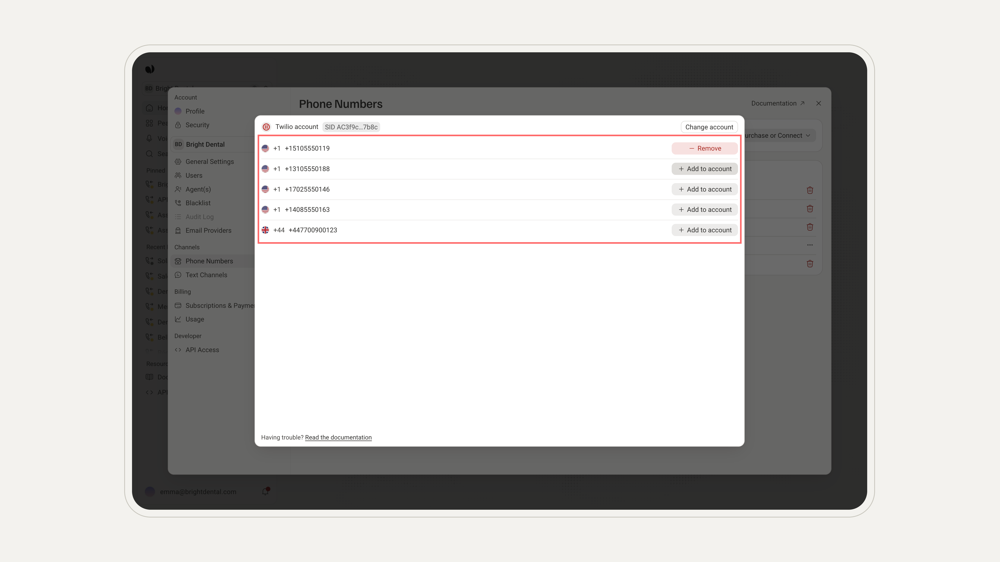</Frame>

<Frame>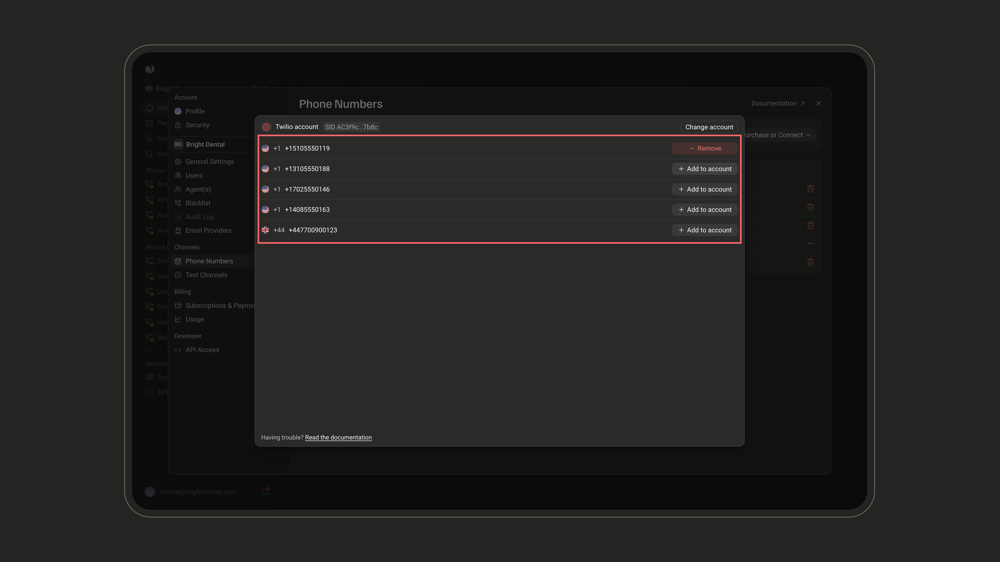</Frame>

<Info>
You can come back to this window at any time (**Purchase or Connect → Connect to Twilio**) to import numbers you add to your Twilio account later.
</Info>

</Step>

<Step title="Assign the Number to a Pearl">

Open the Pearl that should use the number, inbound or outbound, and click **Settings** at the top right of its page. In the **Phone Number** row, click the current number (or **Choose a number**): your imported numbers are listed under **Twilio**. Pick one, and it is saved right away.

<Frame>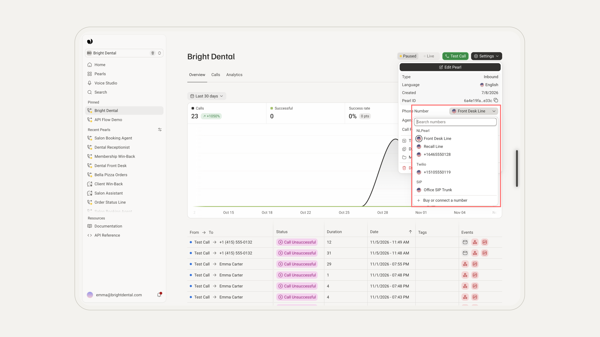</Frame>

<Frame>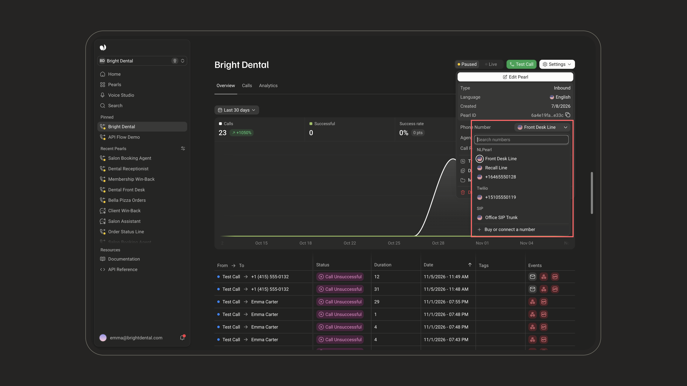</Frame>

<Warning>
When an inbound Pearl starts on a Twilio number, NLPearl sets the number's **Voice URL** in Twilio (along with its status callback and friendly name) so that calls reach your Pearl. Using the number as an SMS text channel sets its **SMS URL** the same way. Don't use the number in another Twilio application at the same time.
</Warning>

</Step>

<Step title="Manage or Switch Twilio Accounts">

The **Twilio account** window shows the connected account's **SID** at the top, so you always know which account is in use.

To connect a different Twilio account, click **Change account**, then confirm in the **Connect another Twilio account?** window. Enter the new credentials: they replace the account connected now.

<Frame>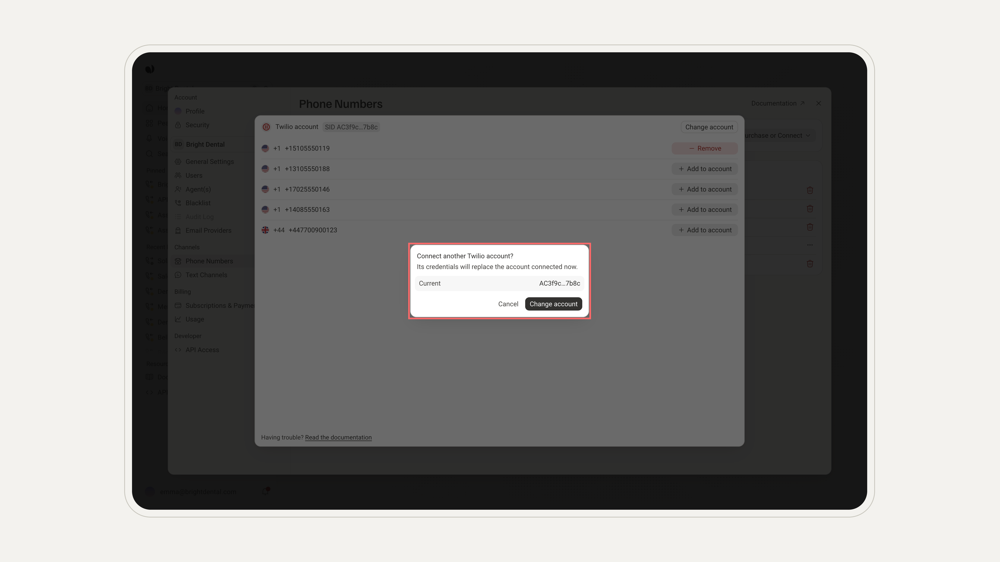</Frame>

<Frame>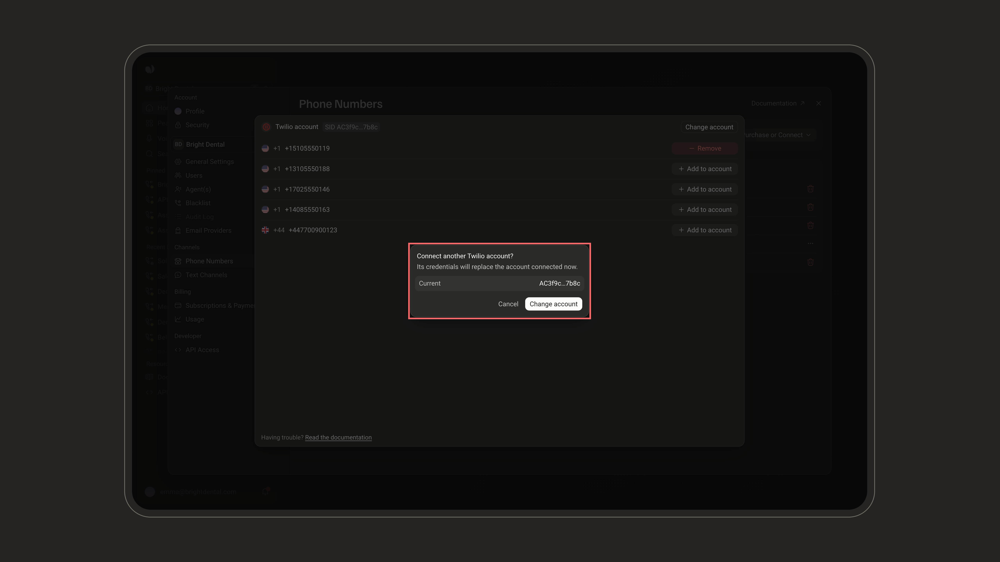</Frame>

<Info>
Numbers you already imported keep their own credentials: switching Twilio accounts doesn't affect them, as long as those credentials stay valid in Twilio. The window only lists the numbers of the account connected now.
</Info>

</Step>
</Steps>

<Card title="Deleting Phone Numbers" icon="circle-info" iconType="light">

If you no longer need a Twilio number in NLPearl, you can remove it from your settings.

In **Settings → Phone Numbers**, click the **trash icon** at the end of the number's row. In the **Delete this number?** window, check the number and click **Delete number**.

<Frame>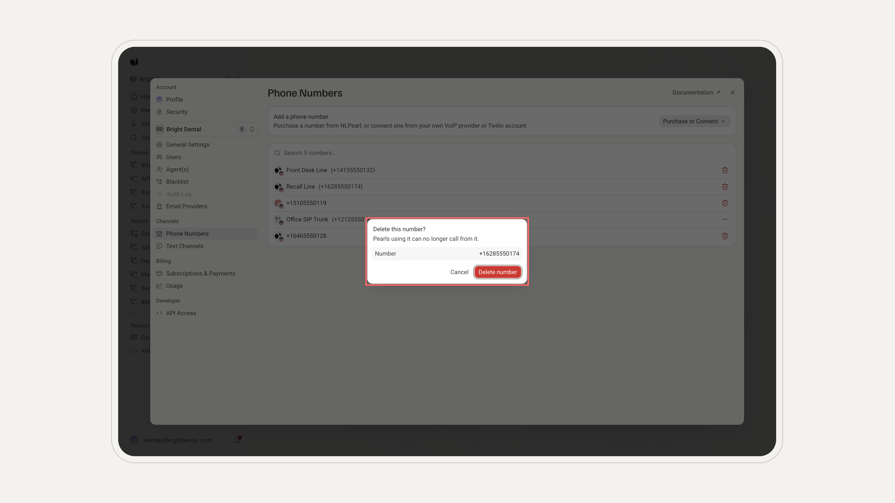</Frame>

<Frame>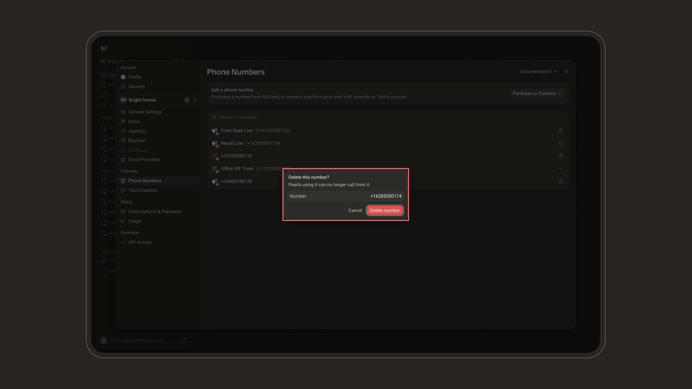</Frame>

The number is removed from NLPearl immediately. Pearls using it are paused, and your workspace's notification email receives the list of paused Pearls.

<Info>
Deleting a number from NLPearl does not delete it from your Twilio account: the number stays yours. Its **Voice URL** in Twilio still points to NLPearl, so update it in Twilio if you use the number elsewhere.
</Info>

</Card>
---

### Disabling HTTP Basic Authentication for Media Access

To ensure full functionality, disable HTTP Basic Authentication for media access in Twilio:

<Steps>

<Step title="Access Twilio Voice Settings">

Start by logging into your **Twilio dashboard**. In the left-hand navigation, click on **Voice** (1) to open the voice-related settings. Under the Voice section, select **Settings** (2), then click on **General** (3) to access the general voice configuration panel.

<Frame>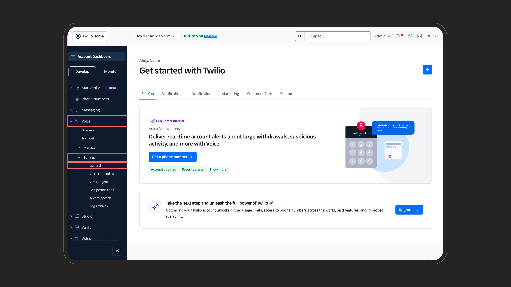 Settings > General in the Twilio Console" className="rounded-[14px]" /></Frame>

<Frame> Settings > General in the Twilio Console" className="rounded-[14px]" /></Frame>

</Step>

<Step title="Disable HTTP Basic Authentication in Twilio">
Once you're in the **Voice > General** settings, scroll down to the **HTTP Basic Authentication for media access** section.

Under this section, select **Disabled** to allow media URLs to be publicly accessible (1). Then, click the **Save** button at the bottom of the page (2) to apply your changes.

<Frame>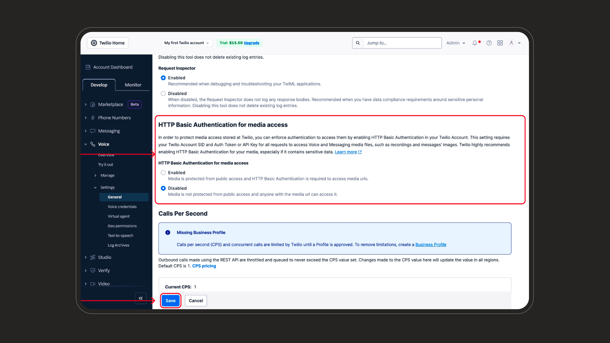</Frame>

<Frame></Frame>

<Note>
By disabling this setting, you ensure that NLPearl.AI can access and use media resources without authentication issues.
</Note>
</Step>
</Steps>

---
<Info>
### Advantages of Twilio Integration

- **Access to Global Phone Numbers**: Use phone numbers from countries not directly supported by NLPearl.AI by purchasing them through Twilio.

- **No Country Limit on Calls**: Unlike NLPearl numbers, a Twilio number can call and transfer to numbers in other countries, as far as your Twilio account allows.

- **Compliance with Country Regulations**: Twilio handles country-specific regulations, allowing you to purchase numbers that comply with local laws.

- **Leverage Existing Numbers**: Utilize the phone numbers you already own in Twilio without needing to acquire new ones.
</Info>

<Warning>
### Important Considerations

- **Phone Number Ownership**: Numbers are purchased and managed in your Twilio account. NLPearl.AI only lets you use them within the platform.

- **Billing**: NLPearl charges no monthly fee for Twilio numbers. Twilio bills you directly for the numbers, calls, and messages, and NLPearl charges its usual usage for your Pearls' calls.

- **Restricted Numbers**: If a number's Twilio credentials are revoked or no longer valid, the number shows **Restricted** in your Phone Numbers list and the Pearls using it are paused. Delete the number and import it again with valid credentials: connecting your account again is not enough.

- **Running Activities**: Deleting a number from NLPearl.AI pauses the Pearls that use it. Assign them another number first to avoid disruptions.
</Warning>

---

If you need assistance with the integration process or have questions about using Twilio phone numbers with NLPearl.AI, please refer to our support resources or contact our support team.

