

  <Frame>
    

      
    

  </Frame>

  <Frame>
    

      
    

  </Frame>

---

Use **Users & Workspaces** settings to control who can access your workspace, what each person is allowed to manage, and which workspace you are currently working in.

<CardGroup cols={2}>
  <Card title="Users" icon="user-plus">
    Invite team members and assign them the right access level.
  </Card>
  <Card title="Roles" icon="shield-check">
    Create reusable permission sets for different responsibilities.
  </Card>
  <Card title="Workspaces" icon="building">
    Switch between workspaces or create a new one.
  </Card>
  <Card title="Access control" icon="lock">
    Limit access to Pearls, billing, phone numbers, API keys, users, and audit logs.
  </Card>
</CardGroup>

---

# Users & Roles

Control who can access the current workspace and what each person is allowed to do.

## Managing Users

Open **Settings** from the profile menu at the bottom of the sidebar, then **Users** (under **Workspace**). Anyone with the **Manage users** permission can invite new members, review existing users, and update their access level.

<Frame>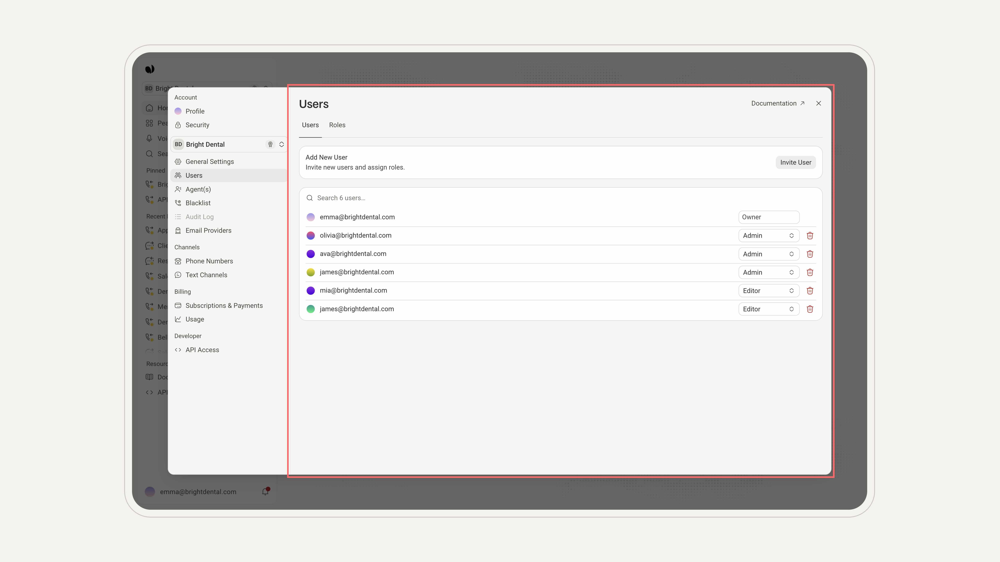</Frame>

<Frame>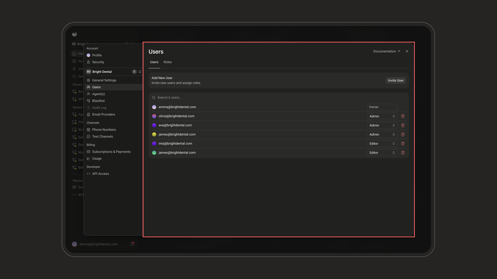</Frame>

<Steps>
  <Step title="Invite a user">
    Click **Invite User**. In the **Invite users** window, enter one or more addresses in **Emails**, choose a **Role**, then click **Invite**.

    
<Frame>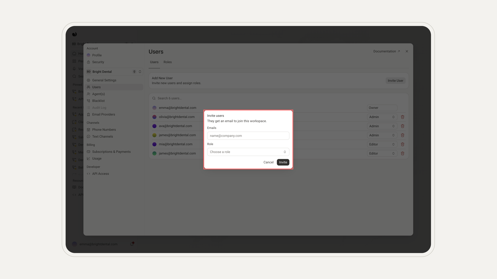</Frame>

    
<Frame>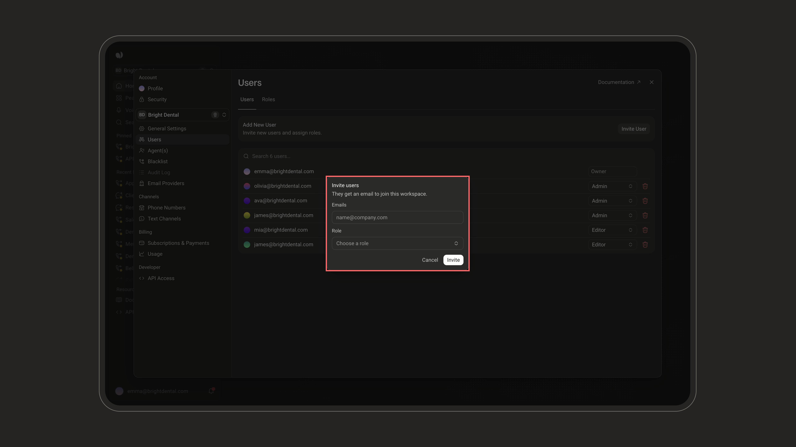</Frame>

    <Info>
      Inviting users requires a subscription: without one, the button reads **Upgrade**. Your plan sets how many users a workspace can have, and pending invitations count toward that limit.
    </Info>
  </Step>
  <Step title="Follow the invitation">
    Until it is accepted, the invitation shows as **Invitation pending** in the list, and you can cancel it from its row. The invited person accepts or declines it from their workspace switcher (see [Switching Workspaces](#switching-workspaces)).
  </Step>
  <Step title="Review access">
    Change a member's role from the role list on their row. The workspace owner is marked **Owner**: that label is fixed, and the owner can't be removed. To remove a member, click the trash icon on their row, then **Delete user** to confirm.
  </Step>
</Steps>

<Note>
  Give users the minimum access they need for their work. You can always update their role later as responsibilities change. Both lists have a search field.
</Note>

---

## Managing Roles

Roles define what users are allowed to do in a workspace. You can use roles to separate responsibilities between admins, operators, support teams, billing teams, and other internal workflows.

To manage roles, open **Settings → Users**, then the **Roles** tab.

<Frame>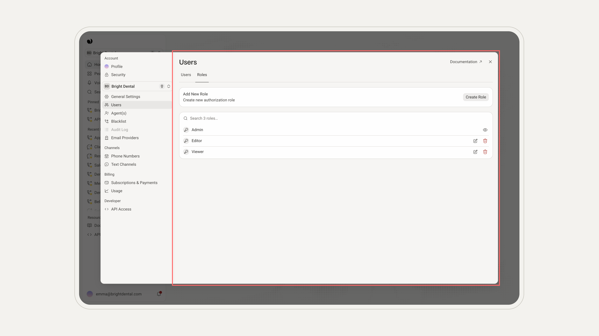</Frame>

<Frame>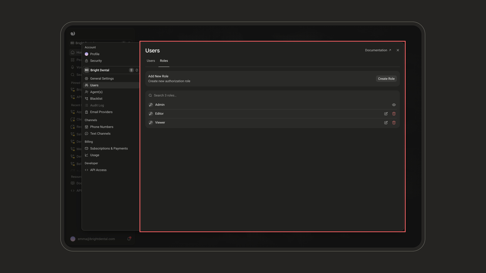</Frame>

<Steps>
  <Step title="Create a role">
    In **Add New Role** (*Create new authorization role*), click **Create Role** and enter a clear role name.
  </Step>
  <Step title="Select permissions">
    Tick the actions the role should allow.

    
<Frame>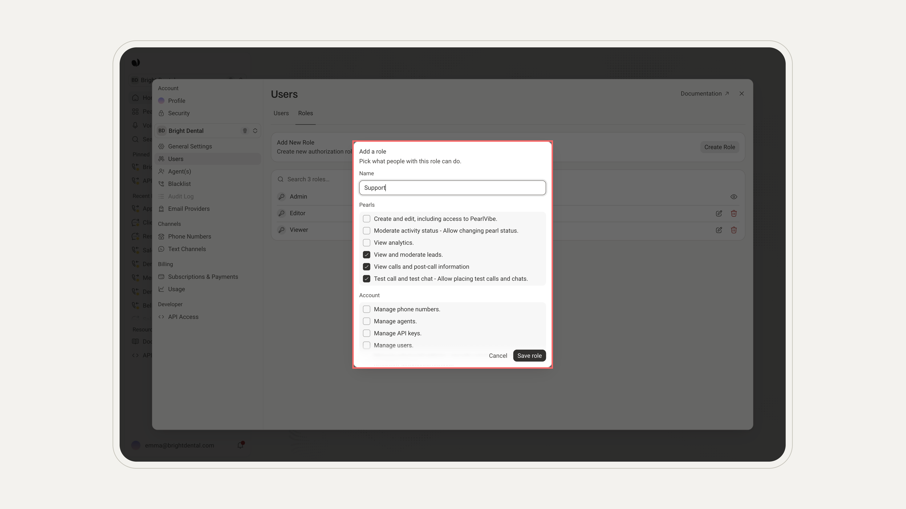</Frame>

    
<Frame>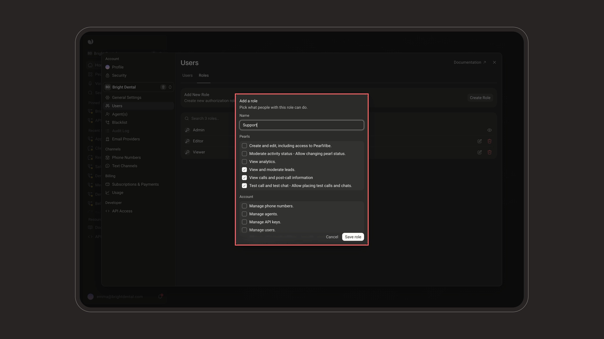</Frame>

  </Step>
  <Step title="Save the role">
    Click **Save role** to make the role available when inviting or updating users.
  </Step>
</Steps>

Your own roles can be edited (pencil) or deleted (trash). Deleting a role asks you which role to **move** its members to. The built-in roles can't be changed: the eye icon opens them read-only.

The permissions are grouped as follows:

| Group | Permission |
|------|----------------|
| **Pearls** | Create and edit, including access to PearlVibe. |
| | Moderate activity status: allow changing a Pearl's status. |
| | View analytics. |
| | View and moderate leads. |
| | View calls and post-call information. |
| | Test call and test chat: allow placing test calls and chats. |
| **Account** | Manage phone numbers. |
| | Manage agents. |
| | Manage API keys. |
| | Manage users. |
| | Manage advanced settings: security, sessions, blacklist, email providers, workspace settings. |
| | View audit log. |
| **TTS** | Access Voice Studio: clone voices and generate speech. |
| **Billing** | Manage account billing. |
| | View usage: credits and minutes consumption. |

<Tip>
  Create role names that match real responsibilities, such as `Support`, `Operations`, `Billing`, or `Admin`.
</Tip>

---

# Workspaces

A **workspace** is an isolated environment with its own Pearls, activities, settings, billing, users, and logs. Use workspaces to separate teams, customers, or projects. Everything above (users and roles) is scoped to the workspace you are currently in.

The **Settings** window groups its pages as follows:

- **Account** (**Profile**, **Security**): personal to you, they follow you across every workspace.
- **Workspace** (General Settings, Users, Agent(s), Blacklist, Audit Log, Email Providers), **Channels** (Phone Numbers, Text Channels), **Billing** (Subscriptions & Payments, Usage), and **Developer** (API Access): they apply **only to the workspace you are currently in**. The workspace's name heads the Workspace group.

<Frame>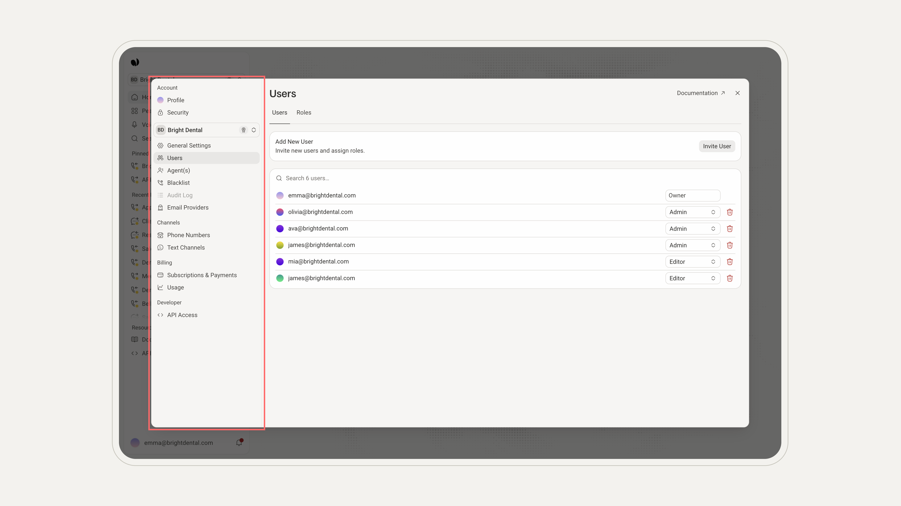</Frame>

<Frame>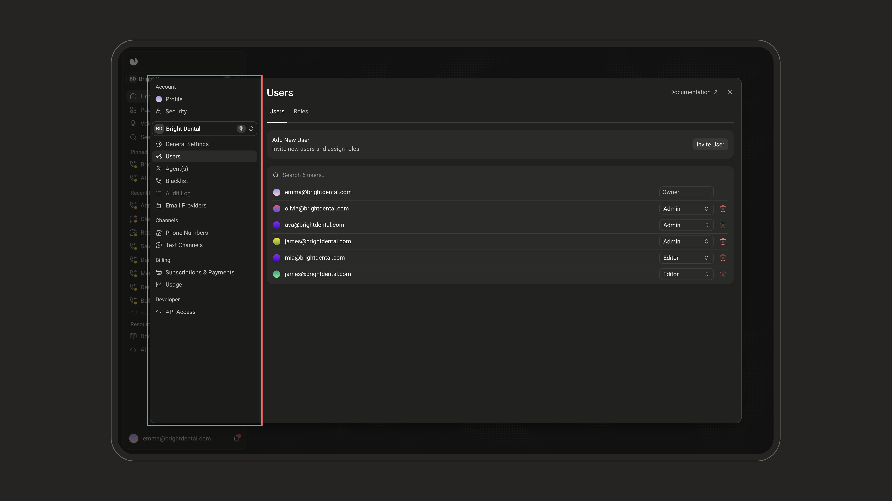</Frame>

<Note>
  When you switch workspaces, every workspace setting changes to reflect the selected workspace. Your **Account** settings stay the same.
</Note>

---

## General Settings

The **General Settings** page manages your workspace identity, notifications, and security preferences. Changing them requires the **Manage advanced settings** permission.

<Frame>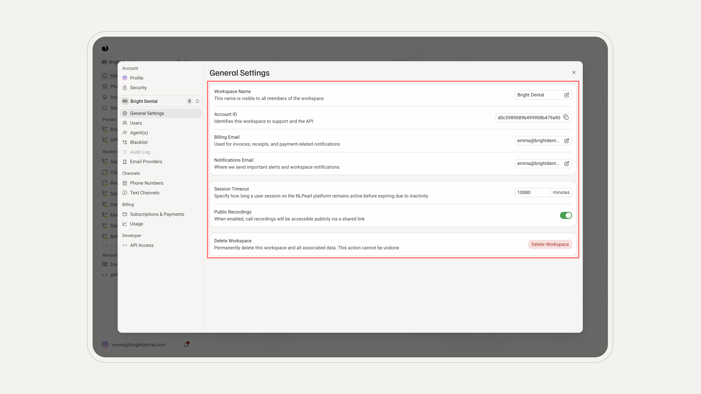</Frame>

<Frame>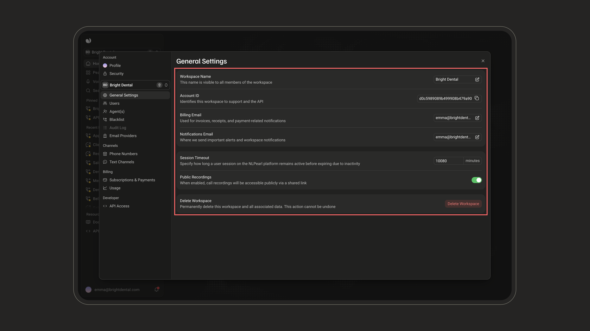</Frame>

| Setting | Description |
|---------|-------------|
| **Workspace Name** | The name visible to all members of the workspace, up to 15 characters. |
| **Account ID** | The workspace's identifier, with a copy button. |
| **Billing Email** | Email used for invoices, receipts, and payment-related notifications. |
| **Notifications Email** | Email where important alerts and workspace notifications are sent. |
| **Session Timeout** | How long a session on the platform stays active before expiring due to inactivity, from 30 to 10,080 minutes. |
| **Public Recordings** | When enabled, call recordings are accessible publicly via a shared link. |
| **Delete Workspace** | *Owner only.* Permanently delete the workspace and all associated data: you type the workspace's name to confirm. Members see **Leave Workspace** instead. |

<Warning>
  Deleting a workspace is permanent and cannot be undone. All associated data is removed.
</Warning>

<Note>
  The newsletter subscription is no longer here: manage it from your **Profile**.
</Note>

---

## Creating a New Workspace

You can create a separate workspace when you need to isolate teams, customers, projects, or billing.

<Frame>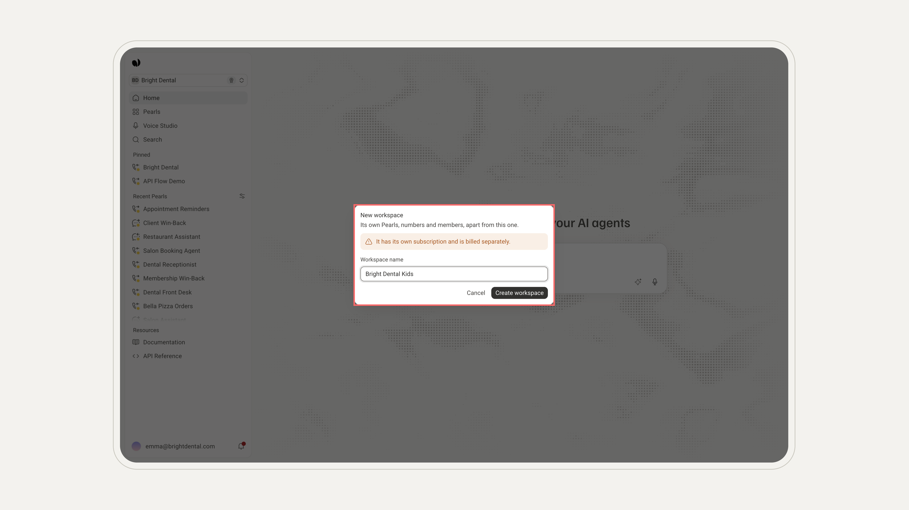</Frame>

<Frame>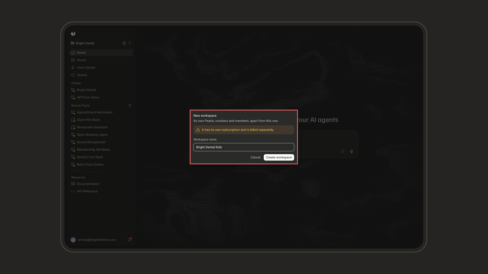</Frame>

<Steps>
  <Step title="Open the workspace menu">
    Click the current workspace name in the sidebar.
  </Step>
  <Step title="Create the workspace">
    Click **New workspace**, enter a **Workspace name** (up to 25 characters), then click **Create workspace**. You are switched to it right away.
  </Step>
</Steps>

<Warning>
  A new workspace has its own subscription and is billed separately. To create one, you need to own a workspace with a paid plan (or own none yet).
</Warning>

---

## Switching Workspaces

If your account belongs to multiple workspaces, use the workspace switcher to move between them. The selected workspace controls which Pearls, activities, settings, billing, users, and logs you are viewing.

<Frame>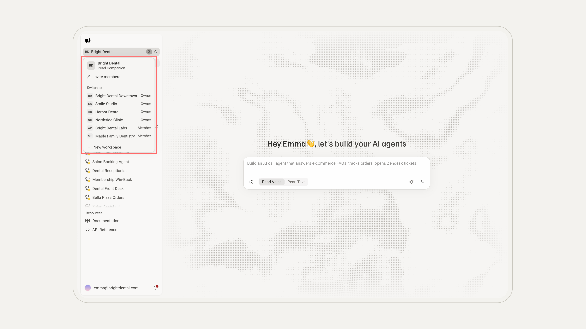</Frame>

<Frame>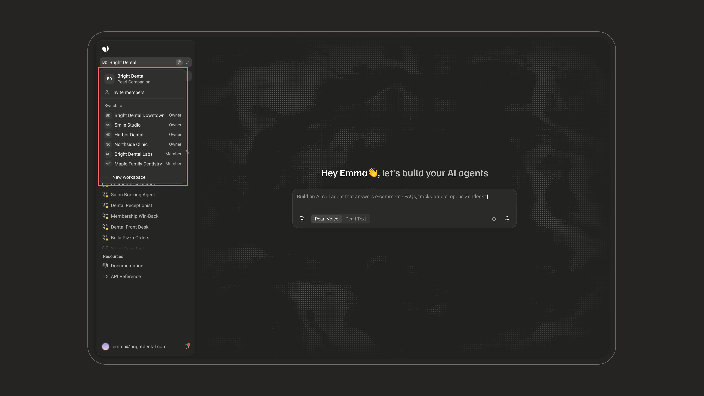</Frame>

<Steps>
  <Step title="Open the workspace menu">
    Click the workspace name in the platform sidebar.
  </Step>
  <Step title="Choose a workspace">
    Under **Switch to**, select the workspace you want to manage. Each one shows whether you are its **Owner** or a **Member**.
  </Step>
</Steps>

The same menu lists the invitations you received, to accept or decline, and offers **Invite members** and **New workspace**. You can also switch workspace from the search, in its **Switch account** group.

---

## Transferring a Pearl to Another Workspace

You can send a copy of a Pearl to another workspace you belong to - useful when you build agents in a test workspace before moving them to production, or manage several customers from a single account.

<Steps>
  <Step title="Open the transfer dialog">
    On the Pearl's page, open the **Settings** menu and click **Transfer Pearl**. The same option is available from the Pearls list.
  </Step>
  <Step title="Choose the version to transfer">
    Select which version of the Pearl to send, then click **Continue**. It becomes **version 1** of the new Pearl in the destination workspace.

    
<Frame>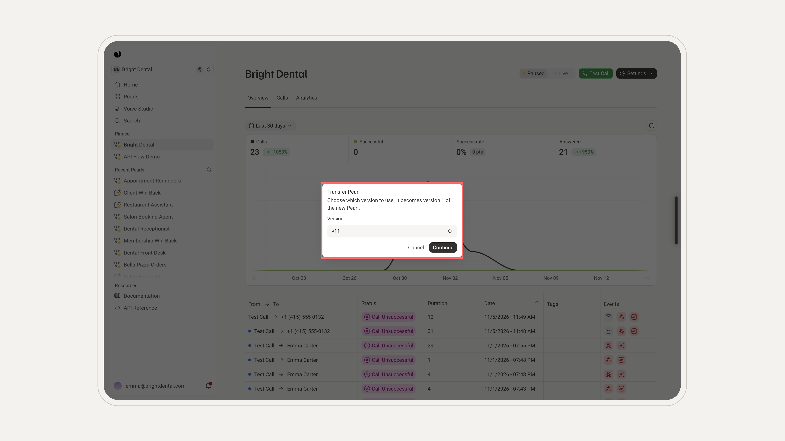</Frame>

    
<Frame>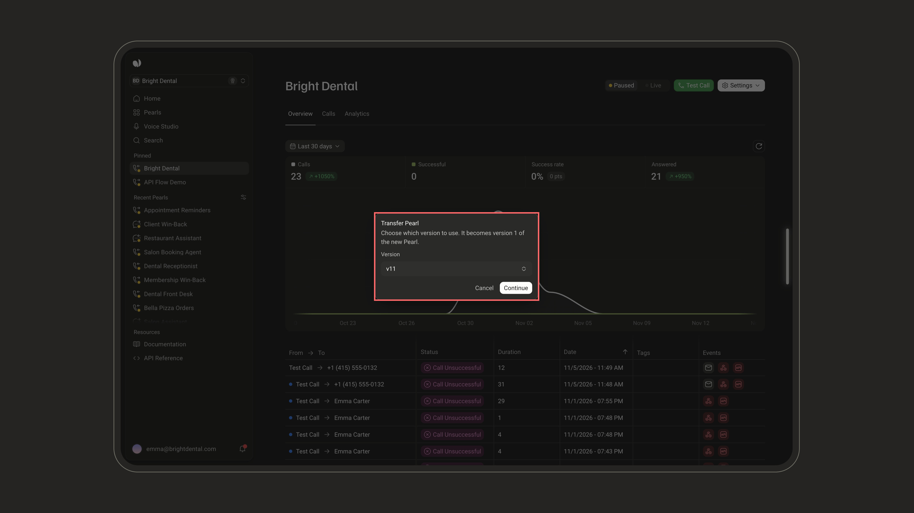</Frame>

  </Step>
  <Step title="Pick the destination">
    Select one or more workspaces, then click **Transfer**.

    
<Frame>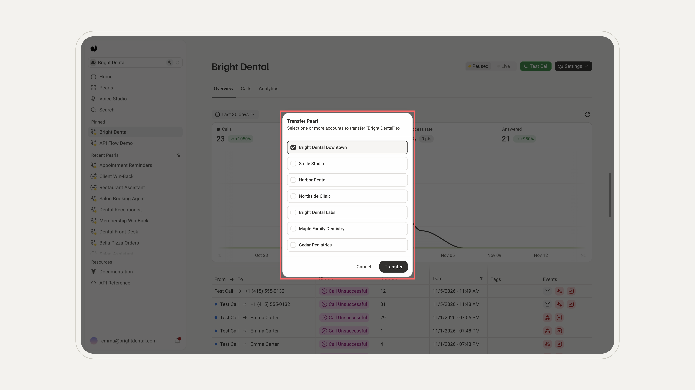</Frame>

    
<Frame>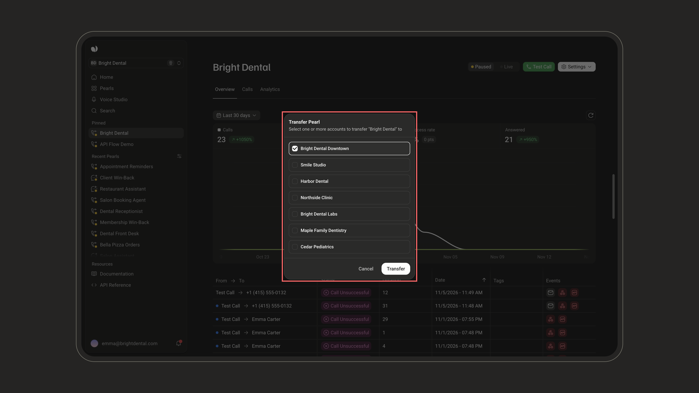</Frame>

  </Step>
</Steps>

The option appears when you belong to at least two workspaces and can **create and edit** Pearls. You must be an active member of each destination, and each destination's plan must have room for one more Pearl.

The Pearl is **copied, not moved**: the original stays in the current workspace, untouched and still running. The copy arrives as a **draft** named after the original with *- Transfered* at the end, with a clean slate - no calls, conversations, leads, or usage history follows it - so you can review it and publish it when ready. It starts with **one agent**, and a custom hold sound is reset to the default.

<Warning>
  Phone numbers and text channels are not transferred. Before going live, assign the copy a phone number or text channel that belongs to the destination workspace.
</Warning>

<CardGroup cols={2}>
  <Card title="Account Security Settings" icon="lock" href="/pages/security">
    Configure session timeout, audit logs, 2FA, and enterprise SSO.
  </Card>
  <Card title="Billing" icon="wallet" href="/pages/billing">
    Manage subscriptions, payment methods, invoices, and auto-recharge.
  </Card>
</CardGroup>
