<div className="block dark:hidden">
  <Frame>
    <div className="p-1">
      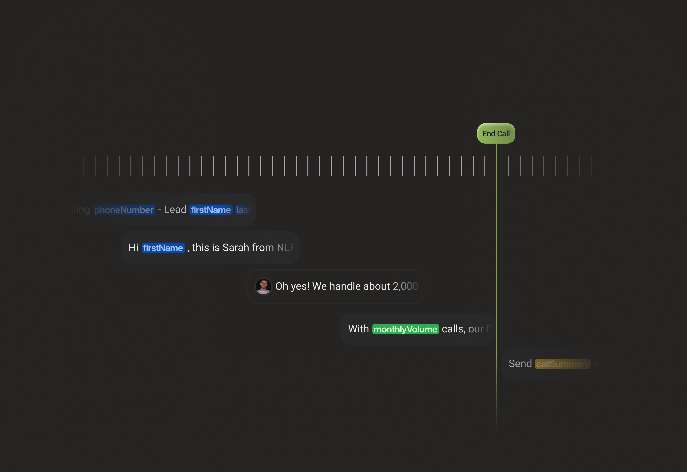
    </div>
  </Frame>
</div>

<div className="hidden dark:block">
  <Frame>
    <div className="p-1">
      
    </div>
  </Frame>
</div>

---

## Introduction

Variables are placeholders that hold data during a conversation. They hold information such as:

- **Customer data**: details you know before the conversation, from your CRM, a lead file, or an API (e.g. a name, a membership level).
- **Collected answers**: details Pearl gathers from the customer during the conversation (e.g. a preferred day, an email address).
- **Call results**: details produced once the conversation ends (e.g. the summary, the transcript).
- **Fixed settings**: values that stay the same for a whole version of your Pearl (e.g. an API base URL).

<Check>
  <b>Why Are Variables Important?</b>

- **Personalize Interactions**: Tailor conversations to each customer.
- **Control Conversation Flow**: Branch the conversation based on what you know or what Pearl collected.
- **Store and Reuse Information**: Keep track of data throughout the conversation for consistency.
- **Integrate with External Systems**: Send collected data to your tools, and pull data from them.
- **Enhance Actions**: Use variables in actions like personalized emails, SMS, or API requests.
</Check>

---

## Variable Manager Overview

Variables are managed in the **Variables & credentials** dialog of the Pearl editor, shared by the whole Pearl. Its **Variables** section lists every variable with its **Name**, its **ID**, and its group; **Credentials** holds the keys your API requests sign in with (see [API node](/pages/api_action#credentials-authentication)).

<div className="block dark:hidden"><Frame>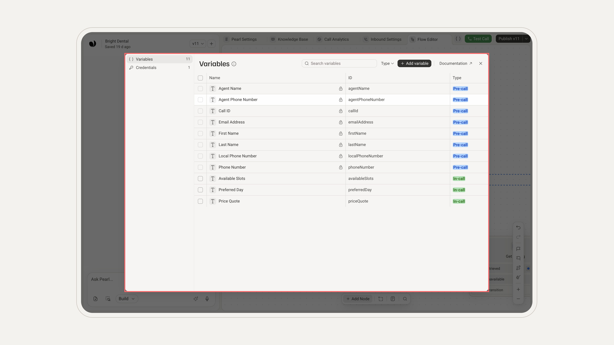</Frame></div>
<div className="hidden dark:block"><Frame>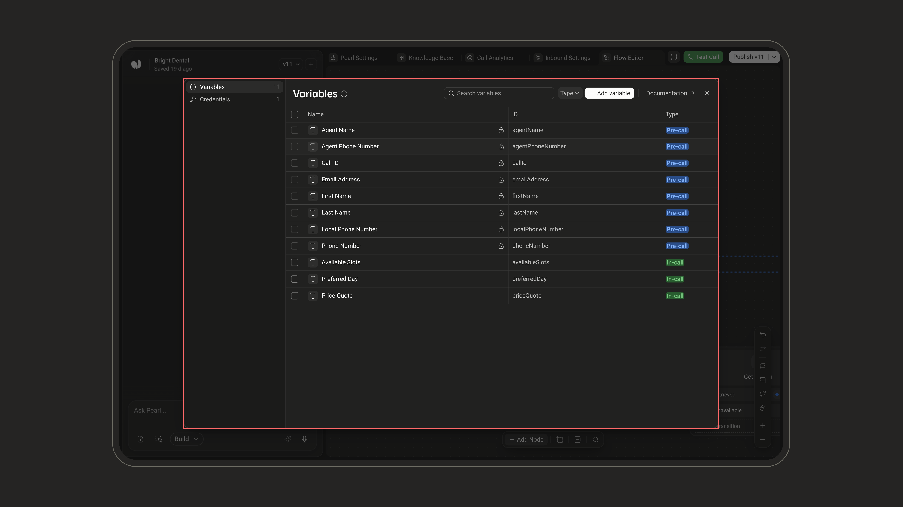</Frame></div>

Variables belong to one of four groups, each with its own colour in the editor:

| Group | Description | Colour |
| --- | --- | --- |
| **Pre-call** | Data known before the conversation starts, such as customer information, set from a lead file, the API, or the call itself. | Blue |
| **In-call** (Collected in-call) | Data Pearl collects during the conversation, based on what the customer says. | Green |
| **Post-call** | Data produced once the conversation ends, such as the summary, the transcript, or the recording. | Yellow |
| **Environment** | A fixed value of the Pearl version, such as an API base URL or an account ID, filled in everywhere before each call. | Teal |

<Warning>
**Post-call variables** are predefined by the platform: they can't be created or modified, and they're available only in **Post-Call Actions**, to send structured data (summaries, recordings) to your tools after the conversation.
</Warning>

Some variables are **built in**: they're listed first with a lock, set by the platform on every call. You can use them, not edit or delete them.

| Group | Built-in variables |
| --- | --- |
| **Pre-call** | Agent Name, Agent Phone Number, Call ID, Email Address, First Name, Last Name, Local Phone Number, Phone Number |
| **Post-call** | Call Time, Summary, Recording, Duration, Transcript, Indicator Tags, Sentiment Analysis |

<Warning>
**Agent Phone Number** (`agentPhoneNumber`) contains the Pearl's own phone line for the current conversation, unlike **Phone Number**, which identifies the customer. It is empty on channels without a phone number, including Telegram and browser Test Chat. An API node that requires it as an input doesn't run while it's empty.
</Warning>

#### Accessing the Variable Manager

<Steps>
<Step title="From the editor header">
Click the `{ }` button (**Variables & credentials**) in the header of the Pearl editor.

<div className="block dark:hidden"><Frame>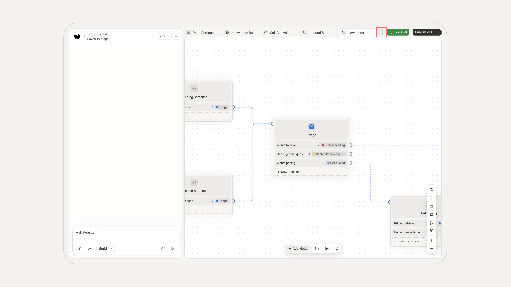</Frame></div>
<div className="hidden dark:block"><Frame>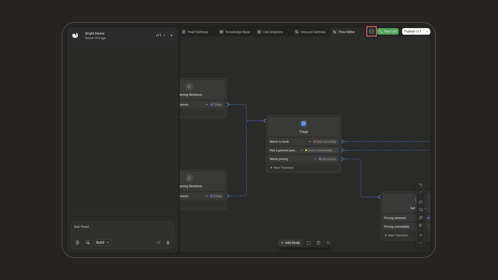</Frame></div>
</Step>

<Step title="From a field">
In any field that accepts variables, click **Variable** (or the `{ }` button) to open the list of variables, grouped by **Pre-call**, **Collected in-call**, **Post-call**, **Credentials**, and **Environment**, with a search. Pick one to insert it, or click **Manage Variables** at the bottom to open the dialog.

<div className="block dark:hidden"><Frame>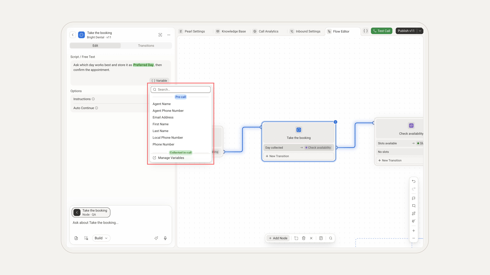</Frame></div>
<div className="hidden dark:block"><Frame>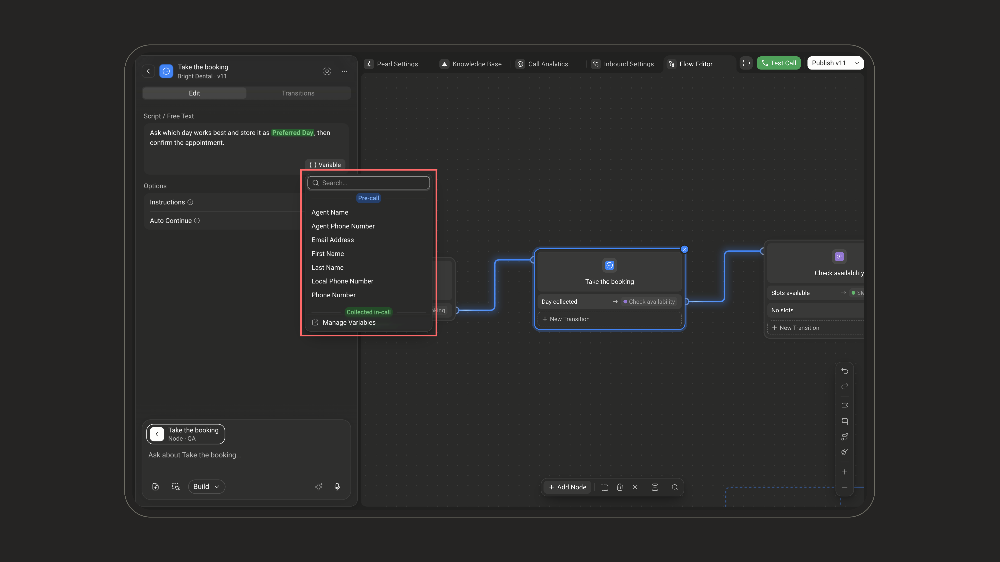</Frame></div>
</Step>
</Steps>

#### Creating and Managing Variables

<Steps>
<Step title="Add a variable">
In the **Variables** section, click **Add variable**, then pick its group at the top of the form: **Pre-call**, **In-call**, or **Environment**.
</Step>

<Step title="Fill in the variable details">

| Field | Description | Rules |
| --- | --- | --- |
| **Type** | The variable's data type (see the **Variable Types** table below). | Required |
| **Display name** | Human-readable label shown in the editor and used by Pearl (e.g. `Insurance Provider`). | Required · max 40 characters · letters, numbers, spaces |
| **ID** | Unique key used to reference the variable in flows, lead files, and API payloads. Filled in from the Display name while the variable is new, and editable. | Required · unique · max 40 characters · letters, numbers, `_`, `-` · no spaces · case-sensitive |
| **Description** _(optional)_ | What the variable holds, and when Pearl should fill it. For an in-call variable, this is what Pearl reads to know what to collect. | Optional · max 1,000 characters |

<div className="block dark:hidden"><Frame>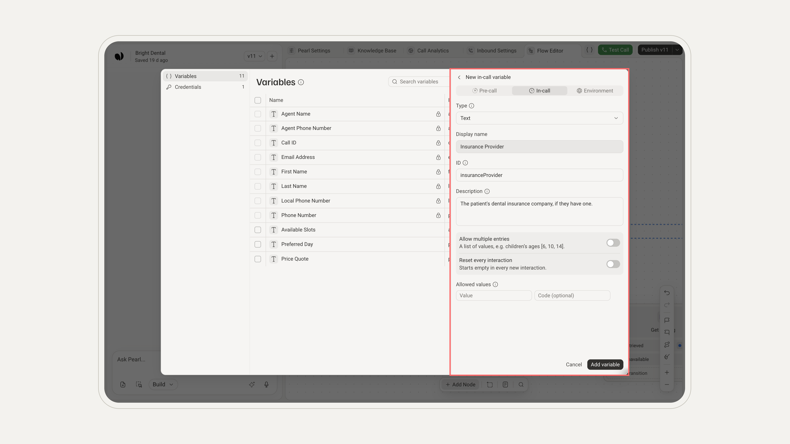</Frame></div>
<div className="hidden dark:block"><Frame>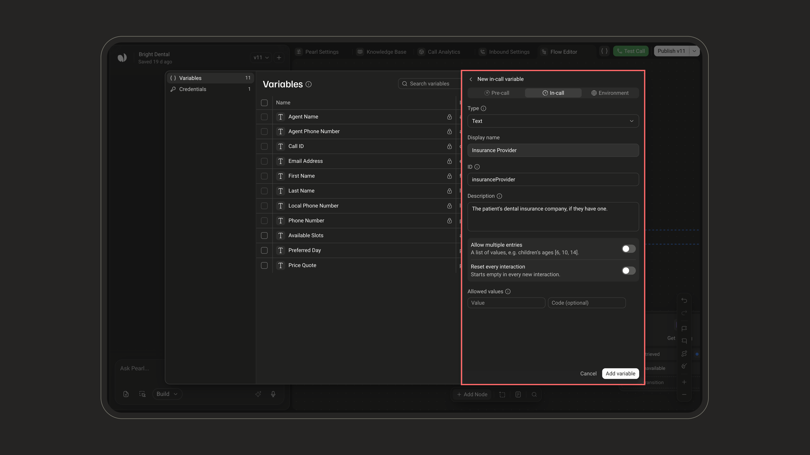</Frame></div>

<Tip>
**Display name vs ID**: the **Display name** is what you read and what Pearl says; the **ID** is the key the system uses everywhere else. When importing leads or calling the API, the column header or `callData` key must match the variable's **ID**, not its Display name.
</Tip>

**Variable Types**

| Type | Example |
| --- | --- |
| **Text** | a name, a plan |
| **Whole Number** | age, quantity |
| **Decimal Number** | an amount, a rate |
| **Boolean** | true / false |
| **Date** | a birth date |
| **Time** | an appointment time |
| **Date & Time** | a meeting slot |
</Step>

<Step title="Set the options (optional)">
- **Allow multiple entries**: store a list of values of the chosen type, e.g. children's ages `[6, 10, 14]`.
- **Reset every interaction**: start the variable empty in every new interaction instead of reusing the value from a previous one.

<div className="block dark:hidden"><Frame>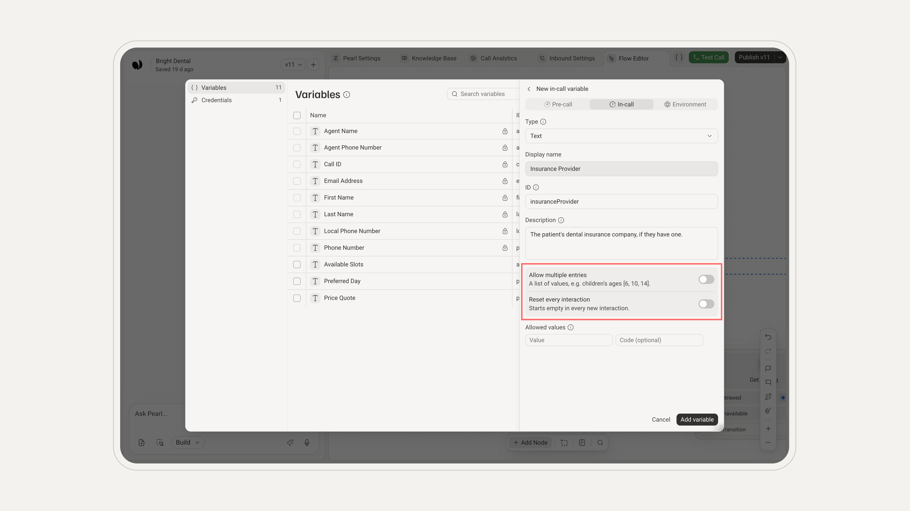</Frame></div>
<div className="hidden dark:block"><Frame>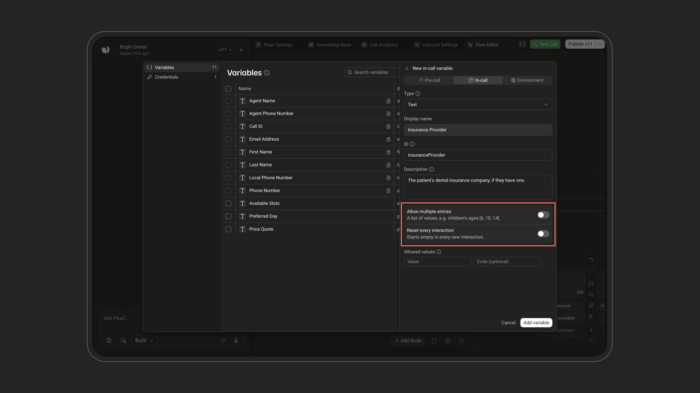</Frame></div>

<Warning>
**Reset every interaction** variables are never filled from lead files or the API: they're left out of the lead template, and values sent for them are ignored.
</Warning>
</Step>

<Step title="Define allowed values (optional)">
In **Allowed values**, list the accepted values, each with an optional **Code** sent to your systems instead of the value. Type in the empty row to add another one.

<div className="block dark:hidden"><Frame>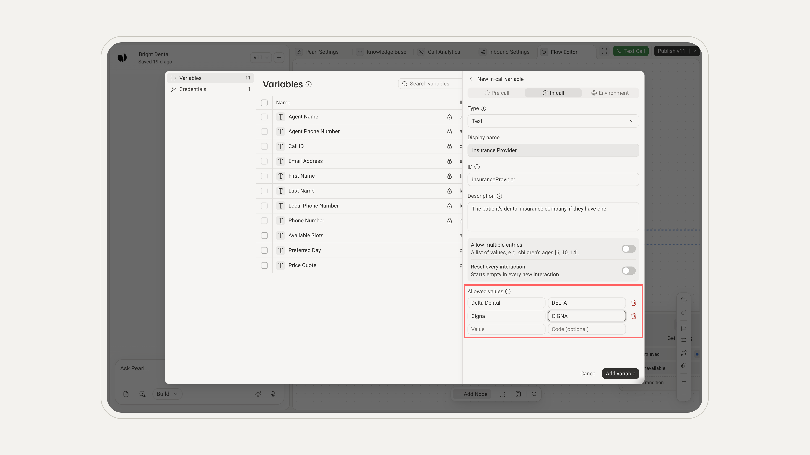</Frame></div>
<div className="hidden dark:block"><Frame>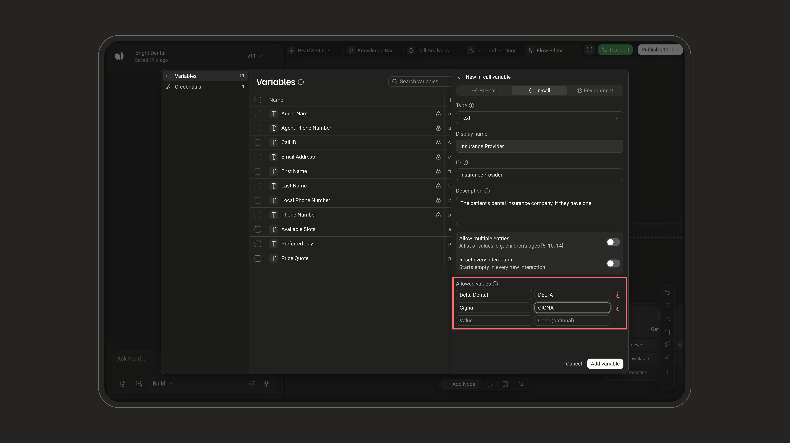</Frame></div>

<Info>
This is ideal for structured answers (e.g. `Issue Type`, `Region`). Pearl only picks from the list, and when a value has a code, the code is what's stored.
</Info>
</Step>

<Step title="Save the variable">
Click **Add variable**. It's now available in every field of your flow that supports variables.

<Info>
Some fields, like the **Opening Sentence**, accept only **Pre-call** and **Environment** variables.
</Info>
</Step>
</Steps>

**Environment variables**

An environment variable holds a fixed value of the Pearl version, such as an API base URL or an account ID. It has only a **Display name**, an **ID**, and a **Value** (required, up to 500 characters, and it can't contain another variable).

Before each call, the platform replaces the variable everywhere in the flow with its value: scripts, prompts, API URLs and headers, messages. Use one to change a value in a single place instead of in every node.

<div className="block dark:hidden"><Frame>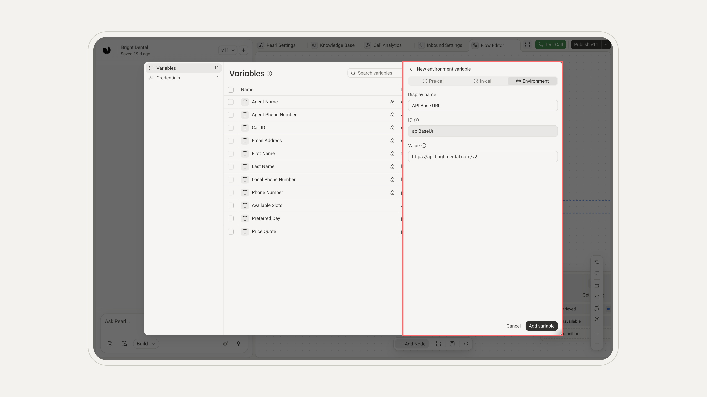</Frame></div>
<div className="hidden dark:block"><Frame>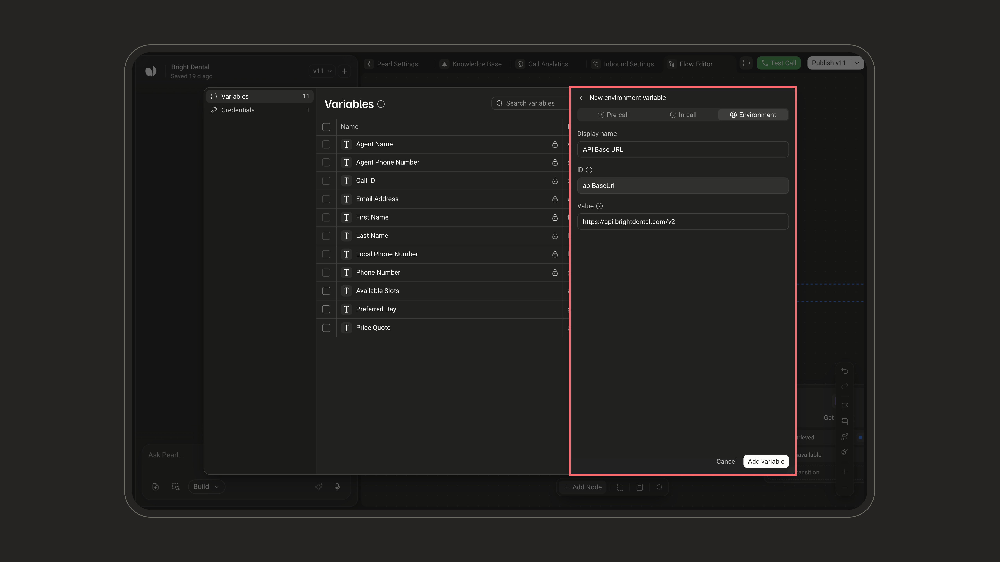</Frame></div>

<Note>
Environment variables can't receive an API response and aren't part of lead files. When you paste a version from another Pearl, this Pearl keeps its own values.
</Note>

<Card icon="circle-info" iconType="light">
  **Find, edit, and delete variables**

  - **Search**: type a name or an ID in **Search variables**, or filter the list by group with **Type**.
  - **Edit**: click a variable's row to open its form, change it, then click **Save**. Built-in variables can't be opened.
  - **Delete**: tick one or more rows, then click **Delete** in the bar that appears; or open a variable and choose **Delete variable** in its **…** menu. Nodes, actions, and prompts that use a deleted variable lose its value.

  <div className="block dark:hidden"><Frame>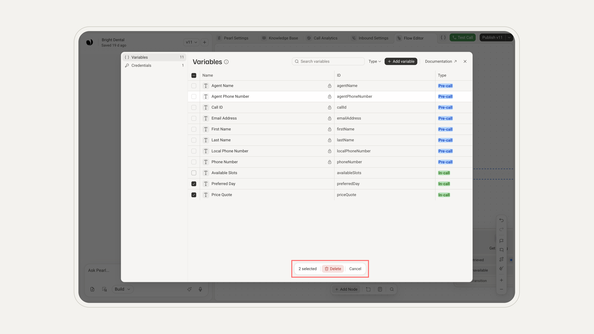</Frame></div>
  <div className="hidden dark:block"><Frame>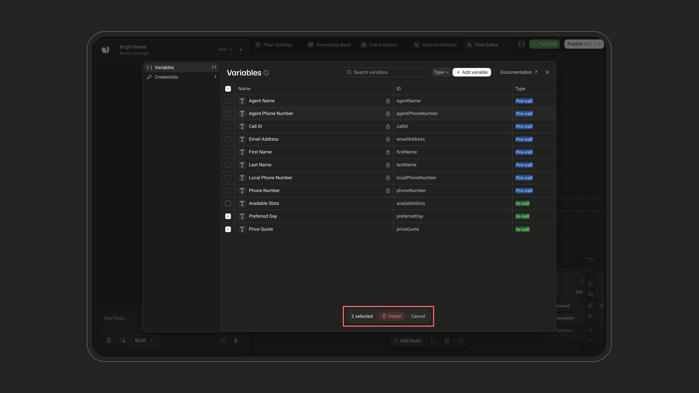</Frame></div>
</Card>

---

## Using Variables in Conversations

Insert a variable in any field that supports them with the **Variable** button: a node's script, an SMS or email, an API URL or body, a transition. It shows as a coloured chip in the field, and Pearl replaces it with its value during the conversation.

<Card title="Example">
In a Dialogue node's script: *"Hi `{firstName}`, which day works best for you?"* Pearl says *"Hi Jane, which day works best for you?"*.
</Card>

**How in-call variables are filled**: Pearl collects them during the conversation, guided by each variable's **Description**: describe what it holds and when to fill it. A new value replaces the previous one. Once the conversation ends, a pre-call or in-call variable that is still empty is filled from the transcript when possible.

<Card title="Example in an SMS Node">
In an SMS node's **SMS Content**: `Hi {firstName}, your appointment on {preferredDay} is confirmed.` The SMS is sent with the values Pearl has at that moment.
</Card>

<Card title="Example in a Post-Call Email">
In a post-call email, combine call results with collected data: `Summary of your call with {firstName}: {post_call_summary}`.
</Card>

---

## Implementing Conditional Logic with Variables

Each transition of a node is a condition written in plain language, and it can mention variables. Pearl reads the condition and decides which transition to follow, based on the conversation and the variables' values.

<div className="block dark:hidden"><Frame>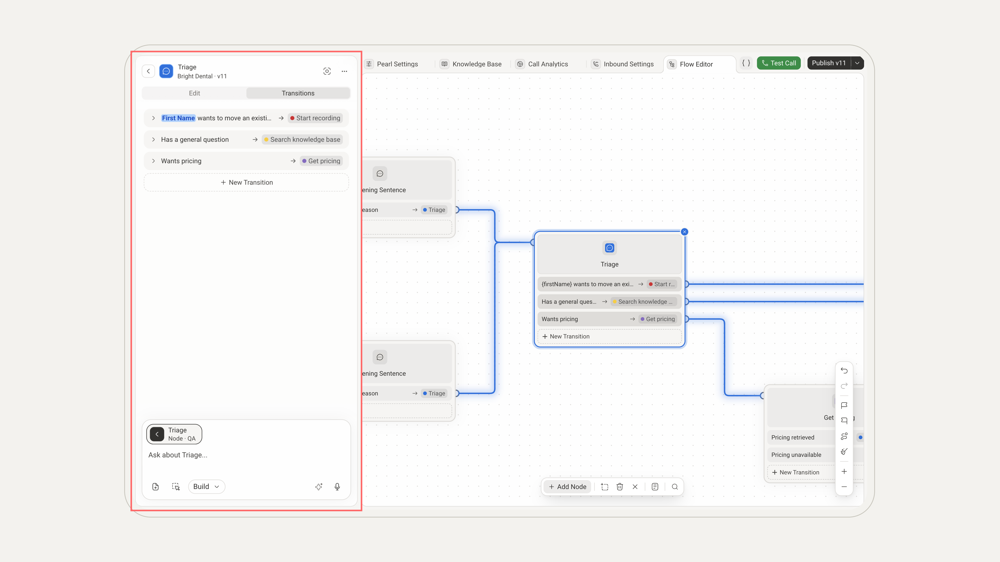</Frame></div>
<div className="hidden dark:block"><Frame>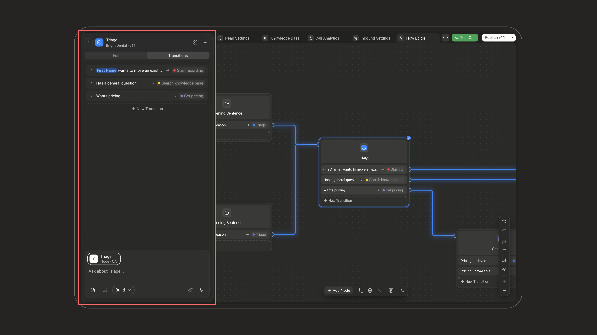</Frame></div>

<Card title="Example">
A survey node with two transitions:

- *"`{satisfactionScore}` is 4 or 5"* → a node thanking the customer.
- *"`{satisfactionScore}` is 3 or less"* → a node asking how to improve.
</Card>

---

## Populating Variables from External Data

Pre-call variables can be filled before the conversation, from a lead file, the API, or the call itself.

<Steps>
<Step title="Open the Leads tab">
On your Pearl's page, open the **Leads** tab (shown when outbound calling is on) and click **Add lead**.
</Step>

<Step title="Upload a file">
In **Upload files**, download the template your Pearl generates (**CSV template** or **XLSX template**), fill in your leads, and upload it back. The template holds only the variables your flow uses; keep its columns as they are.

<div className="block dark:hidden"><Frame>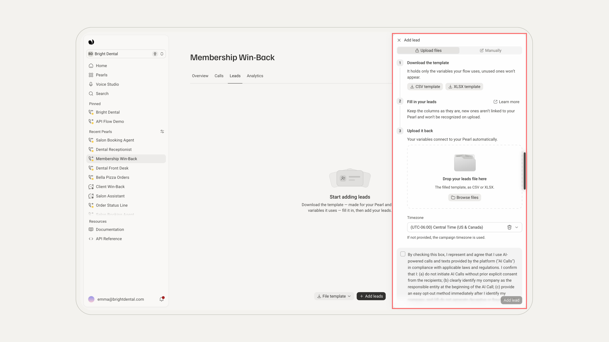</Frame></div>
<div className="hidden dark:block"><Frame>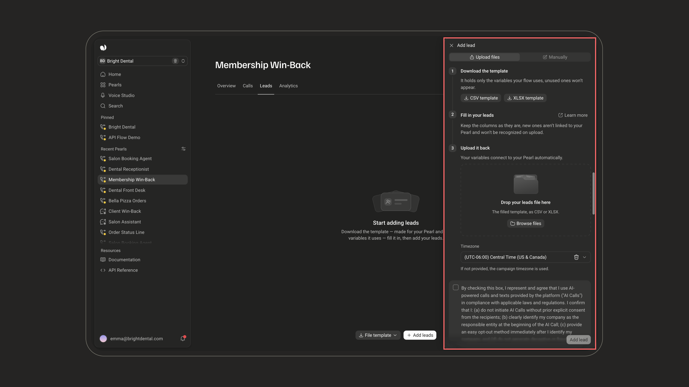</Frame></div>
</Step>

<Step title="Or add a lead manually">
In **Manually**, enter the **Phone number**, then a value for each variable, the **Timezone**, and an optional **Reference ID**.

<div className="block dark:hidden"><Frame>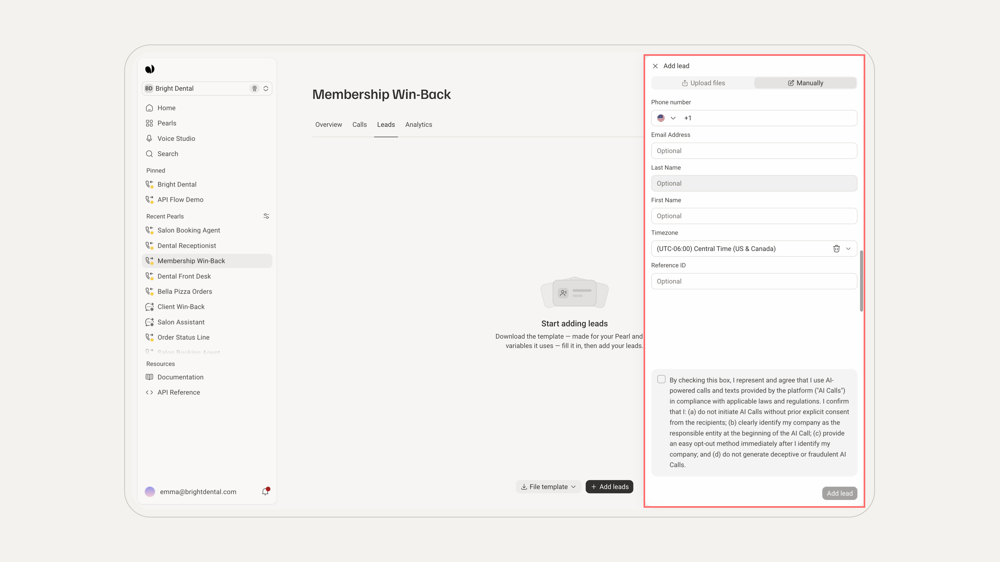</Frame></div>
<div className="hidden dark:block"><Frame>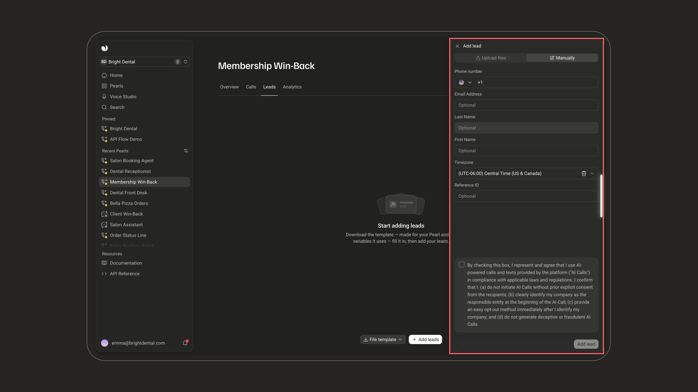</Frame></div>
</Step>
</Steps>

<Card title="Example CSV Entry">

| Country Code | Phone Number | customerName | membershipStatus |
| --- | --- | --- | --- |
| 1 | 2025551234 | Jane Smith | Gold |

**Country Code** and **Phone Number** are required; **Reference ID** is optional. Every other column header must match a variable's **ID** exactly, including the case.
</Card>

<Note>
A value sent for a variable, through a lead file or the API, can be up to **200 characters**.
</Note>

---

<span style={{ fontSize: '18px', fontWeight: 600 }}>
  Adding Variables via API
</span>

1. **Use the Add Lead API Endpoint**: `PUT /v1/Outbound/{outboundId}/Lead`.
2. **Include Variables** in the `callData` field of your JSON payload.

<Card title="Example Request">

```http
PUT /v1/Outbound/{outboundId}/Lead
Content-Type: application/json
Authorization: Bearer <token>

{
  "phoneNumber": "+1234567890",
  "externalId": "lead123",
  "callData": {
    "customerName": "Jane Smith",
    "membershipStatus": "Gold"
  }
}
```
</Card>

---

<span style={{ fontSize: '18px', fontWeight: 600 }}>
  Sending Variables in Single On-Demand Calls
</span>

1. **Use the Make Call API Endpoint**: `POST /v1/Outbound/{outboundId}/Call`.
2. **Include Variables** in the `callData` field of your JSON payload.

<Card title="Example Request">

```http
POST /v1/Outbound/{outboundId}/Call
Content-Type: application/json
Authorization: Bearer <token>

{
  "to": "+1234567890",
  "callData": {
    "firstName": "John",
    "accountBalance": "$100"
  }
}
```
</Card>

---

### Passing Data on Inbound Calls with Custom SIP Headers

External data can be passed to a Pearl on inbound calls using custom SIP headers. Include the values on the INVITE with an `X-` prefix (for example `X-CustomerId`), then create a **Pre-call** variable whose ID matches the header name exactly, including the prefix. The values are mapped to those variables on each call and are available to the agent and the workflow.

<Note>
This option is available only for numbers connected through [Custom VoIP](/pages/custom_voip). Type the ID by hand: the Display name can't contain a `-`.
</Note>

<Card title="Example">

Your SIP trunk sends this header on the INVITE:

```http
X-CustomerId: 48213
```

Create a Pre-call variable with the ID `X-CustomerId`. On each call, it holds the value sent in the header, and you can use it like any other variable, for example `{X-CustomerId}` in a script or in an API request.
</Card>

---

<Note>
Best Practices for Using Variables

- **Use Descriptive Names**: Clearly name variables for easy identification (e.g. `customerEmail`).
- **Describe In-call Variables**: The **Description** is what tells Pearl what to collect and when.
- **Define Variables Early**: Plan your variables before building the conversation flow.
- **Avoid Unnecessary Variables**: Only create variables that are essential to your conversation.
- **Test Thoroughly**: Run test calls to make sure variables are filled as intended.
- **Handle Data Securely**: Be cautious with personal and sensitive information.
- **Use Allowed Values and Codes**: When appropriate, define allowed values and codes for cleaner data.
</Note>

---

## Examples

<Card title="Example 1: Personalizing an Outbound Call">
<Info>
**Scenario**: Notifying customers about a service upgrade.
</Info>

1. **Variables**:
   - **Pre-call**: `customerName` (Text), `currentPlan` (Text)
   - **In-call**: `interested` (Boolean), described as *"Whether the customer wants to hear about the upgrade."*
2. **Script**: "Hello `{customerName}`, we're excited to tell you about an upgrade to your `{currentPlan}` plan. Would you like to hear more?"
3. **Transitions**:
   - *"The customer is interested"* → the details of the upgrade.
   - *"The customer isn't interested"* → thank the customer and end the call.

<Note>
  **Lead Import Tip**: add `customerName` and `currentPlan` to your lead file, with these exact IDs as column headers.
</Note>
</Card>

<br/>

<Card title="Example 2: Scheduling Multiple Dates">
<Info>
**Scenario**: Collecting several available dates from a customer.
</Info>

1. **Variable**: `availableDates` (Date & Time), with **Allow multiple entries** on.
2. **Script**: "Which dates are you available for the meeting?"
3. **Usage**: Pearl stores every date the customer gives in `availableDates`, ready to be sent to your calendar through an API node.
</Card>

<br/>

<Card title="Example 3: Survey with Conditional Logic">
<Info>
**Scenario**: Gathering customer feedback.
</Info>

1. **Ask for a score**: "On a scale of 1 to 5, how satisfied are you with our service?", stored in `satisfactionScore` (Whole Number).
2. **Transitions**:
   - *"`{satisfactionScore}` is 4 or 5"* → a node thanking the customer.
   - *"`{satisfactionScore}` is 3 or less"* → a node asking for improvement suggestions.
3. **Follow-up**: a post-call email using the collected data, thanking them or addressing their concerns.
</Card>

---

## Frequently Asked Questions (FAQ)

<AccordionGroup>
  <Accordion title="How do I handle empty variables?">
    Mention the case in a transition (e.g. *"The customer didn't give an email address"*), or ask for the value again in a Dialogue node. Once the conversation ends, empty variables are filled from the transcript when possible.
  </Accordion>

  <Accordion title="Are variable IDs case-sensitive?">
    Yes. `firstName` and `FirstName` are two different IDs, in your flow as well as in lead files and API payloads.
  </Accordion>

  <Accordion title="Can I change a variable's value during the conversation?">
    Yes. Pearl can update a variable as many times as needed; the latest value replaces the previous one.
  </Accordion>

  <Accordion title="How do I include variables when adding leads via the platform or API?">
    Use the template generated in the **Leads** tab, whose columns are your variables' IDs, or the `callData` field when using the API.
  </Accordion>

  <Accordion title="What is the difference between Pre-call and In-call variables?">
    **Pre-call variables** are known before the conversation starts, from a lead file, the API, or the call itself. **In-call variables** are collected by Pearl during the conversation, based on what the customer says.
  </Accordion>

  <Accordion title="Do I have to fill in variables for a test call?">
    No. All the variables of a test call are optional: leave empty the ones you don't need for the test.
  </Accordion>

  <Accordion title="What happens if I delete a variable that's in use?">
    Nodes, actions, and prompts that use it lose its value. Check where it's used before deleting it.
  </Accordion>
</AccordionGroup>

---

## Conclusion

Variables make your conversations dynamic and personalized. With them, you can:

- **Collect and Store Customer Answers**: Gather essential information during the conversation.
- **Personalize Interactions**: Create tailored experiences for each customer.
- **Control Conversation Flow**: Direct the conversation based on answers and data.
- **Integrate External Data**: Bring in information from your systems, and send results back.

---

For additional support, contact our support team at [support@nlpearl.ai](mailto:support@nlpearl.ai).
