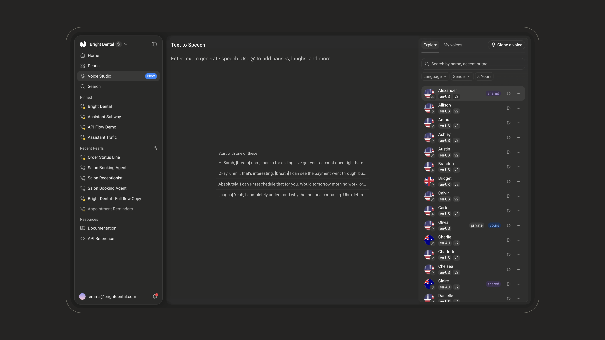
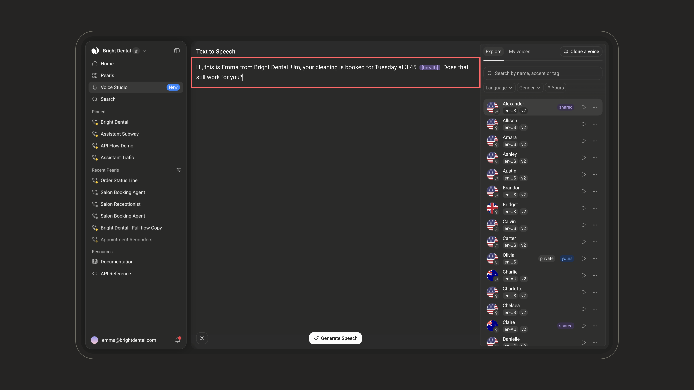
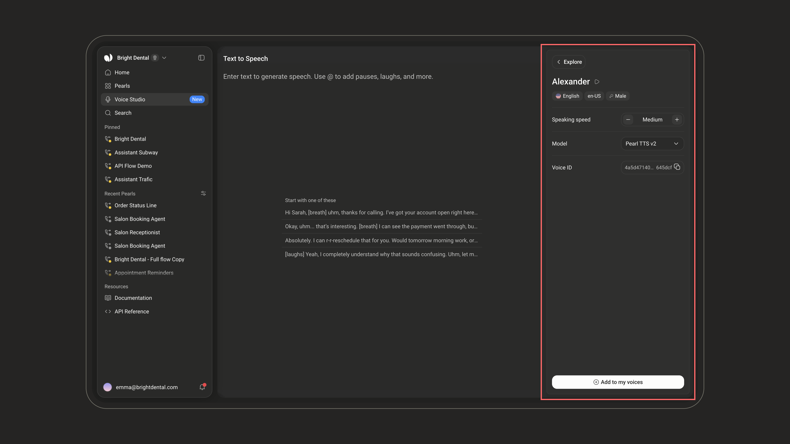
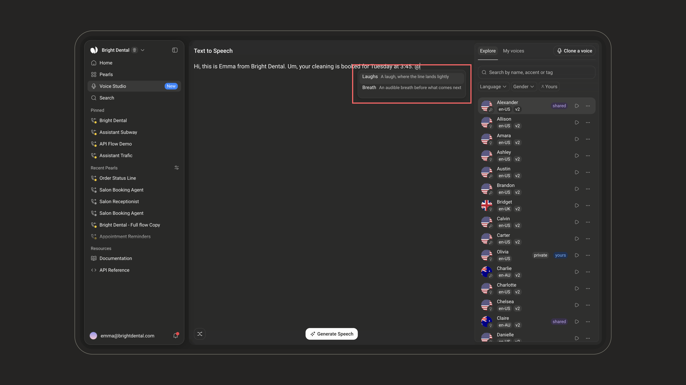
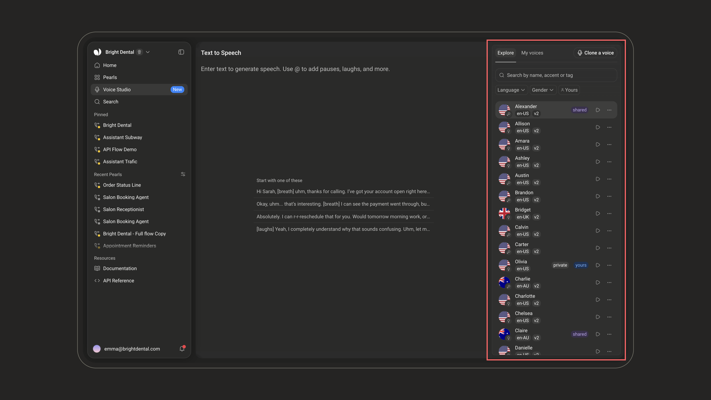
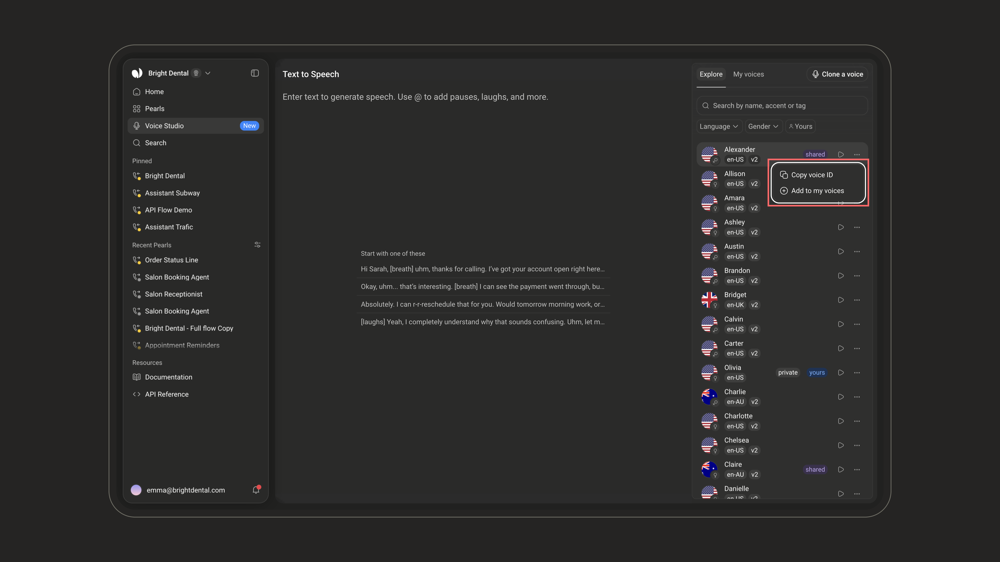
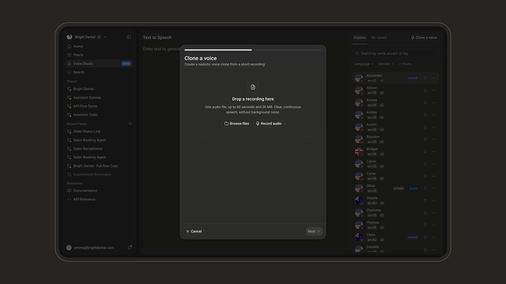
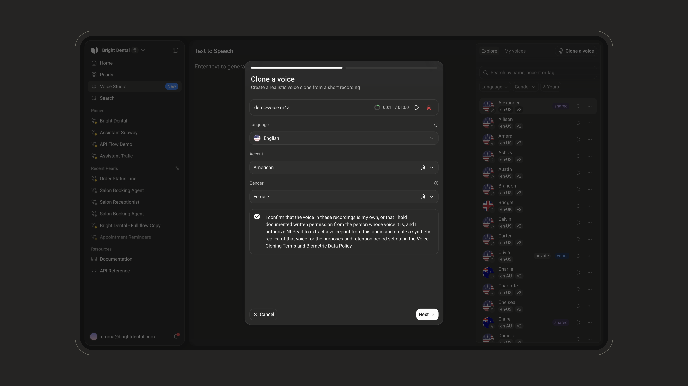
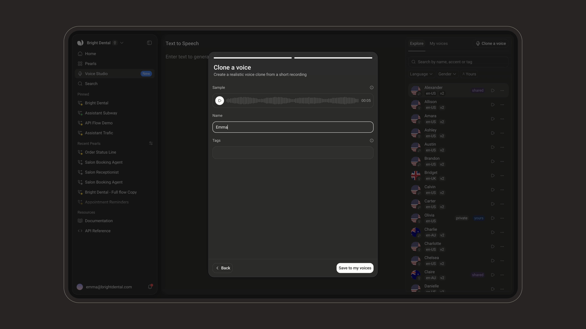
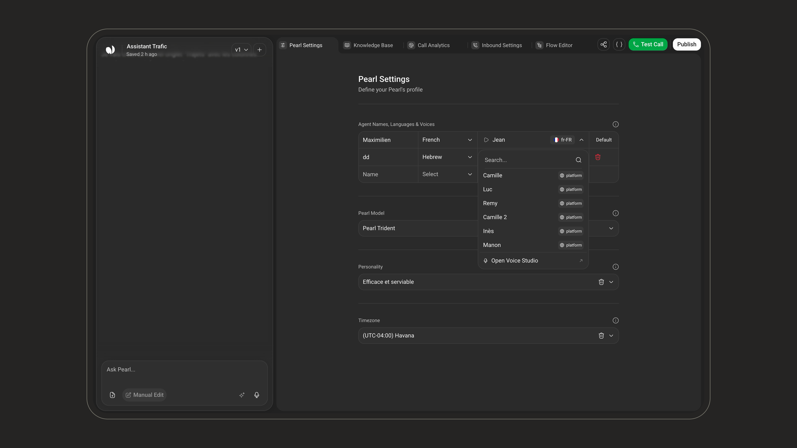

<iframe
  src="https://www.youtube.com/embed/a8ffNsXDqR4"
  title="NLPearl - Voice Studio"
  frameBorder="0"
  allow="accelerometer; autoplay; clipboard-write; encrypted-media; gyroscope; picture-in-picture"
  allowFullScreen
  style={{ width: '100%', aspectRatio: '16/9', borderRadius: '0.5rem' }}
></iframe>

Voice Studio is where you work with voices. Write a line, choose who says it, and hear it — then keep the voices you like, or clone one of your own from a short recording and use it across your Pearls.

Open it from **Voice Studio** in the left sidebar. The page has two parts: the **draft** in the middle, where you write and listen, and the **voice library** on the right, where you pick a voice and adjust it.

<Frame>
  
</Frame>

<Note>
A voice **is** a speaker in a language, so choosing a voice already chooses the language it speaks. That's why there is no separate language selector on this screen.
</Note>

<Info>
Voice Studio requires the **TTS** permission (*Access Voice Studio - clone voices and generate speech*). See [Users & Workspaces](/pages/users_workspaces) to manage permissions.
</Info>

---

### Generating speech

<Steps>
  <Step title="Choose a voice">
Pick a voice in the library on the right. See [The voice library](#the-voice-library) for searching, filtering, and managing voices.
  </Step>

  <Step title="Write what the voice should say">
Type into the draft. A single take can be up to **4,000 characters**. Past that limit, the page tells you by how much and the **Generate Speech** button stays disabled until you trim it.

On an empty draft, **Start with one of these** offers a few ready-made lines: click one to use it. Once the draft has text, the **Example line** button fills it with a line written to show the selected voice off: hesitations, a breath, a number said out loud. Press it again for a different one.

Type `@` anywhere in your text to insert a **speech marker** — a short tag the model reads as an instruction rather than as words. See [Speech markers](#speech-markers) below.

<Frame>
  
</Frame>

<Tip>
Clean sentences sound the same in every voice and tell you very little about the one you picked. The example lines are written to bring out what makes a voice different.
</Tip>
  </Step>

  <Step title="Generate and listen">
Click **Generate Speech**. Playback starts as soon as the first audio is ready — you don't wait for the whole take to finish generating, which matters for longer texts.

When the take lands, a card shows the text that was spoken, the voice that spoke it, and a player. From there you can:

- **Play, pause and scrub** through the take.
- **Download** the audio.
- **Minimize** the card to a single line to get your draft back in full view, and **Expand** it again.

Each new take stacks on top of the previous ones: Voice Studio keeps your last **20 takes**. Click **Show earlier takes** to list them, replay one, or click **Use this text again** to put its text back in the draft.
  </Step>
</Steps>

---

### Adjusting a voice

Click a voice in the library to open its panel. It replaces the list until you click the back button at the top of the panel.

<Frame>
  
</Frame>

| Setting | What it does |
| --- | --- |
| **Speaking speed** | How slowly or quickly the voice reads a line, in five levels from **Very slow** to **Very fast**. Use **−** and **+** to change it. For a voice in **My voices**, the speed is saved with the voice and used by every agent set to it. For any other voice, it only shapes the takes you generate here. |
| **Model** | The speech model: **Pearl TTS v2**, our latest, most human-like text-to-speech model, with ultra-low latency. |
| **Voice ID** | The voice's identifier, with a copy button. Use it to set this voice on an agent through the API. |

You can also **rename** a voice from its panel.

---

### Speech markers

Markers are tags the speech model reads as **instructions**, not as words. Type `@` in your draft to open the marker menu at your cursor, then pick one.

<Frame>
  
</Frame>

| Marker | Inserts | What it does |
| --- | --- | --- |
| **Laughs** | `[laughs]` | A laugh, where the line lands lightly. |
| **Breath** | `[breath]` | An audible breath before what comes next. |

<Warning>
Only the markers listed above are recognised. Any other bracketed tag you type — including one that looks like it should work — is **read out loud, brackets and all**. For a beat in the middle of a sentence, use punctuation, or a `[breath]` mid-clause.
</Warning>

---

### Speaking to a man or a woman

Hebrew writes the same sentence differently depending on who is being addressed: the second person is inflected, so one written line is two different spoken ones.

When you select a Hebrew voice, a **Speaking to** control appears under your draft. Set it to the gender of **the person being spoken to**.

<Note>
This is the **listener**, not the speaker. The voice's own gender is a property of the voice and is never something you set here. A female voice addressing a man is an ordinary call.
</Note>

The control appears for Hebrew voices only, because it is the only supported language where this changes the delivery.

---

### The voice library

The library on the right of the page is where you browse, filter and manage the voices available to your account.

<Frame>
  
</Frame>

It has two tabs:

<CardGroup cols={2}>
  <Card title="Explore" icon="compass" iconType="light">
    Every voice available to you, for **choosing**: the NLPearl voices, your own clones, and voices other accounts have published.
  </Card>
  <Card title="My voices" icon="star" iconType="light">
    Your account's own list, for **managing**. Your Pearls can be set to these voices, and their speaking speed is saved.
  </Card>
</CardGroup>

A voice reaches **My voices** in one of two ways: you clone it, or you add it from Explore.

#### Searching and filtering

Search by **name, accent or tag**, and narrow the list with the filters:

- **Language**
- **Accent** — appears once you've picked a language, and only for languages that have accent variants.
- **Gender**
- **Yours** — shows only your own clones. It appears when the list mixes your voices with others.

#### Reading a row

Each row shows the language flag, a gender mark, the voice's name, and its accent and tags. Some rows also carry a label:

| Label | Meaning |
| --- | --- |
| `private` | Only your account can use it. Every voice you clone starts out private. Shown on the Explore tab. |
| `public` | One of your voices that you've published to the shared library. Shown on the Explore tab. |
| `shared` | Published by another account, rather than one of your own. |
| `yours` | One of your own clones. |

Click the **play** button on a row to hear the voice without leaving the list. A voice you cloned plays back the sample built when you created it, so what you hear here is what you approved.

<Note>
Playing a voice doesn't generate a new take — the clip is rendered once and reused, so every play after the first is instant.
</Note>

#### Managing a voice

The **⋯** button on a row opens its menu. The actions offered depend on the tab and on whose voice it is:

<Frame>
  
</Frame>

| Action | Where | What it does |
| --- | --- | --- |
| **Copy voice ID** | Both tabs | Copies the voice's identifier. |
| **Add to my voices** | Explore | Adds the voice to your account's list, so your Pearls can use it. Each press adds another copy, with its own speaking speed. |
| **Publish to library** | Explore, on your own private voices | Publishes the voice to the shared library, after a confirmation — see [Publishing a voice](#publishing-a-voice). |
| **Remove from my voices** | My voices | Takes this copy off your list, after a confirmation. The voice itself stays in the library, and you can add it again. |
| **Delete voice** | Explore, on your own unpublished clones | **Destroys the voice** and every copy of it in your account, after a confirmation. |

<Warning>
**Remove from my voices** and **Delete voice** both take the voice away from **any agent already using it**: those agents lose their voice. **Delete voice** cannot be undone — the voice and its recording are gone for good, and it leaves Explore too.
</Warning>

---

### Cloning a voice

You can build a voice from a short recording of someone speaking, then use it like any other voice on the platform.

Click **Clone a voice** in the voice library. Cloning takes two steps: **Recording**, then **Details**.

<Steps>
  <Step title="Provide one recording">
Drag an audio file onto the popup, click **Browse files**, or click **Record audio** to record straight from your microphone.

<Frame>
  
</Frame>

| | |
| --- | --- |
| **Length** | 5 to 60 seconds |
| **File size** | Up to 20 MB |
| **Formats** | WAV, MP3, M4A, OGG, WEBM |
| **How many** | One |

<Note>
A voice is built from **a single recording**. Dropping a second file replaces the first rather than adding to it.
</Note>

For the best result, use **clear, continuous speech with no background noise** — one person talking, no music, no overlapping voices.
  </Step>

  <Step title="Describe the speaker and confirm your permission">
Still on the **Recording** step, describe the speaker:

| Field | Required | |
| --- | --- | --- |
| **Language** | Yes | The language the speaker is speaking. The voice is built for it — generating in another language won't sound like them. |
| **Accent** | For English and Spanish | Shown only for languages that have accent variants. |
| **Gender** | Yes | Used to filter the library, and to inflect the sample line in languages that need it. |

Then tick the box confirming that the voice in the recording is your own, or that you hold documented written permission from the person whose voice it is, and that you authorize NLPearl to create a synthetic replica of that voice.

<Frame>
  
</Frame>

<Warning>
Cloning someone's voice without their explicit, documented permission is not permitted. The confirmation is a legal attestation, not a formality.
</Warning>

Click **Next**. Your recording is uploaded and the voice is built — this takes a few seconds.
  </Step>

  <Step title="Hear the sample and name the voice">
On the **Details** step, the **Sample** plays a line in the cloned voice, so you know what you're keeping. This is also the clip the library will play for this voice. If it doesn't sound right, build it again, or go **Back** to change the recording.

Give the voice a **Name** (2 to 25 characters), and optionally up to 3 **Tags** to make it easier to find — for example `warm`, `support`, `news`.

<Frame>
  
</Frame>

If your recording contained little actual speech, a warning next to the sample says so: the clone still works, but a longer take makes a closer match.
  </Step>

  <Step title="Save">
Click **Save to my voices**. The voice appears in **My voices** right away, selected, with its panel open, ready to generate speech.
  </Step>
</Steps>

<Note>
If a recording can't be read, try another file or record it again. After many attempts in a short time, cloning pauses for a little while.
</Note>

---

### Publishing a voice

Publishing puts one of your voices into the **shared library**, where every account on the platform can use it.

<Warning>
**Publishing cannot be undone.** Once a voice is published, it stays in the shared library and you cannot withdraw or delete it. Publish only voices you are certain you want to share, and only if the permission you hold for that voice covers it.
</Warning>

Publishing is offered from the voice's row menu on the **Explore** tab, and only while the voice is still private. A confirmation asks you to approve it. Once published, the option is gone.

---

### Using your voices in a Pearl

An agent's **Voice** dropdown lists the platform's voices and the voices in your **My voices** list.

<Steps>
  <Step title="Add the voice to your list">
Clone it, or add it from **Explore**.
  </Step>
  <Step title="Open your Pearl's settings">
Go to **Pearl Settings → Agent Names, Languages & Voices**.
  </Step>
  <Step title="Pick it for an agent">
Open the agent's **Voice** dropdown and select it. For the languages Voice Studio supports, the dropdown also offers **Open Voice Studio** at the bottom of the list, which opens the studio in a new tab so you can clone or audition a voice without losing your place in the form.

<Frame>
  
</Frame>
  </Step>
</Steps>

<Note>
The agent uses the **speaking speed** saved on that voice in My voices. Change it from the voice's panel in Voice Studio.
</Note>

See [Voices and Languages](/pages/languages) for how agents, languages and voices work together in a Pearl.

---

### Supported languages

Voice Studio generates speech in the following languages:

| Language | Accents |
| --- | --- |
| **English** | American, British, Australian, Canadian, Irish, Indian |
| **Spanish** | Castilian, Mexican, Argentinian, Colombian, Venezuelan |
| **French** | — |
| **German** | — |
| **Italian** | — |

<Note>
This is the list of languages the speech model currently serves, which is narrower than the full set of languages a Pearl can speak. See [Voices and Languages](/pages/languages) for everything the platform supports.
</Note>

<Info>
Your **My voices** list is empty until you clone a voice or add one from **Explore**.
</Info>

---

<CardGroup cols={2}>
  <Card
    title="Voices and Languages"
    icon="language"
    iconType="light"
    href="/pages/languages"
  >
    Configure agents, languages and voices for a Pearl.
  </Card>
  <Card
    title="Pearl Settings"
    icon="user-gear"
    iconType="light"
    href="/pages/agent_customization"
  >
    Everything you can configure on a Pearl, including its agents.
  </Card>
</CardGroup>
