<iframe
  src="https://www.youtube.com/embed/a8ffNsXDqR4"
  title="NLPearl - Voice Studio"
  frameBorder="0"
  allow="accelerometer; autoplay; clipboard-write; encrypted-media; gyroscope; picture-in-picture"
  allowFullScreen
  style={{ width: '100%', aspectRatio: '16/9', borderRadius: '0.5rem' }}
></iframe>

Voice Studio is where you work with voices. Write a line, choose who says it, and hear it — then save the voices you like with your own settings, or clone one of your own from a short recording and use it across your Pearls.

Open it from **Voice Studio** in the left sidebar. The page, titled **Text to Speech**, has three parts: the **draft** on the left, where you write; the **settings** on the right, where you choose the voice and adjust it; and the **generations** below, where your takes are listed.

<Frame>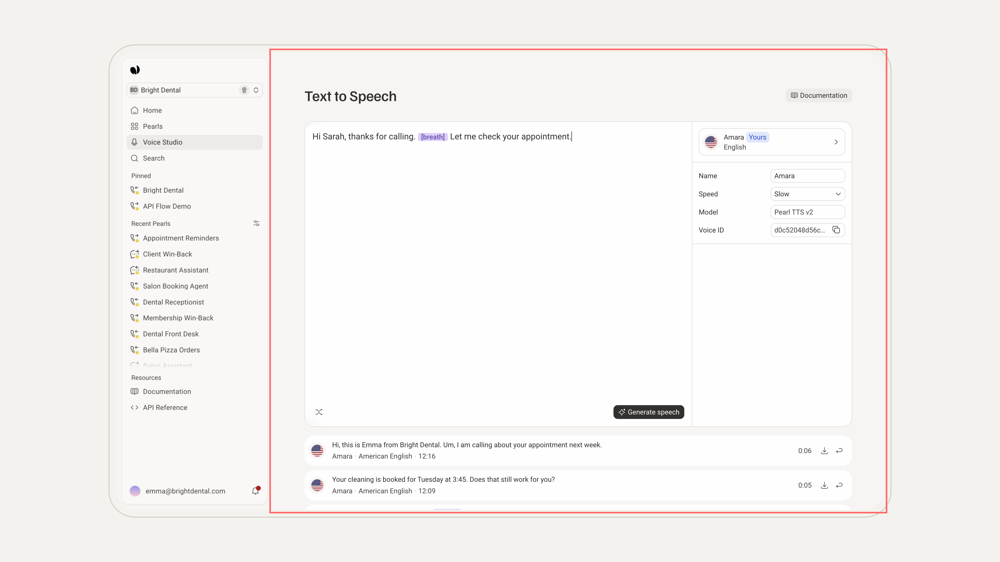</Frame>

<Frame>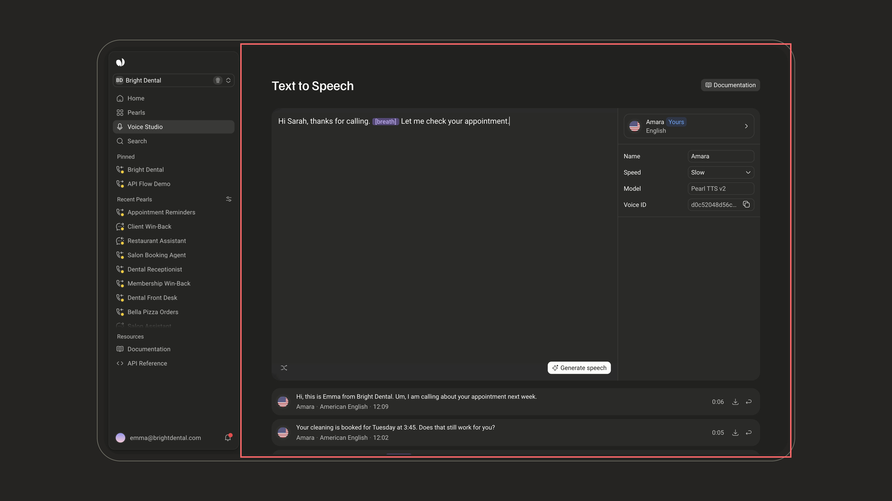</Frame>

<Note>
A voice **is** a speaker in a language, so choosing a voice already chooses the language it speaks. That's why there is no separate language selector on this screen.
</Note>

<Info>
Voice Studio requires the **TTS** permission (*Access Voice Studio - clone voices and generate speech*). See [Users & Workspaces](/pages/users_workspaces) to manage permissions.
</Info>

---

### Generating speech

<Steps>
  <Step title="Choose a voice">
At the top of the settings, click the current voice to open the voice library and pick another one. See [The voice library](#the-voice-library). Click the flag of the voice to hear a sample of it. Voice Studio remembers the last voice you used.
  </Step>

  <Step title="Write what the voice should say">
Type into the draft. A single take can be up to **4,000 characters**. Past that limit, the page tells you by how much (*Over limit by … characters*) and **Generate speech** stays disabled until you trim it.

On an empty draft, **Start with one of these** offers a few ready-made lines: click one to use it. Once the draft has text, the **Example line** button (the shuffle icon) fills it with a line written to show the selected voice off: hesitations, a breath, a number said out loud. Press it again for a different one.

Type `@` anywhere in your text to insert a **speech marker** — a short tag the model reads as an instruction rather than as words. See [Speech markers](#speech-markers) below.

<Tip>
Clean sentences sound the same in every voice and tell you very little about the one you picked. The example lines are written to bring out what makes a voice different.
</Tip>
  </Step>

  <Step title="Generate and listen">
Click **Generate speech**. Playback starts as soon as the first audio is ready — you don't wait for the whole take to finish generating, which matters for longer texts.

Each take is added to the **generations** under the draft, newest first. For each one you see the text, the voice, the time and the duration. You can:

- **Play and pause** it with the flag at the start of the row, and click along the bottom of the row to jump to a moment.
- **Download** the audio.
- **Use this text** to put its text back in the draft.

Voice Studio keeps your last **20 takes**.
  </Step>
</Steps>

---

### Adjusting a voice

The settings on the right apply to the voice you chose:

| Setting | What it does |
| --- | --- |
| **Name** | The name of the voice. Shown for a voice of **My voices**: change it, then click **Save changes**. |
| **Speed** | How slowly or quickly the voice reads a line: **Slowest**, **Slow**, **Normal**, **Fast**, or **Fastest**. |
| **Model** | The speech model: **Pearl TTS v2**, our latest, most human-like text-to-speech model, with ultra-low latency. |
| **Voice ID** | The voice's identifier, with a copy button. Use it to set this voice on an agent through the API. |

<Frame>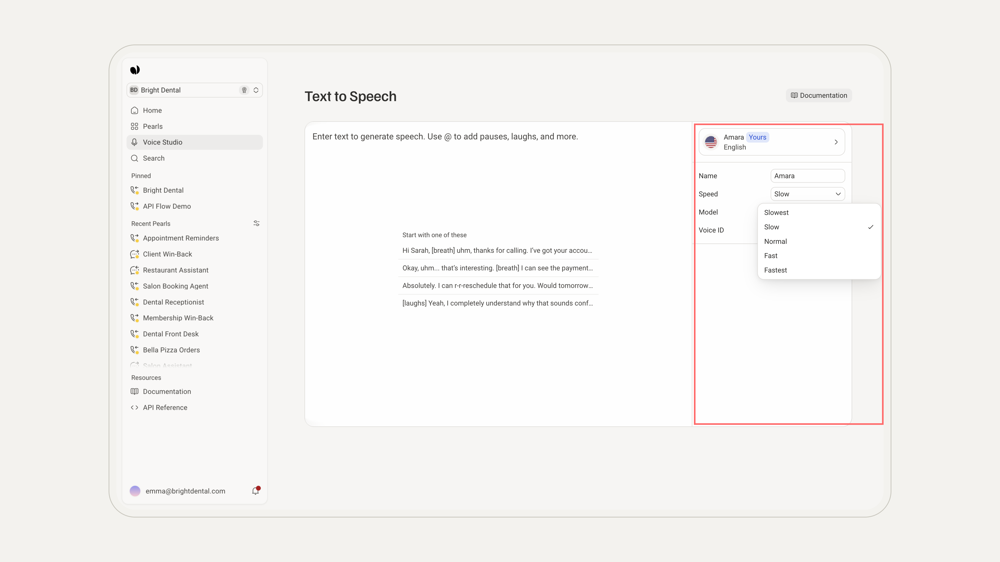</Frame>

<Frame>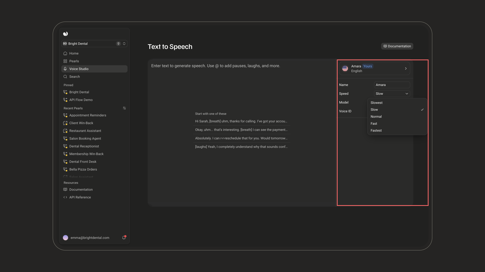</Frame>

A setting you change shapes the takes you generate right away. To keep it, save the voice:

- For a voice of the library, click **Save as my voice**, give it a **Voice name**, and click **Save**. The voice is added to **My voices** with your settings.
- For a voice of **My voices**, click **Save changes** to update it, or **Save as new** to keep it as another voice of your list, with its own name.

<Frame>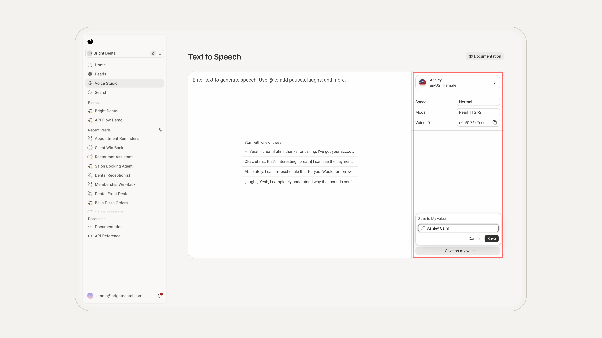</Frame>

<Frame>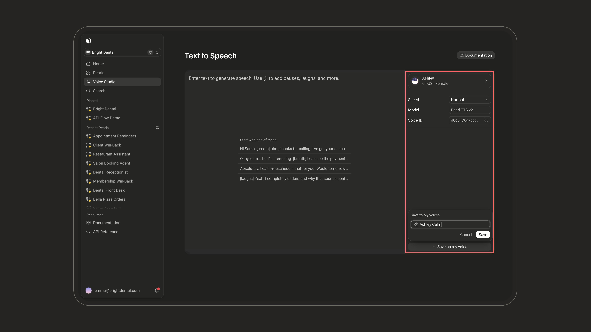</Frame>

<Note>
Your agents use the voices of **My voices** with the speed saved on them. See [Using your voices in a Pearl](#using-your-voices-in-a-pearl).
</Note>

---

### Speech markers

Markers are tags the speech model reads as **instructions**, not as words. Type `@` in your draft to open the marker menu at your cursor, then pick one.

<Frame>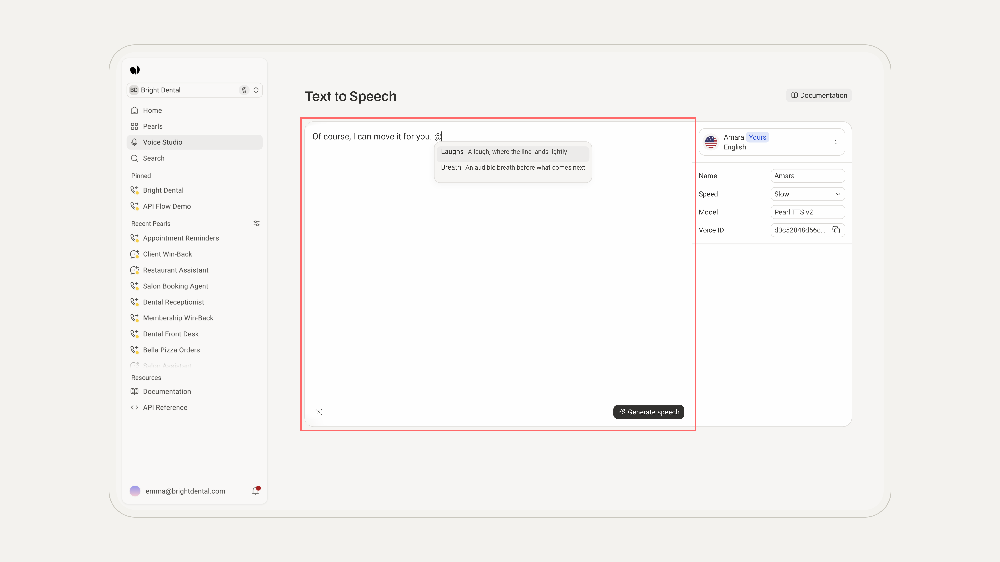</Frame>

<Frame>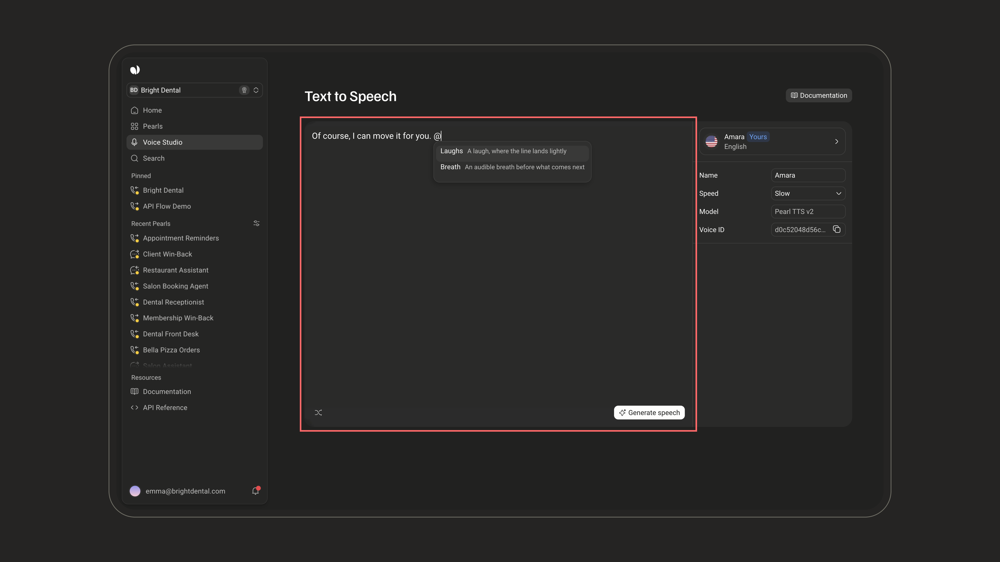</Frame>

| Marker | Inserts | What it does |
| --- | --- | --- |
| **Laughs** | `[laughs]` | A laugh, where the line lands lightly. |
| **Breath** | `[breath]` | An audible breath before what comes next. |

<Warning>
Only the markers listed above are recognised. Any other bracketed tag you type — including one that looks like it should work — is **read out loud, brackets and all**. For a beat in the middle of a sentence, use punctuation, or a `[breath]` mid-clause.
</Warning>

---

### The voice library

Click the current voice at the top of the settings to open the voice library. It has two tabs:

<CardGroup cols={2}>
  <Card title="Explore" icon="compass" iconType="light">
    Every voice available to you, for **choosing**: the NLPearl voices, and the voices other accounts have published.
  </Card>
  <Card title="My voices" icon="star" iconType="light">
    Your account's own list, for **managing**: the voices you saved, added or cloned. Your Pearls can be set to these voices.
  </Card>
</CardGroup>

<Frame>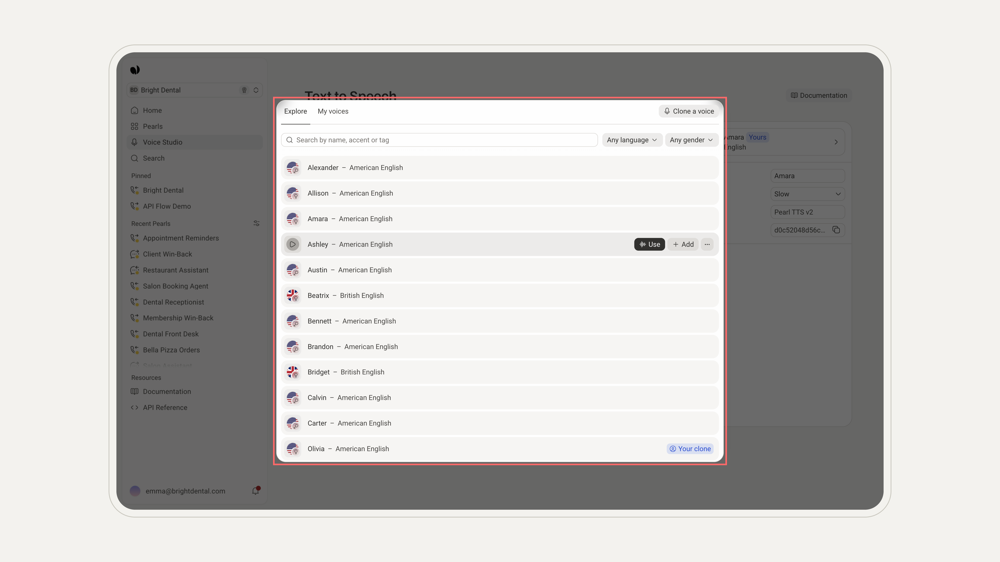</Frame>

<Frame>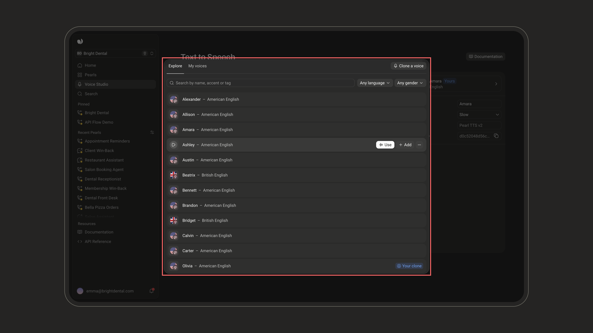</Frame>

A voice reaches **My voices** in three ways: you clone it, you add it from Explore, or you save it from the settings with **Save as my voice**.

#### Searching and filtering

Search by **name, accent or tag**, and narrow the list with the filter chips:

- **Any language**
- **Any accent** — appears once you've picked a language, and only for languages that have accent variants.
- **Any gender**
- **Your clones** — on **My voices**, shows only the voices you cloned.

#### Reading a card

Each card shows the language flag, the voice's name, and its accent and tags. Some cards also carry a label:

| Label | Meaning |
| --- | --- |
| **Your clone** | A voice you cloned, still private to your account. |
| **Published by you** | One of your clones that you published to the shared library. Shown on Explore. |
| **Published in Explore** | The same, shown on My voices. |

Hover a card to **Use** it (or see that it is **In use**), to **Add** it to My voices from Explore, or to open its **⋯** menu. You can also click the card itself to use the voice.

#### Managing a voice

The **⋯** menu of a card offers actions that depend on the tab and on whose voice it is:

<Frame>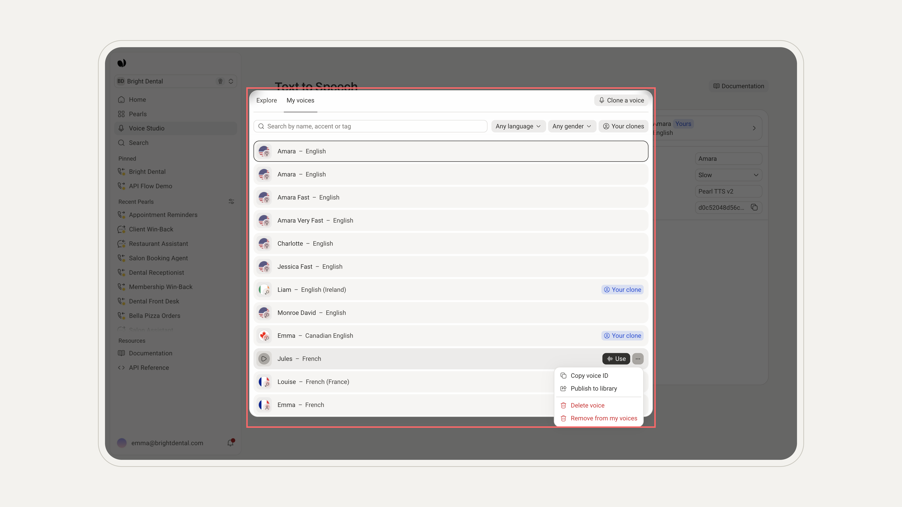</Frame>

<Frame>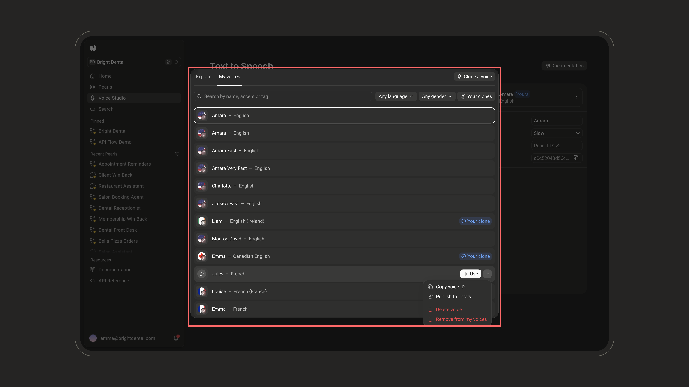</Frame>

| Action | Where | What it does |
| --- | --- | --- |
| **Copy voice ID** | Both tabs | Copies the voice's identifier. |
| **Add to my voices** | Explore | Adds the voice to your account's list, so your Pearls can use it. Each press adds another copy, with its own speed. |
| **Publish to library** | My voices, on your own private clones | Publishes the voice to the shared library, after a confirmation — see [Publishing a voice](#publishing-a-voice). |
| **Remove from my voices** | My voices | Takes this voice off your list, after a confirmation. A library voice stays in the library, and you can add it again. |
| **Delete voice** | My voices, on your own unpublished clones | **Destroys the voice** and every copy of it in your account, after a confirmation. |

<Warning>
**Remove from my voices** and **Delete voice** both take the voice away from **any agent already using it**: those agents lose their voice. **Delete voice** cannot be undone — the voice and its recording are gone for good.
</Warning>

---

### Cloning a voice

You can build a voice from a short recording of someone speaking, then use it like any other voice on the platform.

Click **Clone a voice** in the voice library. Cloning takes two steps: **Recording**, then **Details**.

<Steps>
  <Step title="Provide one recording">
Drop an audio file on the window, click **Browse files**, or click **Record audio** to record straight from your microphone. While you record, **Need something to read?** shows a script to read aloud, in the language of your choice; click **Done** to stop.

<Frame>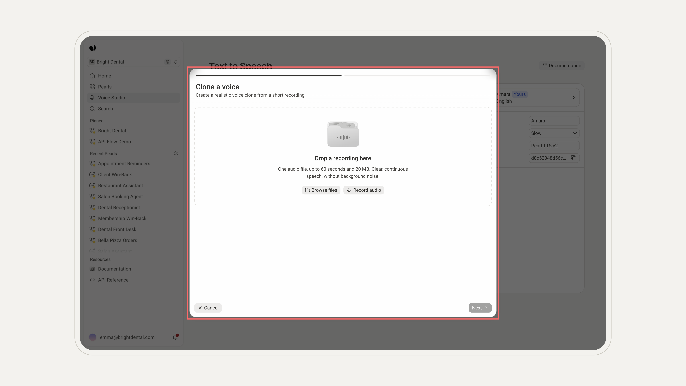</Frame>

<Frame>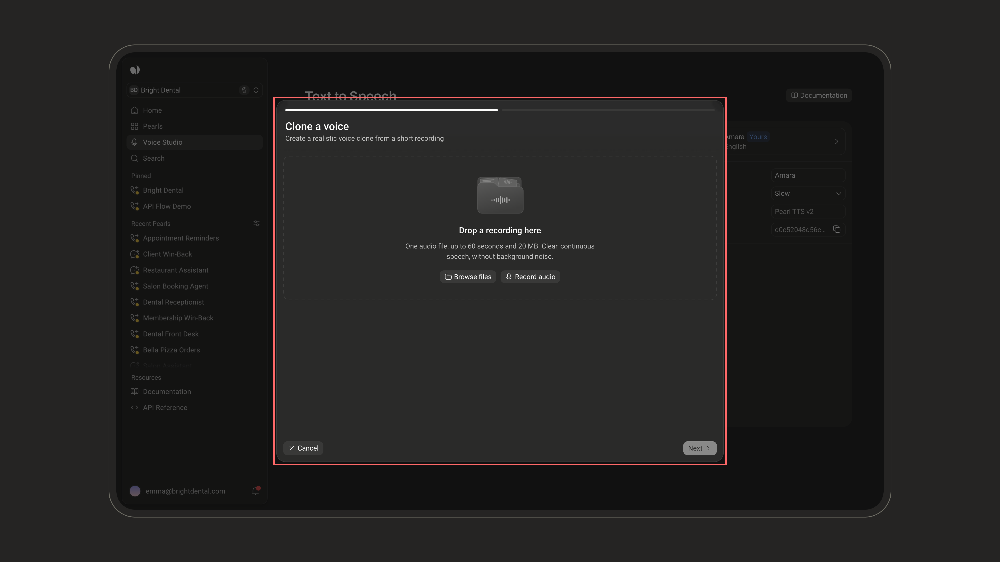</Frame>

| | |
| --- | --- |
| **Length** | 5 to 60 seconds |
| **File size** | Up to 20 MB |
| **Formats** | WAV, MP3, M4A, OGG, WEBM |
| **How many** | One |

<Note>
A voice is built from **a single recording**. Dropping a second file replaces the first rather than adding to it.
</Note>

For the best result, use **clear, continuous speech with no background noise** — one person talking, no music, no overlapping voices.
  </Step>

  <Step title="Describe the speaker and confirm your permission">
Still on the **Recording** step, describe the speaker:

| Field | Required | |
| --- | --- | --- |
| **Language** | Yes | The language the speaker is speaking. The voice is built for it — generating in another language won't sound like them. |
| **Accent** | For English and Spanish | Shown only for languages that have accent variants. |
| **Gender** | Yes | Used to filter the library, and to inflect the sample line in languages that need it. |

Then tick the box confirming that the voice in the recording is your own, or that you hold documented written permission from the person whose voice it is, and that you authorize NLPearl to create a synthetic replica of that voice.

<Frame>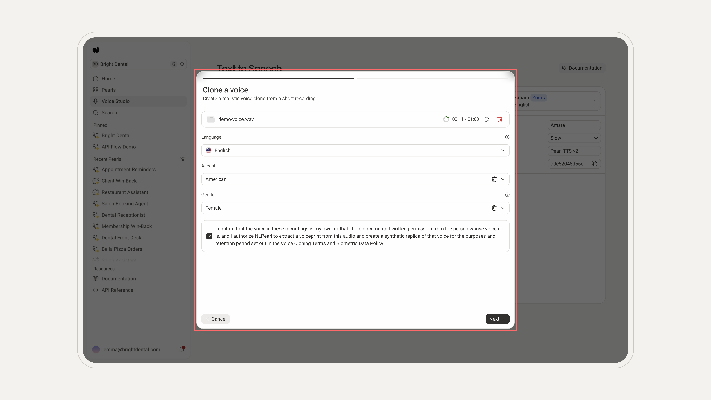</Frame>

<Frame>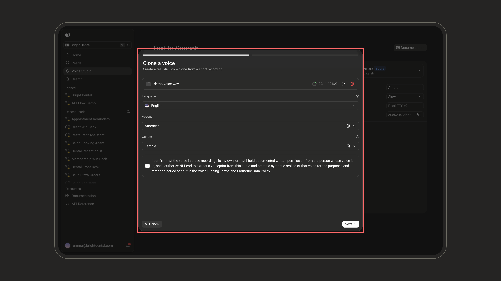</Frame>

<Warning>
Cloning someone's voice without their explicit, documented permission is not permitted. The confirmation is a legal attestation, not a formality.
</Warning>

Click **Next**. Your recording is uploaded and the voice is built — this takes a few seconds.
  </Step>

  <Step title="Hear the sample and name the voice">
On the **Details** step, the **Sample** plays a line in the cloned voice, so you know what you're keeping. This is also the clip the library will play for this voice. If it doesn't sound right, go **Back** to change the recording.

Give the voice a **Name** (2 to 25 characters), and optionally up to 3 **Tags** to make it easier to find — for example `warm`, `support`, `news`.

<Frame>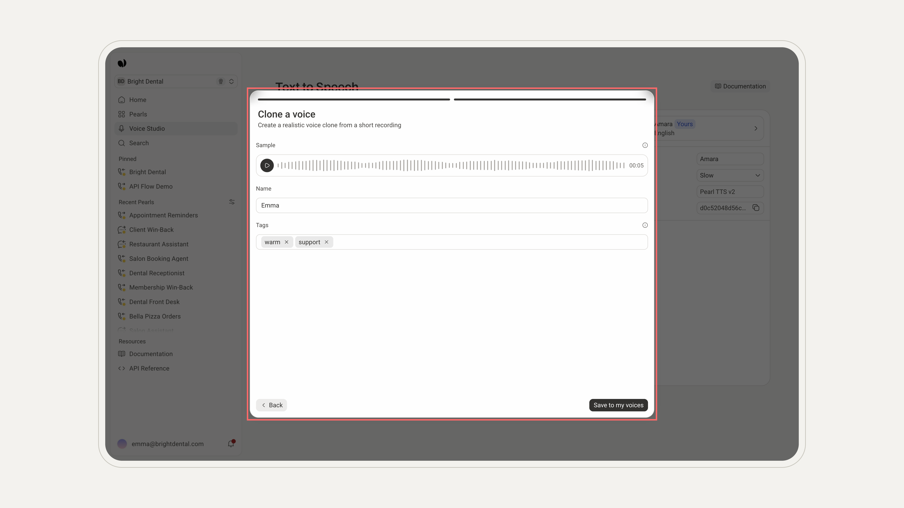</Frame>

<Frame>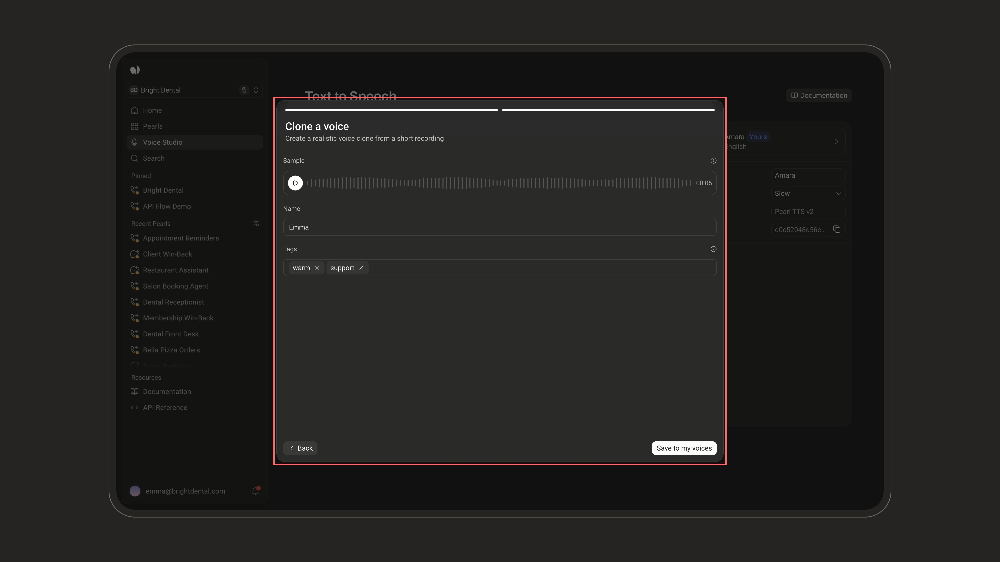</Frame>

If your recording contained little actual speech, a warning next to the sample says so: the clone still works, but a longer take makes a closer match.
  </Step>

  <Step title="Save">
Click **Save to my voices**. The voice is added to **My voices** and becomes the selected voice, ready to generate speech.
  </Step>
</Steps>

<Note>
If a recording can't be read, try another file or record it again. After many attempts in a short time, cloning pauses for a little while.
</Note>

---

### Publishing a voice

Publishing puts one of your cloned voices into the **shared library**, where every account on the platform can use it.

<Warning>
**Publishing cannot be undone.** Once a voice is published, it stays in the shared library and you cannot withdraw or delete it. Publish only voices you are certain you want to share, and only if the permission you hold for that voice covers it.
</Warning>

Publishing is offered from the voice's **⋯** menu on the **My voices** tab, and only while the voice is still private. A confirmation asks you to approve it. Once published, the option is gone and the card reads **Published in Explore**.

---

### Using your voices in a Pearl

An agent's **Voice** dropdown lists the platform's voices and the voices in your **My voices** list.

<Steps>
  <Step title="Add the voice to your list">
Clone it, add it from **Explore**, or save it from the settings with **Save as my voice**.
  </Step>
  <Step title="Open your Pearl's settings">
Go to **Pearl Settings → Agent Names, Languages & Voices**.
  </Step>
  <Step title="Pick it for an agent">
Open the agent's **Voice** dropdown and select it. For the languages Voice Studio supports, the dropdown also offers **Open Voice Studio** at the bottom of the list, which opens the studio in a new tab so you can clone or audition a voice without losing your place in the form.

<Frame>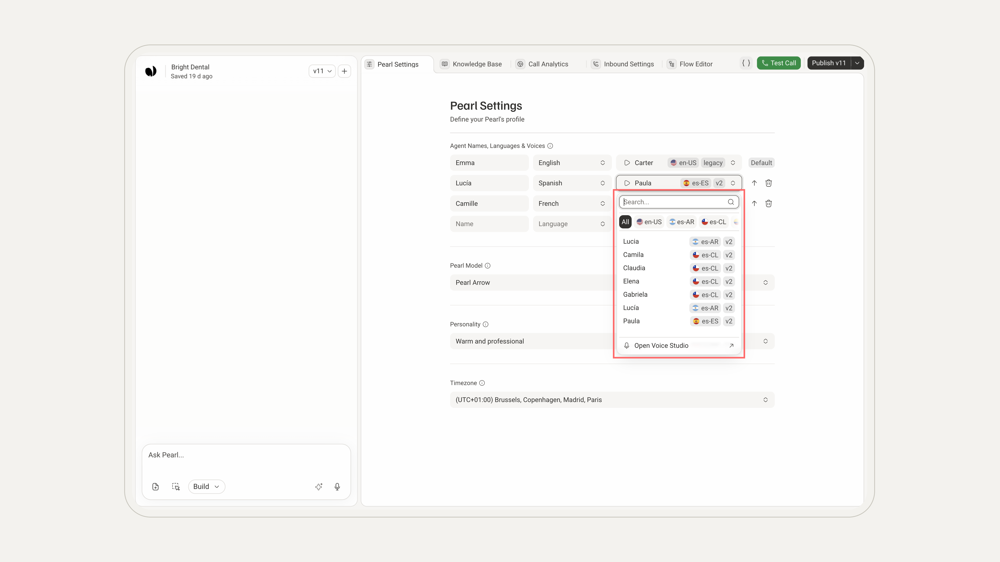</Frame>

<Frame>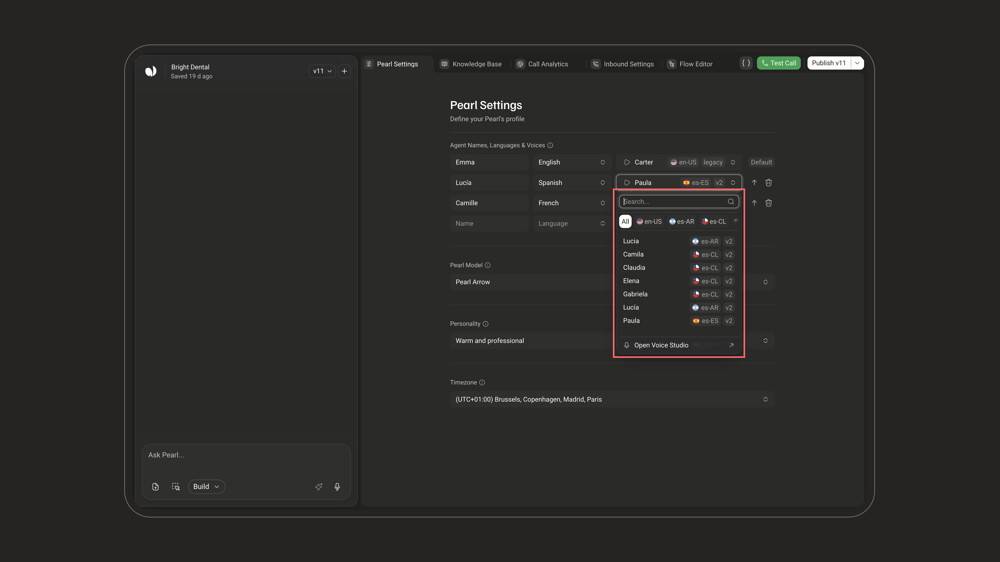</Frame>

  </Step>
</Steps>

<Note>
The agent uses the **speed** saved on that voice in My voices. Change it from the settings in Voice Studio, then click **Save changes**.
</Note>

See [Voices and Languages](/pages/languages) for how agents, languages and voices work together in a Pearl.

---

### Supported languages

Voice Studio generates speech in the following languages:

| Language | Accents |
| --- | --- |
| **English** | American, British, Australian, Canadian, Irish, Indian |
| **Spanish** | Castilian, Mexican, Argentinian, Colombian, Venezuelan |
| **French** | — |
| **German** | — |
| **Italian** | — |

<Note>
This is the list of languages the speech model currently serves, which is narrower than the full set of languages a Pearl can speak. See [Voices and Languages](/pages/languages) for everything the platform supports.
</Note>

<Info>
Your **My voices** list is empty until you save, add, or clone a voice.
</Info>

---

<CardGroup cols={2}>
  <Card
    title="Voices and Languages"
    icon="language"
    iconType="light"
    href="/pages/languages"
  >
    Configure agents, languages and voices for a Pearl.
  </Card>
  <Card
    title="Pearl Settings"
    icon="user-gear"
    iconType="light"
    href="/pages/agent_customization"
  >
    Everything you can configure on a Pearl, including its agents.
  </Card>
</CardGroup>
